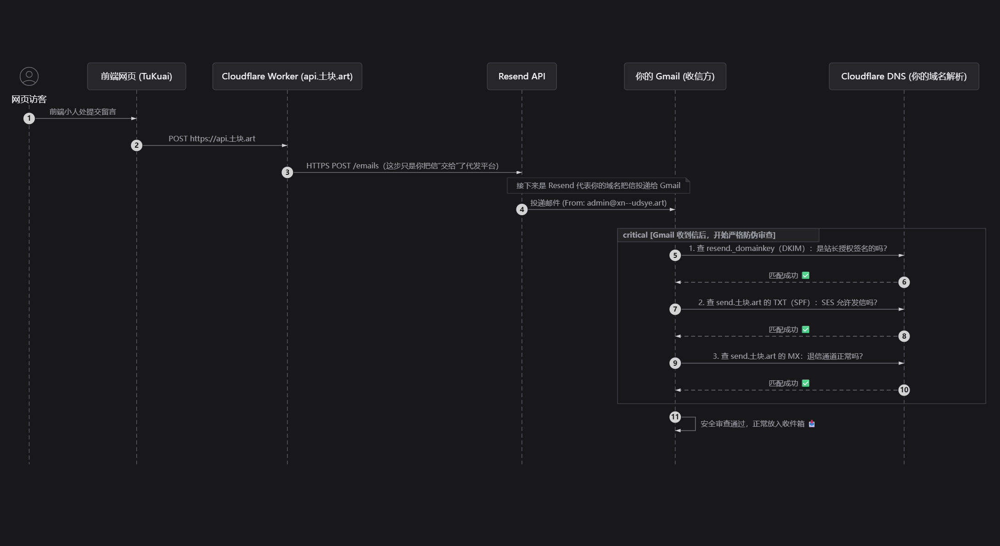

# Resend 无服务架构：现代 Serverless 邮件系统的全链路原理

在传统的网络架构中，如果想让网站拥有“发邮件给站长”或者“给用户发验证码”的功能，开发者往往需要自己购买一台带有独立公网 IP 的云服务器，在 Linux 上折腾复杂的 Postfix、Sendmail 等服务，还要面对反向解析（rDNS）、黑名单拦截等令人头疼的运维泥潭。

而今天，结合 **Cloudflare Workers** 与 **Resend**，我们可以构建一套**纯粹的无服务（Serverless）邮件系统**——没有常驻运行的云主机，没有空转的服务器费用，代码平时处于休眠状态，只有当访客点击“发送”的一瞬间，边缘算力被毫秒级唤醒，完成投递后立刻销毁。

然而，在享受轻量与敏捷的同时，很多开发者在配置域名时常常陷入困惑：**“既然我只是在代码里用 HTTPS 发了个 API 请求，为什么 Cloudflare 里还要配置什么 MX、SPF、DKIM 解析？同一个主机名怎么会有两条记录？它们到底在起什么作用？”**

本文将为你深度拆解这一现代无服务架构的底层全链路与安全鉴权逻辑。

---

## 一、 全链路架构：一封留言如何从网页飞入 Gmail？

当用户在你的网站前端（例如前端小人处的留言弹窗）写下一段话并点击发送时，后台其实经历了一场严密的接力协作：

```mermaid
sequenceDiagram
    autonumber
    actor User as 网页访客
    participant Front as 前端页面 (TuKuai)
    participant Worker as Cloudflare Worker (api.土块.art)
    participant Resend as Resend API 服务
    participant Gmail as 接收方 (Gmail 邮件集群)
    participant DNS as Cloudflare 权威 DNS (土块.art)

    User->>Front: 1. 提交留言内容与附件
    Front->>Worker: 2. HTTPS POST 请求（发往自定义域名 api.土块.art）
    
    rect rgb(20, 25, 35)
        Note over Worker: 边缘函数被瞬间唤醒<br/>提取数据并组装 Payload
    end
    
    Worker->>Resend: 3. 携带 API Key 调用 https://api.resend.com/emails
    
    rect rgb(20, 25, 35)
        Note over Resend: Resend 校验 API Key 成功<br/>接管投递任务，生成加密数字签名
    end
    
    Resend->>Gmail: 4. 代表你的域名发起底层 SMTP 投递 (From: admin@土块.art)
    
    critical 5. Gmail 收到信件后启动安全审查（反向核验 DNS）
        Gmail->>DNS: 查 resend._domainkey 的 TXT（核对公钥验签 DKIM）
        DNS-->>Gmail: 签名匹配，内容未被篡改 ✅
        Gmail->>DNS: 查 send.土块.art 的 TXT（核对发件 IP 是否符合 SPF）
        DNS-->>Gmail: 发信服务器在白名单内 ✅
        Gmail->>DNS: 查 send.土块.art 的 MX（确认退信通道正常）
        DNS-->>Gmail: 退信路由合法有效 ✅
    end
    
    Gmail->>Gmail: 6. 防伪鉴权全部通过，放入正式收件箱 📥
    Resend-->>Worker: 7. 返回 200 OK 与投递 ID
    Worker-->>Front: 8. 响应 success: true，页面弹出发送成功提示
```





从上述流程可以清晰地看出，整个流程被分为了两个截然不同的阶段：
1. **应用调用阶段（第 1 ~ 3 步）：** 前端 $\to$ Cloudflare Worker $\to$ Resend。这是纯粹的 **HTTPS API 通信**，只需保证网络通畅与 API Key 正确。
2. **邮件协议投递阶段（第 4 ~ 6 步）：** Resend $\to$ Gmail $\to$ DNS。这是标准的 **SMTP 协议与 DNS 密码学鉴权**。

---

## 二、 核心误区：“我只是调了个 API，为什么还要配 DNS？”

很多开发者最容易产生的疑问：
> “我的 Worker 代码里只写了一句 `fetch('https://api.resend.com/emails')`，既然本质上是在调用别人做好的云接口，为什么还需要我在自己的域名下添加一堆解析？”

### 1. “委托接单”与“代表投递”的区别
* **你调 API，只是把邮件“交给”了代发平台：** 这一步相当于你给快递公司（Resend）打电话：“喂，帮我送一份信，发件人写我（`admin@土块.art`）。”
* **代发平台去送信时，对方只认房产证：** Resend 拿着写着你名字的信件去敲 Google（Gmail）的大门。Google 的邮件安检系统非常严苛，它面对 Resend 的第一反应是怀疑：**“全世界任何黑客都可以伪造发件人姓名。我怎么知道你 Resend 是不是在冒充土块的站长在群发钓鱼邮件？”**
* **DNS 就是你在全世界面前公示的授权声明：** Google 不会打电话问你，它只会**自动向互联网的权威根服务器查询 `土块.art` 的 DNS 记录**。如果查不到你的授权记录，Google 会判定这封信是假冒伪造的，直接丢进垃圾箱甚至直接拒收。

这就是为什么：**即使调用的是现成的无服务 API，域名层面的所有权与发信授权依然必须由站长亲自在 DNS 中盖章确认。**

---

## 三、 解密三大防伪护照：MX、SPF、DKIM

在 Cloudflare 的 DNS 列表中，Resend 通常要求我们添加三条关键记录。很多初学者看到两条名为 `send.土块.art` 的记录会以为自己配重了，实则不然：

### 1. SPF 记录：合法发件人白名单（TXT 记录）
* **记录类型：** `TXT`
* **主机名称：** `send`（完整域名为 `send.土块.art`）
* **记录内容：** `v=spf1 include:amazonses.com ~all`
* **底层原理：**
  Resend 的底层邮件发送集群依托于亚马逊的 AWS SES（Amazon Simple Email Service）基础设施。
  这条 SPF 记录相当于你向全世界宣告：**“凡是代表 `send.土块.art` 发出的邮件，只有来自 `amazonses.com` 旗下的服务器 IP 才是合法的，其他统统都是假冒伪造的！”**

### 2. DKIM 记录：不可伪造的数字公章（TXT 记录）
* **记录类型：** `TXT`
* **主机名称：** `resend._domainkey`
* **记录内容：** `p=MIGfMA0GCSqGSIb3DQEBAQUAA4GN...`（超长公钥字符串）
* **底层原理：**
  这是一种基于**非对称加密（RSA）**的防篡改技术。
  * **私钥：** 妥善保存在 Resend 的服务器中。每当发出一封信，Resend 都会用私钥对这封信的标题、正文、附件进行加密运算，生成一串唯一的数字签名贴在信封上。
  * **公钥：** 公开存放在你域名的 `resend._domainkey` TXT 记录里。
  * **验证：** Gmail 收到信后，去你的 DNS 读取这段公钥进行解密验签。如果信件在传输途中被黑客哪怕篡改了一个字母，公钥解密就会失败，瞬间原形毕露。

### 3. MX 记录：退信与死信的专属邮筒（MX 记录）
* **记录类型：** `MX`
* **主机名称：** `send`（完整域名为 `send.土块.art`）
* **记录目标：** `feedback-smtp.ap-northeast-1.amazonses.com`
* **底层原理：**
  许多人困惑：“MX 记录不是用来接收邮件的吗？我只是发信，为什么要加 MX 记录？”
  答案是：**为了处理“退信（Bounces）”与“垃圾投诉（Complaints）”**。
  万一你给一个不存在的邮箱发了信，或者对方邮箱爆满无法接收，接收方邮件服务器会把退信通知原路返回给发信域名的 MX 记录。退信回到亚马逊反馈节点后，Resend 才能精准统计投递失败率，并在控制台标记出来，防止你的发信信誉受损。

> **💡 通俗总结：**  
> 这三者就像出入境时的不同凭证——**SPF 是你的出行授权书**，**DKIM 是你的防伪印章**，**MX 是你的退信联系地址**。三者协同，构成了现代邮件防伪的铁三角。

---

## 四、 实战避坑：Cloudflare DNS 的“自动补全”大陷阱

在配置过程中，最容易导致发信失效的一个极其隐蔽的 Bug 就是 **主机名二次拼接**：

### 1. 现象
你在 Resend 控制台看到要求的记录名称写着：`send.土块.art`。于是你在 Cloudflare 添加 DNS 记录时，顺手就在“Name（名称）”框里完整地打入了 `send.土块.art`。

### 2. 后果
**Cloudflare 的控制台默认认为你输入的是子域名前缀！**
它会自动在末尾加上你的根域名，最终在 DNS 根服务器里生效的真实名字变成了：
`send.土块.art.土块.art`（也就是 `send.xn--udsye.art.xn--udsye.art`）。

### 3. 致命影响
当 Gmail 去查询 `send.土块.art` 的 SPF 时，返回的是一片空白（`NXDOMAIN`），SPF 鉴权立刻报错。而那个真正的 SPF 记录却孤零零地挂在没人会去查的套娃域名下。

> **⚠️ 避坑铁律：**  
> 在 Cloudflare 中添加二级域名记录时，**Name 框中绝对不要写主域名后缀**：
> * 如果是根域名，填写 `@`；
> * 如果是 `send.土块.art`，只需要填 `send`；
> * 如果是 `resend._domainkey.土块.art`，只需要填 `resend._domainkey`。

---

## 五、 核心代码拆解：生产级 Cloudflare Worker 实现

在无服务架构中，承载全部后端业务逻辑的就是下面这段运行在 Cloudflare 边缘节点上的轻量 JavaScript 脚本：

```javascript
export default {
  async fetch(request, env, ctx) {
    // 1. 处理浏览器的跨域预检请求 (CORS Preflight)
    if (request.method === 'OPTIONS') {
      return new Response(null, {
        headers: {
          'Access-Control-Allow-Origin': '*',
          'Access-Control-Allow-Methods': 'POST, OPTIONS',
          'Access-Control-Allow-Headers': 'Content-Type',
        }
      });
    }

    // 2. 仅允许 POST 方法，其他请求直接阻断
    if (request.method !== 'POST') {
      return new Response('Method Not Allowed', { status: 405 });
    }

    try {
      // 3. 解析前端传递的 JSON 数据（包含文本留言与多媒体附件）
      const { message, attachments } = await request.json();

      // 4. 构建递交给 Resend 的信件数据结构
      const payload = {
        from: 'TuKuai OS <admin@xn--udsye.art>', // 已通过验证的专属域名
        to: 'your_email@gmail.com',              // 你的目标接收邮箱
        subject: 'TuKuai OS - 收到新的前端留言',
        text: `土块，有人在前端小人那给你留言了：\n\n${message}`
      };

      // 如果包含附件，追加进 Payload 配置中
      if (attachments && attachments.length > 0) {
        payload.attachments = attachments; 
      }

      // 5. 毫秒级发起外部 API 委托投递
      const res = await fetch('https://api.resend.com/emails', {
        method: 'POST',
        headers: {
          'Content-Type': 'application/json',
          'Authorization': `Bearer ${env.RESEND_API_KEY || '你的API密钥'}`
        },
        body: JSON.stringify(payload)
      });

      // 6. 处理响应结果并返回给前端
      if (res.ok) {
        return new Response(JSON.stringify({ success: true }), {
          headers: { 'Access-Control-Allow-Origin': '*', 'Content-Type': 'application/json' }
        });
      } else {
        const errorText = await res.text();
        return new Response(JSON.stringify({ success: false, error: errorText }), {
          status: res.status,
          headers: { 'Access-Control-Allow-Origin': '*', 'Content-Type': 'application/json' }
        });
      }
    } catch (err) {
      return new Response(JSON.stringify({ success: false, error: err.message }), {
        status: 500,
        headers: { 'Access-Control-Allow-Origin': '*', 'Content-Type': 'application/json' }
      });
    }
  }
};
```

---

## 六、 进阶优化：配置 DMARC 让邮件信誉拉满

从 2024 年 2 月开始，Google（Gmail）和 Yahoo 联合推出了针对自定义域名发件人的全球新规：**凡是向其用户发送邮件的域名，强烈建议或强制要求具备 DMARC 策略**，否则进垃圾箱的概率将显著提升。

### 什么是 DMARC？
DMARC（Domain-based Message Authentication, Reporting, and Conformance）相当于 SPF 和 DKIM 的**最高督察官**。它告诉接收方：“如果一封冒充我的邮件既通不过 SPF 也通不过 DKIM，你应该采取什么惩罚措施（放过、隔离进垃圾箱、还是直接拒绝）？”

### 如何一行快速配置？
在 Cloudflare DNS 中添加一条最轻量的监控级 DMARC 记录即可：
* **类型 (Type)：** `TXT`
* **名称 (Name)：** `_dmarc`
* **内容 (Content)：** `v=DMARC1; p=none;`
* **TTL：** `Auto`

这里的 `p=none` 意味着只监控合规性而不强行拦截任何邮件，既满足了 Gmail 2024 年的最新合规审查，又保证了原本业务发信的 100% 稳定性。

---

## 结语

通过 **Cloudflare Workers（边缘计算） + Resend（智能邮件中继） + Cloudflare DNS（密码学防伪）** 的组合，我们用零服务器成本实现了一个企业级的可靠邮件收发体系。

这不仅是技术上的精简，更是现代 Web 全栈开发理念的演进：**将计算委托给边缘，将底层协议委托给专业服务，开发者只专注最具创造力的核心业务。**
