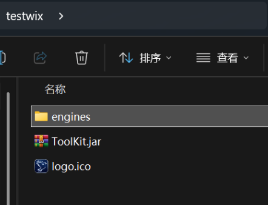
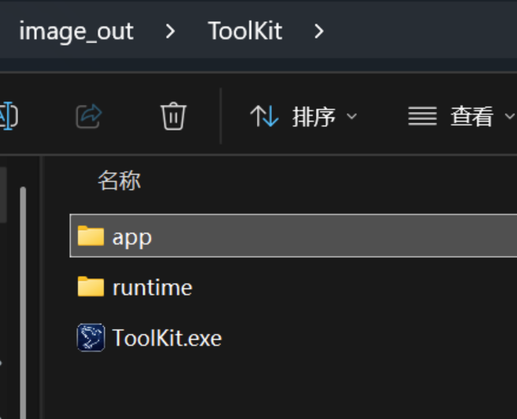

# 怎么用wix封装java软件为msi和同步签名？

软件的最终不应是单一文件。因为单一文件不管是 Python 还是 Java，底层本质上都是做成一个自解压的壳子。比如我的 BlackHole 经常被火绒查杀，报错最经典的就是 pythonshell，这其实和用 RAR 打包成 exe 自解压命令去启动 jar 是同一个道理。这种软件形式极易被查杀：没有作者信息、没有安装过程、一键直接拉起，像极了病毒，这确实不怪安全软件。

所以成熟软件的最终形态，通常都是“正规安装 + 快捷方式启动”，这背后是有深层原因的：
第一，软件启动得很快。因为它无需在每次启动时经历临时解压的预加载过程，软件运行所需的一切早已经安放在电脑磁盘中了；
第二，具备良好的可追溯性与完整的生命周期体验。用户不会因为不小心删了桌面快捷方式就导致软件彻底消失。试想在桌面放一个虽然足够绿色的软件，但如果用户有文件整理洁癖，他就得把你的软件手动移到某个盘符里，再搞一个一模一样的快捷方式，这种体验是非常不好的。

而且随着微软 Windows 安全机制的不断升级，虽然我们常说“魔高一尺，道高一丈”，黑科技绕过法对短期维护来说或许有效，但想真正做成一套产品——不说适配所有系统，仅仅就 x64 的 Windows 桌面端而言——正规安装绝对是最成熟、最稳定、最安全的一套方案了。那么本文将提供 WiX 工具针对 Windows 桌面端软件的安装包制作教程，摒除一切黑科技，走科班与当今最成熟的体系与方法。

首先还是要站在巨人的肩膀上，下载最稳定的 WiX 3.14 成熟版本。安装完成后需要配置一下系统环境变量：在 Windows 搜索“编辑系统环境变量” -> 点击“环境变量” -> 双击系统变量中的 `Path` -> 点击“新建”，将 WiX 的可执行目录（默认一般为 `C:\Program Files (x86)\WiX Toolset v3.14\bin`）添加进去，保存后重新打开终端测试。

接下来要配合 `jpackage` 命令进行操作，这是 JDK 自带的一个打包工具。理论上只要您的电脑配置好了环境变量，就不需要打开 IDE，直接在终端输入即可。




好了，那么现在开始打包了。   

```IDE
jpackage --type app-image --name ToolKit --app-version 1.9.6 --input "C:\Users\w1961\Desktop\testwix" --main-jar ToolKit.jar --main-class shaoxia.MainLauncher --dest "C:\Users\w1961\Desktop\image_out" --icon "C:\Users\w1961\Desktop\testwix\logo.ico"
```

这行 `jpackage` 命令的意思是：**使用 JDK 自带的打包工具，将你的 Java 项目生成一个免安装的独立运行目录（App Image）**。

  

为了让你一目了然，我们可以把这段代码拆解开来看看每个参数的具体含义：

  

- **`jpackage`**：JDK 14 及以上版本自带的官方桌面程序打包工具。
    
      
    
- **`--type app-image`**：指定打包类型为“应用镜像目录”（也就是生成一个可以直接双击运行、包含完整环境的文件夹，而不是直接生成安装包）。
    
      
    
- **`--name ToolKit`**：设定生成程序的名称。（这一步决定了最后的软件名称和快捷方式名称，一定要尤为关注一下。）
    
      
    
- **`--app-version 1.9.6`**：设定当前程序的版本号为 `1.9.6`。
    
      
    
- **`--input "C:\Users\w1961\Desktop\testwix"`**：指定输入文件夹，告诉打包工具去哪里寻找你的 `ToolKit.jar` 以及内置的 `engines` 等素材。
    
      
    
- **`--main-jar ToolKit.jar`**：指定主程序的 JAR 包文件名。
    
      
    
- **`--main-class shaoxia.MainLauncher`**：指定程序的启动入口类（即 `main` 函数所在的类）。
    
      
    
- **`--dest "C:\Users\w1961\Desktop\image_out"`**：指定输出文件夹，打包好的最终文件夹会存放在桌面的 `image_out` 目录下。
    
      
    
- **`--icon "C:\Users\w1961\Desktop\testwix\logo.ico"`**：为生成的程序指定一个自定义的 `.ico` 图标。



那么完成后桌面会多一个image_out的文件夹，里面就是ToolKit文件夹里的文件，您的app里面就是刚刚放进去的engines内置文件，所以子目录您也得注意一下，是app/engines,当在代码里编写绝对路径的时候也要注意这个细节，为什么要这样做，因为我接下来要给ToolKit.exe签名，不知道如何签名可以去我的另一篇文章查看，那么这里会踩一个小坑，大概率会报错Access is denied，错误是因为 `ToolKit.exe` 在编译生成时被 Windows 的某些底层文件缓存或安全扫描服务短暂加锁了。我们可以通过先复制一份临时文件、对其签名、再替换回去的方式来绕过这个文件占用锁定。

这个时候复制粘贴是不行的，需要强行将锁住的文件另存为一个新文件，假设文件在我刚刚应用镜像目录里面也就是C:\Users\w1961\Desktop\image_out\ToolKit\ToolKit.exe
这个文件，我们通过管理员命令

> 👇在桌面生成复件指令如下

```cmd
copy "C:\Users\w1961\Desktop\image_out\ToolKit\ToolKit.exe" "C:\Users\w1961\Desktop\ToolKit_temp.exe"
```

> 👇这时候你的桌面就会多一个ToolKit_temp.exe，这个时候再改名，然后签名，然后替换进去就行了。

```cmd
"C:\Program Files (x86)\Windows Kits\10\bin\10.0.26100.0\x64\signtool.exe" sign /f "C:\Users\w1961\Desktop\tukuai.pfx" /p "574185" /tr "http://timestamp.digicert.com" /td sha256 /fd sha256 "C:\Users\w1961\Desktop\ToolKit.exe"

```

> 👇那么现在进行打包，准备好软件图标ico，因为我把ico在编译时放到了wixtest里面，那么app里面确实是有一个ico的，这是很不好的重复，那么这个时候您就可以把app里面的ico放到桌面上，输入以下代码。

```IDE
jpackage --type msi --app-image "C:\Users\w1961\Desktop\image_out\ToolKit" --name ToolKit --app-version 1.9.6 --dest "C:\Users\w1961\Desktop" --icon "C:\Users\w1961\Desktop\logo.ico" --win-dir-chooser --win-shortcut --win-menu
```


> 临时插入我在1.9.7版本打包的心得，里面附加一句--vendor "土块"，控制面板才会出现作者是土块，这和软件本身的自签名没什么关系。  在最后加上 --verbose可以查看详细输出日志

```
jpackage --type msi --app-image "C:\Users\w1961\Desktop\image_out\ToolKit" --name ToolKit --app-version 1.9.7 --dest "C:\Users\w1961\Desktop" --icon "C:\Users\w1961\Desktop\logo.ico" --vendor "土块"  --win-dir-chooser --win-shortcut --win-menu --verbose 
```


这行指令的意思是：**使用 `jpackage` 工具，将前一步生成的免安装目录（App Image）直接封装并打包成一个标准的 Windows `.msi` 安装包。**

让我们同样把这段命令拆解开来看看每个参数的含义：

  

- **`jpackage`**：JDK 自带的桌面应用打包工具。
    
      
    
- **`--type msi`**：指定最终打包输出的文件格式为 Windows 的 `.msi` 安装包。
    
      
    
- **`--app-image "C:\Users\w1961\Desktop\image_out\ToolKit"`**：告诉打包工具，直接拿桌面上已经生成好的 `ToolKit` 运行目录作为打包的素材源。
    
      
    
- **`--name ToolKit`**：指定安装包在系统中显示的软件名称。（这里的名称最终还是根据第一次打包的独立运行目录决定的。）
    
      
    
- **`--app-version 1.9.6`**：指定安装包的版本号为 `1.9.6`。
    
      
    
- **`--dest "C:\Users\w1961\Desktop"`**：指定最终生成的 `.msi` 安装文件输出保存到你的桌面上。
    
      
    
- **`--icon "C:\Users\w1961\Desktop\logo.ico"`**：为这个安装包及安装后的程序指定自定义的图标。
    
      
    
- **`--win-dir-chooser`**：在安装向导中弹出一个步骤，允许用户自己选择安装到哪个盘（例如 D 盘）。
    
      
    
- **`--win-shortcut`**：安装完成后，自动在桌面上创建带有你自定义图标的 `.exe` 快捷方式。
    
      
    
- **`--win-menu`**：在 Windows 的“开始”菜单中也自动添加程序的快捷启动方式。

> 那么还没有结束，到这里您还要给安装包也签个名，这样就很完美了。如果想要删除直接点击msi卸载即可，如果不小心删除了msi，也可以从命令面板进行卸载。

```cmd
"C:\Program Files (x86)\Windows Kits\10\bin\10.0.26100.0\x64\signtool.exe" sign /f "C:\Users\w1961\Desktop\tukuai.pfx" /p "574185" /tr "http://timestamp.digicert.com" /td sha256 /fd sha256 "C:\Users\w1961\Desktop\ToolKit-1.9.7.msi"
```

那么这里要补充一个很重要的踩坑点，当你第一次编译的时候比如我的openssh服务，他是在目录下的，但是当他被打包成可执行文件目录时候他就因为打包指令被放到app目录里面了，所以在编译代码的时候要考虑到这一点，如果要调用工具，目录下app文件下调用，或者您可以手动删除然后在目录下放一个这种脱裤子的方法再穿上......。

```java
// ✨ 核心修改：动态获取便携版 SSH 引擎的绝对路径
String enginePath = System.getProperty("user.dir")
        + File.separator + "engines"
        + File.separator + "openssh"
        + File.separator + "ssh.exe";
```
只要改成
```java
String enginePath = System.getProperty("user.dir")
        + File.separator + "app"
        + File.separator + "engines"
        + File.separator + "openssh"
        + File.separator + "ssh.exe";
```

---

那么上文说的还是较乱的，其实原理就是 打包成启动文件🔜签名🔜打包成msi🔜安装。还是挺简单的大体思路，然后上文乱就乱在我在启动文件的时候往里面塞入engines，然后编译成msi后目录改变为app目录下牢记这一点就行了。
那么下文我要说的可能会比较复杂，如果是自己的文件建议还是跟着ai教学一步步创造wix内置配置文件指定目录，这里我就直接自己写了。

1.还是打包成绿色启动文件签名塞入可运行.exe文件，这一步很重要，因为如果用临时文件，极有可能被当成套壳病毒查杀了，一定要注意安全，也就是源目录的resources千万不要放任何exe，针对于java程序而言。

```IDE
jpackage --type app-image --name ToolKit --app-version 1.9.7 --input "C:\Users\w1961\Desktop\testwix" --main-jar ToolKit.jar --main-class shaoxia.MainLauncher --dest "C:\Users\w1961\Desktop\image_out" --icon "C:\Users\w1961\Desktop\testwix\logo.ico"
```
2.exe签名塞入转换
```cmd
copy "C:\Users\w1961\Desktop\image_out\ToolKit\ToolKit.exe" "C:\Users\w1961\Desktop\ToolKit_temp.exe"
```
```cmd
"C:\Program Files (x86)\Windows Kits\10\bin\10.0.26100.0\x64\signtool.exe" sign /f "C:\Users\w1961\Desktop\tukuai.pfx" /p "574185" /tr "http://timestamp.digicert.com" /td sha256 /fd sha256 "C:\Users\w1961\Desktop\ToolKit.exe"

```
并且在这一步在app下塞入文件。

3.好重要的就是这里，好玩的来了，假设我希望给自己来点不一样的我就要去自定义一些图片，那么这里我费了很大的劲去改底层配置文件，我想说的是如果您用的是不同的jdk版本或者不同的wix版本，听兄弟一句劝，直接用大语言模型一直问问到底就行了...
我在桌面ctrl shift n新建一个文件夹命名叫wix_resources，我在里面放入了dialog.bmp背景图和banner.bmp，那么这里你可以修图，不过我还是建议您直接用sharex截取固定尺寸的png，然后用转换工具给他转换了，因为我用ps修图到导出的时候居然tm的没有bmp，我真的服了，微软自带的画图好像有。
然后新建main.wxs文件，其实他的意思就是说固定为自定义图片路径打包的时候带上它就行了。


```main.wxs
<?xml version="1.0" encoding="utf-8"?>
<Wix xmlns="http://schemas.microsoft.com/wix/2006/wi"
     xmlns:util="http://schemas.microsoft.com/wix/UtilExtension">

  <?ifdef JpIsSystemWide ?>
    <?define JpInstallScope="perMachine"?>
  <?else?>
    <?define JpInstallScope="perUser"?>
  <?endif?>

  <?define JpProductLanguage=1033 ?>
  <?define JpInstallerVersion=200 ?>
  <?define JpCompressedMsi=yes ?>

  <?include $(var.JpConfigDir)/overrides.wxi ?>

  <?ifdef JpAllowUpgrades ?>
    <?define JpUpgradeVersionOnlyDetectUpgrade="no"?>
  <?else?>
    <?define JpUpgradeVersionOnlyDetectUpgrade="yes"?>
  <?endif?>
  <?ifdef JpAllowDowngrades ?>
    <?define JpUpgradeVersionOnlyDetectDowngrade="no"?>
  <?else?>
    <?define JpUpgradeVersionOnlyDetectDowngrade="yes"?>
  <?endif?>

  <Product
    Id="$(var.JpProductCode)"
    Name="$(var.JpAppName)"
    Language="$(var.JpProductLanguage)"
    Version="$(var.JpAppVersion)"
    Manufacturer="$(var.JpAppVendor)"
    UpgradeCode="$(var.JpProductUpgradeCode)">

    <Package
      Description="$(var.JpAppDescription)"
      Manufacturer="$(var.JpAppVendor)"
      InstallerVersion="$(var.JpInstallerVersion)"
      Compressed="$(var.JpCompressedMsi)"
      InstallScope="$(var.JpInstallScope)" Platform="x64"
    />

    <Media Id="1" Cabinet="Data.cab" EmbedCab="yes" />

<WixVariable Id="WixUIBannerBmp" Value="C:\Users\w1961\Desktop\wix_resources\banner.bmp" />
<WixVariable Id="WixUIDialogBmp" Value="C:\Users\w1961\Desktop\wix_resources\dialog.bmp" />

    <Upgrade Id="$(var.JpProductUpgradeCode)">
      <UpgradeVersion
        OnlyDetect="$(var.JpUpgradeVersionOnlyDetectUpgrade)"
        Property="JP_UPGRADABLE_FOUND"
        Maximum="$(var.JpAppVersion)"
        MigrateFeatures="yes"
        IncludeMaximum="$(var.JpUpgradeVersionOnlyDetectUpgrade)" />
      <UpgradeVersion
        OnlyDetect="$(var.JpUpgradeVersionOnlyDetectDowngrade)"
        Property="JP_DOWNGRADABLE_FOUND"
        Minimum="$(var.JpAppVersion)"
        MigrateFeatures="yes"
        IncludeMinimum="$(var.JpUpgradeVersionOnlyDetectDowngrade)" />
    </Upgrade>

    <?ifndef JpAllowUpgrades ?>
    <CustomAction Id="JpDisallowUpgrade" Error="!(loc.DisallowUpgradeErrorMessage)" />
    <?endif?>
    <?ifndef JpAllowDowngrades ?>
    <CustomAction Id="JpDisallowDowngrade" Error="!(loc.DowngradeErrorMessage)" />
    <?endif?>

    <Binary Id="JpCaDll" SourceFile="wixhelper.dll"/>

    <CustomAction Id="JpFindRelatedProducts" BinaryKey="JpCaDll" DllEntry="FindRelatedProductsEx" />

    <!-- Standard required root -->
    <Directory Id="TARGETDIR" Name="SourceDir"/>

    <Feature Id="DefaultFeature" Title="!(loc.MainFeatureTitle)" Level="1">
      <ComponentGroupRef Id="Shortcuts"/>
      <ComponentGroupRef Id="Files"/>
      <ComponentGroupRef Id="FileAssociations"/>
    </Feature>

    <CustomAction Id="JpSetARPINSTALLLOCATION" Property="ARPINSTALLLOCATION" Value="[INSTALLDIR]" />
    <CustomAction Id="JpSetARPCOMMENTS" Property="ARPCOMMENTS" Value="$(var.JpAppDescription)" />
    <CustomAction Id="JpSetARPCONTACT" Property="ARPCONTACT" Value="$(var.JpAppVendor)" />
    <CustomAction Id="JpSetARPSIZE" Property="ARPSIZE" Value="$(var.JpAppSizeKb)" />

    <?ifdef JpHelpURL ?>
      <CustomAction Id="JpSetARPHELPLINK" Property="ARPHELPLINK" Value="$(var.JpHelpURL)" />
    <?endif?>

    <?ifdef JpAboutURL ?>
      <CustomAction Id="JpSetARPURLINFOABOUT" Property="ARPURLINFOABOUT" Value="$(var.JpAboutURL)" />
    <?endif?>

    <?ifdef JpUpdateURL ?>
      <CustomAction Id="JpSetARPURLUPDATEINFO" Property="ARPURLUPDATEINFO" Value="$(var.JpUpdateURL)" />
    <?endif?>

    <?ifdef JpIcon ?>
    <Property Id="ARPPRODUCTICON" Value="JpARPPRODUCTICON"/>
    <Icon Id="JpARPPRODUCTICON" SourceFile="$(var.JpIcon)"/>
    <?endif?>

    <UIRef Id="JpUI"/>

    <InstallExecuteSequence>
      <Custom Action="JpSetARPINSTALLLOCATION" After="CostFinalize">Not Installed</Custom>
      <Custom Action="JpSetARPCOMMENTS" After="CostFinalize">Not Installed</Custom>
      <Custom Action="JpSetARPCONTACT" After="CostFinalize">Not Installed</Custom>
      <Custom Action="JpSetARPSIZE" After="CostFinalize">Not Installed</Custom>
      <?ifdef JpHelpURL ?>
        <Custom Action="JpSetARPHELPLINK" After="CostFinalize">Not Installed</Custom>
      <?endif?>
      <?ifdef JpAboutURL ?>
        <Custom Action="JpSetARPURLINFOABOUT" After="CostFinalize">Not Installed</Custom>
      <?endif?>
      <?ifdef JpUpdateURL ?>
        <Custom Action="JpSetARPURLUPDATEINFO" After="CostFinalize">Not Installed</Custom>
      <?endif?>

      <?ifndef JpAllowUpgrades ?>
      <Custom Action="JpDisallowUpgrade" After="JpFindRelatedProducts">JP_UPGRADABLE_FOUND</Custom>
      <?endif?>
      <?ifndef JpAllowDowngrades ?>
      <Custom Action="JpDisallowDowngrade" After="JpFindRelatedProducts">JP_DOWNGRADABLE_FOUND</Custom>
      <?endif?>
      <RemoveExistingProducts Before="CostInitialize"/>
      <Custom Action="JpFindRelatedProducts" After="FindRelatedProducts"/>
    </InstallExecuteSequence>

    <InstallUISequence>
      <Custom Action="JpFindRelatedProducts" After="FindRelatedProducts"/>
    </InstallUISequence>

  </Product>
</Wix>
```

然后执行

```IDE
jpackage --type msi --app-image "C:\Users\w1961\Desktop\image_out\ToolKit" --name ToolKit --app-version 1.9.7 --dest "C:\Users\w1961\Desktop" --icon "C:\Users\w1961\Desktop\logo.ico" --vendor "土块" --win-dir-chooser --win-shortcut --win-menu --resource-dir "C:\Users\w1961\Desktop\wix_resources" --verbose
```

注意看--resource-dir "C:\Users\w1961\Desktop\wix_resources"就是指定自定义目录了，总而言之我想起某位大佬说的话，人生苦短，如果只是做一个软件，还是学python吧，因为python本身就是c的快捷语言，cpython，然后他的支持者又特别多，java只是一个静态语言，不管是抽取jre，还是编译，真的是一个混沌巨兽。它主要还是用于后端服务代码，因为他在后端层面是非常完善稳定的，但是在就软件开发这个角度来说，在ai发展和智能体跑一切的今天，java真的不再适合作为软件开发代码。我做ToolKit也半年多了，我今天回首看，一路走来，确实没什么问题是解决不了的，但是如果从现在看起点，我觉得我只需要充值个会员，图片拿给他看，然后用智能体跑个7749天，似乎也能大差不差，但是我确实是一点点手改的，配合我的gemini美国大豆包熬过了很多岁月，人们往往很在意快，很在意结果，包括以前的我也是，我特别想立刻做出一个软件来一战成名，就是因为着急，所以软件修修补补了很长时间，我认为有些东西是快不了的，感情，成长，读书等，即使我写了很多文章，但是我只是精简我的经验，您读到也可能觉得，我靠写的啥玩意，好了废话少说了，如果用一句话来表达当下的感受就是，欲速不达，求真求实。


