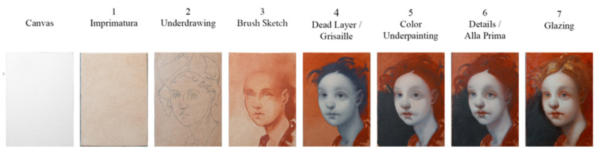

# 古典油画的创作周期

古典油画的绘制周期通常需要**几周到几个月，甚至数年**。这种漫长的周期是由油画颜料的干燥特性（亚麻仁油需要氧化固化）以及古典写实所采用的“多层间接画法”（Indirect Painting）决定的。画家必须遵循“肥盖瘦”（上层颜料含油量多于下层）的原则，每一层画完后，必须等待几天到几周完全干透，才能画下一层。

  

像达芬奇、伦勃朗和维米尔这些大师，他们并非一开始就把五颜六色的颜料直接画在画布上，而是将“明暗”与“色彩”分离开来，像盖房子一样一层层往上叠加。

  

## 古典多层画法标准步骤

**1.有色底打底：**Imprimatura。

在涂了胶和底料的画布上，刷上一层透明的中性暖色（如土黄或生褐）。这不仅能“杀死”刺眼的纯白画布，还能为整幅画定下全局的中间色调。

  

**2.单色起稿：**Underdrawing。

使用木炭条或稀释的褐色颜料勾勒出人物或静物的轮廓、比例和基本结构。

  

**3.灰阶底色层：**Grisaille / Dead Color。

这是古典油画的核心步骤。画家仅用黑、白两色（或加入少许绿色/褐色），将画面的光影、体积和明暗关系完整地画出来。此时的画面就像一张黑白照片，这一步彻底解决了“素描关系”，为后续的色彩铺路。

  

**4.实体色塑造：**Body Color。

在干透的灰阶底色上，开始使用不透明或半透明的颜料塑造受光部。亮部的颜料通常画得较厚（例如在人物鼻尖和颧骨处使用厚涂法），以建立物理上的肌理和坚实感。

  

**5.透明罩染：**Glazing。

这是产生古典油画“透明感”和“宝石般光泽”的秘诀。画家使用大量的调色油将高纯度的透明颜料（如茜草红、群青）稀释成彩色玻璃纸一样的薄层，平涂在干透的底色上。光线穿透这层透明色，照射在底层的白/灰色上再反射进观众的眼睛，形成极具深度的“光学灰”。

  

**6.罩光保护：**Varnishing。

作品彻底干透（通常需要等待半年到一年）后，在表面刷上一层透明的树脂光油。它能统一画面的光泽度，让暗部变得更加深邃，同时保护颜料层免受空气氧化。

  

这种将素描与色彩分离的作画逻辑，虽然极其耗时，但能创造出直接画法（如印象派的一气呵成）无法比拟的深邃光影和丰富的皮肤透明度。