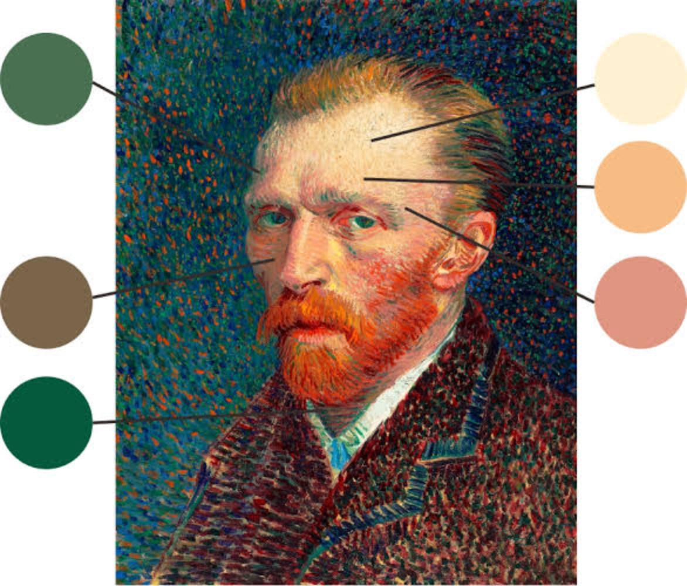

# 面部三段式

在传统肖像画（尤其是油画）的色彩理论中，人脸通常被划分为**三个色彩区域（面部三段式）**。这种微妙的色彩变化是由面部不同区域的皮肤厚度、毛细血管分布以及底层骨骼结构决定的。这三种色彩趋势是在基础肤色的基础上，通过混入特定的颜料来调配出来的：

  

- **上段（额头区域）：偏黄/亮金色**
    
      
    - **生理原因**：额头的皮肤较薄，紧贴着额骨，毛细血管较少，因此透出底层脂肪和骨骼的色泽，且该区域通常最受天光或顶光的影响。
        
          
        
    - **常用颜料**：在基础肤色中加入**土黄（Yellow Ochre）**、**那不勒斯黄（Naples Yellow）**，并配合**钛白（Titanium White）**。在强冷光下，也会透出极微妙的冷灰色。
        
          
        
- **中段（脸颊、鼻子、眼眶、耳朵）：偏红/暖色**
    
      
    - **生理原因**：面部中段拥有最丰富的毛细血管网，血液流动最旺盛。
        
          
        
    - **常用颜料**：在基础肤色中混入**镉红（Cadmium Red Light）**、**茜草深红（Alizarin Crimson）**或**熟赭（Burnt Sienna）**。鼻尖、内眼角和颧骨处往往是红色的高潮区，暖色的融入能赋予人物血液流动的生命力。
        
          
        
- **下段（下颌、下巴、口周）：偏青/蓝灰色/冷绿**
    
      
    - **生理原因**：这一区域分布着较多的毛囊（男性的胡青尤为明显，女性和儿童也同样存在微妙的冷色），且下颌通常处于面部的背光面或形体转折处，容易受环境冷反光的影响。
        
          
        
    - **常用颜料**：在基础肤色中混入少量的**群青（Ultramarine Blue）**、**蔚蓝（Cerulean Blue）**，或是用沙绿（Viridian）**配合**生褐（Raw Umber）调和出的灰绿色。
        
          
        

**基础肤色（Base Tone）的构建**

这三种色彩倾向是交织渐变的，它们都建立在一个统一的肉色基础之上。经典的调色起点通常是：**钛白 + 土黄 + 少量的红（如朱红或镉红）**，再用极少量的互补色（蓝或绿）来降低纯度。

  

无论是古典大师（如伦勃朗、维米尔）利用多层罩染展现出的肌肤透明感，还是印象派画家在户外自然光下对面部冷暖色的敏锐捕捉，核心都在于控制这三个区域的“色彩温度（冷暖）”对比，而不是生硬地涂抹黄、红、蓝。掌握这种微妙的温度交替，是让画布上的面孔告别“塑料感”、变得真实透气的关键。而印象派和后印象派（如梵高）则直接把这层“黄-红-绿”的滤镜给强化出来了。