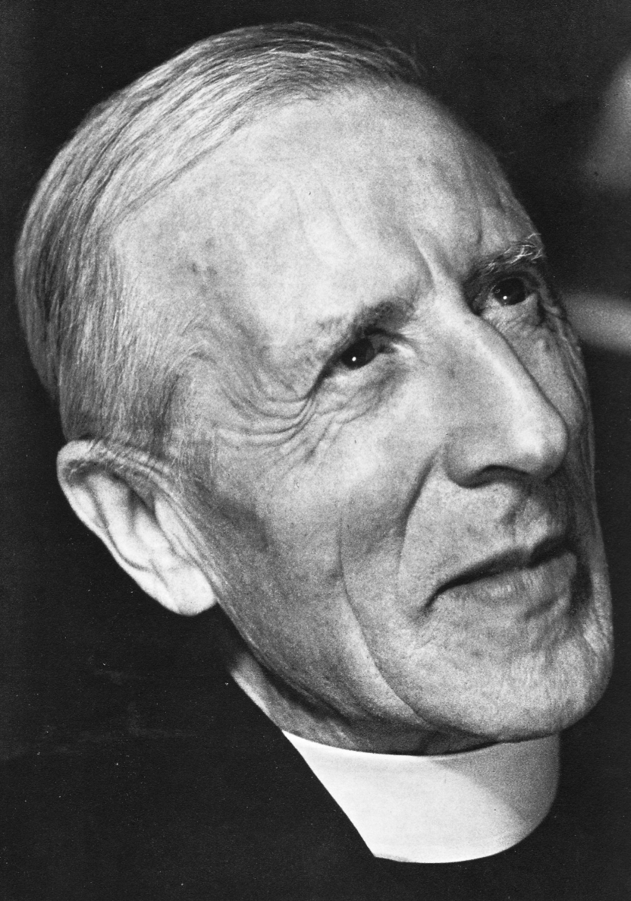

# 一切上升者必汇合

**皮埃尔·德日进（Pierre Teilhard de Chardin，1881–1955）跨学科专题科研报告**

  

**核心命题：** 物质复杂化与意识中心化的协同演化——从东亚第四纪古生物学实证到“心智圈—奥米茄点”收敛模型

  

德日进（法文原名 Pierre Teilhard de Chardin）在20世纪科学史与思想史上占据着极为独特的坐标：他既是受过严格索邦大学地质学与古生物学训练的实证科学家（曾任法国地质学会主席、中国地质调查所新生代研究室荣誉顾问），又是天主教耶稣会神父与演化哲学家。

  

名言 **« Tout ce qui monte converge. »**（一切上升者必汇合）并非单纯的神学格言，而是他基于二十余年古生物地层学考察（尤其是中国北方晚新生代与周口店古人类遗址研究），试图打通**热力学、生物演化论与人类学**而建立的一套宇宙演化动力学方程。

## 一、 实证科学基石：东亚第四纪地质与古人类学考察（1923–1946）

德日进的演化哲学并非书斋里的玄想，其底层经验支撑直接源自他在中国长达23年的田野地质与古生物考察。在这一时期，他与丁文江、翁文灏、杨钟健、裴文中、贾兰坡等中国第一代地质与古生物学家紧密合作，完成了多项奠基性科研工作：

  

1. **鄂尔多斯（河套）旧石器实证：** 1923年，德日进与桑志华（Émile Licent）深入宁夏水洞沟与内蒙古萨拉乌苏流域进行地层发掘，出土了大量旧石器时代晚期石器与伴生第四纪哺乳动物化石，并发现了“河套人”牙齿化石。这一发现直接推翻了此前国际学界认为“中国境内不存在旧石器时代人类遗存”的论断。
    
      
    
2. **泥河湾标准地层序列的建立：** 他与巴尔博（George B. Barbour）、桑志华等人对河北阳原泥河湾盆地进行了系统的生物地层学研究，确立了东亚早更新世“泥河湾动物群”（Nihewan Fauna）的标准剖面，至今仍是东亚第四纪地质年代学的关键标尺。
    
      
    
3. **周口店“北京猿人”遗址的年代与文化定性：** 自1929年裴文中发现第一颗北京猿人完整头盖骨起，德日进作为核心团队成员，主要负责**周口店遗址的地层对比、年代学界定及伴生哺乳动物化石分类**。他通过严谨的地层学证据，确认了直立人（_Homo erectus pekinensis_）对火的控制性使用与石器制造行为，为人类演化跨越“反思阈值”提供了关键实证。
    
      
    

获巴黎大学（索邦）自然科学博士学位

1922年

以法国始新世哺乳动物化石研究获博士学位，同年当选法国地质学会主席，奠定其在欧洲古脊椎动物学界的学术声誉。

  

首次来华与水洞沟、萨拉乌苏发掘

1923–1924年

与桑志华考察宁夏水洞沟与内蒙古萨拉乌苏，在《人类学》期刊发表论文，确证中国北方旧石器时代文化层的存在。

  

受聘中国地质调查所新生代研究室

1929–1937年

深度参与周口店北京猿人遗址发掘与研究，主导第四纪冰川、黄土成因及东亚哺乳动物群演替的综合考察，足迹遍及华北、新疆、华南及印缅地区。

  

在北平完成《人的现象》手稿

1938–1940年

因二战与抗战爆发滞留北平，在东交民巷与地质调查所实验室整理半生科研数据与哲学思考，完成代表作《人的现象》（Le Phénomène humain）定稿。

  

《人的现象》正式出版与全球反响

1955年

德日进于纽约逝世后，其友人整理出版《人的现象》法文原版（英译本由进化生物学家朱利安·赫胥黎作序），引发自然科学界与哲学界的广泛论争。

  

## 二、 理论内核：《人的现象》与演化动力学公理

在《人的现象》中，德日进明确声明该书并非神学论著，而是将“人”完全作为自然科学的观察对象（即“现象”）纳入宇宙整体演化史。为了解释宇宙为何没有在热力学熵增中彻底走向无序，反而涌现出生命与高阶意识，他提出了三大理论支点：

  

### 1. 物质的内在维度与“双能模型”

传统物理学仅从“外部”（Le Dehors）研究物质的质量、动量与相互作用；德日进认为，既然人类大脑这一高度复杂的物质系统具有纯粹的“内部”（Le Dedans，即意识与主观体验），那么根据演化连续性原则，**意识的雏形（前生命心理维度）必然作为普遍属性内在于一切物质微粒之中**。为此，他将宇宙能量划分为两个正交分量：

  

- **切向能（Énergie tangentielle）：** 使一个基本粒子与同一复杂层级的其他粒子发生物理、化学联系的能量，受制于热力学第二定律，总体表现为熵增与能量耗散。
    
      
    
- **径向能（Énergie radiale）：** 驱动物质微粒突破原有层级、向更高组织度与中心化演进的内在向心力，表现为宇宙演化中的“反熵（负熵）”趋势。
    
      
    

### 2. 复杂性—意识定律（Loi de complexité-conscience）

这是德日进演化体系的核心自然法则。该定律指出：**宇宙演化具有明确的时间矢量，物质系统的拓扑结构越复杂（组成元素的数量庞大、连接网络高度紧密且中心化），其对应的内在意识维度就越集中、越深邃。**

  

若以 $C_x$ 表示物质系统的结构复杂性（尤其以中枢神经系统的脑化指数 Encephalization 为代表），以 $\Psi$ 表示意识的内在中心化程度，在演化时间轴 $t$ 上存在正相关单调递增关系：

  

$$\frac{d\Psi}{dt} \propto \frac{dC_x}{dt}$$

在古生物学视野中，从无脊椎动物的分散神经节，到脊椎动物的脊髓—脑干，再到灵长类与智人高度折叠的大脑皮层，正是这一法则在地质时间尺度上的直接映射。

  

### 3. 宇宙演化的四重圈层跃迁

当量变（复杂性积累）达到临界点时，系统会发生相变式的“阈值跃迁”。德日进将宇宙历史划分为四个连续递进的演化阶段：

  

|**演化阶段**|**核心圈层**|**临界跃迁事件（相变点）**|**主导结构与演化特征**|
|---|---|---|---|
|**1. 宇生阶段（Cosmogenesis）**|物质圈（Géosphère）|基本粒子聚合与分子化|原子→分子→巨分子；切向能占优，局部孕育前生命大分子结构|
|**2. 生生阶段（Biogenesis）**|生物圈（Biosphère）|细胞化阈值（Pas de la Vie）|自我复制、新陈代谢与物种适应性辐射；神经系统出现并持续脑化|
|**3. 心生阶段（Noogenesis）**|心智圈（Noosphère）|反思阈值（Pas de la Réflexion）|“人化”（Hominisation）：个体不仅知道，而且**“知道自己知道”**；工具、语言与文化接管生物基因演化|
|**4. 终极阶段（Christogenesis）**|奥米茄点（Point Oméga）|集体意识的超个人收敛|全球心智圈高度整合，意识脱离生物基质束缚，汇聚于终极吸引子|

## 三、 “一切上升者必汇合”：球面几何学与收敛演化机制

为什么“上升”（复杂性与意识的提升）必然导致“汇合”（Convergence），而不是像达尔文演化树那样无限发散下去？德日进给出了一个极具洞察力的**行星几何与进化生态学证明**：

  

### 1. 从“发散辐射”到“球面压缩”

在生物演化的前数十亿年里，生命遵循达尔文式的**发散演化（Divergence / 适应性辐射）**：物种通过基因隔离不断分支，占领陆地、海洋与天空的各个生态位。然而，当直立人跨越“反思阈值”演变为智人后，情况发生了根本逆转：

  

- **精神的可通约性：** 动物的形态演化会导致生殖隔离（分道扬镳），而人类的思维、语言、符号与科学技术具有天然的跨个体传播与融合能力。
    
      
    
- **有限球面的曲率约束：** 地球是一个封闭的球体（有限表面积）。当人口增长、交通网络与信息传递在有限的球面上不断扩张时，发散的演化力越过地球的“赤道”后，在球面几何的约束下必然转向**向心压缩（Compression）与内卷化整合（Planétisation，行星化）**。
    
      
    

### 2. 心智圈（Noosphère）与全球大脑预言

1920年代，德日进与苏联地球化学家维尔纳茨基（Vladimir Vernadsky）、法国哲学家勒鲁瓦（Édouard Le Roy）共同提出并深化了“心智圈”（Noosphère，源自希腊语 _nous_ 即心智/理性）概念。德日进指出，在岩石圈、水圈、大气圈与生物圈之上，人类通过科学、教育、经济与通信网络，正在地球表面编织一层全新的、会思考的包膜。

  

他在20世纪三四十年代的论述，精准预见了数十年后的**互联网、全球实时通信网络与分布式群体智能**：人类不再仅仅是分散的生物个体，而是正在形成一个行星尺度的“超级神经系统”。

  

### 3. “合而分化”（L'union différencie）与奥米茄点

对于“汇合是否意味着极权主义式的个体泯灭或千篇一律”这一哲学质疑，德日进提出了著名的结构原则——**“合而分化”（Union differentiates）**：

  

> 在低级的物质混合中，汇聚会导致同质化（如水滴汇入大海失去边界）；但在高阶的精神与有机系统中，**整合度越高，组成部分的特异性反而越强**——正如人体细胞在高度整合的器官系统中，比单细胞阿米巴原虫具有远为鲜明的功能独特性。真正的精神汇合是“中心对中心的联结”，它不是抹杀自我（Ego），而是成全最高度的人格化（Personnalisation）。
> 
>   

作为这一收敛过程的终极极限，奥米茄点（Point Oméga）在德日进的模型中扮演着宇宙演化的“终极吸引子（Attractor）”，具备四项基本规定性：

  

1. **自主性（Autonomie）：** 独立于局部系统的衰变之外；
    
      
    
2. **现实性（Actualité）：** 并非仅仅是未来生成的产物，而是作为超越时空的既有引力中心拉动演化；
    
      
    
3. **不可逆性（Irréversibilité）：** 确保宇宙演化积累的意识成果不会因热寂（Heat Death）而归零；
    
      
    
4. **超验性（Transcendance）：** 弥合科学实证的演化终点与神学宇宙论的终极关怀。
    
      
    

## 四、 科学史评估与跨学科思想遗产

德日进的理论在20世纪下半叶至今引发了跨学科的持久震荡，其学术评价呈现出鲜明的双面张力：

  

### 1. 现代综合演化论的方法论批判

主流新达尔文主义（Neo-Darwinism）与分析哲学界对德日进的哲学外推持严厉审视态度。

  

- **非目的论 vs. 定向演化：** 现代演化生物学强调基因突变的随机性与自然选择的盲目性（无预设目的、无固定方向），而德日进的“复杂性—意识定律”带有明显的定向演化论（Orthogenesis）与目的论（Teleology）色彩。
    
      
    
- **实证主义批评：** 1960年诺贝尔生理学或医学奖得主彼得·梅达沃（Peter Medawar）在1961年撰文，严厉批评《人的现象》将诗学隐喻与热力学、生物学概念混用，偏离了严格可证伪的经验科学边界。
    
      
    
- **演化生物学内部的支持者：** 与此相对，现代综合演化论的奠基人之一费奥多西·杜布赞斯基（Theodosius Dobzhansky）**以及联合国教科文组织首任总干事**朱利安·赫胥黎（Julian Huxley）则高度评价德日进的宏观视野。杜布赞斯基在其名篇《若无演化之光，生物学毫无意义》（1973）结尾处，直接引用德日进的思想，肯定其将人类历史重新嵌入宇宙演化史的整合贡献。
    
      
    

### 2. 对复杂系统科学、控制论与技术哲学的影响

随着20世纪后期科学范式从还原论向复杂系统科学演进，德日进的许多前瞻性概念获得了新的科学诠释：

  

- **非平衡态热力学与自组织理论：** 普里高津（Ilya Prigogine）的耗散结构理论与斯图尔特·考夫曼（Stuart Kauffman）的复杂自组织理论，从物理学与数学层面解释了开放系统如何远离热力学平衡态并自发涌现出高阶复杂结构，为德日进所说的“径向能（反熵演化）”提供了祛魅后的科学机制。
    
      
    
- **地球系统科学与数字媒介理论：** 洛夫洛克（James Lovelock）的“盖亚假说”继承了生物圈整体调控的思想；传播学家马歇尔·麦克卢汉（Marshall McLuhan）的“地球村（Global Village）”（麦克卢汉曾坦言其电子媒介作为“人类中枢神经系统外化”的观点直接受启发于德日进的心智圈概念），以及凯文·凯利（Kevin Kelly）的“技术元素（Technium）”、物理学家弗兰克·蒂普勒（Frank Tipler）的《物理学的奥米茄点》，均可视为德日进理论在当代信息科学中的世俗化变体。
    
      
    

### 3. 文学与存在主义维度的折射

正如题干所提及，美国南方哥特文学巨匠弗兰纳里·奥康纳（Flannery O'Connor）对德日进的《人的现象》推崇备至，并于1961年创作了同名短篇小说《一切上升者必汇合》（_Everything That Rises Must Converge_）。奥康纳敏锐地抓住了德日进命题中的戏剧性张力：当原本处于不同阶层、不同种族的人们在现代社会变革中共同“上升”时，他们在狭窄的世俗空间（如一辆公共汽车）里发生了无可逃避的碰撞与汇合。奥康纳借此表明，通往“奥米茄点”的精神汇聚绝非田园诗般的温情脉脉，往往伴随着傲慢的破碎、剧烈的生存阵痛与残酷的自我审视。

  

德日进用一生在化石的冰冷断面与宇宙的炽热未来之间架设桥梁。无论现代科学如何修正其目的论前提，他所描绘的“物质孕育生命、生命点亮心智、心智在有限星球上彼此交织汇聚”的宏大史诗，依然是人类在面对宇宙深空与人工智能浪潮时，最具洞察力的思想坐标之一。