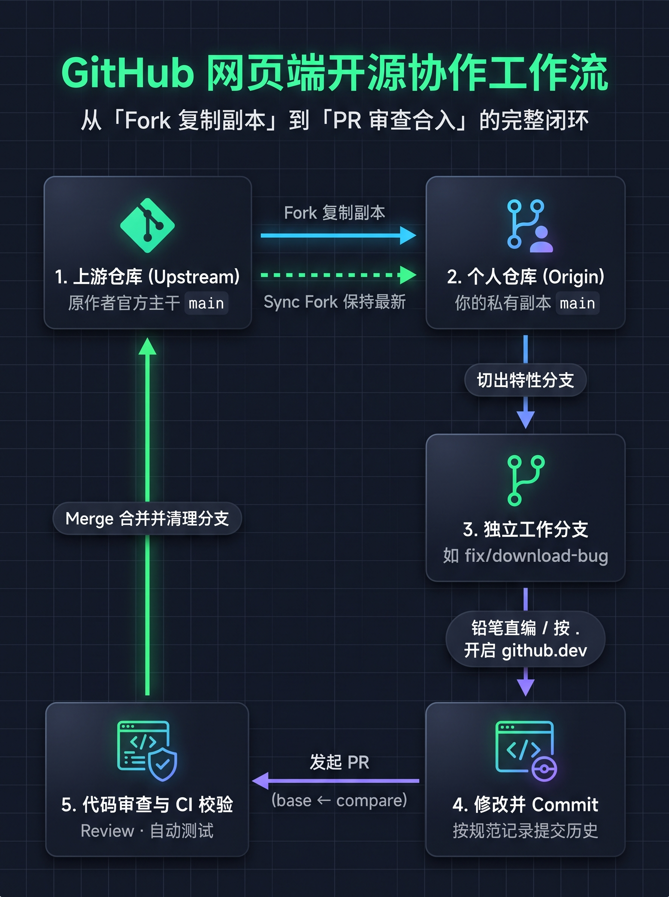

# GitHub 网页端开源协作与轻量开发工作流

> **GitHub 网页端开发工作流（Fork & Pull Request 模型）** 是一套无需本地配置 Git 环境、仅凭浏览器即可完成代码阅读、分支隔离、多文件修改、提交审核与合入主干的现代化协作范式。  
> 简单来说，你不需要把动辄几百 MB 的项目克隆到硬盘里，也能随时随地参与开源项目修 Bug 或维护自己的文档与工具：**先 Fork 出私人副本，再开独立分支改代码，最后发起 Pull Request（拉取请求）邀请对方把你的改动拉回主干。**

如果把一个开源项目比作出版社正在连载的权威典籍：原作者的主仓库（Upstream）是**出版社母版**，Fork 是你领走的**个人复印本**，新建分支（Branch）是在复印本上夹入的**独立修改便签**，**而 Pull Request（PR），则是你向总编辑递交的一份正式修稿申请：“我写好了这一章，请你审核后把它拉取（Pull）并合入官方母版。”**

---

## 一、举个生活中的例子

假设你正用平板或在没有配置 Git / SSH 密钥的办公电脑上浏览开源项目（比如 `CharlesPikachu/musicdl`），突然发现一段解析逻辑有明显 Bug，或者某篇文档里有个关键参数写错了。

传统本地开发流与 GitHub 网页端轻量流的效率对比立竿见影：

- **传统本地 Git 流程**：安装 Git → 配置 SSH 密钥 → `git clone` 下载完整历史 → 切分支修改 → `git push` → 再回浏览器提 PR，折腾半小时只为改三行代码；
- **GitHub 网页端轻量流**：打开浏览器 → 点击 **Fork** → 切出 `fix/download-bug` 分支 → 直接用网页编辑器或按 `.` 键秒开网页版 VS Code 改完提交 → 一键发出 **Pull Request**。**全程零本地安装、零环境污染，3 分钟优雅拿下一次开源贡献。**

---

## 二、全景视角：网页端开源协作是怎么运转的？

标准开源协作的核心在于**“双仓库 + 特性分支隔离”**——原作者的上游仓库（**Upstream**）与你的个人副本（**Origin**）各司其职，通过 **Sync Fork（向下同步）** 与 **Pull Request（向上贡献）** 形成闭环：




整个闭环只有四条黄金法则：

1. **Upstream 只读参考**：外部贡献者没有权限直接改原作者仓库，所有改动都在自己的 Fork 里完成。
2. **个人 `main` 永远保持干净**：绝对不要直接往自己 Fork 的 `main` 分支提交代码，让它只负责一键对齐上游。
3. **一件事一个分支**：每次修 Bug 或加功能都从最新 `main` 切出一个语义化分支（如 `fix/xxx`、`docs/xxx`）。
4. **方向永远是 `base ← compare`**：PR 是请求把右边 `compare` 分支的改动，合并进左边 `base` 目标分支。

---

## 三、五阶段实战通关指南（含高阶网页技巧）

### 阶段一：复制个人副本（Fork）

1. 打开目标开源项目主页（例如 `CharlesPikachu/musicdl`）。
2. 点击页面右上角的 **Fork** 按钮。
3. 确认 **Owner** 为你自己的账号（如 `GallantTarry`），勾选仅复制默认分支（`Copy the main branch only` 可大幅提速），点击 **Create fork**。

> **结果**：几秒后你的账号下会生成一个完全独立的副本仓库（`GallantTarry/musicdl`），你在里面拥有最高管理员权限，怎么折腾都不会影响原作者。

---

### 阶段二：开工前对齐上游（Sync Fork）

开源项目每天都可能有新提交。每次准备动手改代码前，务必先把自己的副本同步到最新状态，避免后续产生烦人的合并冲突：

1. 进入你自己 Fork 出来的仓库主页，确保当前停留在默认主分支（`main` 或 `master`）。
2. 在文件列表右上方找到 **Sync fork** 下拉按钮。
3. 若提示 `This branch is X commits behind`，点击绿色的 **Update branch**；若显示 `This branch is up to date`，则无需操作。

> **为什么千万别直接往自己的 `main` 分支提交代码？**  
> 只要你的 `main` 分支干干净净没有私人提交，点击 **Update branch** 就能无痛快进（Fast-Forward）对齐上游；一旦你直接在 `main` 里改过代码，再同步就会产生分叉甚至冲突，被迫丢弃提交或手动解冲突。

---

### 阶段三：创建独立工作区（新建 Branch）

在确认 `main` 已是最新后，为本次修改开辟一块专属“平行宇宙”：

1. 点击文件列表左上角的分支下拉菜单（显示着 `main` 或 `master`）。
2. 在输入框中填入语义化分支名，推荐遵循业界通用的前缀规范：
   - 修复 Bug：`fix/music-download-timeout`
   - 新增功能：`feat/dark-mode-toggle`
   - 修正文档：`docs/fix-readme-typo`
3. 点击下方出现的 **Create branch: `fix/...` from 'main'**，页面会自动切入该新分支。

---

### 阶段四：修改代码并提交快照（Edit / `github.dev` + Commit）

GitHub 网页端其实提供了**两档编辑武器**，按修改规模按需选用：

- **改单个文件（极速微调）**：点开目标文件，点击右上角的 **铅笔图标（Edit this file）** 直接修改；改完点击右上角 **Commit changes...**。
- **改多个文件 / 全局搜索（隐藏神技）**：在你的仓库页面**直接按下键盘上的英文句号 `.` 键**（或把网址 `github.com` 改成 `github.dev`），浏览器会瞬间加载**网页版 VS Code**！你可以像在本地一样同时修改十几个文件、全局搜索符号，最后在左侧「源代码管理」面板里一次性打包成单个整洁的 Commit 提交到当前分支。

填写提交说明（Commit Message）时，建议遵循 **Conventional Commits（约定式提交）** 规范，让历史记录一目了然：

```text
fix: 修复特定音源链接重定向导致的下载失败问题
docs: 补充 Docker 部署环境变量说明
feat: 为导出功能新增 JSON 格式支持
```

确认提交目标选择的是**当前新建的特性分支**（而非 `main`），点击 **Commit changes** 完成保存。

---

### 阶段五：发起合并与收尾（Pull Request）

代码提交完毕后，根据你的目标选择对应合并流向：

#### 情况 A：贡献给原作者（向上游提交 PR）

1. 回到你的仓库主页，顶部通常会自动弹出一条醒目提示条，直接点击绿色的 **Compare & pull request** 按钮。
2. **核对合并方向（最容易踩坑的一步）**：
   - 左侧 **`base repository`** = **原作者仓库**，`base` = 原作者的 `main`（接收改动的目标）；
   - 右侧 **`head repository`** = **你的仓库**，`compare` = 你的特性分支 `fix/...`（提供改动的来源）。
   - 记住箭头方向：**`base ← compare`**。
3. **写一份让维护者秒批的 PR 描述**：清晰说明 **改了什么（What）**、**为什么这么改（Why）** 以及 **如何验证（How）**。如果本次修复对应某个 Issue，在正文写上 **`Closes #42`**，PR 一旦合并，GitHub 会自动关闭 42 号 Issue。
4. 点击 **Create pull request**，静候自动化测试（GitHub Actions）跑绿与作者审核合并。

#### 情况 B：只合并到自己的主分支（个人仓库迭代）

1. 点击顶部 **Pull requests** → **New pull request**。
2. 将左侧 **`base repository`** 手动切回**你自己的仓库**，选 `base: main` ← `compare: fix/...`。
3. 创建 PR 并点击底部的 **Merge pull request** 确认合入。

> **高频概念纠偏：为什么叫“Pull Request（拉取请求）”而不是“Push Request”？**  
> 很多新手容易把方向理解反。PR 并不是“我要去拉取 `base` 库的代码”（那是 **Sync Fork** 干的事），而是**站在对方的视角说话：“我向 `base` 仓库管理员发出请求，请你把（Pull）我 `compare` 分支里的代码拉过去合并！”**

> **收尾好习惯**：PR 成功合并后，页面底部会出现一个 **Delete branch** 按钮，顺手点一下删掉已合并的特性分支，既能让仓库保持清爽，也不会丢失任何已合入的提交记录。

---

## 四、交互实验室：GitHub 协作流与 PR 方向模拟器

为了把 **Fork 副本、上游更新导致落后、Sync Fork 对齐、分支 Commit，以及最容易选反的 `base ← compare` PR 方向校验** 彻底玩明白，你可以直接在下方模拟器中切换场景，或按 1→6 顺序亲手走完一次完整开源贡献：

<style>
.tk-gh {
  --gh-bg: rgba(24, 24, 27, 0.72);
  --gh-panel: rgba(39, 39, 42, 0.55);
  --gh-sub: #0d0d10;
  --gh-border: rgba(255, 255, 255, 0.1);
  --gh-accent: #10b981;
  --gh-blue: #38bdf8;
  --gh-amber: #f59e0b;
  --gh-red: #f43f5e;
  --gh-purple: #a78bfa;
  --gh-text: #f4f4f5;
  --gh-muted: #a1a1aa;
  box-sizing: border-box;
  margin: 20px 0 24px;
  padding: 18px;
  border: 1px solid var(--gh-border);
  border-radius: 16px;
  background: var(--gh-bg);
  color: var(--gh-text);
  font-family: 'Inter', -apple-system, BlinkMacSystemFont, "PingFang SC", "Microsoft YaHei", sans-serif;
  box-shadow: 0 12px 32px rgba(0, 0, 0, 0.35);
}
body.theme-light .tk-gh {
  --gh-bg: rgba(255, 250, 253, 0.85);
  --gh-panel: rgba(243, 232, 255, 0.52);
  --gh-sub: rgba(255, 255, 255, 0.92);
  --gh-border: rgba(236, 72, 153, 0.22);
  --gh-accent: #ec4899;
  --gh-blue: #0284c7;
  --gh-amber: #d97706;
  --gh-red: #e11d48;
  --gh-purple: #7c3aed;
  --gh-text: #2e1065;
  --gh-muted: #6d597a;
  box-shadow: 0 12px 32px rgba(167, 139, 250, 0.16);
}
.tk-gh, .tk-gh *, .tk-gh *::before, .tk-gh *::after { box-sizing: border-box; }
.tk-gh-head {
  display: flex;
  flex-wrap: wrap;
  justify-content: space-between;
  align-items: center;
  gap: 8px;
  padding-bottom: 12px;
  margin-bottom: 14px;
  border-bottom: 1px solid var(--gh-border);
}
.tk-gh-title {
  font-size: 15px;
  font-weight: 700;
  color: var(--gh-text);
  display: flex;
  align-items: center;
  gap: 8px;
}
.tk-gh-dot {
  width: 8px;
  height: 8px;
  border-radius: 50%;
  background: var(--gh-accent);
  box-shadow: 0 0 10px var(--gh-accent);
}
.tk-gh-legend { font-size: 12px; color: var(--gh-muted); }
.tk-gh-bar {
  display: flex;
  flex-wrap: wrap;
  gap: 7px;
  margin-bottom: 10px;
}
.tk-gh-btn {
  appearance: none;
  border: 1px solid var(--gh-border);
  background: var(--gh-panel);
  color: var(--gh-text);
  padding: 6px 11px;
  border-radius: 9px;
  font-size: 12px;
  font-weight: 600;
  cursor: pointer;
  transition: all 0.16s ease;
  font-family: inherit;
}
.tk-gh-btn:hover:not(:disabled) {
  border-color: var(--gh-accent);
  color: var(--gh-accent);
  transform: translateY(-1px);
}
.tk-gh-btn:disabled {
  opacity: 0.38;
  cursor: not-allowed;
}
.tk-gh-btn.is-primary {
  background: var(--gh-accent);
  border-color: var(--gh-accent);
  color: #ffffff;
}
.tk-gh-btn.is-primary:hover:not(:disabled) { opacity: 0.92; color: #ffffff; }
.tk-gh-btn.is-blue {
  background: var(--gh-blue);
  border-color: var(--gh-blue);
  color: #ffffff;
}
.tk-gh-btn.is-blue:hover:not(:disabled) { opacity: 0.92; color: #ffffff; }
.tk-gh-grid {
  display: grid;
  grid-template-columns: 1fr 1fr;
  gap: 12px;
  margin-bottom: 12px;
}
.tk-gh-panel {
  background: var(--gh-panel);
  border: 1px solid var(--gh-border);
  border-radius: 12px;
  padding: 12px;
  display: flex;
  flex-direction: column;
  gap: 9px;
  min-width: 0;
}
.tk-gh-ptitle {
  font-size: 12px;
  font-weight: 700;
  color: var(--gh-text);
  display: flex;
  flex-wrap: wrap;
  justify-content: space-between;
  align-items: center;
  gap: 6px;
}
.tk-gh-badge {
  display: inline-block;
  padding: 2px 8px;
  border-radius: 999px;
  font-family: 'JetBrains Mono', Consolas, monospace;
  font-size: 11px;
  font-weight: 700;
}
.tk-gh-badge.is-ok { background: rgba(16, 185, 129, 0.18); color: var(--gh-accent); }
.tk-gh-badge.is-warn { background: rgba(245, 158, 11, 0.18); color: var(--gh-amber); }
.tk-gh-badge.is-err { background: rgba(244, 63, 94, 0.18); color: var(--gh-red); }
.tk-gh-badge.is-blue { background: rgba(56, 189, 248, 0.18); color: var(--gh-blue); }
.tk-gh-badge.is-purple { background: rgba(167, 139, 250, 0.18); color: var(--gh-purple); }
.tk-gh-branchbox {
  background: var(--gh-sub);
  border: 1px solid var(--gh-border);
  border-radius: 9px;
  padding: 9px 10px;
}
.tk-gh-bname {
  font-family: 'JetBrains Mono', Consolas, monospace;
  font-size: 11.5px;
  color: var(--gh-muted);
  margin-bottom: 6px;
  display: flex;
  justify-content: space-between;
  align-items: center;
}
.tk-gh-commits {
  display: flex;
  flex-wrap: wrap;
  gap: 6px;
  align-items: center;
}
.tk-gh-node {
  display: inline-flex;
  align-items: center;
  gap: 5px;
  padding: 3px 8px;
  border-radius: 6px;
  font-family: 'JetBrains Mono', Consolas, monospace;
  font-size: 11.5px;
  border: 1px solid var(--gh-border);
  background: rgba(56, 189, 248, 0.12);
  color: var(--gh-blue);
}
.tk-gh-node.is-feat {
  background: rgba(16, 185, 129, 0.15);
  color: var(--gh-accent);
  border-color: rgba(16, 185, 129, 0.35);
}
.tk-gh-node.is-merged {
  background: rgba(167, 139, 250, 0.16);
  color: var(--gh-purple);
  border-color: rgba(167, 139, 250, 0.35);
}
.tk-gh-arrow { color: var(--gh-muted); font-size: 11px; }
.tk-gh-prbox {
  background: var(--gh-panel);
  border: 1px solid var(--gh-border);
  border-radius: 12px;
  padding: 12px;
  margin-bottom: 12px;
}
.tk-gh-prrow {
  display: grid;
  grid-template-columns: 1fr auto 1fr auto;
  gap: 10px;
  align-items: center;
  margin-top: 8px;
}
.tk-gh-select {
  width: 100%;
  padding: 7px 10px;
  border-radius: 9px;
  border: 1px solid var(--gh-border);
  background: var(--gh-sub);
  color: var(--gh-text);
  font-family: 'JetBrains Mono', Consolas, monospace;
  font-size: 12px;
  outline: none;
}
.tk-gh-select:focus { border-color: var(--gh-accent); }
.tk-gh-dirtag {
  font-family: 'JetBrains Mono', Consolas, monospace;
  font-size: 12.5px;
  font-weight: 700;
  color: var(--gh-amber);
  text-align: center;
  white-space: nowrap;
}
.tk-gh-logs {
  background: var(--gh-sub);
  border: 1px solid var(--gh-border);
  border-radius: 10px;
  padding: 9px 11px;
  font-family: 'JetBrains Mono', Consolas, monospace;
  font-size: 12px;
  line-height: 1.7;
  max-height: 130px;
  overflow-y: auto;
}
.tk-gh-log-ok { color: var(--gh-accent); }
.tk-gh-log-info { color: var(--gh-blue); }
.tk-gh-log-warn { color: var(--gh-amber); }
.tk-gh-log-err { color: var(--gh-red); }
@media (max-width: 820px) {
  .tk-gh { padding: 14px; }
  .tk-gh-grid { grid-template-columns: 1fr; }
  .tk-gh-prrow { grid-template-columns: 1fr; }
}
</style>

<section id="tk-gh-lab" class="tk-gh" aria-label="GitHub 网页端 Fork Branch PR 交互模拟器">
  <div class="tk-gh-head">
    <div class="tk-gh-title"><span class="tk-gh-dot"></span><span>GitHub 网页端协作流与 PR 方向模拟器</span></div>
    <span class="tk-gh-legend">按步骤操作体验双仓库同步、特性分支隔离与 base ← compare 方向校验</span>
  </div>
  <div class="tk-gh-bar">
    <button type="button" class="tk-gh-btn" id="tk-gh-s1">1. Fork 仓库</button>
    <button type="button" class="tk-gh-btn" id="tk-gh-s2">2. Sync Fork</button>
    <button type="button" class="tk-gh-btn" id="tk-gh-s3">3. 新建分支</button>
    <button type="button" class="tk-gh-btn" id="tk-gh-s4">4. 网页 Commit</button>
    <button type="button" class="tk-gh-btn is-blue" id="tk-gh-s5">5. 发起 PR</button>
    <button type="button" class="tk-gh-btn is-primary" id="tk-gh-s6">6. 合并并删分支</button>
    <button type="button" class="tk-gh-btn" id="tk-gh-up">模拟上游有新提交 (+1)</button>
    <button type="button" class="tk-gh-btn" id="tk-gh-reset">重置从头体验</button>
  </div>
  <div class="tk-gh-bar">
    <button type="button" class="tk-gh-btn" id="tk-gh-p0">预设 1：准备提上游 PR</button>
    <button type="button" class="tk-gh-btn" id="tk-gh-p1">预设 2：分支落后需 Sync</button>
    <button type="button" class="tk-gh-btn" id="tk-gh-p2">预设 3：PR 方向选反演示</button>
  </div>
  <div class="tk-gh-grid">
    <div class="tk-gh-panel">
      <div class="tk-gh-ptitle">
        <span>上游仓库 (Upstream · 原作者/musicdl)</span>
        <span class="tk-gh-badge is-blue" id="tk-gh-upbadge">官方主干</span>
      </div>
      <div class="tk-gh-branchbox">
        <div class="tk-gh-bname"><span>branch: main</span><span id="tk-gh-upcnt">2 commits</span></div>
        <div class="tk-gh-commits" id="tk-gh-upnodes"></div>
      </div>
    </div>
    <div class="tk-gh-panel">
      <div class="tk-gh-ptitle">
        <span>个人副本 (Origin · 你的账号/musicdl)</span>
        <span class="tk-gh-badge is-ok" id="tk-gh-syncbadge">Up to date</span>
      </div>
      <div class="tk-gh-branchbox">
        <div class="tk-gh-bname"><span>branch: main（保持干净，只做同步）</span><span id="tk-gh-orcnt">2 commits</span></div>
        <div class="tk-gh-commits" id="tk-gh-ornodes"></div>
      </div>
      <div class="tk-gh-branchbox" id="tk-gh-featwrap">
        <div class="tk-gh-bname"><span id="tk-gh-featname">branch: fix/download-bug</span><span id="tk-gh-featcnt">1 commit</span></div>
        <div class="tk-gh-commits" id="tk-gh-featnodes"></div>
      </div>
    </div>
  </div>
  <div class="tk-gh-prbox">
    <div class="tk-gh-ptitle">
      <span>Pull Request 合并方向校验器（记住：把右边的改动“拉”进左边！）</span>
      <span class="tk-gh-badge is-ok" id="tk-gh-prverdict">✅ 正确：向上游开源项目贡献 PR</span>
    </div>
    <div class="tk-gh-prrow">
      <select id="tk-gh-base" class="tk-gh-select" aria-label="base 目标分支">
        <option value="up:main" selected>base: 原作者/musicdl (main)</option>
        <option value="or:main">base: 你的账号/musicdl (main)</option>
        <option value="or:feat">base: 你的账号/musicdl (fix/download-bug)</option>
      </select>
      <span class="tk-gh-dirtag">← 拉取合并 ←</span>
      <select id="tk-gh-cmp" class="tk-gh-select" aria-label="compare 来源分支">
        <option value="or:feat" selected>compare: 你的账号/musicdl (fix/download-bug)</option>
        <option value="or:main">compare: 你的账号/musicdl (main)</option>
        <option value="up:main">compare: 原作者/musicdl (main)</option>
      </select>
      <select id="tk-gh-mode" class="tk-gh-select" aria-label="合并策略">
        <option value="squash" selected>Squash and merge</option>
        <option value="merge">Create a merge commit</option>
        <option value="rebase">Rebase and merge</option>
      </select>
    </div>
  </div>
  <div class="tk-gh-logs" id="tk-gh-logs"></div>
</section>

<script>
(function () {
  var lab = document.getElementById('tk-gh-lab');
  if (!lab || lab.dataset.ready === '1') return;
  lab.dataset.ready = '1';

  var bS1 = document.getElementById('tk-gh-s1');
  var bS2 = document.getElementById('tk-gh-s2');
  var bS3 = document.getElementById('tk-gh-s3');
  var bS4 = document.getElementById('tk-gh-s4');
  var bS5 = document.getElementById('tk-gh-s5');
  var bS6 = document.getElementById('tk-gh-s6');
  var bUp = document.getElementById('tk-gh-up');
  var bReset = document.getElementById('tk-gh-reset');
  var elUpNodes = document.getElementById('tk-gh-upnodes');
  var elOrNodes = document.getElementById('tk-gh-ornodes');
  var elFeatWrap = document.getElementById('tk-gh-featwrap');
  var elFeatNodes = document.getElementById('tk-gh-featnodes');
  var elUpCnt = document.getElementById('tk-gh-upcnt');
  var elOrCnt = document.getElementById('tk-gh-orcnt');
  var elFeatCnt = document.getElementById('tk-gh-featcnt');
  var elSyncBadge = document.getElementById('tk-gh-syncbadge');
  var elBase = document.getElementById('tk-gh-base');
  var elCmp = document.getElementById('tk-gh-cmp');
  var elMode = document.getElementById('tk-gh-mode');
  var elVerdict = document.getElementById('tk-gh-prverdict');
  var elLogs = document.getElementById('tk-gh-logs');

  var state = {};
  var logItems = [];

  function pushLog(cls, text) {
    logItems.unshift({ cls: cls, text: text });
    if (logItems.length > 6) logItems.pop();
  }

  function renderCommits(container, list) {
    while (container.firstChild) container.removeChild(container.firstChild);
    if (!list.length) {
      var empty = document.createElement('span');
      empty.style.color = 'var(--gh-muted)';
      empty.style.fontSize = '11.5px';
      empty.textContent = '（尚未创建）';
      container.appendChild(empty);
      return;
    }
    list.forEach(function (c, i) {
      if (i > 0) {
        var ar = document.createElement('span');
        ar.className = 'tk-gh-arrow';
        ar.textContent = '→';
        container.appendChild(ar);
      }
      var n = document.createElement('span');
      n.className = 'tk-gh-node' + (c.type === 'feat' ? ' is-feat' : (c.type === 'merged' ? ' is-merged' : ''));
      n.textContent = c.id + ' ' + c.label;
      container.appendChild(n);
    });
  }

  function evalDirection() {
    var b = elBase.value;
    var c = elCmp.value;
    if (b === c) {
      return { ok: false, cls: 'is-err', text: '❌ 无效：base 与 compare 选了同一个分支，无差异可合并' };
    }
    if (b === 'up:main' && c === 'or:feat') {
      return { ok: true, target: 'upstream', cls: 'is-ok', text: '✅ 正确：请求原作者把你的特性分支拉取合入上游 main' };
    }
    if (b === 'or:main' && c === 'or:feat') {
      return { ok: true, target: 'self', cls: 'is-blue', text: '✅ 正确：把特性分支合并到你自己的个人 main 分支' };
    }
    if (b === 'or:feat' && c === 'up:main') {
      return { ok: false, cls: 'is-err', text: '❌ 方向选反！你这是在把上游代码拉回你的特性分支（更新上游请用 Sync Fork）' };
    }
    if (b === 'up:main' && c === 'or:main') {
      return { ok: false, cls: 'is-warn', text: '⚠️ 不推荐：应从特性分支发起 PR，避免污染你自己的 main 分支' };
    }
    return { ok: false, cls: 'is-err', text: '❌ 方向异常：请确保左侧 base 是接收合并的主分支，右侧 compare 是你的修改分支' };
  }

  function render() {
    renderCommits(elUpNodes, state.upstream);
    elUpCnt.textContent = state.upstream.length + ' commits';

    if (!state.forked) {
      renderCommits(elOrNodes, []);
      elOrCnt.textContent = '未 Fork';
      elSyncBadge.className = 'tk-gh-badge is-warn';
      elSyncBadge.textContent = '尚未创建副本';
      elFeatWrap.style.opacity = '0.4';
      renderCommits(elFeatNodes, []);
      elFeatCnt.textContent = '未创建';
    } else {
      var behind = state.upstream.length - state.originMain.length;
      renderCommits(elOrNodes, state.originMain);
      elOrCnt.textContent = state.originMain.length + ' commits';
      if (behind > 0) {
        elSyncBadge.className = 'tk-gh-badge is-warn';
        elSyncBadge.textContent = '落后上游 ' + behind + ' commit';
      } else {
        elSyncBadge.className = 'tk-gh-badge is-ok';
        elSyncBadge.textContent = 'Up to date (已同步)';
      }

      elFeatWrap.style.opacity = state.hasBranch ? '1' : '0.45';
      if (state.hasBranch) {
        renderCommits(elFeatNodes, state.featCommits);
        elFeatCnt.textContent = state.featCommits.length + ' new commit' + (state.prOpen ? ' · PR 审核中' : '');
      } else {
        renderCommits(elFeatNodes, []);
        elFeatCnt.textContent = '尚未新建分支';
      }
    }

    var dir = evalDirection();
    elVerdict.className = 'tk-gh-badge ' + dir.cls;
    elVerdict.textContent = dir.text;

    bS1.disabled = state.forked;
    bS2.disabled = !state.forked || state.upstream.length <= state.originMain.length;
    bS3.disabled = !state.forked || state.hasBranch;
    bS4.disabled = !state.hasBranch || state.prOpen;
    bS5.disabled = !state.hasBranch || state.featCommits.length === 0 || state.prOpen || !dir.ok;
    bS6.disabled = !state.prOpen;

    while (elLogs.firstChild) elLogs.removeChild(elLogs.firstChild);
    logItems.forEach(function (it) {
      var d = document.createElement('div');
      d.className = it.cls;
      d.textContent = it.text;
      elLogs.appendChild(d);
    });
  }

  function loadPreset(mode) {
    logItems = [];
    if (mode === 'clean') {
      state = {
        upstream: [{ id: 'a1b2', label: 'init' }, { id: 'c3d4', label: 'feat: core' }],
        forked: false, originMain: [], hasBranch: false, featCommits: [], prOpen: false, seq: 1
      };
      elBase.value = 'up:main'; elCmp.value = 'or:feat';
      pushLog('tk-gh-log-info', '[就绪] 请依次点击「1. Fork 仓库」→「3. 新建分支」→「4. 网页 Commit」体验完整协作流');
    } else if (mode === 'ready') {
      state = {
        upstream: [{ id: 'a1b2', label: 'init' }, { id: 'c3d4', label: 'feat: core' }],
        forked: true,
        originMain: [{ id: 'a1b2', label: 'init' }, { id: 'c3d4', label: 'feat: core' }],
        hasBranch: true,
        featCommits: [{ id: 'f7e8', label: 'fix: download bug', type: 'feat' }],
        prOpen: false, seq: 2
      };
      elBase.value = 'up:main'; elCmp.value = 'or:feat';
      pushLog('tk-gh-log-ok', '[预设已加载] 已完成 Fork、Sync、建分支与 Commit，点击「5. 发起 PR」即可向上游提交审核');
    } else if (mode === 'behind') {
      state = {
        upstream: [
          { id: 'a1b2', label: 'init' }, { id: 'c3d4', label: 'feat: core' },
          { id: 'd5e6', label: 'fix: auth' }, { id: 'e7f8', label: 'docs: api' }
        ],
        forked: true,
        originMain: [{ id: 'a1b2', label: 'init' }, { id: 'c3d4', label: 'feat: core' }],
        hasBranch: false, featCommits: [], prOpen: false, seq: 1
      };
      elBase.value = 'up:main'; elCmp.value = 'or:feat';
      pushLog('tk-gh-log-warn', '[Sync 提醒] 你的 Fork 已落后上游 2 个提交，开工前请先点击「2. Sync Fork」对齐主干！');
    } else if (mode === 'wrong') {
      state = {
        upstream: [{ id: 'a1b2', label: 'init' }, { id: 'c3d4', label: 'feat: core' }],
        forked: true,
        originMain: [{ id: 'a1b2', label: 'init' }, { id: 'c3d4', label: 'feat: core' }],
        hasBranch: true,
        featCommits: [{ id: 'f7e8', label: 'fix: download bug', type: 'feat' }],
        prOpen: false, seq: 2
      };
      elBase.value = 'or:feat'; elCmp.value = 'up:main';
      pushLog('tk-gh-log-err', '[方向报错] 当前把 base 选成了你的特性分支，PR 按钮已阻止提交！请把左侧改回原作者 main');
    }
    render();
  }

  bS1.addEventListener('click', function () {
    state.forked = true;
    state.originMain = state.upstream.slice();
    pushLog('tk-gh-log-ok', '[Fork] 已完整复制上游仓库至你的个人账号 (GallantTarry/musicdl)');
    render();
  });

  bS2.addEventListener('click', function () {
    state.originMain = state.upstream.slice();
    pushLog('tk-gh-log-ok', '[Sync Fork] 个人 main 分支干净无冲突，已无痛 Fast-Forward 对齐上游最新提交！');
    render();
  });

  bS3.addEventListener('click', function () {
    state.hasBranch = true;
    state.featCommits = [];
    pushLog('tk-gh-log-info', '[Branch] 已从 main 切出独立工作分支 fix/download-bug，可放心修改代码');
    render();
  });

  bS4.addEventListener('click', function () {
    var hash = 'f' + (state.seq++) + 'a' + Math.floor(Math.random() * 9);
    var msg = state.featCommits.length === 0 ? 'fix: download bug' : 'docs: update notes';
    state.featCommits.push({ id: hash, label: msg, type: 'feat' });
    pushLog('tk-gh-log-ok', '[Commit] 在网页端提交快照 ' + hash + ' (' + msg + ') 到 fix/download-bug');
    render();
  });

  bS5.addEventListener('click', function () {
    var dir = evalDirection();
    if (!dir.ok) return;
    state.prOpen = true;
    pushLog('tk-gh-log-info', '[PR #108] 已发起拉取请求：' + elBase.options[elBase.selectedIndex].text + ' ← ' + elCmp.options[elCmp.selectedIndex].text + '，CI 检查已通过！');
    render();
  });

  bS6.addEventListener('click', function () {
    var dir = evalDirection();
    var m = elMode.value;
    var targetArr = dir.target === 'self' ? state.originMain : state.upstream;
    if (m === 'squash') {
      targetArr.push({ id: '9a0b', label: 'fix: download (#108)', type: 'merged' });
      pushLog('tk-gh-log-ok', '[Squash & Merge] 已将 ' + state.featCommits.length + ' 个零碎提交压缩为 1 个整洁提交合入主干，并自动删除特性分支！');
    } else if (m === 'merge') {
      targetArr.push({ id: 'm108', label: 'Merge PR #108', type: 'merged' });
      pushLog('tk-gh-log-ok', '[Merge Commit] 已保留完整分支拓扑并生成合并节点合入主干，特性分支已清理！');
    } else {
      state.featCommits.forEach(function (c) { targetArr.push({ id: c.id, label: c.label, type: 'merged' }); });
      pushLog('tk-gh-log-ok', '[Rebase & Merge] 已将提交线性变基重放至主干末端，特性分支已清理！');
    }
    state.prOpen = false;
    state.hasBranch = false;
    state.featCommits = [];
    render();
  });

  bUp.addEventListener('click', function () {
    var id = 'u' + (state.upstream.length + 1) + 'c9';
    state.upstream.push({ id: id, label: 'chore: upstream #' + state.upstream.length });
    pushLog('tk-gh-log-warn', '[上游动态] 原作者主干新增提交 ' + id + '，你的个人 Fork 现已落后上游！');
    render();
  });

  bReset.addEventListener('click', function () { loadPreset('clean'); });
  document.getElementById('tk-gh-p0').addEventListener('click', function () { loadPreset('ready'); });
  document.getElementById('tk-gh-p1').addEventListener('click', function () { loadPreset('behind'); });
  document.getElementById('tk-gh-p2').addEventListener('click', function () { loadPreset('wrong'); });
  elBase.addEventListener('change', render);
  elCmp.addEventListener('change', render);

  loadPreset('ready');
})();
</script>

---

## 五、工具选型：GitHub 网页端三种编辑方式怎么选？

并不是所有修改都适合用同一种网页入口，按改动规模选对工具能省下大量时间：

| 开发方式 | 触发入口 | 能力边界 | 最佳适用场景 |
| :--- | :--- | :--- | :--- |
| **网页铅笔直编（Web Editor）** | 文件页右上角 `✏️` 图标 | 仅支持单文件纯文本编辑，无终端、无语法补全 | 改 README 错别字、调整配置文件参数、修 1~5 行显而易见的单文件 Bug |
| **网页版 VS Code（`github.dev`）** | 仓库页按键盘 **`.`（英文句号）** | 完整 VS Code 界面、跨文件搜索、多文件打包成单个 Commit；但**无运行终端** | 文档站批量改稿、纯静态前端/CSS 调整、无需本地编译验证的多文件重构 |
| **GitHub Codespaces** | 绿色 `Code` 按钮 → `Codespaces` | 分配真实云端 Linux 容器，**自带完整终端、编译器与端口预览**（每月含免费额度） | 在平板或公司电脑上跑完整项目单测、编译后端代码后再提交 PR |
| **本地 Git CLI / IDE** | `git clone` 本地克隆 | 全功能离线开发、性能最强、支持复杂交互式 Rebase 与本地硬件调试 | 长期主力开发、大型工程重构与高频日常提交 |

---

## 六、PR 合并避坑：三种 Merge 策略与四大翻车现场

### 1. 点击合并时的三种策略有什么区别？

当你管理自己的仓库（或作为项目维护者审核别人 PR）时，绿色合并按钮的下拉菜单提供三种策略：

| 合并策略 | 历史记录长什么样 | 适用场景与建议 |
| :--- | :--- | :--- |
| **Squash and merge（压缩合并）** | 把 PR 里的 5 个零碎提交（如 `fix typo`、`try again`）压成 **1 个干净的提交**合入主干 | **开源项目与中小团队首选**。让 `main` 分支历史极度清爽，回滚单个功能只需撤回一个提交 |
| **Create a merge commit（普通合并）** | 完整保留特性分支上的所有提交，并额外生成一个 `Merge pull request #N` 分叉节点 | 需要严格审计每次小改动的传统大型项目或版本发布分支 |
| **Rebase and merge（变基合并）** | 将特性分支上的每个提交逐一线性重放到主干最新节点之后，不产生分叉合并节点 | 要求提交历史呈一条完美直线、且贡献者本身提交记录非常规范的项目 |

### 2. 新手最容易踩的 4 个翻车坑

- **把自己的 `main` 分支改脏了**：直接在 Fork 的 `main` 上提交修改，导致后续无法一键 `Sync fork`，甚至发 PR 时把上次没合入的无关改动也一并带了进去。
- **在一个 PR 里塞进八杆子打不着的改动**：既修了下载 Bug 又顺手格式化了整个项目的代码，导致 Diff 动辄上千行，维护者根本没法 Review，大概率直接关闭。坚持**“一个分支只解决一个原子问题”**。
- **在网页端连点十次保存产生刷屏提交**：每改一个错别字就点一次 Commit，PR 里堆满 `Update README.md`。需要多处修改时，优先按 `.` 键进 `github.dev` 改完再统一提交，或合并时使用 `Squash and merge`。
- **发起 PR 后不管 CI 报错**：提交完 PR 别急着关网页，等几十秒看看页面底部的自动化检查（GitHub Actions）是否全部变绿；如果有语法检查（Lint）或单测报错，直接往同一个特性分支追加 Commit，PR 会自动同步更新。

---

## 七、总结

掌握这套 GitHub 网页端轻量工作流，本质上是吃透了整个开源世界最底层的协作契约：

- **Fork + Sync Fork** 划清了上游官方主干与个人实验田的边界，让你既能紧跟最新进展，又拥有绝对安全的修改沙盒；
- **特性分支 + 网页版 VS Code（`.`）** 让你彻底摆脱设备与本地环境的束缚，哪怕只带一台浏览器也能写出干净、规范的多文件提交；
- **Pull Request（`base ← compare`）** 则用透明的 Diff 对比、自动化检查与代码审查，让素未谋面的全球开发者能够放心地把彼此的代码编织进同一个伟大项目里。

**隔离于分支，同步于主干，对话于 PR——这就是现代开源协作最轻盈也最可靠的工程秩序。**