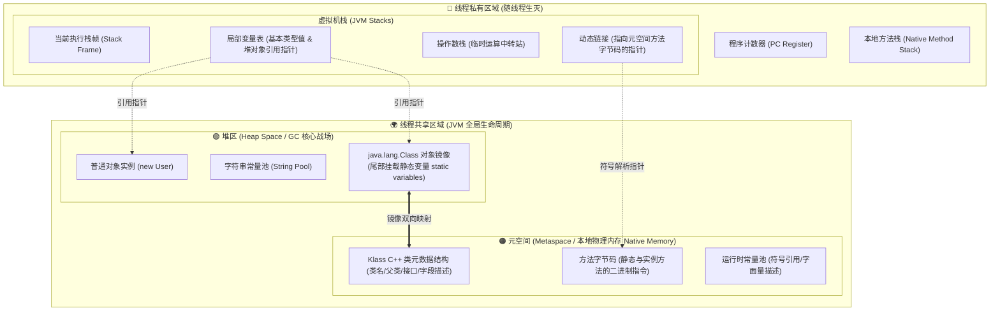
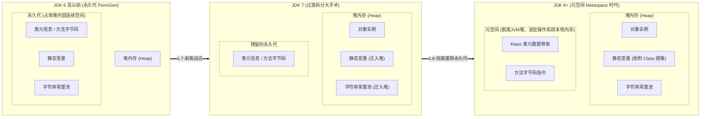
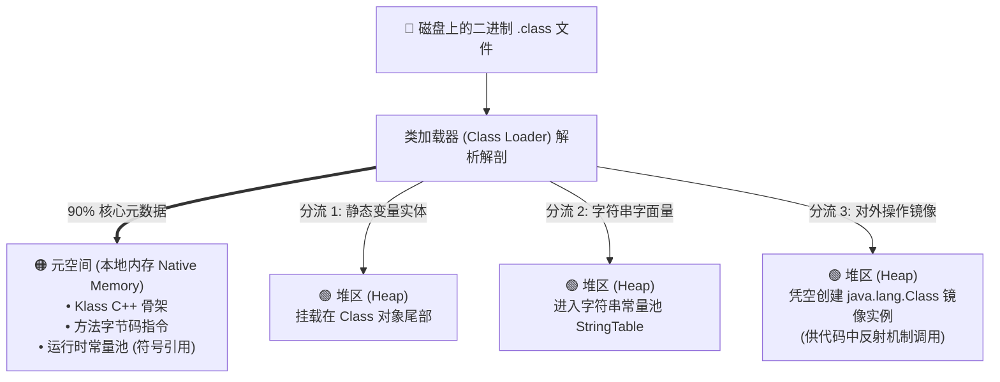
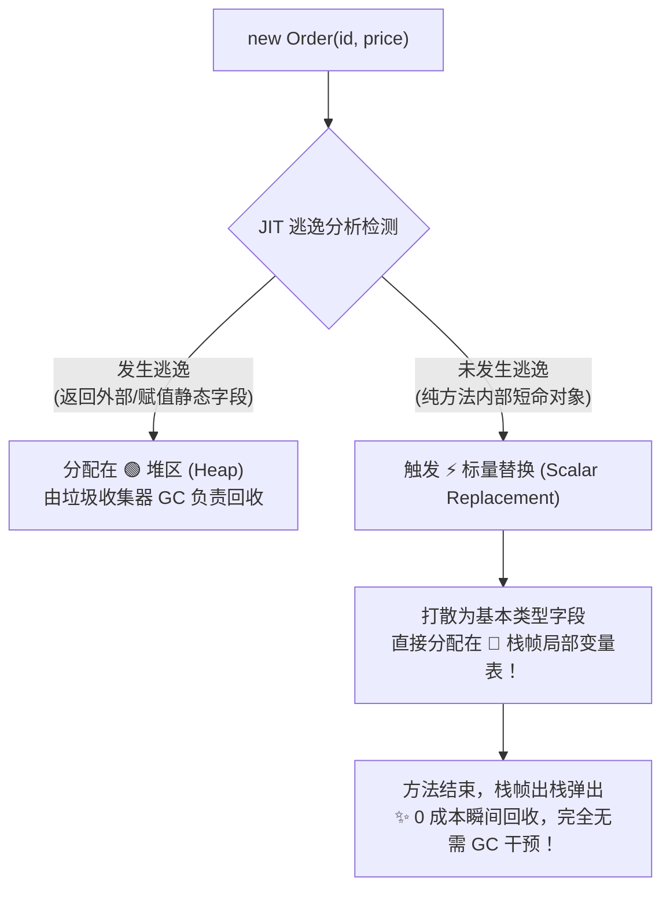

# JVM内存大手术：栈堆与元空间

> **核心导读**：
> 在 Java 的内存版图中，没有哪一块区域经历过如“方法区”一般惊心动魄的重构大手术。从 JDK 6 时代动辄引发宕机的 `PermGen space OOM`，到 JDK 7 的阵痛拆解与静态变量迁移，再到 JDK 8 彻底废除永久代、借道操作系统的“本地内存元空间（Metaspace）”——这绝非单纯的版本号更迭，而是 HotSpot 虚拟机架构师们与内存碎片、垃圾回收效率进行了十数年拉锯战后的终极答卷。
>
> 本文彻底打通宏观与微观，带你一次性弄清**栈、堆、元空间**的三色边界，以及**静态变量为何死死钉在堆中、磁盘 `.class` 如何被解剖为元空间骨架**的底层内幕。

---

## 目录
- [一、 宏观全景图解：JVM 运行时数据区的三色世界](#一-宏观全景图解jvm-运行时数据区的三色世界)
- [二、 历史大手术：方法区规范、永久代之死与元空间崛起](#二-历史大手术方法区规范永久代之死与元空间崛起)
  - [2.1 规范与现实：“方法区”只是个接口声明](#21-规范与现实方法区只是个接口声明)
  - [2.2 演进三部曲：从 JDK 6 到 JDK 8+ 的惊险手术](#22-演进三部曲从-jdk-6-到-jdk-8-的惊险手术)
- [三、 深度破密：静态变量为什么死死钉在“堆”里？](#三-深度破密静态变量为什么死死钉在堆里)
  - [3.1 致命误区：静态变量真的跟着去了元空间吗？](#31-致命误区静态变量真的跟着去了元空间吗)
  - [3.2 底层真相：依附于 Class 镜像对象的尾部](#32-底层真相依附于-class-镜像对象的尾部)
  - [3.3 架构智慧：为什么要把它们从方法区抠出来挪进堆？](#33-架构智慧为什么要把它们从方法区抠出来挪进堆)
- [四、 编译与运行真相：磁盘 `.class` 怎么被解剖进元空间？](#四-编译与运行真相磁盘-class-怎么被解剖进元空间)
  - [4.1 编译期与运行期的本质界限](#41-编译期与运行期的本质界限)
  - [4.2 压缩包解压：从字节码文件到元空间 Klass 结构体](#42-压缩包解压从字节码文件到元空间-klass-结构体)
  - [4.3 三大分流：那些没有进元空间的数据去了哪里？](#43-三大分流那些没有进元空间的数据去了哪里)
- [五、 内存流转纪录片：一段代码的生命轨迹与内存映射](#五-内存流转纪录片一段代码的生命轨迹与内存映射)
- [六、 极致性能黑科技：打破“对象必在堆”的逃逸分析](#六-极致性能黑科技打破对象必在堆的逃逸分析)
- [七、 全局总结：现代 JVM 数据最终归宿速查表](#七-全局总结现代-jvm-数据最终归宿速查表)

---

## 一、 宏观全景图解：JVM 运行时数据区的三色世界

在 Java 程序运行的一瞬间，操作系统分配给 JVM 的内存会被划分为职责截然不同的区域。我们使用三原色来确立它们的心智模型：

* 🟢 **绿色区域【堆区 (Heap Space)】**：JVM 内部最大的一块**线程共享内存**，是存放数据实体的“中央大仓库”。
* 🔵 **蓝色区域【虚拟机栈 (JVM Stacks)】**：每一个线程独占一份的**线程私有内存**，是指令执行的“快节奏流水线”。
* 🟠 **橙色区域【元空间 (Metaspace)】**：直接借用操作系统 RAM 的**本地物理内存 (Native Memory)**，是存放系统规范、类结构的“图纸陈列室”。



---

## 二、 历史大手术：方法区规范、永久代之死与元空间崛起

### 2.1 规范与现实：“方法区”只是个接口声明
初学者常被“方法区”、“永久代”、“元空间”搞得晕头转向。其实它们的辩证关系就像面向对象里的**接口与实现类**：

$$\text{Java 接口：方法区 (Method Area)} \quad \Longleftarrow \quad \begin{cases} \text{JDK 6 实现：永久代 (PermGen)} \\ \text{JDK 8 实现：元空间 (Metaspace)} \end{cases}$$

《Java 虚拟机规范》只规定了**逻辑上**必须有一块叫“方法区”的地方用来存类的结构信息，但**完全没有规定它必须放在哪、怎么实现**。

### 2.2 演进三部曲：从 JDK 6 到 JDK 8+ 的惊险手术



1. **JDK 6 及以前：永久代（PermGen）的至暗时刻**
   * **物理位置**：直接占用 JVM 堆内存中一块连续的固定空间。
   * **存储内容**：类元数据、方法字节码、静态变量、字符串常量池一锅端。
   * **致命死穴**：由 `-XX:MaxPermSize` 静态限制。随着现代框架（Spring、CGLIB、动态代理）在运行时疯狂动态生成类，永久代极难被垃圾回收，极易抛出臭名昭著的 `java.lang.OutOfMemoryError: PermGen space` 导致全服崩溃。

2. **JDK 7：动大手术的过渡阵痛期**
   * HotSpot 团队开始拆除违章建筑：把最占内存且生命周期变化频繁的 **字符串常量池（String Pool）** 和 **静态变量（Static Variables）** 强行从永久代中剥离，**转移到了堆内存（Heap）中**。
   * 此时永久代还在，但只剩下了纯粹的类元数据和字节码。

3. **JDK 8 及以后：元空间（Metaspace）推倒重来**
   * **彻底删除永久代**，迎来元空间。
   * **空间大腾挪**：元空间不再向 JVM 申请内存，而是直接分配在**操作系统的本地内存（Native Memory / RAM）**中。
   * **核心优势**：默认情况下，只要你宿主机的物理内存够大，元空间就可以动态扩容，彻底与 `PermGen OOM` 说再见！同时简化了 Full GC 的触发条件。

---

## 三、 深度破密：静态变量为什么死死钉在“堆”里？

### 3.1 致命误区：静态变量真的跟着去了元空间吗？
很多人以为：“JDK 8 永久代删除了换成元空间，所以静态变量现在放在元空间。”
**这是大错特错的过时认知！**

> **铁打的现代结论**：
> 在 JDK 7 及以上（包括当下所有的 JDK 8 / 11 / 17 / 21），**静态变量永远留在【堆 (Heap)】中！它压根没有去元空间！**

### 3.2 底层真相：依附于 Class 镜像对象的尾部
静态变量既然在堆里，究竟藏在堆的什么地方？

当类加载器将 `.class` 文件加载到元空间后，JVM 会在 **堆（Heap）** 中凭空实例化一个与之对应的 `java.lang.Class` 镜像对象。
**该类的所有静态变量，在内存布局上直接紧紧依附在这个 Class 对象的末尾（Instance Fields 之后）！**

```
堆内存 (Heap Space)
┌────────────────────────────────────────────────────────┐
│  java.lang.Class 对象实体 (例如 User.class)            │
│  ├─ 对象头 (Mark Word + Klass Pointer 指向元空间)       │
│  ├─ Class 基础内部属性                                  │
│  └─ [静态字段区] (Static Fields)                        │
│      ├─ static int count = 100;     <-- 基本类型：数值直接存此处 │
│      └─ static User admin = 0x88ff; <-- 引用类型：指针存此处───┼───┐
│                                                                │   │
│  真正被 new 出来的 User 实例 (地址: 0x88ff)                    │   │
│  └─ 包含普通成员变量 (name="Admin", age=18) <──────────────────┘   │
└────────────────────────────────────────────────────────────────┘
```

* **基本类型静态变量**（如 `public static int age = 18;`）：数值 `18` 直接保存在 Class 对象尾部的连续内存内。
* **引用类型静态变量**（如 `public static User user = new User();`）：Class 对象尾部只保存一个内存指针地址（如 `0x88ff`），而实际由 `new User()` 生成的实体对象，依然自由分配在堆的普通年轻代/老年代中。

### 3.3 架构智慧：为什么要把它们从方法区抠出来挪进堆？
为什么 HotSpot 设计师宁可大动干戈，也不让静态变量跟着字节码去元空间？

1. **GC 回收效率天差地别**：
   元空间（本地内存）存储的是类结构骨架，只有当一个类对应的类加载器都被回收时（几乎只有 OSGi 或热部署插件才会发生），元空间才会发生垃圾回收。如果静态变量留在元空间，它引用的巨大对象集群就很难被 GC 回收，极易导致内存泄漏。
2. **纳入通用分代收集模型**：
   移入堆后，静态变量引用的对象可以直接参与年轻代、老年代的常规垃圾回收（Minor GC / Full GC）。对象的存活判定与普通对象统一，GC 的算法复杂度大幅降低。

---

## 四、 编译与运行真相：磁盘 `.class` 怎么被解剖进元空间？

### 4.1 编译期与运行期的本质界限
必须理清的一条底线逻辑：**“编译期”不会产生任何 Java 对象**。
当你敲下 `javac User.java` 时，JVM 进程根本还没启动。磁盘上的 `.class` 文件只是一段静态的、紧凑的、给机器阅读的原始二进制字节流（包含魔数 `0xCAFEBABE`、版本号、常量池、字段表、方法表等）。

### 4.2 压缩包解压：从字节码文件到元空间 Klass 结构体
如果把磁盘上的 `.class` 文件比作一个紧凑的“压缩包”，那么元空间（Metaspace）就是解压陈列室。
类加载器读取 `.class` 二进制流后，在底层的 C++ 层面构造一个名为 **`Klass` 的 C++ 结构体实例**，存放进元空间：

1. **类结构元数据（类的骨架）**：
   * 记录类的全限定名、父类是谁、实现了哪些接口、访问权限修饰符（`public/abstract`）。
   * **字段声明表**：记录“该类定义了一个名为 `name` 的 `String` 字段”（注意：只存字段结构和类型描述，不存运行时实体）。
2. **方法字节码（类的肌肉与逻辑）**：
   * 业务代码被编译后的底层机器指令（如 `aload_0`、`invokespecial`、`iadd`、`return`）。
   * 无论是静态方法、私有方法、还是构造函数，**全部指令序列一视同仁钉在元空间中**，供所有线程共享调用。

### 4.3 三大分流：那些没有进元空间的数据去了哪里？
`.class` 文件在进入 JVM 时，有三大核心成分发生了“分流出境”：



---

## 五、 内存流转纪录片：一段代码的生命轨迹与内存映射

我们用一段融合了**静态变量、实例变量、静态方法、实例方法与局部变量**的典型代码，还原它在三色内存中的实时轨迹：

```java
public class MemoryArchitectureDemo {

    // 【1. 静态变量 (引用类型)】
    // 物理归宿：🟢 堆 (Heap)
    // 轨迹：类加载时随 Class 对象生成在堆上。GLOBAL_KEY 变量本身在 Class 尾部，
    // 其引用的 "SYS_ALPHA" 字符串对象存放在堆的字符串常量池中。
    public static String GLOBAL_KEY = "SYS_ALPHA";

    // 【2. 成员变量 / 实例变量】
    // 物理归宿：🟢 堆 (Heap)
    // 轨迹：仅在 new 实例化时随对象一起在堆上开辟内存。
    public int instanceCode = 8801;

    // 【3. 静态方法】
    // 代码逻辑归宿：🟠 元空间 (Metaspace)
    // 轨迹：指令代码属于类元数据，无论是否加 static，指令全部存放在元空间。
    public static void printSystemBanner() {
        // 【4. 局部变量 (基本类型)】
        // 物理归宿：🔵 栈 (Stack) - 当前线程的当前方法栈帧内
        // 轨迹：数值 3 直接压入当前栈帧的局部变量表中，方法执行完毕栈帧弹出，瞬间化为乌有。
        int bootLevel = 3;
        System.out.println("启动等级: " + bootLevel + "，全局秘钥: " + GLOBAL_KEY);
    }

    // 【5. 实例方法】
    // 代码逻辑归宿：🟠 元空间 (Metaspace)
    public void executeProcess(String taskTag) {
        // 【6. 局部变量 (引用类型)】
        // 物理协作：🔵 栈 (Stack) 存指针，🟢 堆 (Heap) 存实体
        // 轨迹：局部变量 status 作为 32/64位引用地址存在栈帧中；
        // 字符串实体 "RUNNING" 则安睡在堆内存中。
        String status = "RUNNING";
        System.out.println("任务: " + taskTag + " | 状态: " + status + " | 实例编码: " + this.instanceCode);
    }

    public static void main(String[] args) {
        // [阶段 A] 静态调用：栈帧中的动态链接直接寻址元空间中的字节码指令
        MemoryArchitectureDemo.printSystemBanner();

        // [阶段 B] 对象诞生：
        // 1. demo 引用变量存放在 main 方法的栈帧局部变量表中 (🔵 栈)
        // 2. new 创建的对象实体分配在 🟢 堆区 (内部包含 instanceCode=8801)
        MemoryArchitectureDemo demo = new MemoryArchitectureDemo();

        // [阶段 C] 实例调用：通过 demo 指针找到堆对象，再通过对象头里的类型指针找到元空间字节码执行
        demo.executeProcess("DataPipeline");
    }
}
```

---

## 六、 极致性能黑科技：打破“对象必在堆”的逃逸分析

在传统的教科书里，“所有对象都在堆中创建”被奉为公理。但在现代的高性能 HotSpot 虚拟机中，这条铁律已经被彻底颠覆！

### 6.1 什么是逃逸分析（Escape Analysis）？
在 JIT（即时编译器）运行期间，JVM 会对局部创建的对象进行**逃逸行为推导**：
* **方法逃逸**：对象被作为返回值返回给外部，或者赋值给了外部类的属性/静态变量；
* **线程逃逸**：对象被其他线程所访问。

如果一个对象在方法内部被 `new` 出来后，**从始至终只在当前方法内部自生自灭，从未被外部嗅探到**，JVM 就会判定该对象：**未发生逃逸！**



### 6.2 标量替换（Scalar Replacement）
不可再分的变量称为**标量**（如 `int`、`long`、`reference`），而对象则是**聚合量**。
当判定未逃逸后，JVM 甚至懒得在堆上分配这个对象的头部和实体，而是直接将这个对象“**碎尸万段**”，把它包含的若干个标量字段，**直接平铺插在当前线程栈帧的局部变量表中**！

**收益是降维打击级别的**：
1. **零 GC 负担**：方法执行完毕，CPU 执行 `POP` 指令让栈帧出栈，栈顶指针移动，这些内存直接被覆写回收，彻底免除垃圾回收开销；
2. **寄存器级缓存命中**：栈内存位于连续的物理内存页，极大提升了 CPU L1/L2 高速缓存（Cache Line）的命中率。

---

## 七、 全局总结：现代 JVM 数据最终归宿速查表

| 数据类型 / 语法结构 | 物理所属区域 | 生命周期机制 | 垃圾回收 / 释放方式 |
| :--- | :--- | :--- | :--- |
| **类的 Klass 结构体、接口与继承关系** | 🟠 **元空间 (Metaspace / 本地内存)** | 伴随类加载产生，极少卸载 | 只有类加载器被卸载时才会清理 |
| **方法字节码指令 (含静态与普通方法)** | 🟠 **元空间 (Metaspace / 本地内存)** | 伴随类加载产生，进程存续 | 只有类加载器被卸载时才会清理 |
| **普通对象实例 (`new User()`)** | 🟢 **堆区 (Heap)** | 运行时动态诞生，存活于年轻代/老年代 | 核心 GC（Minor GC / Full GC）回收 |
| **静态变量 (基本类型 & 引用地址)** | 🟢 **堆区 (Class 镜像尾部)** | 随类加载在堆中绑定，存活期极长 | 类卸载时随 Class 对象一同被 GC |
| **字符串常量池字面量 (`"abc"`)** | 🟢 **堆区 (StringTable)** | 首次触达时延迟入池或解析生成 | 堆内存紧张时可正常参与 GC 清理 |
| **局部变量 (基本类型数值)** | 🔵 **虚拟机栈 (栈帧局部变量表)** | 仅在当前方法调用期间存活 | 方法结束栈帧弹出时，**瞬间归还** |
| **局部变量 (对象引用指针)** | 🔵 **虚拟机栈 (栈帧局部变量表)** | 仅在当前方法调用期间存活 | 方法结束指针失效，堆中实体沦为垃圾 |
| **未逃逸的局部对象 (经 JIT 优化)** | 🔵 **虚拟机栈 (标量替换后平铺)** | 随方法执行诞生 | 方法结束栈帧弹出时，**零成本释放** |

---
*全篇完。本篇已将 JVM 规范、历史演进、微观指针与 JIT 现代优化彻底融为一体。*
