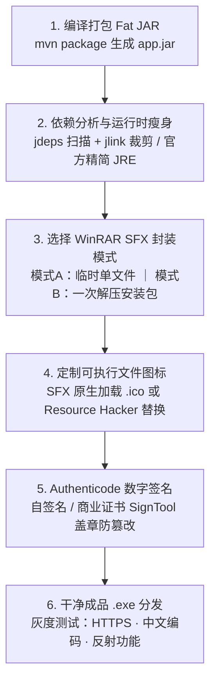
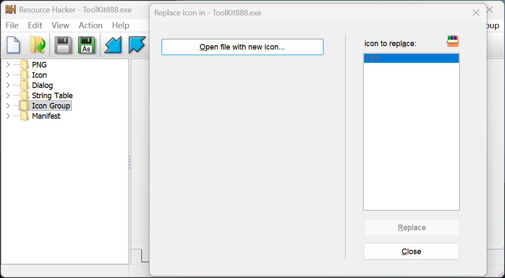

# Java 桌面应用轻量封装与分发实战

> **Java 桌面应用封装**，是指将编译后的可执行 `.jar`、第三方依赖与精简后的专属 Java 运行环境（JRE）打包为独立可执行文件（`.exe` / `.msi`），让终端用户在**无需预装 JDK、无需配置环境变量**的前提下双击即用的工程流程。  
> 简单来说，传统 Java 程序离开配置好的本地环境就寸步难行；**通过 `jlink` 按需裁剪运行时，再配合 WinRAR SFX 自解压或 Inno Setup 封装，就能把动辄 300 MB 的运行环境压缩成二三十兆的精致桌面程序，实现真正的“开箱即用”。**

如果把交付软件比作开一家移动咖啡摊：让用户自己先去下载安装 JDK 并配置 `PATH`，相当于把咖啡豆寄给顾客，让他自己买磨豆机和咖啡机；**而轻量封装，则是直接递上一杯封装好的即饮咖啡——撕开封口（首次解压），立刻就能喝（双击秒开）。**

---

## 一、举个生活中的例子

假设你用 Java 21 + Swing 开发了一款内部办公效率套件 **ToolKit**，准备发给几十位完全不懂编程的同事或外部用户使用。

直接发 `.jar` 与做好轻量封装的交付体验天差地别：

- **裸发 `ToolKit.jar`**：用户双击要么用压缩软件打开，要么弹出“找不到 Java 运行环境”；你不得不远程帮每个人在电脑上装 JDK、配 `JAVA_HOME`，光是环境排查就能消耗掉一整天。
- **使用 `jlink` + WinRAR SFX 轻量封装**：把裁剪后的最小 JRE 与 `app.jar` 压进一个 25~35 MB 的独立 `.exe` 文件。用户拿到后无需配置任何环境，直接双击就能完成部署并启动图形界面；而且不需要像 `jpackage` 那样额外折腾 WiX Toolset 工具链，版本高频迭代时打包只需几秒钟。

> **关于 Windows SmartScreen 的客观真相**  
> 不少教程声称“用 WinRAR 自解压可以绕过 Windows 11 SmartScreen 拦截”，这是**常见误区**。在没有商业代码签名证书（OV/EV）或足够下载信誉积累的情况下，**无论是 `jpackage` 还是 WinRAR SFX 生成的未签名 `.exe`，首次从网络下载运行时都可能触发 SmartScreen 提示**；甚至带“静默释放到 `%TEMP%` 并拉起子进程”行为的 SFX 包，还更容易触发杀毒软件的启发式警报。  
> 选择 WinRAR SFX 的真正理由是：**零工具链门槛、极高压缩率、单文件极简分发与极速迭代**；若面向海量公网用户正式发布，最终仍建议采用 Inno Setup / `jpackage` 并配合可信签名。

---

## 二、全景视角：从 JAR 到可分发 `.exe` 的完整流水线

一套零踩坑的 Java 桌面应用封装流水线，严格遵循 **静态依赖扫描 → 运行时裁剪 → 双模式封包 → 图标替换 → 数字签名** 五个顺序阶段（注意第 4 步与第 5 步**顺序绝不能颠倒**）：



---

## 三、运行时瘦身：`jlink` 隐式依赖暗坑与安全替代方案

Java 9 引入模块化系统（JPMS）后，使用 `jdeps` + `jlink` 构建定制版最小 JRE 是压缩体积的标准手段。但在真实业务项目里，盲目照抄 `jdeps` 输出结果几乎必踩以下两类坑。

### 1. 静态分析看不见的反射加载（Reflection）

`jdeps` 本质上是静态字节码扫描器。当业务代码或第三方库通过反射动态加载类时：

```java
Class.forName("com.mysql.cj.jdbc.Driver");
```

静态扫描器只会把引号里的内容当成普通字符串常量，根本不知道它依赖 JDBC 相关模块，从而把 `java.sql` 或 `java.naming` 误裁掉，导致程序在本地 IDE 跑得好好的，打包后运行到查库那一步直接抛出 `ClassNotFoundException` 或 `NoClassDefFoundError`。

### 2. JDK 底层隐式服务模块（四大高频暗坑）

还有一类模块在代码里根本不会出现显式 `import`，而是由 JVM 底层通过 SPI（Service Provider Interface）动态拉起，极易被 `jdeps` 遗漏：

| 隐式模块名 | 核心职责 | 漏裁后的典型崩溃症状 |
| :--- | :--- | :--- |
| **`jdk.crypto.ec`** | 椭圆曲线密码学算法（ECC） | 访问几乎所有现代 HTTPS 接口时 SSL/TLS 握手失败，报错 `SSLHandshakeException` |
| **`jdk.charsets`** | 扩展字符集（GBK、GB18030、Shift_JIS 等） | 读取中文 CSV/TXT 或老旧系统接口时报错 `UnsupportedCharsetException: GBK` |
| **`jdk.localedata`** | 国际化与多区域本地化数据 | 解析非美式日期格式、货币或本地化时间时出现乱码或 `DateTimeParseException` |
| **`jdk.unsupported`** | 底层非标准 API（`sun.misc.Unsafe`） | 使用 Netty、Kryo、部分反射/序列化加速库时启动直接崩溃 |

### 3. 可直接抄作业的生产级 `jlink` 裁剪命令

针对典型的 Swing / JavaFX + HTTPS + 中文文件处理桌面应用，推荐先用 `jdeps --print-module-deps --ignore-missing-deps app.jar` 扫描出基础模块，再手动补全隐式模块后执行裁剪：

```bash
jlink \
  --add-modules java.desktop,java.logging,java.net.http,java.sql,java.naming,jdk.crypto.ec,jdk.charsets,jdk.localedata,jdk.unsupported \
  --strip-debug \
  --no-man-pages \
  --no-header-files \
  --compress=zip-6 \
  --output runtime
```

- `--strip-debug`：剥离字节码调试符号，通常可再省 15%~20% 体积；
- `--compress=zip-6`：JDK 21+ 推荐的模块压缩参数（老版本 JDK 11/17 使用 `--compress=2`）；
- 裁剪完成后，原本 300+ MB 的完整 JDK 通常会骤降至 **45~65 MB**（经过 WinRAR 压缩后仅约 **18~26 MB**）。

### 4. 不想折腾 `jlink` 时的稳妥替代方案

如果项目引入了大量反射框架、不想逐一排查模块依赖，**首选做法**是直接前往 Eclipse Temurin（Adoptium）或 Azul Zulu 官网，下载对应版本的官方预构建 **JRE** 压缩包（天然不含编译器与源码，解压仅 ~110 MB）。

如果手头只有完整 JDK 目录需要手动精简，请按以下清单**精准去肥、切勿误删**：

| 目标目录 / 文件 | 建议操作 | 真实原因与避坑说明 |
| :--- | :--- | :--- |
| **`jmods/`** | ✅ 安全删除（省 ~80–120 MB） | 仅用于 `jlink` 拼装定制运行时，正常跑程序完全用不到 |
| **`lib/src.zip`** | ✅ 安全删除（省 ~50 MB） | JDK 完整标准库源码压缩包，仅给 IDE 看源码提示用，是常被遗漏的“最大肥肉” |
| **`include/`** | ✅ 安全删除（省 ~1 MB） | C/C++ JNI 头文件，仅编译本地动态库时需要 |
| **`bin/` 下编译调试工具** | ⚠️ 可按需删除 | `javac.exe`、`javadoc.exe`、`jdb.exe`、`jconsole.exe` 等开发工具可删；**务必保留 `java.exe`、`javaw.exe` 及所有 `.dll`** |
| **`legal/` 与 `release`** | ❌ **建议保留** | `legal/` 仅几百 KB，但 OpenJDK（GPLv2+CE）分发许可要求保留版权声明；`release` 仅 1 KB，部分框架与诊断工具会读取其中的版本号 |

---

## 四、WinRAR SFX 工程化封包：绿色启动器 vs 轻量安装包

原生的 WinRAR 自解压配置里藏着一个**极易踩中的互斥陷阱**：很多教程一边让你填写“解压路径 `%TEMP%\ToolKit`”，一边又让你勾选“解压到临时文件夹（`TempMode`）”。  
实际上，**只要勾选了 `TempMode`，WinRAR 就会强行在系统临时目录新建随机子目录并直接忽略你填写的固定路径**，而且每次双击都要重新全量解压几十兆 JRE，如果同时勾选“全部隐藏”，用户双击后电脑会“毫无反应” 3~5 秒，极易以为没点开而疯狂连点！

正确的工程实践，应当根据分发需求明确二选一：

### 模式 A：绿色无痕单文件启动器（适合极速体验 / 临时排查工具）

特点：用户拿到即用，不留桌面快捷方式，关闭进程后自动清理临时目录；缺点是**每次启动都要等待几秒解压**。

- **常规 → 解压路径**：留空（不填）
- **模式 → 临时模式**：✅ 勾选 `解压到临时文件夹`
- **模式 → 静默模式**：推荐选 **`隐藏启动对话框`（`Silent=2`）**——保留一条极简进度条告诉用户“正在启动”，防止假死误连点（若非常轻巧 $< 10$ MB 再选 `全部隐藏`）
- **设置 → 解压后运行**：`runtime\bin\javaw.exe -jar app.jar`

### 模式 B：一次解压轻量单机安装包（**强烈推荐，办公套件最佳实践**）

特点：**本质上把 WinRAR 变成一个轻量级单机安装器**。仅在首次安装或覆盖升级时解压一次到固定目录（如 `%LOCALAPPDATA%\ToolKit`），并自动在桌面生成带专属图标的快捷方式。此后每次点击桌面图标都是**真正的零解压秒开**！

> **桌面快捷方式零黑框技巧**  
> WinRAR SFX 的 `Shortcut` 指令不能直接给 `.exe` 传递 `-jar app.jar` 命令行参数；若用 `.bat` 启动又会闪出一个难看的黑色命令行窗口。最优雅的零依赖方案，是在打包根目录放一个仅 **1 行代码**的 `launch.vbs`，再让桌面快捷方式指向它并绑定你的 `.ico` 图标：

```vbscript
CreateObject("WScript.Shell").Run """runtime\bin\javaw.exe"" -jar ""app.jar""", 0, False
```

对应的 WinRAR SFX 自动化配置脚本（保存为 `sfx_config.txt`，既可直接粘贴进 GUI「注释」栏，也可供命令行自动化调用）：

```ini
; 安装到当前用户目录，全程无需管理员 UAC 弹窗
Path=%LOCALAPPDATA%\ToolKit
SavePath
Overwrite=1
Silent=2
Title=ToolKit 正在安装...
; 首次解压完成后立刻无黑框启动
Setup=wscript.exe launch.vbs
; 在桌面 (D) 自动创建带专属图标的快捷方式
Shortcut=D, launch.vbs, , "启动 ToolKit 桌面套件", "ToolKit", app.ico
```

配合命令行一条指令即可完成自动化构建（告别每次手动勾选点错）：

```bash
"C:\Program Files\WinRAR\WinRAR.exe" a -sfx -ep1 -r -m5 -md64m -iicon"app.ico" -z"sfx_config.txt" "dist\ToolKit.exe" "build_dir\*"
```

---

## 五、交互实验室：Java 桌面打包配置生成器

为了彻底消灭模块漏裁与 SFX 参数配错，你可以直接在下方交互面板中输入应用名称、勾选你的业务能力，并切换封装模式——下方将实时为你生成可一键复制的 **`jlink` 裁剪命令**、**WinRAR SFX 配置脚本** 与 **自动化自签名 PowerShell 脚本**：

<style>
.tk-jpack {
  --jp-bg: rgba(24, 24, 27, 0.72);
  --jp-panel: rgba(39, 39, 42, 0.55);
  --jp-sub: #0d0d10;
  --jp-border: rgba(255, 255, 255, 0.1);
  --jp-accent: #10b981;
  --jp-blue: #38bdf8;
  --jp-amber: #f59e0b;
  --jp-purple: #a78bfa;
  --jp-text: #f4f4f5;
  --jp-muted: #a1a1aa;
  box-sizing: border-box;
  margin: 20px 0 24px;
  padding: 18px;
  border: 1px solid var(--jp-border);
  border-radius: 16px;
  background: var(--jp-bg);
  color: var(--jp-text);
  font-family: 'Inter', -apple-system, BlinkMacSystemFont, "PingFang SC", "Microsoft YaHei", sans-serif;
  box-shadow: 0 12px 32px rgba(0, 0, 0, 0.35);
}
body.theme-light .tk-jpack {
  --jp-bg: rgba(255, 250, 253, 0.85);
  --jp-panel: rgba(243, 232, 255, 0.52);
  --jp-sub: rgba(255, 255, 255, 0.92);
  --jp-border: rgba(236, 72, 153, 0.22);
  --jp-accent: #ec4899;
  --jp-blue: #0284c7;
  --jp-amber: #d97706;
  --jp-purple: #7c3aed;
  --jp-text: #2e1065;
  --jp-muted: #6d597a;
  box-shadow: 0 12px 32px rgba(167, 139, 250, 0.16);
}
.tk-jpack, .tk-jpack *, .tk-jpack *::before, .tk-jpack *::after { box-sizing: border-box; }
.tk-jp-head {
  display: flex;
  flex-wrap: wrap;
  justify-content: space-between;
  align-items: center;
  gap: 8px;
  padding-bottom: 12px;
  margin-bottom: 14px;
  border-bottom: 1px solid var(--jp-border);
}
.tk-jp-title {
  font-size: 15px;
  font-weight: 700;
  color: var(--jp-text);
  display: flex;
  align-items: center;
  gap: 8px;
}
.tk-jp-dot {
  width: 8px;
  height: 8px;
  border-radius: 50%;
  background: var(--jp-accent);
  box-shadow: 0 0 10px var(--jp-accent);
}
.tk-jp-legend { font-size: 12px; color: var(--jp-muted); }
.tk-jp-presets {
  display: flex;
  flex-wrap: wrap;
  gap: 7px;
  margin-bottom: 12px;
}
.tk-jp-btn {
  appearance: none;
  border: 1px solid var(--jp-border);
  background: var(--jp-panel);
  color: var(--jp-text);
  padding: 6px 11px;
  border-radius: 9px;
  font-size: 12px;
  font-weight: 600;
  cursor: pointer;
  transition: all 0.16s ease;
  font-family: inherit;
}
.tk-jp-btn:hover {
  border-color: var(--jp-accent);
  color: var(--jp-accent);
  transform: translateY(-1px);
}
.tk-jp-btn.is-copy {
  padding: 3px 9px;
  font-size: 11.5px;
}
.tk-jp-form {
  display: grid;
  grid-template-columns: repeat(4, minmax(0, 1fr));
  gap: 8px;
  margin-bottom: 12px;
}
.tk-jp-field {
  display: flex;
  flex-direction: column;
  gap: 4px;
}
.tk-jp-label {
  font-size: 11px;
  font-weight: 600;
  color: var(--jp-muted);
}
.tk-jp-input, .tk-jp-select {
  width: 100%;
  padding: 7px 10px;
  border-radius: 9px;
  border: 1px solid var(--jp-border);
  background: var(--jp-sub);
  color: var(--jp-text);
  font-family: 'JetBrains Mono', Consolas, monospace;
  font-size: 12.5px;
  outline: none;
}
.tk-jp-input:focus, .tk-jp-select:focus { border-color: var(--jp-accent); }
.tk-jp-mods {
  background: var(--jp-panel);
  border: 1px solid var(--jp-border);
  border-radius: 12px;
  padding: 11px 12px;
  margin-bottom: 12px;
}
.tk-jp-mtitle {
  font-size: 12px;
  font-weight: 600;
  color: var(--jp-muted);
  margin-bottom: 8px;
  display: flex;
  flex-wrap: wrap;
  justify-content: space-between;
  gap: 6px;
}
.tk-jp-mgrid {
  display: grid;
  grid-template-columns: repeat(3, minmax(0, 1fr));
  gap: 7px 10px;
  font-size: 12px;
}
.tk-jp-mgrid label {
  display: inline-flex;
  align-items: center;
  gap: 6px;
  cursor: pointer;
  user-select: none;
  color: var(--jp-text);
}
.tk-jp-stats {
  display: grid;
  grid-template-columns: repeat(4, minmax(0, 1fr));
  gap: 8px;
  margin-bottom: 12px;
}
.tk-jp-stat {
  background: var(--jp-panel);
  border: 1px solid var(--jp-border);
  border-radius: 10px;
  padding: 9px 10px;
}
.tk-jp-stat-k { font-size: 11px; color: var(--jp-muted); margin-bottom: 3px; }
.tk-jp-stat-v {
  font-family: 'JetBrains Mono', Consolas, monospace;
  font-size: 14px;
  font-weight: 700;
  color: var(--jp-accent);
}
.tk-jp-stat-v.is-blue { color: var(--jp-blue); }
.tk-jp-stat-v.is-amber { color: var(--jp-amber); }
.tk-jp-tabs {
  display: flex;
  flex-wrap: wrap;
  gap: 7px;
  margin-bottom: 8px;
}
.tk-jp-tab {
  appearance: none;
  border: 1px solid var(--jp-border);
  background: var(--jp-panel);
  color: var(--jp-muted);
  padding: 6px 12px;
  border-radius: 9px;
  font-size: 12px;
  font-weight: 600;
  cursor: pointer;
  transition: all 0.16s ease;
  font-family: inherit;
}
.tk-jp-tab.is-active {
  background: var(--jp-accent);
  border-color: var(--jp-accent);
  color: #ffffff;
}
.tk-jp-outpanel {
  background: var(--jp-panel);
  border: 1px solid var(--jp-border);
  border-radius: 12px;
  padding: 12px;
}
.tk-jp-outhead {
  display: flex;
  flex-wrap: wrap;
  justify-content: space-between;
  align-items: center;
  gap: 6px;
  margin-bottom: 8px;
  font-size: 12px;
  font-weight: 600;
  color: var(--jp-muted);
}
.tk-jp-code {
  margin: 0;
  padding: 11px 12px;
  background: var(--jp-sub);
  border: 1px solid var(--jp-border);
  border-radius: 9px;
  font-family: 'JetBrains Mono', Consolas, monospace;
  font-size: 12px;
  line-height: 1.65;
  color: var(--jp-text);
  white-space: pre-wrap;
  word-break: break-all;
  overflow-x: auto;
}
@media (max-width: 820px) {
  .tk-jpack { padding: 14px; }
  .tk-jp-form { grid-template-columns: repeat(2, minmax(0, 1fr)); }
  .tk-jp-mgrid { grid-template-columns: repeat(2, minmax(0, 1fr)); }
  .tk-jp-stats { grid-template-columns: repeat(2, minmax(0, 1fr)); }
}
@media (max-width: 520px) {
  .tk-jp-form, .tk-jp-mgrid { grid-template-columns: 1fr; }
}
</style>

<section id="tk-jpack-lab" class="tk-jpack" aria-label="Java 桌面打包配置生成器">
  <div class="tk-jp-head">
    <div class="tk-jp-title"><span class="tk-jp-dot"></span><span>Java 桌面应用打包脚本生成器（jlink + WinRAR SFX + SignTool）</span></div>
    <span class="tk-jp-legend">勾选业务能力自动补齐隐式 JDK 模块，规避 TempMode 与签名顺序陷阱</span>
  </div>
  <div class="tk-jp-presets">
    <button type="button" class="tk-jp-btn" id="tk-jp-p0">预设 1：轻量办公套件（推荐安装模式）</button>
    <button type="button" class="tk-jp-btn" id="tk-jp-p1">预设 2：极简绿色单文件工具</button>
    <button type="button" class="tk-jp-btn" id="tk-jp-p2">预设 3：全能联网+数据库客户端</button>
  </div>
  <div class="tk-jp-form">
    <div class="tk-jp-field">
      <span class="tk-jp-label">应用名称 (App Name)</span>
      <input id="tk-jp-app" class="tk-jp-input" type="text" value="ToolKit" aria-label="应用名称">
    </div>
    <div class="tk-jp-field">
      <span class="tk-jp-label">主包文件名 (JAR)</span>
      <input id="tk-jp-jar" class="tk-jp-input" type="text" value="app.jar" aria-label="JAR 文件名">
    </div>
    <div class="tk-jp-field">
      <span class="tk-jp-label">封装运行模式</span>
      <select id="tk-jp-mode" class="tk-jp-select" aria-label="WinRAR 封装模式">
        <option value="installer" selected>模式 B：一次解压安装包（秒开+快捷方式）</option>
        <option value="portable">模式 A：临时单文件绿色启动器</option>
      </select>
    </div>
    <div class="tk-jp-field">
      <span class="tk-jp-label">签名主体名称 (CN)</span>
      <input id="tk-jp-cn" class="tk-jp-input" type="text" value="TuKuai Studio" aria-label="证书主体">
    </div>
  </div>
  <div class="tk-jp-mods">
    <div class="tk-jp-mtitle">
      <span>勾选应用涉及的功能场景（自动注入对应隐式模块）</span>
      <span id="tk-jp-modcnt" style="color:var(--jp-blue)">已选 6 个模块</span>
    </div>
    <div class="tk-jp-mgrid">
      <label><input type="checkbox" class="tk-jp-chk" data-mods="java.desktop" data-mb="16" checked> Swing / AWT 图形界面</label>
      <label><input type="checkbox" class="tk-jp-chk" data-mods="java.net.http,jdk.crypto.ec" data-mb="4" checked> HTTPS 网络请求 / API</label>
      <label><input type="checkbox" class="tk-jp-chk" data-mods="jdk.charsets" data-mb="3" checked> 中文 GBK / 扩展字符集</label>
      <label><input type="checkbox" class="tk-jp-chk" data-mods="jdk.localedata" data-mb="6"> 跨时区 / 国际化日期</label>
      <label><input type="checkbox" class="tk-jp-chk" data-mods="jdk.unsupported" data-mb="1" checked> Netty / Unsafe 高性能库</label>
      <label><input type="checkbox" class="tk-jp-chk" data-mods="java.sql,java.naming,java.instrument" data-mb="4"> JDBC 数据库与反射代理</label>
    </div>
  </div>
  <div class="tk-jp-stats">
    <div class="tk-jp-stat"><div class="tk-jp-stat-k">估算裁剪后 JRE 体积</div><div class="tk-jp-stat-v is-blue" id="tk-jp-jremb">~49 MB</div></div>
    <div class="tk-jp-stat"><div class="tk-jp-stat-k">估算最终 SFX .exe 体积</div><div class="tk-jp-stat-v" id="tk-jp-exemb">~22 MB</div></div>
    <div class="tk-jp-stat"><div class="tk-jp-stat-k">二次启动体验</div><div class="tk-jp-stat-v" id="tk-jp-boot">桌面图标秒开</div></div>
    <div class="tk-jp-stat"><div class="tk-jp-stat-k">图标与签名顺序</div><div class="tk-jp-stat-v is-amber">先改图标 → 后签名</div></div>
  </div>
  <div class="tk-jp-tabs">
    <button type="button" class="tk-jp-tab is-active" data-tab="jlink">1. jlink 裁剪命令</button>
    <button type="button" class="tk-jp-tab" data-tab="sfx">2. WinRAR SFX 脚本 & 命令行</button>
    <button type="button" class="tk-jp-tab" data-tab="sign">3. PowerShell 自动自签名</button>
  </div>
  <div class="tk-jp-outpanel">
    <div class="tk-jp-outhead">
      <span id="tk-jp-outtitle">生产级 jlink 模块裁剪命令（JDK 21+）</span>
      <button type="button" class="tk-jp-btn is-copy" id="tk-jp-copy">复制当前脚本</button>
    </div>
    <pre class="tk-jp-code" id="tk-jp-code"></pre>
  </div>
</section>

<script>
(function () {
  var lab = document.getElementById('tk-jpack-lab');
  if (!lab || lab.dataset.ready === '1') return;
  lab.dataset.ready = '1';

  var elApp = document.getElementById('tk-jp-app');
  var elJar = document.getElementById('tk-jp-jar');
  var elMode = document.getElementById('tk-jp-mode');
  var elCn = document.getElementById('tk-jp-cn');
  var chks = Array.prototype.slice.call(lab.querySelectorAll('.tk-jp-chk'));
  var tabs = Array.prototype.slice.call(lab.querySelectorAll('.tk-jp-tab'));
  var elModCnt = document.getElementById('tk-jp-modcnt');
  var elJreMb = document.getElementById('tk-jp-jremb');
  var elExeMb = document.getElementById('tk-jp-exemb');
  var elBoot = document.getElementById('tk-jp-boot');
  var elOutTitle = document.getElementById('tk-jp-outtitle');
  var elCode = document.getElementById('tk-jp-code');
  var btnCopy = document.getElementById('tk-jp-copy');

  var activeTab = 'jlink';
  var generated = { jlink: '', sfx: '', sign: '' };

  function cleanName(str, fallback) {
    var s = (str || '').trim();
    return s || fallback;
  }

  function render() {
    var app = cleanName(elApp.value, 'ToolKit');
    var jar = cleanName(elJar.value, 'app.jar');
    var cn = cleanName(elCn.value, 'TuKuai Studio');
    var mode = elMode.value;

    var modList = ['java.base', 'java.logging'];
    var estJre = 25;
    chks.forEach(function (c) {
      if (c.checked) {
        c.getAttribute('data-mods').split(',').forEach(function (m) {
          if (modList.indexOf(m) === -1) modList.push(m);
        });
        estJre += parseInt(c.getAttribute('data-mb'), 10) || 0;
      }
    });

    var estExe = Math.round(estJre * 0.42 + 2);
    elModCnt.textContent = '已选 ' + modList.length + ' 个模块（含 java.base / java.logging）';
    elJreMb.textContent = '~' + estJre + ' MB';
    elExeMb.textContent = '~' + estExe + ' MB';
    elBoot.textContent = mode === 'installer' ? '桌面图标零解压秒开' : '每次解压 ~2-4 秒';

    generated.jlink = [
      '# 1. 生成最小精简版 JRE 目录 (runtime/)',
      'jlink ^',
      '  --add-modules ' + modList.join(',') + ' ^',
      '  --strip-debug ^',
      '  --no-man-pages ^',
      '  --no-header-files ^',
      '  --compress=zip-6 ^',
      '  --output build_dir\\runtime'
    ].join('\n');

    if (mode === 'installer') {
      generated.sfx = [
        '# 文件 A：build_dir\\launch.vbs（1 行实现零黑框启动）',
        'CreateObject("WScript.Shell").Run """runtime\\bin\\javaw.exe"" -jar """ + "' + jar + '" + """", 0, False'.replace('""" + "\'' + jar + '\'" + """', '""' + jar + '""'),
        '',
        '# 文件 B：sfx_config.txt（一次解压轻量安装包配置）',
        'Path=%LOCALAPPDATA%\\' + app,
        'SavePath',
        'Overwrite=1',
        'Silent=2',
        'Title=' + app + ' 正在安装...',
        'Setup=wscript.exe launch.vbs',
        'Shortcut=D, launch.vbs, , "启动 ' + app + '", "' + app + '", app.ico',
        '',
        '# 命令行一键编译为独立 .exe',
        '"C:\\Program Files\\WinRAR\\WinRAR.exe" a -sfx -ep1 -r -m5 -md64m -iicon"build_dir\\app.ico" -z"sfx_config.txt" "dist\\' + app + '.exe" "build_dir\\*"'
      ].join('\n');
      generated.sfx = generated.sfx.replace(
        'CreateObject("WScript.Shell").Run """runtime\\bin\\javaw.exe"" -jar """ + "' + jar + '" + """", 0, False',
        'CreateObject("WScript.Shell").Run """runtime\\bin\\javaw.exe"" -jar ""' + jar + '""", 0, False'
      );
    } else {
      generated.sfx = [
        '# 文件：sfx_config.txt（绿色临时单文件模式，切勿再填固定 Path！）',
        'TempMode',
        'Silent=2',
        'Overwrite=1',
        'Setup=runtime\\bin\\javaw.exe -jar ' + jar,
        '',
        '# 命令行一键编译为独立 .exe',
        '"C:\\Program Files\\WinRAR\\WinRAR.exe" a -sfx -ep1 -r -m5 -md64m -iicon"build_dir\\app.ico" -z"sfx_config.txt" "dist\\' + app + '_Portable.exe" "build_dir\\*"'
      ].join('\n');
    }

    var exePath = mode === 'installer' ? ('.\\dist\\' + app + '.exe') : ('.\\dist\\' + app + '_Portable.exe');
    generated.sign = [
      '# 1. 生成自签名代码签名证书（若已生成过可跳过此步）',
      '$cert = New-SelfSignedCertificate -Subject "CN=' + cn + '" `',
      '  -Type CodeSigningCert -CertStoreLocation "Cert:\\CurrentUser\\My"',
      '',
      '# 2. 自动查找本机最新 Windows SDK 的 signtool.exe（无需硬编码路径）',
      '$signtool = Get-ChildItem "C:\\Program Files (x86)\\Windows Kits\\10\\bin\\*\\x64\\signtool.exe" |',
      '  Sort-Object FullName -Descending | Select-Object -First 1 -ExpandProperty FullName',
      '',
      '# 3. 务必在图标替换全部完成后执行最终签名 + RFC3161 时间戳',
      '& $signtool sign /sha1$cert.Thumbprint /fd SHA256 `',
      '  /tr http://timestamp.digicert.com /td SHA256 "' + exePath + '"'
    ].join('\n');

    var titles = {
      jlink: '生产级 jlink 模块裁剪命令（Windows CMD / PowerShell）',
      sfx: mode === 'installer' ? '模式 B：一次解压轻量安装包脚本（零黑框 + 桌面快捷方式）' : '模式 A：绿色单文件临时启动器脚本（TempMode）',
      sign: 'PowerShell 自动定位 SignTool 与自签名脚本'
    };
    elOutTitle.textContent = titles[activeTab];
    elCode.textContent = generated[activeTab];
  }

  tabs.forEach(function (t) {
    t.addEventListener('click', function () {
      activeTab = t.getAttribute('data-tab');
      tabs.forEach(function (x) { x.classList.toggle('is-active', x === t); });
      render();
    });
  });

  btnCopy.addEventListener('click', function () {
    var txt = generated[activeTab];
    if (navigator.clipboard && navigator.clipboard.writeText) {
      navigator.clipboard.writeText(txt).then(function () {
        btnCopy.textContent = '已复制 ✓';
        setTimeout(function () { btnCopy.textContent = '复制当前脚本'; }, 1400);
      });
    } else {
      btnCopy.textContent = '请手动全选复制';
      setTimeout(function () { btnCopy.textContent = '复制当前脚本'; }, 1400);
    }
  });

  function applyPreset(idx) {
    var flags = [
      [true, true, true, false, true, false],
      [true, true, false, false, false, false],
      [true, true, true, true, true, true]
    ][idx];
    chks.forEach(function (c, i) { c.checked = flags[i]; });
    elMode.value = idx === 1 ? 'portable' : 'installer';
    render();
  }

  document.getElementById('tk-jp-p0').addEventListener('click', function () { applyPreset(0); });
  document.getElementById('tk-jp-p1').addEventListener('click', function () { applyPreset(1); });
  document.getElementById('tk-jp-p2').addEventListener('click', function () { applyPreset(2); });
  [elApp, elJar, elCn].forEach(function (el) { el.addEventListener('input', render); });
  elMode.addEventListener('change', render);
  chks.forEach(function (c) { c.addEventListener('change', render); });

  render();
})();
</script>

---

## 六、图标定制与自签名盖章（千万别弄反先后顺序）

> **铁律：必须先替换完图标，最后再执行数字签名！**  
> Windows Authenticode 数字签名会对整个 `.exe` 的 PE 结构与资源段计算 SHA-256 摘要。如果你签完名再去改图标，文件哈希立刻变化，数字签名会瞬间显示为“**此数字签名无效**”。

### 1. 用 Resource Hacker 补救自定义图标

如果遇到 WinRAR 加载 `.ico` 报错（常见原因是 `.ico` 文件本质上是改了后缀的 PNG、缺少多尺寸图层，或杀毒软件短暂锁住了 SFX 模块），可以使用免费轻量工具 [Resource Hacker](https://www.angusj.com/resourcehacker/) 直接替换编译好的 `.exe` 图标：

1. 用 Resource Hacker 打开生成的 `.exe` 文件。
2. 展开左侧目录树 **`Icon Group` → 右键目标图标组 → `Replace Icon...`**。
3. 选中标准多尺寸 `.ico`（推荐包含 16/32/48/256px 图层），保存覆盖即可。



### 2. 用 PowerShell 为成品盖上专属自签名

商业 OV/EV 代码签名证书动辄每年数千元，个人开发者或内部团队可以用 PowerShell 给软件签发一张**自签名证书**——不仅右键「属性 → 数字签名」里能展示你的专属品牌名，还能配合团队内网信任证书实现防篡改校验。

**第一步：生成个人代码签名证书（首次执行一次即可）**

```powershell
$cert = New-SelfSignedCertificate `
  -Subject "CN=TuKuai Studio" `
  -Type CodeSigningCert `
  -CertStoreLocation "Cert:\CurrentUser\My"
```

**第二步：自动定位 Windows SDK 中的 `signtool.exe` 并加盖 SHA-256 签名与时间戳**

```powershell
# 自动匹配本机已安装的最新版 Windows SDK 下的 x64 signtool.exe
$signtool = Get-ChildItem "C:\Program Files (x86)\Windows Kits\10\bin\*\x64\signtool.exe" |
  Sort-Object FullName -Descending | Select-Object -First 1 -ExpandProperty FullName

# 对成品执行签名并附带公开 RFC3161 时间戳（证书过期后旧版签名依然可验证）
& $signtool sign /sha1$cert.Thumbprint /fd SHA256 `
  /tr [http://timestamp.digicert.com](http://timestamp.digicert.com) /td SHA256 ".\dist\ToolKit.exe"
```

> **自签名证书的边界说明**  
> 自签名证书在**局域网内部团队分发**中非常实用（只需导出 `.cer` 公钥导入同事电脑的“受信任的根证书颁发机构”，即可彻底消除未知发布者警告并验证文件未被中途篡改）；但对于**公网陌生用户**，由于证书并非由微软信任的商业 CA 签发，它只能展示你的署名和防篡改信息，无法直接消除公网 SmartScreen 提示。

---

## 七、方案选型对比：不同阶段该用哪一套打包工具？

没有银弹，选对封装方案取决于你的受众规模与迭代频率：

| 封装方案 | 成品形态与体积 | 启动速度 | 工程门槛与核心优缺点 | 最适合的使用阶段 |
| :--- | :--- | :--- | :--- | :--- |
| **WinRAR SFX（模式 A：临时单文件）** | 单个 `.exe`（~20–30 MB） | 慢（每次解压 2–5 秒） | 门槛最低、完全绿色无残留；但易触发静默释放误报、启动慢 | 个人临时小工具、一次性演示 Demo |
| **WinRAR SFX（模式 B：轻量安装包）** | 单个 `.exe`（~20–30 MB） | **极快（首次解压后秒开）** | 无需学安装脚本语法，支持无 UAC 静默安装与桌面快捷方式；缺点是缺少控制面板标准卸载项 | **团队内部办公套件、个人高频迭代的实用软件** |
| **`jlink` + Inno Setup** | 标准安装向导 `.exe`（~22–32 MB） | **极快** | 压缩率媲美 7z，原生自带标准卸载程序、开始菜单、开机自启与版本覆盖升级，对杀软友好 | **面向公网正式发布的独立桌面软件主力方案** |
| **`jpackage`（JDK 内置）** | 原生 `.msi` / `.exe`（~35–50 MB） | **极快** | 官方标准方案，原生生成 `.exe` 启动器无需 `.vbs`；但需依赖 WiX Toolset，定制 UI 相对繁琐 | 企业级规范化交付、CI/CD 跨平台（Win/macOS/Linux）自动构建 |
| **GraalVM Native Image** | 无 JVM 原生机器码（~15–40 MB） | **毫秒级瞬开** | 彻底脱离 JRE，内存占用极低；但对 Swing 图形界面、动态反射配置门槛极高 | 命令行 CLI 工具、轻量后台常驻服务 |

---

## 八、总结

把一款 Java 桌面软件优雅地送到用户手里，从来不只是打出一个 `.jar` 那么简单，而是一场在**体积、启动体验、兼容性与打包成本**之间寻找黄金平衡点的工程实践：

- **运行时层**：用 `jlink` 配合隐式模块清单（`jdk.crypto.ec` / `jdk.charsets` / `jdk.localedata` / `jdk.unsupported`）砍掉 80% 冗余体积，或直接采用官方精简 JRE 兜底；
- **封包层**：告别 `TempMode` 与固定路径混用的死坑，优先采用**一次解压到 `%LOCALAPPDATA%` + 1 行 VBS 零黑框桌面快捷方式**，把 WinRAR SFX 升级为真正秒开的轻量安装包；
- **收尾层**：严守 **“先用 Resource Hacker 换好图标，最后再由 SignTool 签名盖章”** 的顺序，让你的桌面工具从里到外都具备专业级质感。

**把环境复杂性彻底封死在打包阶段，把双击即用的轻盈留给用户，这就是 Java 桌面应用轻量封装的全部核心。**