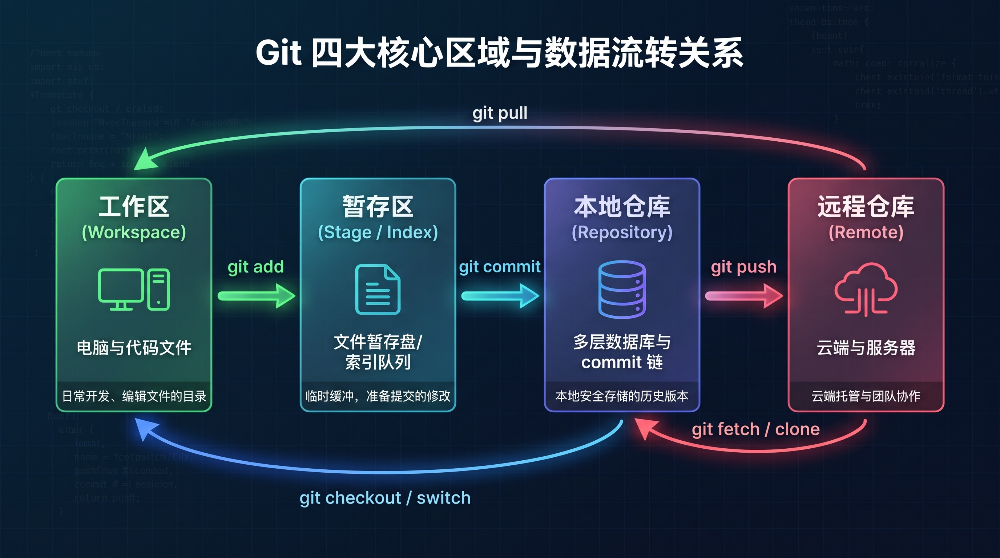

# git和github核心概念大串讲

Git 是运行在本地的分布式版本控制系统（底层本质是一个基于内容寻址的快照文件系统），而 GitHub 是基于 Git 构建的云端代码托管与协作平台——简单来说，Git 负责在本地记录“代码怎么变”，GitHub 负责在云端解决“多人怎么一起改”。

  

**一、空间模型：四大区域与数据流转**

  

Git 的日常操作本质上是让代码在四个存储区域之间流转，理解下图中的箭头就能串联起最核心的日常命令：

  

- **工作区（Workspace）**：本地磁盘上直接看到和编辑源码的普通目录。
    
      
    
- **暂存区（Stage / Index）**：位于隐藏目录 .git 下的临时缓冲索引，使用 `git add` 可将工作区的零散改动筛选放入此处，攒够一组完整逻辑后再统一打包。
    
      
    
- **版本库（Repository）**：本地的正式历史数据库，执行 `git commit` 会把暂存区的内容生成一张不可篡改的永久快照，并计算出唯一的 SHA-1 哈希值作为身份证。
    
      
    
- **远程仓库（Remote）**：托管在 GitHub 上的云端版本库，通过 `git push` 将本地历史快照推送到云端，或用 `git fetch`（只拉数据不合并）、`git pull`（拉取并直接合并到工作区）同步最新进展。
    
      
    

**二、时间模型：提交、分支与 HEAD 指针**

  

Git 高效的秘诀在于抛弃了“按文件对比差异”和“复制文件夹建分支”的传统做法，把一切都抽象为**快照节点与轻量级指针**：

  

- **提交节点（Commit）**：每次提交都会记录当前项目的文件树快照，并包含一个指向父节点（上一次提交）的指针，无数个节点由此串联成一条可回溯的单向时间链。
    
      
    
- **分支（Branch）**：本质上只是一个指向某个提交节点的轻量级文本指针（如默认主干 main），创建新分支仅仅是新建一个 41 字节的指针文件，耗时近乎为零。
    
      
    
- **当前指针（HEAD）**：指向你当前所在分支的“指针的指针”，产生新提交时，HEAD 会带着当前分支指针一起向前移动一格；使用 `git switch` 或 `git checkout` 切换分支时，HEAD 会改指目标分支，并将工作区文件瞬间还原为该分支指向的快照状态。
    
      
    

**三、多线收束：合并、变基与冲突处理**

  

当多条分支各自演进后，将代码整合回主干有两种核心路径：

  

- **合并（Merge）**：执行 `git merge` 会寻找两条分支的共同祖先，将双方改动整合成一个新的“合并提交节点”，完整保留真实的并行开发轨迹，但分支繁多时历史图谱会呈网状交织。
    
      
    
- **变基（Rebase）**：执行 `git rebase` 会把当前分支的提交逐个“摘下”，重新嫁接到目标分支的最新节点之后，从而整理出一条干净笔直的线性历史（黄金法则：只对尚未推送到远程的本地私有分支做变基）。
    
      
    
- **冲突（Conflict）**：当两条分支修改了同一文件的同一区域，Git 无法自动裁决并会暂停整合，需手动在源码中清理冲突标记、保留最终代码，再执行 `git add` 与提交完成收束。
    
      
    

**四、本地后悔药：回退、反做与现场储藏**

  

- **指针回退（Reset）**：使用 `git reset` 直接将当前分支指针倒退回指定的历史节点，可选择保留工作区改动或彻底清空，适合修正尚未推送到远程的本地失误。
    
      
    
- **反向抵消（Revert）**：使用 `git revert` 会生成一次全新的“反向提交”来抵消某次历史提交的改动，不抹除既有历史记录，适合修复已经推送到 GitHub 公共分支上的错误。
    
      
    
- **现场储藏（Stash）**：代码写了一半需紧急切换分支修 Bug 时，用 `git stash` 将未完成的改动压入临时栈中使工作区恢复干净，处理完紧急任务后再用 `git stash pop` 恢复现场。
    
      
    

**五、云端协同：GitHub 的核心生态机制**

  

当本地仓库通过远程别名（通常命名为 origin）与 GitHub 关联后，工作流便从单机记录延伸至多人工程协作：

  

- **复刻（Fork）与克隆（Clone）**：面对没有直接写入权限的开源仓库，先在 GitHub 网页端点击 Fork 复制一份独立仓库到自己名下，再通过 `git clone` 下载到本地开发。
    
      
    
- **拉取请求（Pull Request，简称 PR）**：GitHub 协作的核心枢纽——将改动推送到自己的分支或 Fork 仓库后，向原仓库发起 PR，请求维护者进行代码审查（Code Review）、讨论并合入主分支。
    
      
    
- **议题（Issues）与版本发布（Releases）**：Issues 用于汇报 Bug、讨论需求并可通过编号与 PR 自动联动关闭；Releases 则基于 Git 标签（Tag）打包特定节点的源码与编译产物，对外发布正式版本。
    
      
    
- **自动化流水线（GitHub Actions）**：内置的云端 CI/CD 引擎，可监听代码推送或 PR 事件，自动拉起云端容器执行单元测试、代码规范检查、编译打包或静态站点部署（如自动发布至 GitHub Pages）。

---

<tukuai-player url="media/videos/Git概念大串讲.mp4" title="Git概念大串讲"></tukuai-player>

[Git概念大串讲](https://www.bilibili.com/video/BV1ySLc6QEcB/?t=1170.1)
