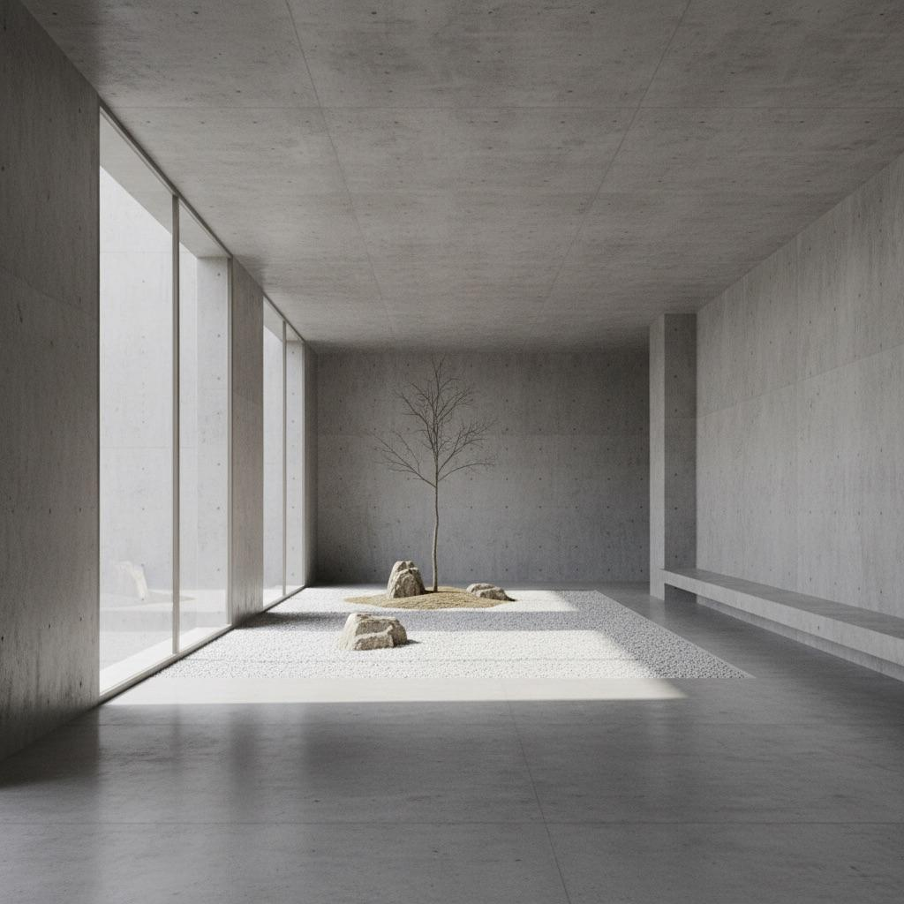
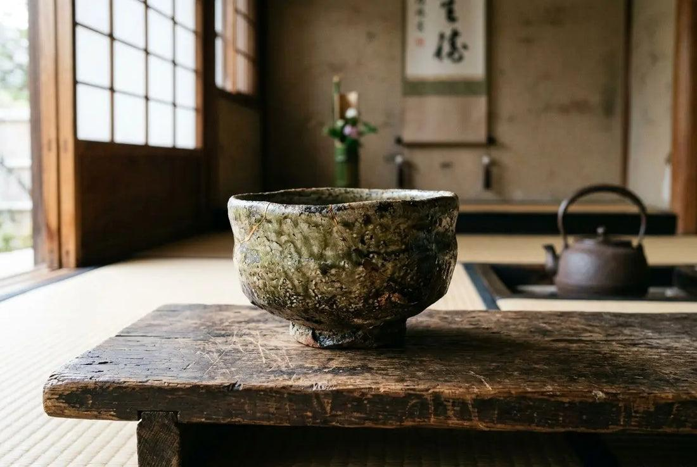

# 什么是美学（Aesthetics）？

> **美学（Aesthetics）** 是哲学的一个分支，研究**美、审美经验、艺术**，以及人类如何感知、理解和评价事物。  
> 如果说数学研究的是“什么是正确”，逻辑学研究的是“什么是合理”，那么美学追问的就是：**为什么有些事物会让我们感到美？美究竟存在于客观事物本身，还是存在于我们的主观感受之中？**

---

## 一、美学不等于“研究什么东西好看”

很多人听到“美学”，第一反应是“教人怎么配色、怎么构图、怎么把东西变漂亮”。但实际上，美的形态远比“精致好看”宽广得多。我们先看三种截然不同的审美体验：

### 1. 形式之美：比例、秩序、节奏与对称

几何结构、建筑光影与清晰的留白比例，往往能让人一眼感受到克制而高级的秩序感。这种美来源于人类大脑对规律、平衡与空间节奏的天然敏感。

### 2. 崇高之美：壮阔、敬畏与震撼

面对翻涌的风暴云海与巍峨陡峭的山峰，人感受到的并不是“可爱”或“舒适”，而是一种混杂着渺小感、敬畏感与强烈震撼的心灵冲击——这在美学上被称为**崇高（The Sublime）**。

### 3. 不完美之美：质朴、残缺与岁月痕迹

东方美学（如日式“侘寂 / Wabi-Sabi”）常常欣赏手工陶碗粗糙的釉面、不对称的边缘与木桌上留下的岁月划痕。它并不追求工整无瑕，反而从自然流逝与不完美中体会到宁静与真实。

你会发现，上面三种事物几乎没有相同的外观特征，却都能引发深刻的审美体验。因此，**美学不只是研究如何把东西做漂亮，更重要的是研究“美的产生机制”——人类为什么会被某种形式、意境或意义打动。**

---

## 二、美学的五个核心问题

千百年来，美学家围绕人的感知与评价，一直在反复探讨下面五个根本问题：

1. **美的本质**：美究竟是物体自带的客观属性（如比例、对称），还是只存在于观察者大脑中的主观感受？
2. **审美判断**：为什么同一个事物，有人觉得美得动人心魄，有人却觉得平淡甚至丑陋？
3. **形式与内容**：打动我们的究竟是外在的线条、色彩与结构（形式），还是作品背后传递的思想与情感（内容）？
4. **艺术的价值**：艺术一定要“美”吗？一幅令人不安、压抑甚至刺痛人心的作品，是否依然可以成为伟大的艺术？
5. **审美与文化**：为什么不同时代、不同地域与不同社会环境下的审美标准会发生剧烈变迁？

---

## 三、历史上最重要的几种美学思想

从古希腊到德国古典哲学，思想家们对“美是什么”给出了各自极具启发性的回答：

| 思想家 | 核心观点 | 关键理解 |
| :--- | :--- | :--- |
| **柏拉图** | 感官世界中的美，与更高层次的“美的理念”有关 | 具体事物只是倒影，背后存在永恒抽象的“美本身” |
| **亚里士多德** | 秩序、比例与整体结构是理解美的重要线索 | 把美从神秘理念拉回现实结构，强调各部分协调统一 |
| **大卫·休谟** | 审美关乎主观感受，但审美判断力可以通过经验培养 | 虽然各花入各眼，但阅历与训练能建立更高层次的共识 |
| **康德** | 审美判断是“无利害感的愉悦”，并要求他人的普遍认同 | 不为实用占有而喜欢，纯粹沉浸在对象本身带来的自由感中 |
| **黑格尔** | 艺术是“精神与理念的感性呈现” | 伟大的艺术是用可见、可听的感性形式，承载人类精神世界 |

> **康德提出过一个尤其深刻的问题**：  
> 当你吃一颗草莓时，你会说“我喜欢它”；但当你面对一片壮丽的日落或一首动人的乐曲时，为什么你不只是说“我喜欢”，还会下意识地觉得**“其他人也应该能感受到它的美”**？  
> 正是这种“既主观又渴望普遍共鸣”的奇特体验，把美学从简单的个人喜好，推进到了严谨的哲学层面。

---

## 四、美学如何应用到现代设计？

理解了美学原理，再回头看现代 UI 与图形设计，很多争论就会豁然开朗。假设你正在设计一款软件的图标，摆在面前的往往有两条截然不同的路线：

### 1. 极简主义：用克制与留白建立秩序

大幅精简多余元素，仅靠干净的几何形状、清晰的轮廓与恰到好处的负空间（留白）完成识别，让图标在极小尺寸下依然锐利、耐看。

### 2. 繁复主义：用丰富细节制造视觉冲击

通过高密度的形态交织、丰富的色彩过渡、光影浮雕与装饰纹理堆叠出饱满的视觉张力，在第一时间抓住观者的注意力并传达奇幻或华丽的气质。

**两种极端风格都能诞生杰出的设计。** 真正决定成败的，从来不是“元素越多越好”或“越少越好”，而是**设计语言是否统一、情绪表达是否准确、用户能否一眼读懂**。

在专业设计实践中，一件成熟的作品通常需要同时照顾到以下**三个递进层次**：

| 设计层次 | 关注要素 | 在作品中扮演的角色 |
| :--- | :--- | :--- |
| **视觉层** | 形状、色彩、比例、明暗对比度 | **第一眼抓人**：决定画面是否清晰、耐看、好识别 |
| **感知层** | 平衡感、节奏感、协调度、视觉张力 | **体感是否舒服**：决定整体看着是稳重舒展还是局促别扭 |
| **意义层** | 象征隐喻、情绪氛围、文化背景、品牌个性 | **打动人心之处**：让图形真正拥有灵魂与辨识度 |

---

## 五、美学与“黄金比例”是什么关系？

前面刚了解过的**黄金比例（1 : 1.618）**，其实正是整个美学大框架中**“形式组织方法”**的一个典型代表。

但两者在层级与边界上有着明确的区别：

- **黄金比例**研究的是特定的数学比例关系，告诉你“按约 61.8% 与 38.2% 切分往往能产生稳定的视觉节奏”；
- **美学**的视野则广阔得多——它不仅研究**“为什么人会偏好某些秩序与比例”**，更会追问**“为什么有时候故意打破比例，反而能诞生更高级的艺术张力”**。

举个最简单的例子：一个绝对对称、严丝合缝的界面会给人端庄稳定之感，但也可能流于呆板；而刻意制造一点不对称的留白与重心偏移，虽然带来轻微的视觉紧张感，却往往让画面瞬间变得灵动而有呼吸感。

**这正是美学的迷人之处：它既研究秩序如何建立美，也研究为什么打破秩序，有时同样能够成就美。**
