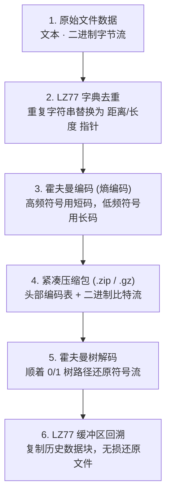

# 数据解压与霍夫曼编码原理解析

> **解压（Decompression）** 是将经过压缩编码的紧凑比特流（Bit Stream）逆向还原为原始字节序列或文件结构的过程；而 **霍夫曼编码（Huffman Coding）** 则是无损压缩与解压底层最核心的**变长前缀编码算法**。  
> 简单来说，压缩是找出数据里的重复规律与高频字符，用极短的“暗号”代替原内容；**解压则是拿着压缩包头部的“密码本”（字典与编码树），把紧凑的二进制流一比一翻译回原始文件的过程**。

如果把网络传输或磁盘存储比作快递寄送，压缩就是把蓬松的羽绒服抽成真空袋并贴上简写标签；**解压要做的，就是拆开密封袋、对照标签说明，让羽绒服分毫不差地恢复原状**。

---

## 一、举个生活中的例子

假设你开发了一款实用工具 **PyKuai**（或桌面套件 **ToolKit**），打包后的原始体积是 `50 MB`，你准备把它挂载到自己的网站 `土块.art`（或通过 CDN 分发）供用户下载。

直接放原始文件与打包成 `.zip` / `.7z` 压缩包的区别立竿见影：

- **直接分发原始文件**：体积臃肿，不仅消耗更多的服务器带宽与 R2 流量费用，用户在弱网环境下下载也很慢；
- **压缩后分发 + 客户端解压**：利用算法消除代码、图标和文本中的冗余，将安装包体积缩小到 `12 MB`。用户下载后，解压程序在几百毫秒内通过底层算法瞬间还原出完整的 `50 MB` 程序，**一分钱带宽不多花，一个字节数据不丢失**。

---

## 二、压缩与解压是怎么工作的？

以日常最常见的 `.zip`、`.gz`、`.png` 使用的 **DEFLATE 算法**为例，从原始文件变成压缩包，再到用户电脑上解压还原，底层大致经历 **字典去重 → 熵编码 → 逆向解码 → 滑动窗口还原** 四个核心阶段：



1. **字典去重（LZ77 阶段）**：扫描文件，发现前面出现过的重复字符串时，不再重复存储，而是记作一个 `[向前回溯 N 字节，复制 L 字节]` 的短指针。
2. **霍夫曼编码（Huffman 阶段）**：统计所有字符和指针出现的频率，构建一棵最优二叉树（霍夫曼树）。**出现越频繁的字符，分配越短的二进制位（如 `1` 占 1 bit）；越罕见的字符，分配越长的二进制位（如 `00101` 占 5 bits）**。
3. **比特流解压（Tree Walk 阶段）**：解压器先读取压缩包头部的霍夫曼树结构，随后逐位（Bit-by-Bit）读取 `0` 和 `1`——遇到 `0` 往左走，遇到 `1` 往右走，一旦撞到叶子节点就立刻吐出对应字符，最终配合滑动窗口完整拼回原文件。

---

## 三、开发中最基础的霍夫曼编解码长什么样？

为什么变长编码不会在解压时产生“断句歧义”？核心就在于霍夫曼编码是**前缀码（Prefix Code）**——所有字符都只存放在二叉树的**叶子节点**上，**没有任何一个字符的编码是另一个字符编码的前缀**。

下面是一段仅 50 行的原生 C 语言核心思想（Python 最小堆实现），完整展示了“建树 → 压缩 → 逐位游走解压”的过程：

```python
import heapq
from collections import Counter

class Node:
    def __init__(self, char=None, freq=0, left=None, right=None):
        self.char, self.freq, self.left, self.right = char, freq, left, right
    def __lt__(self, other):
        return self.freq < other.freq  # 让优先队列按频率从小到大排序

# 1. 构建霍夫曼树：每次取出频率最小的两个节点合并（贪心算法）
def build_huffman_tree(text: str) -> Node:
    heap = [Node(ch, freq) for ch, freq in Counter(text).items()]
    heapq.heapify(heap)
    while len(heap) > 1:
        left, right = heapq.heappop(heap), heapq.heappop(heap)
        heapq.heappush(heap, Node(None, left.freq + right.freq, left, right))
    return heap[0]

# 2. 生成编码表：左分支记 '0'，右分支记 '1'
def build_codes(node: Node, prefix="", code_map=None) -> dict:
    if code_map is None: code_map = {}
    if node.char is not None:
        code_map[node.char] = prefix or "0"
    else:
        build_codes(node.left, prefix + "0", code_map)
        build_codes(node.right, prefix + "1", code_map)
    return code_map

# 3. 逆向解压：顺着比特流 0/1 游走二叉树，撞到叶子即输出字符
def decompress(bit_stream: str, root: Node) -> str:
    result, curr = [], root
    for bit in bit_stream:
        curr = curr.left if bit == '0' else curr.right
        if curr.char is not None:       # 到达叶子节点，成功还原一个字符
            result.append(curr.char)
            curr = root                 # 立刻回到根节点，准备解码下一个字符
    return "".join(result)

if __name__ == "__main__":
    raw_text = "TUKUAI_STUDIO_HUFFMAN"
    tree = build_huffman_tree(raw_text)
    codes = build_codes(tree)
    compressed_bits = "".join(codes[ch] for ch in raw_text)
    restored_text = decompress(compressed_bits, tree)
    print(f"原始大小: {len(raw_text)*8} bits -> 压缩后: {len(compressed_bits)} bits")
    print(f"解压还原结果: {restored_text} (无损一致: {raw_text == restored_text})")
```

这里最核心的四个算法要素分别是：

1. **频率统计与贪心合并**：通过最小堆（Min-Heap）每次挑出权重最小的两个节点合成新父节点，保证频率越高的字符离根节点越近。
2. **左 `0` 右 `1` 路径映射**：从根节点到叶子节点的路径直接决定二进制编码，高频字符路径极短（1~2 bits），低频字符路径较长。
3. **无分隔符前缀特性**：因为叶子节点往下没有子节点，解压器在读取 `01001...` 时根本不需要空格分隔，走到叶子自然断开。
4. **状态机式常数级解压**：解压时只需维护一个指向当前节点的指针 `curr`，按位移动指针即可，时间复杂度严格为 $O(N)$（$N$ 为比特数）。

> **重要提醒**：真实工业级压缩器（如 `zlib`、`zstd`）不会傻乎乎地把整棵二叉树的指针结构存进文件头，而是采用 **范式霍夫曼编码（Canonical Huffman Code）**——只存每个字符的“编码位长”，解压时仅靠位长数组就能直接推算出整棵编码树，把头部开销压到极致。

---

## 四、交互实验室：霍夫曼编码与逐位解压可视化

为了直观感受**“自底向上建树”**与**“逐比特游走解压”**的过程，你可以直接在下方的交互沙盒中修改文本、查看实时生成的霍夫曼树，并点击 **「单步解压」** 或 **「自动解压」** 观察状态机是如何在二叉树上寻路还原字符的：

<style>
.tk-huff {
  --hf-bg: rgba(24, 24, 27, 0.72);
  --hf-panel: rgba(39, 39, 42, 0.55);
  --hf-sub: #0d0d10;
  --hf-border: rgba(255, 255, 255, 0.1);
  --hf-accent: #10b981;
  --hf-blue: #38bdf8;
  --hf-amber: #f59e0b;
  --hf-text: #f4f4f5;
  --hf-muted: #a1a1aa;
  box-sizing: border-box;
  margin: 20px 0 24px;
  padding: 18px;
  border: 1px solid var(--hf-border);
  border-radius: 16px;
  background: var(--hf-bg);
  color: var(--hf-text);
  font-family: 'Inter', -apple-system, BlinkMacSystemFont, "PingFang SC", "Microsoft YaHei", sans-serif;
  box-shadow: 0 12px 32px rgba(0, 0, 0, 0.35);
}
body.theme-light .tk-huff {
  --hf-bg: rgba(255, 250, 253, 0.82);
  --hf-panel: rgba(243, 232, 255, 0.52);
  --hf-sub: rgba(255, 255, 255, 0.9);
  --hf-border: rgba(236, 72, 153, 0.22);
  --hf-accent: #ec4899;
  --hf-blue: #0284c7;
  --hf-amber: #d97706;
  --hf-text: #2e1065;
  --hf-muted: #6d597a;
  box-shadow: 0 12px 32px rgba(167, 139, 250, 0.16);
}
.tk-huff, .tk-huff *, .tk-huff *::before, .tk-huff *::after { box-sizing: border-box; }
.tk-huff-head {
  display: flex;
  flex-wrap: wrap;
  justify-content: space-between;
  align-items: center;
  gap: 8px;
  padding-bottom: 12px;
  margin-bottom: 14px;
  border-bottom: 1px solid var(--hf-border);
}
.tk-huff-title {
  font-size: 15px;
  font-weight: 700;
  color: var(--hf-text);
  display: flex;
  align-items: center;
  gap: 8px;
}
.tk-huff-dot {
  width: 8px;
  height: 8px;
  border-radius: 50%;
  background: var(--hf-accent);
  box-shadow: 0 0 10px var(--hf-accent);
}
.tk-huff-legend {
  font-size: 12px;
  color: var(--hf-muted);
}
.tk-huff-controls {
  display: flex;
  flex-direction: column;
  gap: 10px;
  margin-bottom: 14px;
}
.tk-huff-input {
  width: 100%;
  padding: 9px 12px;
  border-radius: 10px;
  border: 1px solid var(--hf-border);
  background: var(--hf-sub);
  color: var(--hf-text);
  font-family: 'JetBrains Mono', Consolas, monospace;
  font-size: 13.5px;
  outline: none;
}
.tk-huff-input:focus { border-color: var(--hf-accent); }
.tk-huff-btns {
  display: flex;
  flex-wrap: wrap;
  gap: 8px;
}
.tk-huff-btn {
  appearance: none;
  border: 1px solid var(--hf-border);
  background: var(--hf-panel);
  color: var(--hf-text);
  padding: 7px 12px;
  border-radius: 9px;
  font-size: 12.5px;
  font-weight: 600;
  cursor: pointer;
  transition: all 0.16s ease;
  font-family: inherit;
}
.tk-huff-btn:hover {
  border-color: var(--hf-accent);
  color: var(--hf-accent);
  transform: translateY(-1px);
}
.tk-huff-btn.is-primary {
  background: var(--hf-accent);
  border-color: var(--hf-accent);
  color: #ffffff;
}
.tk-huff-btn.is-blue {
  background: var(--hf-blue);
  border-color: var(--hf-blue);
  color: #ffffff;
}
.tk-huff-btn.is-primary:hover, .tk-huff-btn.is-blue:hover {
  opacity: 0.92;
  color: #ffffff;
}
.tk-huff-stats {
  display: grid;
  grid-template-columns: repeat(4, minmax(0, 1fr));
  gap: 8px;
  margin-bottom: 14px;
}
.tk-huff-stat {
  background: var(--hf-panel);
  border: 1px solid var(--hf-border);
  border-radius: 10px;
  padding: 9px 11px;
}
.tk-huff-stat-k {
  font-size: 11.5px;
  color: var(--hf-muted);
  margin-bottom: 3px;
}
.tk-huff-stat-v {
  font-family: 'JetBrains Mono', Consolas, monospace;
  font-size: 15px;
  font-weight: 700;
  color: var(--hf-accent);
}
.tk-huff-grid {
  display: grid;
  grid-template-columns: 1.45fr 1fr;
  gap: 12px;
  margin-bottom: 12px;
}
.tk-huff-panel {
  background: var(--hf-panel);
  border: 1px solid var(--hf-border);
  border-radius: 12px;
  padding: 12px;
  display: flex;
  flex-direction: column;
  min-width: 0;
}
.tk-huff-ptitle {
  font-size: 12px;
  font-weight: 600;
  color: var(--hf-muted);
  margin-bottom: 8px;
  display: flex;
  flex-wrap: wrap;
  justify-content: space-between;
  gap: 6px;
}
.tk-huff-hint { color: var(--hf-amber); font-weight: 600; }
.tk-huff-svg-wrap {
  background: var(--hf-sub);
  border: 1px solid var(--hf-border);
  border-radius: 10px;
  overflow: auto;
  height: 310px;
  display: flex;
  align-items: center;
  justify-content: center;
}
.tk-huff-svg {
  width: 100%;
  height: 100%;
  display: block;
}
.tk-huff-tbl-wrap {
  height: 310px;
  overflow: auto;
  background: var(--hf-sub);
  border: 1px solid var(--hf-border);
  border-radius: 10px;
}
.tk-huff-dhead, .tk-huff-drow {
  display: grid;
  grid-template-columns: 36px 36px minmax(0, 1fr) 46px;
  align-items: center;
  gap: 6px;
  padding: 6px 8px;
  border-bottom: 1px solid var(--hf-border);
  font-family: 'JetBrains Mono', Consolas, monospace;
  font-size: 12px;
  color: var(--hf-text);
}
.tk-huff-dhead span:last-child, .tk-huff-drow span:last-child {
  text-align: right;
  white-space: nowrap;
}
.tk-huff-dhead {
  position: sticky;
  top: 0;
  z-index: 1;
  background: var(--hf-sub);
  color: var(--hf-muted);
  font-weight: 700;
}
.tk-huff-drow:nth-child(even) {
  background: rgba(255, 255, 255, 0.025);
}
body.theme-light .tk-huff-drow:nth-child(even) {
  background: rgba(139, 92, 246, 0.045);
}
.tk-huff-drow.is-hit {
  background: rgba(16, 185, 129, 0.22) !important;
  color: var(--hf-accent);
  font-weight: 700;
}
body.theme-light .tk-huff-drow.is-hit {
  background: rgba(236, 72, 153, 0.16) !important;
}
.tk-huff-pill {
  display: inline-block;
  padding: 1px 6px;
  border-radius: 5px;
  background: rgba(56, 189, 248, 0.15);
  color: var(--hf-blue);
  border: 1px solid rgba(56, 189, 248, 0.35);
}
.tk-huff-decoder {
  background: var(--hf-panel);
  border: 1px solid var(--hf-border);
  border-radius: 12px;
  padding: 12px;
}
.tk-huff-bits {
  font-family: 'JetBrains Mono', Consolas, monospace;
  font-size: 13px;
  line-height: 1.75;
  word-break: break-all;
  background: var(--hf-sub);
  border: 1px solid var(--hf-border);
  border-radius: 8px;
  padding: 8px 10px;
  max-height: 82px;
  overflow-y: auto;
  margin-bottom: 9px;
}
.tk-huff-bit {
  display: inline-block;
  padding: 0 1px;
  border-radius: 3px;
  color: var(--hf-muted);
}
.tk-huff-bit.is-done { color: var(--hf-accent); }
.tk-huff-bit.is-curr {
  background: var(--hf-amber);
  color: #09090b;
  font-weight: 700;
  transform: scale(1.12);
}
.tk-huff-status {
  display: flex;
  flex-wrap: wrap;
  justify-content: space-between;
  gap: 10px;
  font-family: 'JetBrains Mono', Consolas, monospace;
  font-size: 12.5px;
}
.tk-huff-path { color: var(--hf-blue); font-weight: 700; }
.tk-huff-out { color: var(--hf-amber); font-weight: 700; font-size: 14px; letter-spacing: 0.8px; }
@media (max-width: 760px) {
  .tk-huff { padding: 14px; }
  .tk-huff-stats { grid-template-columns: repeat(2, minmax(0, 1fr)); }
  .tk-huff-grid { grid-template-columns: 1fr; }
  .tk-huff-tbl-wrap { height: 220px; }
}
</style>

<section id="tk-huffman-lab" class="tk-huff" aria-label="霍夫曼树构建与比特流解压交互实验室">
  <div class="tk-huff-head">
    <div class="tk-huff-title"><span class="tk-huff-dot"></span><span>霍夫曼树构建与比特流解压实验室</span></div>
    <span class="tk-huff-legend">左分支 = 0（蓝）｜ 右分支 = 1（绿）｜ 橙色高亮 = 当前寻路轨迹</span>
  </div>
  <div class="tk-huff-controls">
    <input id="tk-hf-inp" class="tk-huff-input" type="text" value="TUKUAI_STUDIO_HUFFMAN" placeholder="输入任意文本实时构建霍夫曼树..." aria-label="待编码的输入文本">
    <div class="tk-huff-btns">
      <button type="button" class="tk-huff-btn" id="tk-hf-p0">示例 1：TUKUAI</button>
      <button type="button" class="tk-huff-btn" id="tk-hf-p1">示例 2：ABRACADABRA</button>
      <button type="button" class="tk-huff-btn is-blue" id="tk-hf-step">单步解压 (+1 bit)</button>
      <button type="button" class="tk-huff-btn is-primary" id="tk-hf-play">▶ 自动解压</button>
      <button type="button" class="tk-huff-btn" id="tk-hf-reset">重置</button>
    </div>
  </div>
  <div class="tk-huff-stats">
    <div class="tk-huff-stat"><div class="tk-huff-stat-k">原始定长体积 (8-bit)</div><div class="tk-huff-stat-v" id="tk-hf-raw">0 bits</div></div>
    <div class="tk-huff-stat"><div class="tk-huff-stat-k">霍夫曼压缩体积</div><div class="tk-huff-stat-v" id="tk-hf-comp">0 bits</div></div>
    <div class="tk-huff-stat"><div class="tk-huff-stat-k">空间节省率</div><div class="tk-huff-stat-v" id="tk-hf-ratio">0%</div></div>
    <div class="tk-huff-stat"><div class="tk-huff-stat-k">平均码长</div><div class="tk-huff-stat-v" id="tk-hf-avg">0.00 bits</div></div>
  </div>
  <div class="tk-huff-grid">
    <div class="tk-huff-panel">
      <div class="tk-huff-ptitle"><span>二叉树拓扑视图（叶节点为字符，内部节点为权重和）</span><span id="tk-hf-hint" class="tk-huff-hint">就绪：点击「单步解压」</span></div>
      <div class="tk-huff-svg-wrap"><svg id="tk-hf-svg" class="tk-huff-svg" viewBox="0 0 700 320" xmlns="http://www.w3.org/2000/svg"></svg></div>
    </div>
    <div class="tk-huff-panel">
      <div class="tk-huff-ptitle"><span>前缀编码字典表（按频次降序）</span></div>
      <div class="tk-huff-tbl-wrap">
        <div class="tk-huff-dhead"><span>字符</span><span>频次</span><span>编码</span><span>位长</span></div>
        <div id="tk-hf-tbody"></div>
      </div>
    </div>
  </div>
  <div class="tk-huff-decoder">
    <div class="tk-huff-ptitle"><span>紧凑二进制比特流（点击「单步解压」观察指针顺着 0 / 1 撞击叶子节点）</span><span id="tk-hf-prog">进度: 0 / 0 bits</span></div>
    <div id="tk-hf-bits" class="tk-huff-bits"></div>
    <div class="tk-huff-status">
      <div>当前游走路径：<span id="tk-hf-path" class="tk-huff-path">[ROOT]</span></div>
      <div>已解压还原：<span id="tk-hf-out" class="tk-huff-out"></span></div>
    </div>
  </div>
</section>

<script>
(function () {
  var lab = document.getElementById('tk-huffman-lab');
  if (!lab || lab.dataset.ready === '1') return;
  lab.dataset.ready = '1';

  var inp = document.getElementById('tk-hf-inp');
  var btnP0 = document.getElementById('tk-hf-p0');
  var btnP1 = document.getElementById('tk-hf-p1');
  var btnStep = document.getElementById('tk-hf-step');
  var btnPlay = document.getElementById('tk-hf-play');
  var btnReset = document.getElementById('tk-hf-reset');
  var stRaw = document.getElementById('tk-hf-raw');
  var stComp = document.getElementById('tk-hf-comp');
  var stRatio = document.getElementById('tk-hf-ratio');
  var stAvg = document.getElementById('tk-hf-avg');
  var svg = document.getElementById('tk-hf-svg');
  var tbody = document.getElementById('tk-hf-tbody');
  var bitBox = document.getElementById('tk-hf-bits');
  var progEl = document.getElementById('tk-hf-prog');
  var pathEl = document.getElementById('tk-hf-path');
  var outEl = document.getElementById('tk-hf-out');
  var hintEl = document.getElementById('tk-hf-hint');
  if (!inp || !svg || !tbody || !bitBox) return;

  var presets = ['TUKUAI_STUDIO_HUFFMAN', 'ABRACADABRA_ABRACADABRA'];
  var root = null;
  var codes = {};
  var bits = '';
  var bitIdx = 0;
  var currNode = null;
  var decoded = '';
  var timer = null;
  var activePath = [];
  var pathLabels = [];

  function svgEl(tag, attrs, text) {
    var el = document.createElementNS('http://www.w3.org/2000/svg', tag);
    for (var k in attrs) {
      if (Object.prototype.hasOwnProperty.call(attrs, k)) {
        el.setAttribute(k, String(attrs[k]));
      }
    }
    if (text !== undefined) el.textContent = text;
    return el;
  }

  function buildTree(str) {
    var freq = {};
    for (var i = 0; i < str.length; i++) {
      var ch = str.charAt(i);
      freq[ch] = (freq[ch] || 0) + 1;
    }
    var keys = Object.keys(freq);
    var nodes = keys.map(function (c, idx) {
      return { id: 'n' + idx, char: c, freq: freq[c], left: null, right: null };
    });
    if (nodes.length === 1) {
      return { id: 'root', char: null, freq: nodes[0].freq, left: nodes[0], right: null };
    }
    var uid = 100;
    while (nodes.length > 1) {
      nodes.sort(function (a, b) {
        return a.freq - b.freq || (a.char || '').localeCompare(b.char || '');
      });
      var l = nodes.shift();
      var r = nodes.shift();
      nodes.push({ id: 'n' + (uid++), char: null, freq: l.freq + r.freq, left: l, right: r });
    }
    return nodes[0];
  }

  function genCodes(node, prefix) {
    if (!node) return;
    if (node.char !== null) {
      codes[node.char] = prefix || '0';
      return;
    }
    genCodes(node.left, prefix + '0');
    genCodes(node.right, prefix + '1');
  }

  function layoutTree(node) {
    var leaves = [];
    var maxDepth = 0;
    function collect(n, d) {
      if (!n) return;
      if (d > maxDepth) maxDepth = d;
      if (!n.left && !n.right) {
        leaves.push(n);
      } else {
        collect(n.left, d + 1);
        collect(n.right, d + 1);
      }
    }
    collect(node, 0);
    var w = Math.max(660, leaves.length * 46);
    var rowH = Math.max(46, Math.min(60, Math.floor(240 / Math.max(1, maxDepth))));
    var h = Math.max(300, maxDepth * rowH + 80);
    svg.setAttribute('viewBox', '0 0 ' + w + ' ' + h);
    for (var i = 0; i < leaves.length; i++) {
      leaves[i].x = leaves.length === 1 ? w / 2 : 34 + (i * (w - 68)) / (leaves.length - 1);
    }
    function assignPos(n, d) {
      if (!n) return;
      n.y = 32 + d * rowH;
      if (n.left || n.right) {
        assignPos(n.left, d + 1);
        assignPos(n.right, d + 1);
        if (n.left && n.right) n.x = (n.left.x + n.right.x) / 2;
        else if (n.left) n.x = n.left.x;
        else if (n.right) n.x = n.right.x;
      }
    }
    assignPos(node, 0);
  }

  function renderSVG() {
    while (svg.firstChild) svg.removeChild(svg.firstChild);
    if (!root) return;
    var edges = [];
    var nodes = [];
    function walk(n) {
      if (!n) return;
      if (n.left) {
        edges.push({ from: n, to: n.left, bit: '0' });
        walk(n.left);
      }
      if (n.right) {
        edges.push({ from: n, to: n.right, bit: '1' });
        walk(n.right);
      }
      nodes.push(n);
    }
    walk(root);

    edges.forEach(function (e) {
      var isAct = activePath.indexOf(e.to.id) !== -1;
      var color = isAct ? '#f59e0b' : (e.bit === '0' ? '#38bdf8' : '#10b981');
      svg.appendChild(svgEl('line', {
        x1: e.from.x, y1: e.from.y, x2: e.to.x, y2: e.to.y,
        stroke: color, 'stroke-width': isAct ? 3.2 : 1.6, opacity: isAct ? 1 : 0.72
      }));
      var mx = (e.from.x + e.to.x) / 2 + (e.bit === '0' ? -9 : 9);
      var my = (e.from.y + e.to.y) / 2;
      svg.appendChild(svgEl('text', {
        x: mx, y: my, fill: e.bit === '0' ? '#38bdf8' : '#10b981',
        'font-size': 11, 'font-weight': 700, 'text-anchor': 'middle', 'font-family': 'monospace'
      }, e.bit));
    });

    nodes.forEach(function (n) {
      var isAct = activePath.indexOf(n.id) !== -1;
      var isLeaf = n.char !== null;
      var fill = isAct ? '#f59e0b' : (isLeaf ? '#0284c7' : '#27272a');
      var stroke = isAct ? '#ffffff' : (isLeaf ? '#7dd3fc' : '#71717a');
      svg.appendChild(svgEl('circle', {
        cx: n.x, cy: n.y, r: isLeaf ? 14 : 12,
        fill: fill, stroke: stroke, 'stroke-width': isAct ? 2.2 : 1.5
      }));
      var label = isLeaf ? (n.char === ' ' ? '␣' : n.char) : String(n.freq);
      svg.appendChild(svgEl('text', {
        x: n.x, y: n.y + 4, fill: isAct ? '#09090b' : '#ffffff',
        'font-size': 11, 'font-weight': 700, 'text-anchor': 'middle', 'font-family': 'monospace'
      }, label));
      if (isLeaf) {
        svg.appendChild(svgEl('text', {
          x: n.x, y: n.y + 26, fill: 'var(--hf-muted)',
          'font-size': 10, 'text-anchor': 'middle', 'font-family': 'monospace'
        }, '×' + n.freq));
      }
    });
  }

  function renderTable(str) {
    var freq = {};
    for (var i = 0; i < str.length; i++) {
      var ch = str.charAt(i);
      freq[ch] = (freq[ch] || 0) + 1;
    }
    var rows = Object.keys(freq).map(function (c) { return [c, freq[c]]; });
    rows.sort(function (a, b) { return b[1] - a[1]; });
    while (tbody.firstChild) tbody.removeChild(tbody.firstChild);
    rows.forEach(function (pair) {
      var c = pair[0];
      var f = pair[1];
      var row = document.createElement('div');
      row.className = 'tk-huff-drow';
      row.setAttribute('data-char', c);
      var tdChar = document.createElement('span');
      tdChar.textContent = c === ' ' ? '[空格]' : c;
      tdChar.style.fontWeight = '700';
      var tdFreq = document.createElement('span');
      tdFreq.textContent = String(f);
      var tdCode = document.createElement('span');
      var pill = document.createElement('span');
      pill.className = 'tk-huff-pill';
      pill.textContent = codes[c];
      tdCode.appendChild(pill);
      var tdLen = document.createElement('span');
      tdLen.textContent = codes[c].length + ' bit';
      row.appendChild(tdChar);
      row.appendChild(tdFreq);
      row.appendChild(tdCode);
      row.appendChild(tdLen);
      tbody.appendChild(row);
    });
  }

  function renderBits() {
    while (bitBox.firstChild) bitBox.removeChild(bitBox.firstChild);
    for (var i = 0; i < bits.length; i++) {
      var sp = document.createElement('span');
      sp.className = 'tk-huff-bit' + (i < bitIdx ? ' is-done' : (i === bitIdx ? ' is-curr' : ''));
      sp.textContent = bits.charAt(i);
      bitBox.appendChild(sp);
    }
    progEl.textContent = '进度: ' + bitIdx + ' / ' + bits.length + ' bits';
  }

  function stopAuto() {
    if (timer) {
      clearInterval(timer);
      timer = null;
    }
    btnPlay.textContent = '▶ 自动解压';
  }

  function resetDecode() {
    stopAuto();
    bitIdx = 0;
    currNode = root;
    decoded = '';
    activePath = root ? [root.id] : [];
    pathLabels = [];
    outEl.textContent = '';
    pathEl.textContent = '[ROOT]';
    hintEl.textContent = '就绪：点击「单步解压」或「自动解压」';
    Array.prototype.forEach.call(tbody.querySelectorAll('.tk-huff-drow'), function (tr) {
      tr.classList.remove('is-hit');
    });
    renderBits();
    renderSVG();
  }

  function initAll() {
    stopAuto();
    var str = inp.value || 'A';
    codes = {};
    root = buildTree(str);
    genCodes(root, '');
    layoutTree(root);
    bits = str.split('').map(function (c) { return codes[c]; }).join('');
    var rawBits = str.length * 8;
    var compBits = bits.length;
    var ratio = rawBits ? Math.max(0, (1 - compBits / rawBits) * 100).toFixed(1) : '0.0';
    stRaw.textContent = rawBits + ' bits';
    stComp.textContent = compBits + ' bits';
    stRatio.textContent = ratio + '%';
    stAvg.textContent = (compBits / str.length).toFixed(2) + ' bits';
    renderTable(str);
    resetDecode();
  }

  function stepDecode() {
    if (!root || bitIdx >= bits.length) {
      stopAuto();
      hintEl.textContent = '✅ 全部比特流解压完毕！';
      return;
    }
    var b = bits.charAt(bitIdx);
    if (currNode === root) {
      activePath = [root.id];
      pathLabels = [];
    }
    currNode = (b === '0' ? currNode.left : currNode.right) || currNode;
    activePath.push(currNode.id);
    pathLabels.push(b);
    pathEl.textContent = '[ROOT] → ' + pathLabels.join(' → ');
    Array.prototype.forEach.call(tbody.querySelectorAll('.tk-huff-drow'), function (tr) {
      tr.classList.remove('is-hit');
    });
    if (currNode.char !== null) {
      decoded += currNode.char;
      outEl.textContent = decoded;
      var shown = currNode.char === ' ' ? '[空格]' : currNode.char;
      hintEl.textContent = '🎯 命中叶子 [' + shown + ']，输出字符并回到根节点';
      Array.prototype.forEach.call(tbody.querySelectorAll('.tk-huff-drow'), function (tr) {
        if (tr.getAttribute('data-char') === currNode.char) tr.classList.add('is-hit');
      });
      currNode = root;
    } else {
      hintEl.textContent = '读取比特 ' + b + '，经过内部节点（权重 ' + currNode.freq + '）';
    }
    bitIdx++;
    renderBits();
    renderSVG();
    if (bitIdx >= bits.length) {
      stopAuto();
      hintEl.textContent = '✅ 全部比特流解压完毕！';
    }
  }

  function toggleAuto() {
    if (timer) {
      stopAuto();
      return;
    }
    if (bitIdx >= bits.length) resetDecode();
    btnPlay.textContent = '⏸ 暂停';
    timer = setInterval(stepDecode, 300);
  }

  inp.addEventListener('input', initAll);
  btnP0.addEventListener('click', function () { inp.value = presets[0]; initAll(); });
  btnP1.addEventListener('click', function () { inp.value = presets[1]; initAll(); });
  btnStep.addEventListener('click', stepDecode);
  btnPlay.addEventListener('click', toggleAuto);
  btnReset.addEventListener('click', resetDecode);

  initAll();
})();
</script>

---

## 五、真正工业级的解压引擎包含哪些维度？

在实际工程中，一个成熟的压缩/解压格式（如 ZIP、GZIP、7z、Zstandard）绝不仅仅只有一棵霍夫曼树，而是一套环环相扣的流水线工程：

| 核心维度 | 关注重点与典型做法 | 一句话理解 |
| :--- | :--- | :--- |
| **预过滤与变换（Transforms）** | 差分编码（Delta）、BWT 块排序变换（bzip2）、EXE 指令跳转地址预处理（BCJ） | **先把数据排整齐，让重复规律暴露出来** |
| **字典压缩层（LZ 系列）** | 使用滑动窗口（LZ77 / LZSS / LZMA）寻找历史重复字节串，替换为 `(距离, 长度)` | **消灭成片的重复单词与代码段** |
| **熵编码层（Entropy Coding）** | 霍夫曼编码（Huffman）、算术编码（Arithmetic）、非对称数字系统（ANS / FSE） | **把高频符号压成极短的几个二进制位** |
| **帧结构与范式表（Framing）** | 采用范式霍夫曼（Canonical Huffman）仅存位长数组，支持分块（Block）独立解压 | **让密码本本身占用的体积尽可能小** |
| **完整性校验（Integrity Check）** | 在文件尾部写入 `CRC32`、`Adler-32` 或高性能哈希 `XXH64`（Zstd 标配） | **确保解压出来的每一个字节都没损坏** |

---

## 六、架构选型避坑：DEFLATE、Zstd 与 LZMA 的权衡

对于后端传输、桌面软件打包与前端静态资源分发而言，选对压缩算法直接决定了**CPU 开销、包体积与解压响应速度**的平衡：

| 算法方案 | 代表格式 / 工具 | 底层核心组合 | 压缩率与解压性能对比及适用场景 |
| :--- | :--- | :--- | :--- |
| **DEFLATE** | `.zip`、`.gz`、`PNG`、HTTP `gzip` | LZ77 + 范式霍夫曼编码 | **兼容性之王。** 几乎所有操作系统、浏览器与编程语言原生内置；压缩率中等，适合通用接口响应与常规文档归档。 |
| **Zstandard (Zstd)** | `.zst`、现代游戏资源包、容器镜像 | LZ77 + 有限状态熵（FSE / ANS）+ 霍夫曼 | **速度与压缩率的六边形战士。** 由 Facebook 开源，解压速度极快（可达 GB/s 级），支持训练小文件专用字典；最适合实时通信、数据库备份与现代高频分发。 |
| **LZMA / LZMA2** | `.7z`、`.xz`、Inno Setup 安装包 | 超大滑动字典 + 区间编码（Range Coding） | **极限体积压榨机。** 压缩比极高，但压缩和解压时消耗更多 CPU 与内存；最适合桌面软件 `.exe` 安装包分发、固件镜像与冷数据归档。 |

---

## 七、压缩（Compression）与解压（Decompression）有什么非对称区别？

很多开发者会疑惑：为什么打包一个大文件要等好几秒，而解压它却几乎是一瞬间完成的？这是因为绝大多数现代压缩算法都遵循 **“一次压缩，千次解压”** 的非对称设计哲学：

| 对比项 | 压缩过程（Encoding / Compression） | 解压过程（Decoding / Decompression） |
| :--- | :--- | :--- |
| **核心任务** | 在庞大的滑动窗口中搜索最长匹配串、统计全局频率、构建编码树 | 无需搜索！直接按指令查表、顺着二叉树走左/右分支、复制内存块 |
| **CPU 与内存开销** | **高负载**：需要维护哈希链或后缀树来查找重复内容，极其吃算力 | **极轻量**：基于查表法（Lookup Table）与顺序内存拷贝，几乎跑满磁盘 I/O |
| **耗时特征** | **慢工出细活**：压缩等级（Level 1~19）调得越高，搜索耗时呈指数级增加 | **恒定高速**：无论压缩时选了多高的等级，解压耗时几乎保持恒定高速 |
| **工程优化重心** | 多线程分块并行搜索、启发式剪枝（跳过收益低的匹配） | 使用 SIMD 指令集加速内存复制、采用 8~11 bit 预读查表跳过逐位遍历 |

---

## 八、总结

无论是每天使用的 `.zip` 压缩包、网页请求的 `gzip / br` 响应头，还是用 Inno Setup 打包桌面软件安装包，背后都离不开这套经典哲学：

- **字典算法（LZ77）与霍夫曼编码（Huffman）** 强强联手，前者负责**消灭宏观上的重复字符串**，后者负责**压榨微观上的字符比特位长**；
- **前缀码二叉树** 的精妙设计，让计算机仅凭一串毫无分隔符的 `0` 和 `1`，就能在常数时间内**零歧义、零损耗地还原万千文件**。

**用信息论的数学之美消除冗余，用精巧的数据结构换取极致速度，这就是数据解压与霍夫曼编码全部的核心。**

<tukuai-player url="media/videos/霍夫曼编码.mp4" title="霍夫曼编码"></tukuai-player>
