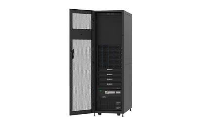
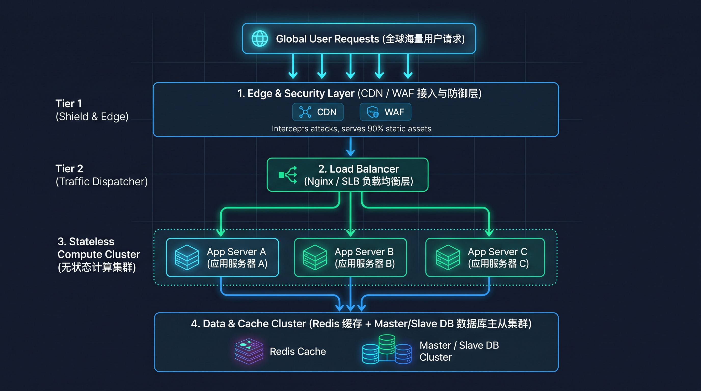

# 服务器算力本质与集群架构

## 一、 什么是服务器？

简单来说，**服务器 (Server) 就是一台专门为你或其他程序提供“服务”的 7×24 小时不间断运行的高性能电脑。**

它和你平时用来写代码或打游戏的电脑（比如外星人或带 RTX 4060 显卡的笔记本）在冯·诺依曼底层架构上是一样的，都有 CPU、内存、硬盘、网卡和主板。但服务器的使命截然不同：家用电脑追求的是“单人视听体验”，而服务器追求的是**全年无休的稳定性（高可用）、同时接待成千上万人的吞吐能力（高并发）以及极端情况下的数据安全（高可靠）**。

在计算机工程里，当我们谈论“服务器”时，通常指代两个层面的意思：

### 1. 硬件层面的服务器（物理实体机器）
这就是存放在恒温恒湿大型数据中心（机房）机柜里的“铁盒子”。它们通常没有显示器、没有鼠标键盘，长得像一个个扁平的金属抽屉（称为 **机架式服务器**，按厚度以 `1U`、`2U` 计量），或者像书本一样插在机框里（**刀片服务器**）。
为了防止断电或硬盘损坏，物理服务器往往配备**双电源冗余**、**ECC 纠错内存**（防止内存比特翻转导致系统蓝屏）以及 **RAID 磁盘阵列**（坏掉一块硬盘也能无缝恢复数据）。开发者通常通过 **SSH 协议**，在黑底白字的终端里远程连接到上面的 Linux（如 Ubuntu、Debian、Rocky Linux）系统来部署代码。

### 2. 软件层面的服务器（后台守护进程）
在日常开发中，“服务器”更多时候指代那些**在后台默默运行、监听特定端口并等待请求的软件程序**。一台物理服务器里可以同时跑好几个软件服务器：
- **Web / 应用服务器**：比如负责反向代理与静态分发的 **Nginx**，或者一个跑起来的 **Spring Boot (Tomcat)**、**Node.js (Express)** 后端项目。
- **数据库服务器**：一直在后台运行的 **MySQL**、**PostgreSQL** 或内存数据库 **Redis** 实例，随时等待被读写查询。
- **文件 / 对象存储服务器**：如自建的 **MinIO** 或云端的 S3 / R2，专门用来存储和提供图片、PDF、Excel 等非结构化文件下载。

---

## 二、 它是怎么工作的？（客户端-服务器模型）

服务器的核心工作逻辑是经典的 **“客户端-服务器” (Client-Server，简称 C/S 或 B/S)** 模型。

你可以把这个过程想象成去餐厅吃饭：

1. **客户端（顾客 / Client）**：主动发起请求的一方。它可以是你用 Java Swing 写的桌面端工具、手机上的 App，或是电脑上的浏览器。客户端负责向服务器“点单”（通过 HTTP / WebSocket 等协议发送网络请求）。
2. **服务器（后厨 / Server）**：被动接收请求并处理的一方。当请求到达时，后端的代码逻辑开始高速运转——比如校验权限、进行 Excel 数据比对、查询数据库、生成 PDF 报表，最后把处理好的结果（JSON 数据或文件流）像“上菜”一样返回给客户端。

下图展示了数据是如何在客户端与服务器之间往返流转的：

 

简而言之，**客户端负责“展现和交互”，服务器负责“计算和存储”**。如果没有服务器，我们手机里的各种 App、多人在线游戏、以及每天访问的网站，都会因为失去中心数据源而变成毫无用处的空壳。

---

## 三、 家里的电脑能当服务器吗？这和域名有什么关系？

既然服务器本质上就是一台电脑，那你平时用的台式机、笔记本，只要装上 Nginx 或 Node.js，再插上网线 24 小时不关机，它不就是一台服务器了吗？

**在底层逻辑上完全正确！** 但是，一台放在家里的电脑和真正的“商用云服务器”之间，隔着几道现实世界的技术鸿沟。我们可以把整个互联网想象成一座巨大的城市，来拆解**电脑、IP 地址与域名**三者的关系：

### 1. 你的电脑（服务器） = 一栋房子（IP 是门牌号）
如果你的电脑要当服务器，它在网络世界里必须有一个全球唯一的确切坐标，别人的数据包才能找上门。这个坐标就是 **公网 IP 地址**（比如 `114.55.205.12`）。

- **云端服务器的优势（临街旺铺）：** 阿里云、腾讯云或 Cloudflare 连接的云服务器，拥有一个**固定不变的独立公网 IP**（就像买了一套拥有独立门牌号的临街商铺）。全世界任何人，只要输入这个 IP，就能直接敲开这台机器的门。
- **家里电脑的劣势（深居小区内网）：** 家里的宽带，运营商（电信/联通/移动）因为全球 IPv4 地址早就枯竭了，通常只会给你分配一个**运营商级内网 IP（NAT）**，再经过你家路由器变成 `192.168.x.x` 的局域网 IP（就像你住在某个封闭小区的某栋某单元，只对小区内部通行，外人根本进不来）。哪怕你好不容易申请到了公网 IP，它也是**动态变化的（PPPoE 拨号）**——路由器每过几天重连一次，你的 IP 门牌号就换了。

### 2. 域名（Domain Name） = 店面招牌 / 地图导航名
虽然 IP 地址是准确的坐标（比如 `114.55.205.12`），但人类的脑子根本记不住一长串数字。所以我们发明了**域名**（比如 `baidu.com`、`github.com` 或 `土块.art`），它就像是挂在店门口的金字招牌。

当我们在浏览器输入域名时，背后会发生一次“查通讯录”的过程：
1. 浏览器去问网络里的“电话查号台”（**DNS 解析服务器**）：“请问 `土块.art` 这个招牌对应的门牌号（IP 地址）是多少？”
2. DNS 查到后返回：“它的坐标是 `114.55.x.x`。”
3. 浏览器再顺着这个 IP 门牌号找过去，敲门拉取网页。

### 3. 家用电脑建站面临的两大死穴
如果你想把家里的电脑当服务器，并且绑定一个你自己买的域名（比如 `https://xn--udsye.art/`），你会立刻撞上两堵墙：
1. **门牌号天天变：** 家用宽带的 IP 是动态的。今天你在域名后台把域名指向了今天的 IP，明天路由器一重启换了新 IP，别人再访问你的域名就会直接扑空，显示“无法连接”。
2. **正门被焊死（80/443 端口封锁）：** 哪怕你的 IP 碰巧没变，国内运营商为了网络安全与合规备案管理，也会在机房层面**默认封禁家用宽带的 `80`（HTTP）和 `443`（HTTPS）端口**。这就好比你虽然在家开了店，但物业把临街的正门给焊死了，客人不带特殊暗号（非标端口号，如 `:8080`）根本进不来。

### 4. 极客是怎么破解这个困局的？（三种实战方案）
如果想把家里的闲置电脑、软路由或 NAS 变成外网能优雅访问的服务器，极客通常有三种武器：

- **方案 A：IPv6 + DDNS（动态域名解析）**
  虽然运营商不给公网 IPv4，但现在普遍分配了货真价实的**公网 IPv6 地址**。在电脑里跑一个 DDNS 脚本（如 `ddns-go`），每分钟检测一次本机 IP，一旦发现 IP 变了，立刻自动调用域名服务商 API 修改解析记录，让域名永远死死咬住最新的家门牌号。
- **方案 B：传统内网穿透（FRP / Ngrok）**
  既然家里的正门被封了，就在云厂商租一台最便宜、带固定公网 IP 的轻量小服务器作为“中转站”，在上面运行 `frps` 服务端，家里的电脑运行 `frpc` 客户端主动向云端挖一条加密地道。外人访问中转站时，流量顺着地道直接传回你家里的电脑处理。
- **方案 C：Cloudflare Tunnel（现代零成本神技）**
  无需租用任何中转服务器，也无需公网 IP！直接在家里电脑运行一行 `cloudflared` 守护进程，它会主动与全球最近的 Cloudflare 边缘节点建立加密隧道，直接把家里电脑的 `localhost:3000` 绑定到你的域名上，不仅完美绕过 80/443 端口限制，还白嫖了免费的 HTTPS 证书与 DDoS 防护！

---

## 四、 进阶拆解：服务器的“算力本质”到底是什么？

当我们说“买一台服务器”或“服务器算力不够、卡死了”的时候，我们买的到底是什么？

剥开操作系统的外壳，**服务器的“算力本质”其实就是四大物理资源的协同吞吐能力：计算、内存、存储 I/O 与网络带宽。** 就像一家餐厅的后厨，任何一块短板都会决定整家店的接客上限（木桶效应）：

| 物理维度 | 硬件载体 | 餐厅后厨比喻 | 决定服务器的什么能力？ | 常见瓶颈症状 |
| --- | --- | --- | --- | --- |
| **1. 逻辑与并行计算力** | **CPU（中央处理器）** 与 **GPU（图形/AI 加速卡）** | **厨师的数量与切菜手速** （CPU 是全能主厨，GPU 是几千个只会切土豆丝的帮厨） | 决定每秒能执行多少条代码指令、加密解密、正则匹配，或大模型矩阵推理 | CPU 占用率飙到 100%，请求排队超时，系统负载（Load Average）爆表 |
| **2. 高速瞬时吞吐力** | **RAM（内存）** | **厨师面前的料理台大小** | 所有正在运行的程序、数据库连接池、Redis 缓存都必须铺在内存里才能被 CPU 加工 | 触发 `OOM (Out of Memory)`，系统为了自保直接强行杀死（Killed）你的 Java 或 Node 进程 |
| **3. 数据持久化吞吐力** | **Disk I/O（NVMe SSD 固态阵列）** | **后厨冷库搬运食材的速度** | 决定数据库落盘、读取海量小文件、写入日志的快慢（核心指标是 **IOPS** 每秒读写次数） | CPU 很闲但网站巨卡（`iowait` 极高），全在排队等硬盘慢慢吞吞地读写数据 |
| **4. 外界通信吞吐力** | **Network（网卡与公网带宽）** | **餐厅传菜窗口的宽度** | 决定每秒能同时向多少个用户发送图片、视频或数据包（注意区分 `Mbps` 兆比特与 `MB/s` 兆字节，相差 **8 倍**！） | 1M 小水管带宽（实际下载速度上限仅 `128 KB/s`）只要两个人同时加载一张 1MB 的大图，网站就卡上天 |

> **工程避坑指南（1Mbps ≠ 1MB/s）：**
> 云厂商卖服务器时标的“带宽 5M”，单位是 **Mbps (Megabits per second，兆比特每秒)**；而我们平时看文件大小是 **MB (Megabytes，兆字节)**。因为 `1 Byte = 8 bits`，所以 **5M 带宽的真实每秒最大传输速度只有 `5 ÷ 8 = 0.625 MB/s`（约 640 KB/s）**！这就是为什么哪怕服务器 CPU 再强，静态大图也一定要扔给 **CDN 或对象存储（R2/OSS）** 去分发，绝不能让静态文件把服务器宝贵的小水管带宽占满。

---

## 五、 终局演进：从“单兵作战”到“集群架构 (Cluster)”

如果你的网站火了，从每天几百人访问暴涨到每秒 10 万人同时在线，靠单台服务器还能撑住吗？

### 1. 纵向扩展（Scale Up）的天花板
最直觉的做法是**“换一台更猛的机器”**——把 2 核 4G 升级成 64 核 256G，这叫**纵向扩展（Scale Up / 垂直扩容）**。
但这条路很快就会撞墙：
- **硬件有物理极限且呈指数级昂贵：** 顶级单机的价格是普通机器的几十倍。
- **致命的单点故障（SPOF，Single Point of Failure）：** 哪怕你的单机价值百万，只要机房挖掘机铲断光缆、或者主板电容爆了一颗，整个网站就会瞬间 100% 彻底瘫痪。

### 2. 横向扩展（Scale Out）与现代集群架构
于是，现代互联网给出了终极答案：**不要买一台价值百万的超级电脑，而是用几十台便宜的普通服务器组成“蜂群军团”协同作战**——这就叫**横向扩展（Scale Out / 水平扩容）**，也就是**服务器集群架构（Cluster Architecture）**。

一套经典的现代高可用集群，通常会把原本挤在一台机器里的工作，拆分成各司其职的四个层级：

1. **第一棒：边缘 CDN 与防火墙（保安与前置仓）**
   用户请求先经过 Cloudflare 等边缘网络，90% 的图片、网页脚本直接由各地边缘节点返回，恶意攻击流量当场拦截，只有真正的业务请求才会进入核心机房。
2. **第二棒：负载均衡器（Load Balancer，大堂迎宾经理）**
   机房大门口站着一台不干重活、专门负责分流的 **负载均衡服务器（如 Nginx、HAProxy 或云厂商 SLB）**。它像餐厅大堂经理一样，看到 1 号后厨忙，就把新客人的请求转发给空闲的 2 号、3 号应用服务器；如果发现 2 号机器突然死机了（健康检查失败），就自动跳过它，**用户完全感知不到后台有机器坏了**！
3. **第三棒：无状态应用服务器集群（Stateless App Nodes，流水线厨师群）**
   后台跑着 3 台甚至 300 台一模一样的 Node.js / Java 服务器。它们被设计成**“无状态（Stateless）”**——机器本地不存任何用户的登录 Session 或上传文件，谁有空谁就接单算数据。双十一流量暴增时，利用 **Docker + Kubernetes (K8s)** 可以在几秒钟内自动复制出 50 台新容器顶上去；半夜流量退去，再自动销毁省钱（弹性伸缩）。
4. **第四棒：分布式缓存与主从数据库（中央共享冷库）**
   既然应用服务器本地不存数据，所有数据都统一汇总到底层的数据集群：
    - **Redis 缓存集群：** 把最常查的热点数据放在内存里，0.1 毫秒极速返回，帮数据库挡住 80% 的查询。
    - **数据库主从架构（Master-Slave）：** 一台**主库（Master）**专门负责“写入/修改数据”，并实时同步给多台**从库（Slave）**专门负责“读取数据”（读写分离）。就算主库硬盘突然烧毁，从库也能在几秒内自动顶替成为新主库（高可用容灾切换）。

---

## 六、 总结：一张表看懂服务器演进史

| 演进阶段 | 架构形态 | 核心特点 | 适用场景 |
| --- | --- | --- | --- |
| **青铜时代** | **家用电脑 + 内网穿透** | 零硬件成本，受制于家庭宽带上行与稳定性 | 个人极客玩具、本地开发联调、私人 NAS |
| **白银时代** | **单台云服务器 (All-in-One)** | 拥有固定公网 IP，前端、后端、数据库全装在一台机器里 | 独立开发者作品、个人博客、早期创业 MVP |
| **黄金时代** | **CDN + 云服务器 + 云数据库/R2** | 动静分离，静态资源走边缘 CDN/对象存储，单机只跑核心代码 | 日活数万的中型网站、高性价比独立开发全栈架构 |
| **王者时代** | **多活负载均衡 + K8s 容器集群** | 消除一切单点故障，支持百万并发与自动弹性伸缩 | 大型商业平台、在线多人游戏、国民级互联网应用 |