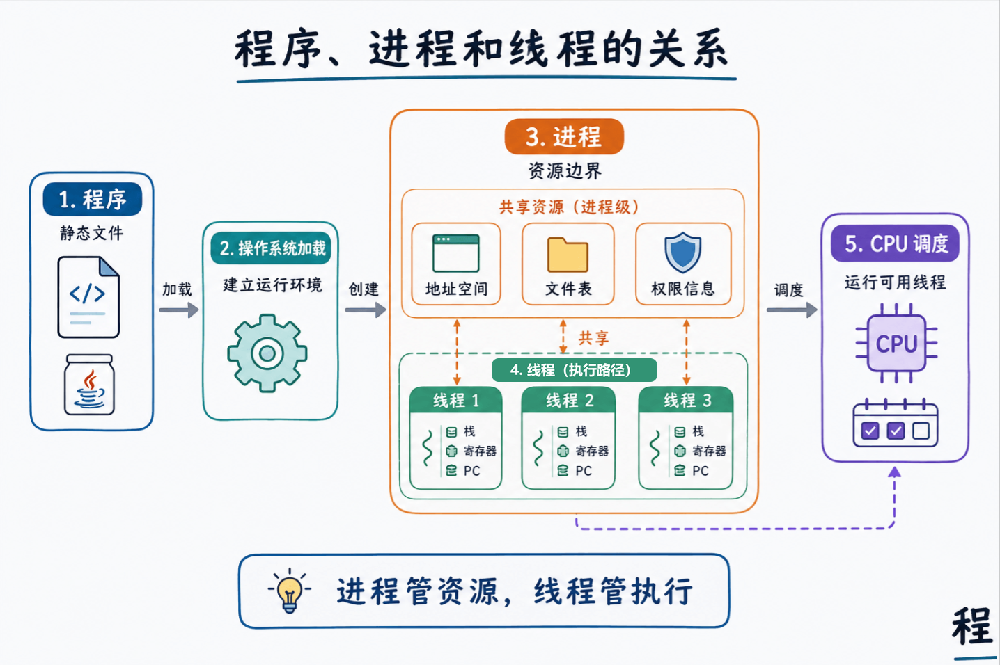

# 程序、进程与线程

在操作系统与软件工程领域，**程序（Program）**、**进程（Process）**与**线程（Thread）**是绕不开的三块基石。初学者常常把它们混为一谈，其实只要抓住操作系统设计里最核心的一条原则，三者的边界就会瞬间清晰：

> **程序是静态的图纸，进程是隔离的资源容器，线程是真正干活的执行路径。**

简言之，**进程管资源，线程管执行**。



下面我们顺着上图所示的演进关系（从左到右），以一份代码从“躺在硬盘”到“跑在 CPU 上”的完整生命周期为线索，把这三者彻底拆解清楚。

---

## 一、程序（Program）：沉睡在硬盘上的静态蓝图

结合图左侧的 “1. 程序”，程序本质上是存储在硬盘（或其他非易失性存储介质）上的**静态文件集合**，例如 Windows 下的 `.exe`、Linux 下的 ELF 可执行文件，或是字节码打包而成的 `.jar` 文件。

打开一个可执行文件的内部，里面装的无非是两类东西：
* **指令（Code）**：编译器翻译好的机器码或字节码，规定了“第一步做什么、第二步做什么”（如代码文件图标 📄 ）。
* **静态数据（Data）**：程序中写死的常量、全局变量的初始值以及供操作系统识别的元信息（如 Java 运行包 ☕️ ）。

程序的关键特征是**静态性**与**持久性**。只要你不去启动它，它就只是磁盘上的一串二进制字节——不占用物理内存，不消耗 CPU 时间片，也不会因为电脑关机而消失。同一份程序文件可以被同时启动多次，衍生出多个互不干扰的运行实例。

---

## 二、进程（Process）：操作系统划出的独立资源容器

当你双击图标或在终端敲下回车，操作系统就会派出加载器（Loader），把硬盘上的程序“加载”到内存中（如上图 “2. 操作系统加载”），为其建立运行环境，并最终“创建”出上图 “3. 进程”。这个**运行中的程序实例**，就是进程。

进程是操作系统**分配和隔离资源的基本单位**。创建一个进程时，内核会为其建立一份档案——**进程控制块（PCB, Process Block）**，并划出一整套专属资源：

1. **独立的虚拟地址空间**：包含代码段、数据段、动态分配的堆区（Heap）以及函数调用栈。
2. **文件表**：记录该进程打开了哪些本地文件、管道、网络 Socket 连接。
3. **权限信息**：进程号（PID）、所属用户权限、安全上下文等。

在图中的进程边界内，我们可以看到这些统称为 **“共享资源（进程级）”**。这意味着同一个进程里的所有活动，都共用这一套地址空间、文件表和权限。

### 为什么必须要有“进程”这一层？

核心答案只有两个字：**隔离**。

早期计算机没有内存隔离机制，一个程序写错了指针，就可能踩坏另一个程序甚至操作系统内核的数据，导致整台机器死机。进程机制通过独立的虚拟地址空间筑起了高墙：进程 A 无法直接读写进程 B 的内存；即便进程 A 发生严重崩溃，操作系统也能干净地回收它的所有内存和文件句柄，而不至于拖垮其他正在运行的软件。

但隔离是有代价的。创建进程需要复制或重建整套页表与资源表，**开销较大**；在不同进程间切换时，CPU 需要切换页表基址，容易导致快表（TLB）与缓存失效；此外，由于内存彼此隔离，进程间若要交换数据，必须借助管道、共享内存、消息队列或 Socket 等**进程间通信（IPC）**机制，编程和运行成本都偏高。

---

## 三、线程（Thread）：真正在 CPU 上干活的执行路径

随着软件越来越复杂，单纯依赖“进程”开始显得笨重。试想一个日常使用的桌面软件：它需要一边实时响应鼠标点击与界面重绘，一边在后台自动保存大文件，同时还要维持网络连接接收推送。

如果把这些任务拆成多个进程，它们之间要高频共享同一份文档数据和界面状态，频繁做 IPC 通信既慢又麻烦；如果全部塞进单进程里按顺序排队执行，只要后台保存文件卡顿两秒，整个界面就会彻底冻住。

于是操作系统在进程内部引入了更轻量的概念——**线程**。

如上图 “3. 进程” 下半部分所示，线程依附于进程存在，是 **CPU 调度和执行的最小单位**（“5. CPU 调度” 会在运行队列中调度这些可运行线程）。一个进程启动时默认至少包含一条**主线程**，并可以按需派生出多条并发工作的子线程。

### 线程的精髓：哪些共享，哪些私有？

理解多线程，最关键的是分清同一进程内各线程之间的内存边界：

* **所有线程共享进程级资源**：包括代码段、全局/静态数据段、堆区（`malloc` / `new` 出来的对象）以及进程打开的文件句柄（文件表）与网络连接。正因为共享同一片地址空间，线程之间传递数据几乎是“零成本”的，直接读写同一个内存地址即可。
* **每条线程（线程 1、2、3）仅独占极少的执行上下文**：
    * **独立的栈（Stack）**：用于保存各自的函数调用链、参数与局部变量。
    * **寄存器（Registers）与程序计数器（PC）**：记录“我当前算到了哪一步、下一条该执行哪行指令”，以便在被操作系统暂停后能无缝恢复。
    * **线程局部存储（TLS）**：专为单条线程隔离的私有全局变量区域。

下面用一段简短的 C 语言代码，直观感受“共享数据段”与“线程私有栈”的区别：

```c
#include <stdio.h>
#include <pthread.h>

// 位于进程的全局数据段：同一进程内的所有线程共享
int shared_counter = 0;

void* worker(void* arg) {
    // 位于各自线程的私有栈：每条线程独立拥有一份
    int local_id = *(int*)arg;

    // 多个线程操作同一块共享内存（注意：无锁并发写入存在竞态风险）
    shared_counter++;

    printf("线程 %d | 私有栈变量地址: %p | 共享变量值: %d\n",
           local_id, (void*)&local_id, shared_counter);
    return NULL;
}

int main(void) {
    pthread_t t1, t2;
    int ids[2] = {1, 2};

    pthread_create(&t1, NULL, worker, &ids[0]);
    pthread_create(&t2, NULL, worker, &ids[1]);

    pthread_join(t1, NULL);
    pthread_join(t2, NULL);
    return 0;
}
```

运行这段程序（`gcc demo.c -pthread && ./a.out`）你会观察到两个现象：两条线程打印出的 `local_id` 内存地址截然不同（各自位于独立的线程栈中），而它们读写的 `shared_counter` 却是同一份数据。

因为切换线程不需要更换虚拟地址空间和页表，只需保存并恢复寄存器与栈指针，所以**线程的创建、销毁与上下文切换开销远小于进程**。

---

## 四、把三者放进同一个真实场景

以你每天都在使用的代码编辑器或桌面办公软件为例：

* **程序**：躺在安装目录里那个静态的 `.exe` 文件。
* **进程**：双击启动软件后，操作系统为它分配的一整块独立内存沙箱与运行环境。如果你同时打开两个独立的软件实例，系统里就存在两个进程。
* **线程**：在软件进程内部同时运转的多条流水线：
    * **UI 主线程**：专门负责监听键盘鼠标事件、绘制窗口画面。
    * **I/O 后台线程**：负责读写磁盘文件、执行自动保存或扫描工程目录。
    * **计算/网络线程**：负责语法高亮解析、代码补全或同步云端数据。

这也是桌面端开发的一条铁律：**绝对不要在 UI 主线程里执行耗时的磁盘读写或网络请求**。一旦主线程被阻塞，界面重绘与事件响应就会停摆，操作系统便会弹出令人头疼的“程序未响应”。

---

## 五、全景对比：一张表看清核心差异

| 对比维度 | 程序（Program） | 进程（Process） | 线程（Thread） |
| --- | --- | --- | --- |
| **核心定位** | 静态的指令与数据文件 | 操作系统分配资源的基本单位 | CPU 调度与执行的基本单位 |
| **存在形态** | 静止存放于硬盘 | 动态运行于内存 | 动态运行于内存，依附于进程 |
| **资源归属** | 不占运行期系统资源 | 独占独立虚拟地址空间、文件表与权限 | 共享进程资源，仅私有栈、寄存器和 PC |
| **创建/切换开销** | 无 | 大（需分配资源与切换页表） | 小（仅切换栈指针与寄存器上下文） |
| **通信方式** | 无 | 较复杂，需借助 IPC 机制 | 极简单，可直接读写共享内存 |
| **容错与隔离** | 永久静态存在 | 隔离性强，单进程崩溃不影响其他进程 | 隔离性弱，单线程致命错误常导致整个进程退出 |

---

## 六、工程实战的两面刃：共享的代价与架构演进

线程通过共享内存换来了极致的性能与协作便利，但也打开了并发编程的潘多拉魔盒：

1. **竞态条件（Race Condition）与数据错乱**：像前面代码里的 `shared_counter++`，在机器指令层面其实是“读取 → 加一 → 写回”三步。两条线程如果不加约束地同时执行，彼此的写入就会互相覆盖。为了守住数据一致性，工程师必须引入**互斥锁（Mutex）**、**信号量**或**原子操作**，而锁一旦使用不当，又会埋下**死锁（Deadlock）**的隐患。
2. **一损俱损的稳定性风险**：由于所有线程共享同一套地址空间，只要其中一条线程触发了非法内存访问（段错误）或未捕获的致命异常，操作系统通常会直接终止整个进程。

因此，现代系统架构很少走极端，而是根据业务诉求做精准权衡：

* **追求强隔离与高稳定，选多进程**：例如现代浏览器（如 Chrome）为不同标签页和插件分配独立进程，某个网页卡死或崩溃，只需关掉该标签页，整个浏览器依然稳如泰山；Nginx 也采用 Master-Worker 多进程模型保证高可用。
* **追求高频数据共享与低开销，选多线程**：例如游戏引擎、数据库内核和桌面应用，在同一进程内通过线程池榨干多核 CPU 的算力。
* **面对百万级高并发 I/O，继续向轻量级演进**：操作系统线程的栈空间通常达到 MB 级别，且调度需要陷入内核态，开几万条线程内存就会吃紧。为此，现代语言在操作系统线程之上演化出了**用户态协程或虚拟线程**（如 Go 的 Goroutine、Java 21 的 Virtual Threads），由语言运行时把成千上万个超轻量级任务复用到少量操作系统线程上，进一步把并发成本压到极致。

---

回到最初的直觉：如果把**程序**看作安静放在书架上的菜谱，那么**进程**就是按菜谱配齐了独立灶台、厨具与食材的一间厨房，而**线程**就是厨房里同时切菜、熬汤、翻炒的厨师。厨房之间彼此隔墙互不干扰，厨房里的厨师共享同一批食材、却各自在脑子里记着自己的进度——理解了这层分工，操作系统并发世界的大门也就真正向你敞开了。