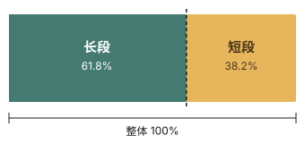
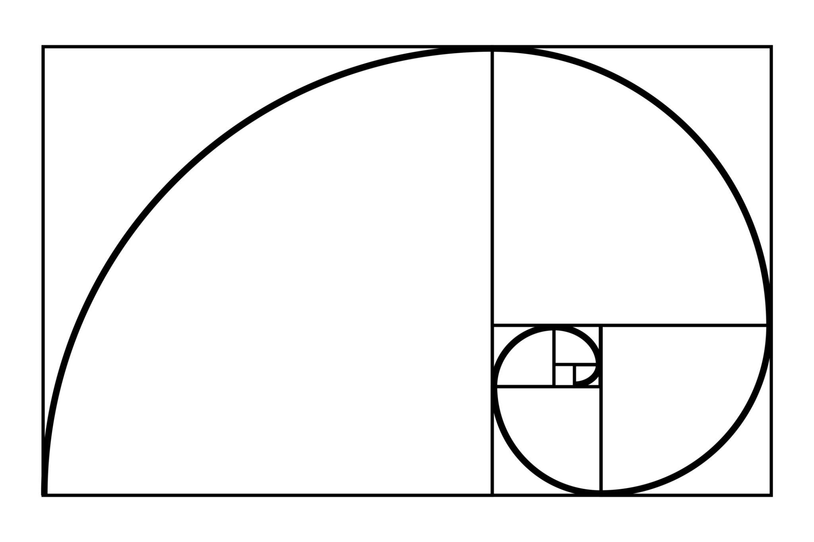
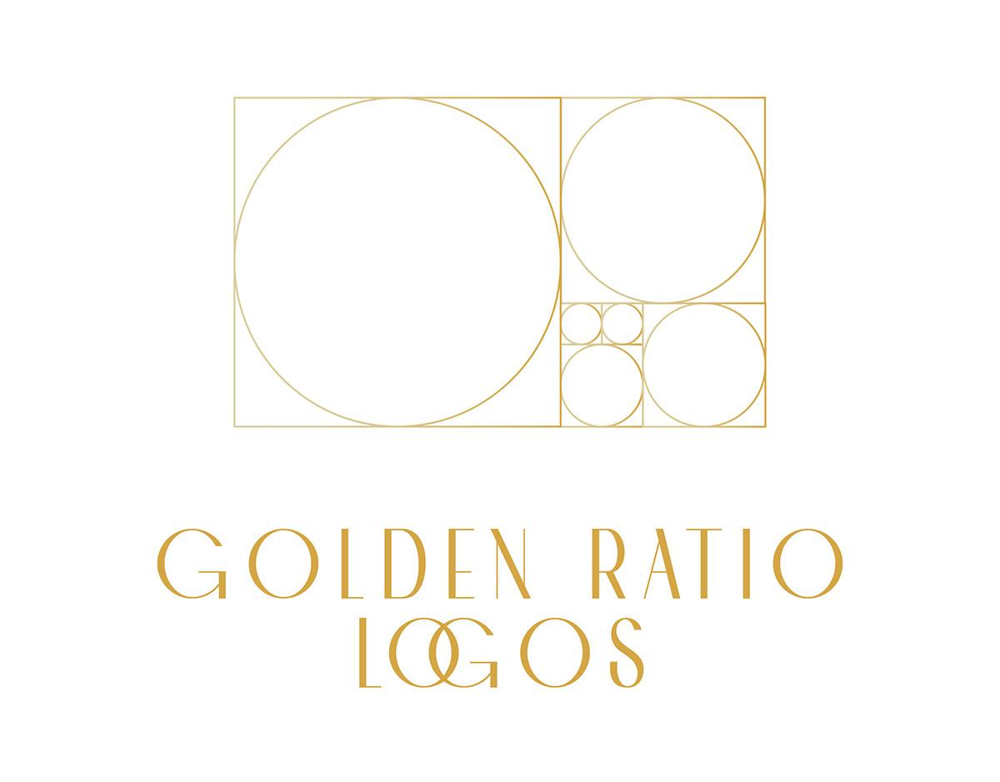
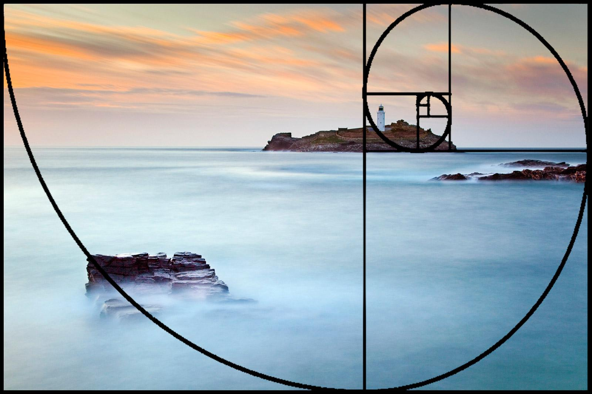

# 黄金比例

> **核心比值**：`1 : 1.618`（黄金比例常数 $\varphi \approx 1.6180339887\dots$）  
> 把一条线段分为长短两部分，如果**整体与长段的比值**恰好等于**长段与短段的比值**，这种分割方式就是 **黄金分割**（Golden Ratio）。

黄金比例在数学、建筑、艺术与现代视觉设计中有着悠久的应用传统，常被用来为版面、图形与构图建立清晰的秩序感。

## 一、黄金比例长什么样？

按黄金比例分割一条线段时，**长段约占整体的 61.8%**，**短段约占整体的 38.2%**。

设长段长度为 $a$，短段长度为 $b$，其数学关系可以写为：

$$
\frac{a+b}{a} = \frac{a}{b} = \varphi
$$

求解上述比例方程（取正根），即可得到精确的黄金比例常数 $\varphi$（Phi）：

$$
\varphi = \frac{1+\sqrt{5}}{2} \approx 1.6180339887\dots
$$

- **整体与长段之比**：$\varphi \approx 1.618$（长段是短段的 1.618 倍）
- **长段占整体比例**：$\frac{1}{\varphi} = \varphi - 1 \approx 0.618$（即 61.8% 与 38.2% 的由来）
- **自相似与数列关联**：在斐波那契数列（`1, 1, 2, 3, 5, 8, 13, 21, 34, 55, 89…`）中，随着数字增大，相邻两项的比值会越来越逼近 $1.618$。

## 二、黄金比例在设计中怎么使用？

在视觉设计中，黄金比例并不是死板的数学教条，而是一把用来快速确立**主次层级、画幅尺度与留白节奏**的参考标尺。

### 1. 黄金矩形与版面编排

- **比例基准**：长宽之比约为 **$1.618 : 1$** 的矩形被称为“黄金矩形”。
- **实际应用**：将黄金矩形切去一个以短边为边长的正方形后，余下区域仍然是黄金矩形。这种比例常用于海报版式、卡片容器与网页分栏（例如 `1000 px` 宽度按 `618 px` 主区 + `382 px` 辅区划分），能自然区分画面主次，避免“对半平分”的呆板感。

### 2. Logo 与几何标志设计

- **比例基准**：用直径按 $1 : 1.618$ 比例缩放的同心圆或相切圆构成辅助网格，用来对齐几何形状的尺寸、圆角曲率与元素间距。
- **实际应用**：让多个图形组件之间保持统一的缩放倍率和呼吸节奏，使极简标志看起来更有整体感与秩序感。

### 3. 摄影与画面构图

- **比例基准**：将画面长宽分别按 **38.2%** 与 **61.8%** 划分，交汇点与黄金螺旋收束区往往是视觉焦点所在。
- **实际应用**：把人物眼神、地平线或主体建筑安排在约 `38.2%` 或 `61.8%` 的位置作为构图起点，既能避免主体居中带来的单调，又能为视线留出舒展空间。

## 三、实战演示：假如你设计一个 1000 × 1000 的软件图标

在设计桌面或移动端应用图标时，图形主体通常不能顶满画布四周，否则在桌面图标阵列中会显得拥挤、缺乏呼吸感。此时可以尝试用黄金比例来规划**主体尺寸与四周留白**（在 `1000 × 1000 px` 画布下，主体取 `618 × 618 px`，四边各留白 `191 px`）。

拖动下方滑块或点击预设比例，实时观察画布主体的松紧变化：

<section id="tk-icon-golden-widget" class="tk-igw" aria-label="1000 × 1000 软件图标黄金比例互动演示">
  

    
1000 × 1000 软件图标画布交互演示

    ✨ 黄金比例 1 : 0.618
  

  

    

      <svg id="tk-igw-svg" class="tk-igw-svg" viewBox="0 0 1000 1000" xmlns="http://www.w3.org/2000/svg" role="img" aria-label="1000 × 1000 图标画布实时预览">
        <defs>
          <linearGradient id="tk-igw-card-grad" x1="0" y1="0" x2="1" y2="1">
            <stop offset="0%" stop-color="var(--igw-icon-bg1)"/>
            <stop offset="100%" stop-color="var(--igw-icon-bg2)"/>
          </linearGradient>
          <linearGradient id="tk-igw-mark-grad" x1="0" y1="0" x2="1" y2="1">
            <stop offset="0%" stop-color="#10b981"/>
            <stop offset="55%" stop-color="#38bdf8"/>
            <stop offset="100%" stop-color="#a78bfa"/>
          </linearGradient>
          <pattern id="tk-igw-grid-pat" width="100" height="100" patternUnits="userSpaceOnUse">
            <path d="M 100 0 L 0 0 0 100" fill="none" stroke="var(--igw-grid)" stroke-width="2"/>
          </pattern>
        </defs>
        <rect x="0" y="0" width="1000" height="1000" rx="224" fill="url(#tk-igw-card-grad)" stroke="var(--igw-border)" stroke-width="4"/>
        <rect x="0" y="0" width="1000" height="1000" rx="224" fill="url(#tk-igw-grid-pat)"/>
        <line x1="500" y1="24" x2="500" y2="976" stroke="var(--igw-grid)" stroke-width="2" stroke-dasharray="10 10"/>
        <line x1="24" y1="500" x2="976" y2="500" stroke="var(--igw-grid)" stroke-width="2" stroke-dasharray="10 10"/>
        <g id="tk-igw-subject-group" transform="translate(191, 191)">
          <rect id="tk-igw-subject-box" x="0" y="0" width="618" height="618" rx="28" fill="var(--igw-accent-soft)" stroke="var(--igw-accent)" stroke-width="3.5"/>
          <g id="tk-igw-emblem" transform="scale(6.18)">
            <circle cx="50" cy="50" r="42" fill="url(#tk-igw-mark-grad)" opacity="0.18"/>
            <path d="M50 12 L61 39 L88 50 L61 61 L50 88 L39 61 L12 50 L39 39 Z" fill="url(#tk-igw-mark-grad)"/>
            <circle cx="50" cy="50" r="11" fill="#ffffff" opacity="0.92"/>
          </g>
        </g>
        <g id="tk-igw-guide">
          <rect x="191" y="191" width="618" height="618" rx="36" fill="none" stroke="var(--igw-gold)" stroke-width="3" stroke-dasharray="14 10" opacity="0.9"/>
          <text x="500" y="172" text-anchor="middle" fill="var(--igw-gold)" font-size="26" font-weight="700" font-family="monospace">61.8% 黄金参考框 (618×618)</text>
        </g>
        <g id="tk-igw-dims" font-family="monospace" font-size="26" font-weight="700">
          <line id="tk-igw-pad-line" x1="0" y1="500" x2="191" y2="500" stroke="var(--igw-accent)" stroke-width="3"/>
          <circle id="tk-igw-pad-dot1" cx="4" cy="500" r="6" fill="var(--igw-accent)"/>
          <circle id="tk-igw-pad-dot2" cx="191" cy="500" r="6" fill="var(--igw-accent)"/>
          <rect id="tk-igw-pad-pill" x="33" y="452" width="124" height="36" rx="10" fill="var(--igw-canvas-bg)" stroke="var(--igw-accent)" stroke-width="2" opacity="0.95"/>
          <text id="tk-igw-pad-text" x="95" y="478" text-anchor="middle" fill="var(--igw-accent)">191 px</text>
          <text id="tk-igw-box-label" x="500" y="964" text-anchor="middle" fill="var(--igw-muted)" font-size="25">画布 1000 × 1000 px</text>
        </g>
      </svg>
    

    

      

        图形主体尺寸
        
618 × 618px

      

      

        

          
主体占比

          
61.8%

        

        

          
单侧留白

          
191 px

        

        

          
画布 / 主体

          
1.618

        

      

      

        

          拖动调整主体比例
          61.8%
        

        <input id="tk-igw-slider" class="tk-igw-range" type="range" min="40" max="90" step="0.1" value="61.8" aria-label="主体占画布宽度百分比">
        
40%61.8%90%

      

      

        <button type="button" class="tk-igw-btn" data-pct="40">40%</button>
        <button type="button" class="tk-igw-btn" data-pct="50.6">50.6% (506px)</button>
        <button type="button" class="tk-igw-btn is-primary" data-pct="61.8">恢复黄金比例 61.8%</button>
        <button type="button" class="tk-igw-btn" data-pct="90">90%</button>
      

      

        <label class="tk-igw-toggle"><input id="tk-igw-show-guide" type="checkbox" checked>显示 61.8% 黄金参考框</label>
        <label class="tk-igw-toggle"><input id="tk-igw-pure-box" type="checkbox">仅显示几何色块</label>
      

    

  

</section>

> **交互示例**：调整图形主体相对 `1000 × 1000` 画布的大小。`618`（61.8%）只是应用黄金比例的一种常见设计选择，**并不是图标设计的强制标准**——如果图标轮廓较尖锐、内部镂空较多，适当把主体放大一些（如 70% 左右）反而更能保证视觉分量均衡。

## 四、黄金比例一定是最美的吗？

**不一定。这是美学与设计中非常重要的一条认知。**

黄金比例在数学上是严格成立的比例关系，但**“黄金比例天然最美”并不是一条被科学普遍证实的铁律**。在实际设计与审美判断中，有几个常见误区值得辨析：

| 常见说法 / 现象 | 真实情况与设计辨析 |
| :--- | :--- |
| **三分法构图 = 黄金分割** | **两者并不相同。** 常用相机九宫格“三分法”用的是 **`33.3% / 66.7%`**（约 $1:2$），而黄金分割是 **`38.2% / 61.8%`**，只是位置接近。 |
| **知名 Logo 都严格遵循黄金比例** | **不少属于“事后套框”。** 像苹果等经典 Logo 网上流传的几何圆切图，很多是后人用近似圆强行拟合上去的，实际创作更依赖设计师肉眼调校。 |
| **只要按 1 : 1.618 排版就一定优雅** | **比例只是基础骨架。** 真正决定视觉高级感的，还包括**明暗对比、色彩关系、负空间节奏、视觉重量平衡**与文化阅读经验。 |

---

### 小结

- **对于你设计的 Kore 小蛇图标**：黄金比例可以帮你快速确定蛇形主体的合适尺度、形态边界与安全留白；但在细节收口时，真正决定它是否优雅耐看的，依然是图形整体的**视觉平衡**。
- **记住一句话**：**黄金比例是好用的设计工具，而不是决定美感的万能公式。**