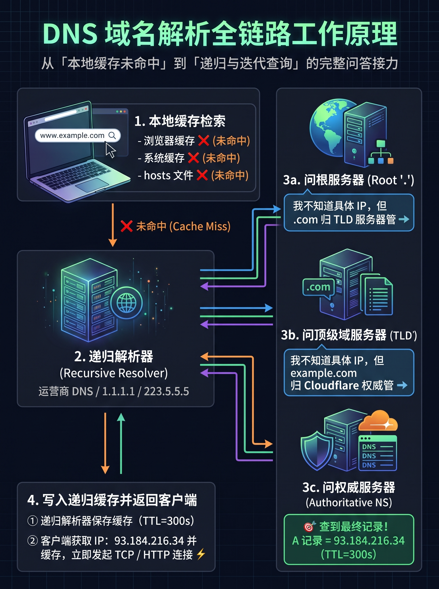

# 💯DNS域名解析与污染防护原理解析

> **DNS（Domain Name System，域名系统）** 是互联网的分布式电话簿，负责把人类易记的域名（如 `www.example.com` 或中文域名 `土块.art`）翻译成路由器唯一认识的 IP 地址（如 `93.184.216.34`）；而 **DNS 污染（DNS Poisoning）** 则是利用传统明文 UDP 53 协议“无加密、无密码学签名”的弱点，由链路中间设备照抄请求参数、伪造并抢先返回虚假 IP 的网络干扰技术。  
> 简单来说，输入网址按下回车的第一毫秒，浏览器连目标服务器在哪都不知道；**必须先经过一场层层递进的 DNS 问路接力拿到真实 IP，后续的 TCP 握手、CIDR 路由转发和 HTTP 通信才能正式启动。**

如果把访问网站比作给远方朋友寄信：IP 地址是精确到经纬度的门牌坐标，**DNS 就是遍布全球的查号台网络**；而 **DNS 污染**，就像是你在电话里大声问查号台“某某家住哪”，还没等远方的总台开口，旁边偷听的陌生人就冒充查号台、照着你刚喊出的问题抢先报出一个假地址——你一核对来电号码和所问人名都对得上，便采纳了这“第一声合格回答”挂断电话，结果把信寄去了空房子。

---

## 一、举个生活中的例子

假设你在浏览器输入 `www.example.com`（或者经过 Punycode 转码的中文域名 `土块.art` → `xn--udsye.art`）准备打开网页。

在这个瞬间，如果 DNS 链路正常与遭遇污染，你的电脑会经历截然不同的命运：

- **正常解析链路**：你的电脑先查本地缓存，没查到就问递归 DNS（如 `223.5.5.5` 或 `1.1.1.1`），递归服务器沿着全球层级树问到最终权威服务器，拿到真实的服务器 IP 并按 `TTL` 时间缓存下来，浏览器顺利建立连接；
- **遭遇 DNS 污染**：你的明文查询请求刚离开本地路由器、经过骨干网出口时，中间审查或干扰设备截获了明文域名，**伪造源 IP 抢先塞回一个假的 IP（甚至是不存在的黑洞 IP）**。你的电脑信以为真，随后发出的 TCP 握手包要么永远石沉大海（连接超时），要么撞上错误的服务器触发 HTTPS 证书报错。

---

## 二、一次完整的 DNS 解析是如何运转的？

很多初学者以为“全球只有 13 台根服务器，查一次域名要绕地球跑好几圈”。实际上，全球存在 **13 组逻辑根域名服务器（`a.root-servers.net` ~ `m.root-servers.net`）**，它们通过 **BGP 任播（Anycast）技术**在全世界部署了上千个物理镜像节点，确保绝大多数查询都能就近命中。

一次完整的缓存未命中（Cache Miss）DNS 解析，结合了**客户端到递归解析器的“递归查询”**，以及**递归解析器向各级域名服务器的“迭代查询”**：



1. **本地就近查（0 毫秒开销）**：依次查询浏览器 DNS 缓存 → 操作系统缓存 → 本机 `hosts` 文件。只要命中且 `TTL`（生存时间）未过期，直接返回，不发任何网络包。
2. **递归查询（甩手掌柜模式）**：本地没查到时，电脑把请求丢给配置好的**递归 DNS 服务器**，并把报文里的 `RD`（Recursion Desired）标志位置为 `1`，潜台词是：“我不管你怎么找，你必须把最终 IP 找回来给我”。
3. **迭代查询（逐级指路模式）**：如果递归服务器自己也没缓存，它就化身“跑腿专员”，依次向 **根服务器（`.`）→ 顶级域服务器（`.com` / `.art`）→ 权威域名服务器（如 Cloudflare / 阿里云 DNS）** 逐级问路，最终拿到精确的 `A` 或 `AAAA` 记录。
4. **TTL 分层缓存**：拿到结果后，递归服务器和你的电脑都会按权威服务器指定的 `TTL`（例如 300 秒）把结果存进内存，接下来 5 分钟内再访问同一域名都无需重复问路。

---

## 三、代码看透底层：手写 RFC 1035 原生 DNS 报文与解包

为什么传统 DNS 如此脆弱？直接看它在网线里跑的原始字节就一目了然。标准 DNS 查询运行在 **UDP 53 端口**上，报文结构极度精简，**既没有通道加密，也没有默认数字签名，只能靠地址、端口、16 位事务 ID（Transaction ID）和问题内容来核对响应归属**。

下面是一段约 60 行的纯 Python 标准库代码，不依赖任何第三方包，按 RFC 1035 拼装二进制 DNS 查询包，并按 [RFC 5452 §9.1](https://www.rfc-editor.org/rfc/rfc5452.html#section-9.1) 核对响应后提取解析结果（原生兼容中文 IDN 域名）：

```python
import random
import socket
import struct
import time

def build_dns_query(domain: str) -> tuple[int, bytes, bytes]:
    tx_id = random.randint(0, 0xFFFF)
    # 12 字节固定头部：事务ID, 标志(0x0100=标准递归查询), 问题数=1, 其余计数=0
    header = struct.pack("!HHHHHH", tx_id, 0x0100, 1, 0, 0, 0)
    # 域名编码为长度前缀标签序列（支持中文域名自动转 Punycode）
    ascii_domain = domain.strip(".").lower().encode("idna").decode("ascii")
    qname = b"".join(bytes([len(p)]) + p.encode("ascii") for p in ascii_domain.split(".")) + b"\x00"
    question = qname + struct.pack("!HH", 1, 1)  # QTYPE=1 (A记录), QCLASS=1 (IN)
    return tx_id, question, header + question

def skip_name(data: bytes, offset: int) -> int:
    while offset < len(data):
        length = data[offset]
        if length == 0:
            return offset + 1
        if (length & 0xC0) == 0xC0:  # 遇到 RFC 1035 名称压缩指针（占 2 字节）
            return offset + 2
        offset += 1 + length
    raise ValueError("DNS 域名字段截断")

def parse_dns_response(
    data: bytes, expected_tx_id: int, expected_question: bytes
) -> list[tuple[str, int]]:
    if len(data) < 12:
        raise ValueError("报文长度不足 12 字节")
    tx_id, flags, qdcount, ancount, _, _ = struct.unpack("!HHHHHH", data[:12])
    if not (flags & 0x8000) or tx_id != expected_tx_id or qdcount != 1:
        raise ValueError("响应标志、事务 ID 或问题数不匹配")
    q_end = skip_name(data, 12) + 4  # QNAME + QTYPE(2B) + QCLASS(2B)
    if data[12:q_end].lower() != expected_question.lower():
        raise ValueError("响应 Question 段与原查询不一致")
    offset, results = q_end, []
    for _ in range(ancount):
        offset = skip_name(data, offset)
        rtype, rclass, ttl, rdlength = struct.unpack("!HHIH", data[offset:offset + 10])
        rdata = data[offset + 10:offset + 10 + rdlength]
        offset += 10 + rdlength
        if rtype == 1 and rclass == 1 and rdlength == 4:  # 仅提取 IN 类 IPv4 A 记录
            results.append((".".join(map(str, rdata)), ttl))
    return results

if __name__ == "__main__":
    target, dns_server = "example.com", "223.5.5.5"
    tx_id, question, packet = build_dns_query(target)
    deadline = time.monotonic() + 3.0
    with socket.socket(socket.AF_INET, socket.SOCK_DGRAM) as sock:
        sock.sendto(packet, (dns_server, 53))
        while (remaining := deadline - time.monotonic()) > 0:
            sock.settimeout(remaining)
            resp, addr = sock.recvfrom(512)
            if addr != (dns_server, 53):
                continue  # 核对发送方地址与端口，不符则丢弃
            try:
                answers = parse_dns_response(resp, tx_id, question)
                break     # 首个通过全部检查的响应到达后即被采纳
            except ValueError:
                continue  # 事务 ID 或查询内容不符，丢弃并继续等待
        else:
            raise TimeoutError("等待合规 DNS 响应超时")
    print(f"域名 {target} (TxID={tx_id:#06x}) 解析结果:", answers)
```

仔细看上面的收包循环与 `parse_dns_response` 校验逻辑：根据 [RFC 5452 §9.1](https://www.rfc-editor.org/rfc/rfc5452.html#section-9.1)，合规解析器并不会“盲目相信第一个到达的任意 UDP 包”，而是**会先核对地址、端口、事务 ID（`tx_id`）和查询内容（Question 段）**，把对不上号的杂散包直接丢弃。但在**链路旁路（On-Path）干扰**面前，传统 DNS 依然暴露了**三大致命死穴**：

1. **全明文裸奔**：查询的域名以纯 ASCII 字节写在 UDP 载荷里，链路上任何一台路由器或旁路分光设备都能毫秒级读取你在查什么域名。
2. **核对要素全部随明文请求泄露，缺乏密码学签名**：解析器用来验明正身的源/目的 IP、客户端随机源端口、16 位 `tx_id` 以及查询问题内容，**全在刚发出的明文请求包里暴露得一干二净**。旁路设备无需像盲投毒那样暴力猜解端口和 `tx_id`，直接把这些字段原样照抄并伪造源 IP 回包，就能完整通过上述检查。
3. **伪造包过检后抢先到达即被采纳**：旁路干扰设备通常部署在物理距离更近的网络出口节点，**当伪造响应通过地址、端口、事务 ID 和查询内容检查，并抢先（耗时约 `15ms`）到达时，才可能被解析器采纳**。客户端收下这个“表面完全合规”的假包后便结束查询并关闭 Socket，远方服务器姗姗来迟的真实响应（耗时约 `150ms`）反而被内核丢弃。

---

## 四、交互实验室：DNS 递归解析与链路污染抢答模拟器

为了直观感受**“明文 UDP 53 下的旁路抢答竞态（Race Condition）”**，以及**“DoH/DoT 加密隧道与 DNSSEC 签名校验如何拦截污染”**，你可以在下方实验室中切换预设场景或自由组合协议与防护开关，点击 **「▶ 发起 DNS 查询」** 观察报文竞速与校验过程：

<style>
.tk-dns {
  --dn-bg: rgba(24, 24, 27, 0.72);
  --dn-panel: rgba(39, 39, 42, 0.55);
  --dn-sub: #0d0d10;
  --dn-border: rgba(255, 255, 255, 0.1);
  --dn-accent: #10b981;
  --dn-blue: #38bdf8;
  --dn-amber: #f59e0b;
  --dn-red: #f43f5e;
  --dn-purple: #a78bfa;
  --dn-text: #f4f4f5;
  --dn-muted: #a1a1aa;
  box-sizing: border-box;
  margin: 20px 0 24px;
  padding: 18px;
  border: 1px solid var(--dn-border);
  border-radius: 16px;
  background: var(--dn-bg);
  color: var(--dn-text);
  font-family: 'Inter', -apple-system, BlinkMacSystemFont, "PingFang SC", "Microsoft YaHei", sans-serif;
  box-shadow: 0 12px 32px rgba(0, 0, 0, 0.35);
}
body.theme-light .tk-dns {
  --dn-bg: rgba(255, 250, 253, 0.85);
  --dn-panel: rgba(243, 232, 255, 0.52);
  --dn-sub: rgba(255, 255, 255, 0.92);
  --dn-border: rgba(236, 72, 153, 0.22);
  --dn-accent: #ec4899;
  --dn-blue: #0284c7;
  --dn-amber: #d97706;
  --dn-red: #e11d48;
  --dn-purple: #7c3aed;
  --dn-text: #2e1065;
  --dn-muted: #6d597a;
  box-shadow: 0 12px 32px rgba(167, 139, 250, 0.16);
}
.tk-dns, .tk-dns *, .tk-dns *::before, .tk-dns *::after { box-sizing: border-box; }
.tk-dns-head {
  display: flex;
  flex-wrap: wrap;
  justify-content: space-between;
  align-items: center;
  gap: 8px;
  padding-bottom: 12px;
  margin-bottom: 14px;
  border-bottom: 1px solid var(--dn-border);
}
.tk-dns-title {
  font-size: 15px;
  font-weight: 700;
  color: var(--dn-text);
  display: flex;
  align-items: center;
  gap: 8px;
}
.tk-dns-dot {
  width: 8px;
  height: 8px;
  border-radius: 50%;
  background: var(--dn-accent);
  box-shadow: 0 0 10px var(--dn-accent);
}
.tk-dns-legend { font-size: 12px; color: var(--dn-muted); }
.tk-dns-presets {
  display: flex;
  flex-wrap: wrap;
  gap: 7px;
  margin-bottom: 12px;
}
.tk-dns-btn {
  appearance: none;
  border: 1px solid var(--dn-border);
  background: var(--dn-panel);
  color: var(--dn-text);
  padding: 6px 11px;
  border-radius: 9px;
  font-size: 12px;
  font-weight: 600;
  cursor: pointer;
  transition: all 0.16s ease;
  font-family: inherit;
}
.tk-dns-btn:hover {
  border-color: var(--dn-accent);
  color: var(--dn-accent);
  transform: translateY(-1px);
}
.tk-dns-btn.is-primary {
  background: var(--dn-accent);
  border-color: var(--dn-accent);
  color: #ffffff;
}
.tk-dns-btn.is-primary:hover { opacity: 0.92; color: #ffffff; }
.tk-dns-form {
  display: grid;
  grid-template-columns: 1.3fr 1fr 1.2fr;
  gap: 8px;
  margin-bottom: 10px;
}
.tk-dns-field {
  display: flex;
  flex-direction: column;
  gap: 4px;
}
.tk-dns-label {
  font-size: 11px;
  font-weight: 600;
  color: var(--dn-muted);
}
.tk-dns-select, .tk-dns-input {
  width: 100%;
  padding: 7px 10px;
  border-radius: 9px;
  border: 1px solid var(--dn-border);
  background: var(--dn-sub);
  color: var(--dn-text);
  font-family: 'JetBrains Mono', Consolas, monospace;
  font-size: 12.5px;
  outline: none;
}
.tk-dns-select:focus, .tk-dns-input:focus { border-color: var(--dn-accent); }
.tk-dns-toggles {
  display: flex;
  flex-wrap: wrap;
  gap: 14px;
  margin-bottom: 12px;
  font-size: 12px;
  color: var(--dn-muted);
}
.tk-dns-toggles label {
  display: inline-flex;
  align-items: center;
  gap: 5px;
  cursor: pointer;
  user-select: none;
}
.tk-dns-pipe {
  display: grid;
  grid-template-columns: repeat(5, minmax(0, 1fr));
  gap: 6px;
  margin-bottom: 12px;
}
.tk-dns-hop {
  background: var(--dn-panel);
  border: 1px solid var(--dn-border);
  border-radius: 9px;
  padding: 7px 6px;
  font-size: 11.5px;
  text-align: center;
  color: var(--dn-muted);
  font-weight: 600;
  transition: all 0.2s ease;
}
.tk-dns-hop.is-active {
  border-color: var(--dn-blue);
  color: var(--dn-blue);
  box-shadow: 0 0 0 1px rgba(56, 189, 248, 0.25);
}
.tk-dns-hop.is-ok { border-color: var(--dn-accent); color: var(--dn-accent); }
.tk-dns-hop.is-err { border-color: var(--dn-red); color: var(--dn-red); }
.tk-dns-hop.is-skip { opacity: 0.42; }
.tk-dns-race {
  background: var(--dn-panel);
  border: 1px solid var(--dn-border);
  border-radius: 12px;
  padding: 12px;
  margin-bottom: 12px;
}
.tk-dns-ptitle {
  font-size: 12px;
  font-weight: 600;
  color: var(--dn-muted);
  margin-bottom: 9px;
  display: flex;
  flex-wrap: wrap;
  justify-content: space-between;
  align-items: center;
  gap: 6px;
}
.tk-dns-badge {
  display: inline-block;
  padding: 2px 9px;
  border-radius: 999px;
  font-family: 'JetBrains Mono', Consolas, monospace;
  font-size: 11.5px;
  font-weight: 700;
}
.tk-dns-badge.is-ok { background: rgba(16, 185, 129, 0.18); color: var(--dn-accent); }
.tk-dns-badge.is-err { background: rgba(244, 63, 94, 0.18); color: var(--dn-red); }
.tk-dns-badge.is-warn { background: rgba(245, 158, 11, 0.18); color: var(--dn-amber); }
.tk-dns-badge.is-blue { background: rgba(56, 189, 248, 0.18); color: var(--dn-blue); }
.tk-dns-track {
  display: grid;
  grid-template-columns: 125px 1fr 78px;
  align-items: center;
  gap: 10px;
  margin-bottom: 8px;
  font-family: 'JetBrains Mono', Consolas, monospace;
  font-size: 12px;
}
.tk-dns-track:last-child { margin-bottom: 0; }
.tk-dns-barbg {
  height: 12px;
  border-radius: 999px;
  background: var(--dn-sub);
  border: 1px solid var(--dn-border);
  overflow: hidden;
}
.tk-dns-barfill {
  height: 100%;
  width: 0%;
  border-radius: 999px;
  transition: width 0.55s cubic-bezier(0.22, 1, 0.36, 1);
}
.tk-dns-barfill.is-real { background: var(--dn-accent); }
.tk-dns-barfill.is-fake { background: var(--dn-red); }
.tk-dns-barfill.is-blocked { background: var(--dn-muted); opacity: 0.4; }
.tk-dns-grid {
  display: grid;
  grid-template-columns: 1fr 1.2fr;
  gap: 12px;
}
.tk-dns-panel {
  background: var(--dn-panel);
  border: 1px solid var(--dn-border);
  border-radius: 12px;
  padding: 12px;
  display: flex;
  flex-direction: column;
  min-width: 0;
}
.tk-dns-box {
  background: var(--dn-sub);
  border: 1px solid var(--dn-border);
  border-radius: 9px;
  padding: 10px 12px;
  font-family: 'JetBrains Mono', Consolas, monospace;
  font-size: 12px;
  line-height: 1.7;
  min-height: 165px;
  overflow: auto;
}
.tk-dns-kv { display: flex; justify-content: space-between; gap: 8px; border-bottom: 1px dashed var(--dn-border); padding: 3px 0; }
.tk-dns-kv:last-child { border-bottom: none; }
.tk-dns-k { color: var(--dn-muted); }
.tk-dns-v { color: var(--dn-text); font-weight: 700; text-align: right; }
.tk-dns-v.is-ok { color: var(--dn-accent); }
.tk-dns-v.is-err { color: var(--dn-red); }
.tk-dns-v.is-blue { color: var(--dn-blue); }
.tk-dns-log-ok { color: var(--dn-accent); }
.tk-dns-log-warn { color: var(--dn-amber); }
.tk-dns-log-err { color: var(--dn-red); }
.tk-dns-log-info { color: var(--dn-blue); }
@media (max-width: 820px) {
  .tk-dns { padding: 14px; }
  .tk-dns-form { grid-template-columns: 1fr; }
  .tk-dns-pipe { grid-template-columns: repeat(2, minmax(0, 1fr)); }
  .tk-dns-pipe .tk-dns-hop:last-child { grid-column: 1 / -1; }
  .tk-dns-grid { grid-template-columns: 1fr; }
  .tk-dns-track { grid-template-columns: 95px 1fr 64px; }
}
</style>

<section id="tk-dns-lab" class="tk-dns" aria-label="DNS 域名解析与链路污染抢答模拟器">
  <div class="tk-dns-head">
    <div class="tk-dns-title"><span class="tk-dns-dot"></span><span>DNS 递归解析与链路污染抢答模拟器</span></div>
    <span class="tk-dns-legend">对比明文 UDP 53 竞态抢答、DoH/DoT 加密通道与 DNSSEC 签名校验</span>
  </div>
  <div class="tk-dns-presets">
    <button type="button" class="tk-dns-btn is-primary" id="tk-dn-run">▶ 发起 DNS 查询</button>
    <button type="button" class="tk-dns-btn" id="tk-dn-p0">场景 1：正常 UDP 解析</button>
    <button type="button" class="tk-dns-btn" id="tk-dn-p1">场景 2：本地缓存命中</button>
    <button type="button" class="tk-dns-btn" id="tk-dn-p2">场景 3：UDP 53 抢答污染</button>
    <button type="button" class="tk-dns-btn" id="tk-dn-p3">场景 4：DoH 加密防污染</button>
    <button type="button" class="tk-dns-btn" id="tk-dn-p4">场景 5：DNSSEC 抓假包</button>
  </div>
  <div class="tk-dns-form">
    <div class="tk-dns-field">
      <span class="tk-dns-label">查询域名 (Domain)</span>
      <select id="tk-dn-domain" class="tk-dns-select" aria-label="查询域名">
        <option value="www.example.com" selected>www.example.com (标准域)</option>
        <option value="土块.art">土块.art (IDN → xn--udsye.art)</option>
        <option value="api.blocked-demo.org">api.blocked-demo.org (敏感演示域)</option>
      </select>
    </div>
    <div class="tk-dns-field">
      <span class="tk-dns-label">记录类型 (QTYPE)</span>
      <select id="tk-dn-type" class="tk-dns-select" aria-label="记录类型">
        <option value="A" selected>A (IPv4 地址)</option>
        <option value="AAAA">AAAA (IPv6 地址)</option>
        <option value="CNAME">CNAME (域名别名)</option>
      </select>
    </div>
    <div class="tk-dns-field">
      <span class="tk-dns-label">传输协议 (Transport)</span>
      <select id="tk-dn-proto" class="tk-dns-select" aria-label="DNS 传输协议">
        <option value="udp" selected>传统明文 UDP / 53</option>
        <option value="dot">DoT (DNS over TLS / 853)</option>
        <option value="doh">DoH (DNS over HTTPS / 443)</option>
      </select>
    </div>
  </div>
  <div class="tk-dns-toggles">
    <label><input type="checkbox" id="tk-dn-cache"> 命中本地 TTL 缓存</label>
    <label><input type="checkbox" id="tk-dn-poison"> 链路存在旁路污染设备 (DPI 抢答)</label>
    <label><input type="checkbox" id="tk-dn-sec"> 启用 DNSSEC 数字签名校验</label>
  </div>
  <div class="tk-dns-pipe" id="tk-dn-pipe">
    <div class="tk-dns-hop">1. 本地缓存 / hosts</div>
    <div class="tk-dns-hop">2. 递归解析器</div>
    <div class="tk-dns-hop">3. 根服务器 (Root)</div>
    <div class="tk-dns-hop">4. 顶级域 (TLD)</div>
    <div class="tk-dns-hop">5. 权威服务器 (Auth)</div>
  </div>
  <div class="tk-dns-race">
    <div class="tk-dns-ptitle">
      <span>回包竞速时间轴（伪造响应通过核对并抢先到达时被采纳）</span>
      <span id="tk-dn-verdict" class="tk-dns-badge is-ok">解析成功 · 结果可信</span>
    </div>
    <div class="tk-dns-track">
      <span style="color:var(--dn-red)">旁路伪造假包</span>
      <div class="tk-dns-barbg"><div id="tk-dn-bar-fake" class="tk-dns-barfill is-fake"></div></div>
      <span id="tk-dn-ms-fake" style="text-align:right;color:var(--dn-muted)">未触发</span>
    </div>
    <div class="tk-dns-track">
      <span style="color:var(--dn-accent)">权威真实响应</span>
      <div class="tk-dns-barbg"><div id="tk-dn-bar-real" class="tk-dns-barfill is-real"></div></div>
      <span id="tk-dn-ms-real" style="text-align:right;color:var(--dn-accent)">118 ms</span>
    </div>
  </div>
  <div class="tk-dns-grid">
    <div class="tk-dns-panel">
      <div class="tk-dns-ptitle"><span>最终采纳的 DNS 应答报文</span><span id="tk-dn-txid" class="tk-dns-badge is-blue">TxID: 0x4A2F</span></div>
      <div class="tk-dns-box" id="tk-dn-pkt"></div>
    </div>
    <div class="tk-dns-panel">
      <div class="tk-dns-ptitle"><span>解析器与加密校验全链路追踪</span></div>
      <div class="tk-dns-box" id="tk-dn-logs"></div>
    </div>
  </div>
</section>

<script>
(function () {
  var lab = document.getElementById('tk-dns-lab');
  if (!lab || lab.dataset.ready === '1') return;
  lab.dataset.ready = '1';

  var elDomain = document.getElementById('tk-dn-domain');
  var elType = document.getElementById('tk-dn-type');
  var elProto = document.getElementById('tk-dn-proto');
  var elCache = document.getElementById('tk-dn-cache');
  var elPoison = document.getElementById('tk-dn-poison');
  var elSec = document.getElementById('tk-dn-sec');
  var elVerdict = document.getElementById('tk-dn-verdict');
  var elBarFake = document.getElementById('tk-dn-bar-fake');
  var elBarReal = document.getElementById('tk-dn-bar-real');
  var elMsFake = document.getElementById('tk-dn-ms-fake');
  var elMsReal = document.getElementById('tk-dn-ms-real');
  var elTxid = document.getElementById('tk-dn-txid');
  var elPkt = document.getElementById('tk-dn-pkt');
  var elLogs = document.getElementById('tk-dn-logs');
  var hops = Array.prototype.slice.call(document.querySelectorAll('#tk-dn-pipe .tk-dns-hop'));
  var timers = [];

  var records = {
    'www.example.com': {
      wire: 'www.example.com',
      A: '93.184.216.34',
      AAAA: '2606:2800:220:1:248:1893:25c8:1946',
      CNAME: 'edge.example.cdn.net',
      fakeA: '198.51.100.66',
      fakeAAAA: '2001:db8::dead:beef',
      fakeCNAME: 'sinkhole.invalid',
      ttl: 300
    },
    '土块.art': {
      wire: 'xn--udsye.art',
      A: '104.21.48.12',
      AAAA: '2606:4700:3031::6815:300c',
      CNAME: 'tukuai-pages.github.io',
      fakeA: '198.51.100.99',
      fakeAAAA: '2001:db8::bad:c0de',
      fakeCNAME: 'sinkhole.invalid',
      ttl: 600
    },
    'api.blocked-demo.org': {
      wire: 'api.blocked-demo.org',
      A: '140.82.114.4',
      AAAA: '2606:50c0:8000::153',
      CNAME: 'lb.blocked-demo.org',
      fakeA: '198.51.100.250',
      fakeAAAA: '2001:db8::1',
      fakeCNAME: 'blackhole.invalid',
      ttl: 120
    }
  };

  function clearTimers() {
    while (timers.length) clearTimeout(timers.pop());
  }

  function addKV(box, k, v, cls) {
    var row = document.createElement('div');
    row.className = 'tk-dns-kv';
    var sk = document.createElement('span'); sk.className = 'tk-dns-k'; sk.textContent = k;
    var sv = document.createElement('span'); sv.className = 'tk-dns-v' + (cls ? (' ' + cls) : ''); sv.textContent = v;
    row.appendChild(sk); row.appendChild(sv);
    box.appendChild(row);
  }

  function addLog(box, cls, text) {
    var row = document.createElement('div');
    row.className = cls;
    row.textContent = text;
    box.appendChild(row);
  }

  function simulate(animate) {
    clearTimers();
    var dom = elDomain.value;
    var qtype = elType.value;
    var proto = elProto.value;
    var hitCache = elCache.checked;
    var hasPoison = elPoison.checked;
    var useSec = elSec.checked;
    var rec = records[dom];
    var txHex = '0x' + Math.floor(0x1000 + Math.random() * 0xEFFF).toString(16).toUpperCase();
    elTxid.textContent = hitCache ? 'TxID: 本地缓存' : ('TxID: ' + txHex);

    var realVal = rec[qtype];
    var fakeVal = rec['fake' + qtype];
    var logs = [];
    var finalAns = realVal;
    var finalTtl = rec.ttl + ' s';
    var statusLabel = 'NOERROR (正常)';
    var verdictText = '解析成功 · 结果可信';
    var verdictCls = 'is-ok';
    var fakePct = 0, realPct = 0;
    var fakeMsText = '未触发', realMsText = '118 ms';
    var fakeBarCls = 'tk-dns-barfill is-fake';
    var pktAnsCls = 'is-ok';
    var secStatusText = useSec ? 'PASSED (已签名且信任链核实通过)' : '未启用';
    var secStatusCls = useSec ? 'is-ok' : '';
    var pipeMode = 'full';

    if (dom === '土块.art') {
      logs.push({ cls: 'tk-dns-log-info', text: '[IDN 转码] 国际域名 土块.art 自动转换为 Punycode: xn--udsye.art' });
    }

    if (hitCache) {
      pipeMode = 'cache';
      realPct = 12;
      realMsText = '0.4 ms';
      finalTtl = Math.floor(rec.ttl * 0.6) + ' s (剩余)';
      statusLabel = 'NOERROR (缓存命中)';
      verdictText = '本地缓存命中 · 零网络开销';
      verdictCls = 'is-blue';
      secStatusText = '本次使用缓存，未收到新应答';
      secStatusCls = 'is-blue';
      logs.push({ cls: 'tk-dns-log-ok', text: '[LocalCache] 命中本机 DNS 缓存，未发出任何外部网络请求，直接返回 ' + realVal });
      if (hasPoison || useSec) {
        logs.push({ cls: 'tk-dns-log-info', text: '[Info] 因本次直接使用本地缓存，链路旁路抢答与新应答签名校验均未触发' });
      }
    } else if (proto !== 'udp') {
      var pname = proto === 'doh' ? 'DoH (HTTPS/443)' : 'DoT (TLS/853)';
      realPct = 76;
      realMsText = proto === 'doh' ? '42 ms' : '38 ms';
      logs.push({ cls: 'tk-dns-log-info', text: '[Transport] 已建立本机到所选解析器的 ' + pname + ' 加密连接，中间链路不可窥探' });
      if (hasPoison) {
        fakePct = 18;
        fakeBarCls = 'tk-dns-barfill is-blocked';
        fakeMsText = 'DPI 盲视';
        logs.push({ cls: 'tk-dns-log-warn', text: '[On-Path DPI] 检测到加密流量，无法提取明文 QNAME，旁路抢答注入失效！' });
      }
      logs.push({ cls: 'tk-dns-log-ok', text: '[Resolver] 所选递归解析器返回 ' + qtype + ' 记录：' + realVal + '（前提：信任所选解析器及其上游结果）' });
      if (useSec) {
        logs.push({ cls: 'tk-dns-log-ok', text: '[DNSSEC] 目标域已签名且公钥信任链核实通过（AD=1）' });
      }
      verdictText = '加密连接防旁路窃听 · 解析完成';
      verdictCls = 'is-ok';
    } else if (hasPoison && !useSec) {
      pipeMode = 'poison';
      fakePct = 24;
      realPct = 100;
      fakeMsText = '18 ms (先到!)';
      realMsText = '145 ms (被丢弃)';
      finalAns = fakeVal;
      finalTtl = '60 s (伪造)';
      statusLabel = 'NOERROR (已遭污染!)';
      verdictText = '⚠️ 遭遇 UDP 53 抢答污染！';
      verdictCls = 'is-err';
      pktAnsCls = 'is-err';
      logs.push({ cls: 'tk-dns-log-warn', text: '[UDP/53] 发出明文查询 QNAME=' + rec.wire + '，暴露地址、端口与 TxID=' + txHex });
      logs.push({ cls: 'tk-dns-log-err', text: '[18ms 旁路抢答] 中间设备照抄地址、端口、TxID 与 Question，抢先塞回假记录 ' + fakeVal });
      logs.push({ cls: 'tk-dns-log-err', text: '[StubResolver] 伪造响应通过地址/端口/TxID/查询内容核对且抢先到达，被采纳并关闭 Socket' });
      logs.push({ cls: 'tk-dns-log-warn', text: '[145ms 真包迟到] 权威真实响应 ' + realVal + ' 抵达时查询已结束，被内核丢弃' });
    } else if (hasPoison && useSec) {
      pipeMode = 'secblock';
      fakePct = 24;
      realPct = 100;
      fakeMsText = '18 ms (验签失败)';
      realMsText = '145 ms (安全拦截)';
      finalAns = '无（拒绝采纳伪造记录）';
      finalTtl = '0 s';
      statusLabel = 'SERVFAIL (DNSSEC 拦截)';
      verdictText = '🛡️ DNSSEC 识破假包并阻断污染';
      verdictCls = 'is-warn';
      pktAnsCls = 'is-err';
      secStatusText = 'FAILED (Bogus · 验签失败拦截)';
      secStatusCls = 'is-err';
      logs.push({ cls: 'tk-dns-log-warn', text: '[UDP/53] 发出明文查询并请求 DNSSEC 校验（前提：目标域已部署签名且信任链可核实）' });
      logs.push({ cls: 'tk-dns-log-err', text: '[18ms 旁路抢答] 伪造假包 ' + fakeVal + ' 抢先到达，但缺少可通过信任链核实的 RRSIG 签名' });
      logs.push({ cls: 'tk-dns-log-ok', text: '[DNSSEC] 沿公钥信任链验签失败（Bogus）！验证方丢弃假包并返回 SERVFAIL' });
      logs.push({ cls: 'tk-dns-log-info', text: '[建议] 搭配可信的 DoH / DoT 加密解析器即可避开明文链路抢答，顺利取回真实结果' });
    } else {
      realPct = 78;
      realMsText = '118 ms';
      logs.push({ cls: 'tk-dns-log-info', text: '[UDP/53] 向递归解析器发出查询 QNAME=' + rec.wire + ' (' + qtype + ')' });
      logs.push({ cls: 'tk-dns-log-info', text: '[Iterative] 依次问路 根服务器 → TLD 顶级域 → 权威域名服务器' });
      logs.push({ cls: 'tk-dns-log-ok', text: '[Answer] 响应通过地址/端口/TxID/问题核对，收下真实应答 ' + realVal + '（TTL=' + rec.ttl + 's）' });
      if (useSec) {
        logs.push({ cls: 'tk-dns-log-ok', text: '[DNSSEC] 目标域已签名且信任链校验通过（Secure, AD=1）' });
      }
    }

    function paintResult() {
      elVerdict.className = 'tk-dns-badge ' + verdictCls;
      elVerdict.textContent = verdictText;
      elBarFake.className = fakeBarCls;
      elBarFake.style.width = fakePct + '%';
      elBarReal.style.width = realPct + '%';
      elMsFake.textContent = fakeMsText;
      elMsReal.textContent = realMsText;

      while (elPkt.firstChild) elPkt.removeChild(elPkt.firstChild);
      addKV(elPkt, '查询域名 (QNAME)', rec.wire, 'is-blue');
      addKV(elPkt, '记录类型 / 协议', hitCache ? (qtype + ' · 本地缓存') : (qtype + ' · ' + proto.toUpperCase()), '');
      addKV(elPkt, '响应状态 (RCODE)', statusLabel, pktAnsCls);
      addKV(elPkt, '返回结果 (RDATA)', finalAns, pktAnsCls);
      addKV(elPkt, '缓存寿命 (TTL)', finalTtl, '');
      addKV(elPkt, 'DNSSEC 验签', secStatusText, secStatusCls);

      while (elLogs.firstChild) elLogs.removeChild(elLogs.firstChild);
      logs.forEach(function (item) { addLog(elLogs, item.cls, item.text); });
    }

    hops.forEach(function (h) { h.className = 'tk-dns-hop'; });
    elBarFake.style.width = '0%';
    elBarReal.style.width = '0%';

    if (!animate) {
      if (pipeMode === 'cache') {
        hops[0].classList.add('is-ok');
        for (var i = 1; i < hops.length; i++) hops[i].classList.add('is-skip');
      } else if (pipeMode === 'poison' || pipeMode === 'secblock') {
        hops[0].classList.add('is-ok');
        hops[1].classList.add('is-err');
        for (var j = 2; j < hops.length; j++) hops[j].classList.add('is-skip');
      } else {
        hops.forEach(function (h) { h.classList.add('is-ok'); });
      }
      paintResult();
      return;
    }

    var activeCount = pipeMode === 'cache' ? 1 : (pipeMode === 'poison' || pipeMode === 'secblock' ? 2 : 5);
    for (var k = 0; k < activeCount; k++) {
      (function (idx) {
        timers.push(setTimeout(function () {
          if (idx > 0) {
            hops[idx - 1].classList.remove('is-active');
            hops[idx - 1].classList.add('is-ok');
          }
          hops[idx].classList.add('is-active');
          if (idx === activeCount - 1) {
            for (var m = activeCount; m < hops.length; m++) hops[m].classList.add('is-skip');
            paintResult();
            timers.push(setTimeout(function () {
              hops[idx].classList.remove('is-active');
              hops[idx].classList.add(pipeMode === 'poison' || pipeMode === 'secblock' ? 'is-err' : 'is-ok');
            }, 220));
          }
        }, idx * 170));
      })(k);
    }
  }

  function applyPreset(cfg) {
    elDomain.value = cfg.domain;
    elType.value = cfg.type;
    elProto.value = cfg.proto;
    elCache.checked = cfg.cache;
    elPoison.checked = cfg.poison;
    elSec.checked = cfg.sec;
    simulate(true);
  }

  document.getElementById('tk-dn-run').addEventListener('click', function () { simulate(true); });
  document.getElementById('tk-dn-p0').addEventListener('click', function () {
    applyPreset({ domain: 'www.example.com', type: 'A', proto: 'udp', cache: false, poison: false, sec: false });
  });
  document.getElementById('tk-dn-p1').addEventListener('click', function () {
    applyPreset({ domain: '土块.art', type: 'A', proto: 'udp', cache: true, poison: false, sec: false });
  });
  document.getElementById('tk-dn-p2').addEventListener('click', function () {
    applyPreset({ domain: 'api.blocked-demo.org', type: 'A', proto: 'udp', cache: false, poison: true, sec: false });
  });
  document.getElementById('tk-dn-p3').addEventListener('click', function () {
    applyPreset({ domain: 'api.blocked-demo.org', type: 'A', proto: 'doh', cache: false, poison: true, sec: true });
  });
  document.getElementById('tk-dn-p4').addEventListener('click', function () {
    applyPreset({ domain: 'api.blocked-demo.org', type: 'A', proto: 'udp', cache: false, poison: true, sec: true });
  });

  [elDomain, elType, elProto, elCache, elPoison, elSec].forEach(function (el) {
    el.addEventListener('change', function () { simulate(false); });
  });

  simulate(false);
})();
</script>

---

## 五、高频 DNS 记录类型速查与 TTL 缓存哲学

在配置 Cloudflare、阿里云 DNS 或排查网站解析失败时，最常打交道的是以下 6 种记录类型：

| 记录类型 | 全称 / 核心作用 | 典型配置示例 | 常见工程坑点 |
| :--- | :--- | :--- | :--- |
| **`A`** | IPv4 地址映射 | `土块.art → 104.21.48.12` | 最基础记录，目标值必须是合法 IPv4 地址 |
| **`AAAA`** | IPv6 地址映射 | `example.com → 2606:2800:...` | 移动 5G 与校园网优先走 AAAA，若服务器未监听 IPv6 会导致首屏卡顿 |
| **`CNAME`** | 域名别名指向 | `www.example.com → app.pages.dev` | **根域名（Apex）在 RFC 标准中不能直接配 CNAME**（Cloudflare 通过 CNAME Flattening 在服务端展平为 A 记录解决） |
| **`NS`** | 指定权威域名服务器 | `example.com → ns1.cloudflare.com` | 修改域名托管商（换 DNS 服务商）改的就是它 |
| **`MX`** | 邮件交换服务器 | `example.com → mail.google.com` | 带优先级数值，数值越小优先级越高 |
| **`TXT`** | 纯文本声明记录 | `v=spf1 include:_spf.google.com ~all` | 用于域名所有权验证、防邮件伪造（SPF / DKIM / DMARC） |

> **TTL（Time To Live）迁移避坑**：直接把 TTL 从 `3600` 秒改小到 `60` 秒，并不会让已经缓存旧地址的解析器立刻刷新——它们仍可按原来的 `3600` 秒继续使用旧记录。更稳妥的迁移顺序是：**先降低 TTL，等原 TTL 走完（工程上常提前数小时至 24 小时留足余量），再切换 IP，并让旧服务器继续服务（或反向代理转发）一段时间**。注意：`60` 秒只是缓存时长，部分解析器会延长过短的 TTL，客户端与长连接也不会整点齐刷刷切流，不能据此保证业务在 1 分钟内恢复（参考 [Amazon Route 53 缓存与变更说明](https://docs.aws.amazon.com/Route53/latest/DeveloperGuide/hosted-zones-change-guardrails.html)）。

---

## 六、厘清三大概念：DNS 污染、DNS 劫持与缓存投毒

很多技术文章会把这三个词混为一谈，但它们的攻击位置、表现特征与排查方式完全不同：

| 对比维度 | DNS 劫持（Hijacking） | DNS 污染（Pollution / Injection） | DNS 缓存投毒（Cache Poisoning） |
| :--- | :--- | :--- | :--- |
| **动手位置** | 本机病毒、恶意路由器或**本地运营商 DNS 服务器本身** | 网络传输路径上的**旁路检测与注入设备（On-Path）** | 外部攻击者主动向**公共递归 DNS 服务器**发起海量伪造灌包 |
| **核心手法** | 直接接管或篡改你配置的 DNS 解析器，把请求导向广告页或错误 IP | 对经过出口的明文 UDP 53 流量做特征匹配，伪造相同 `TxID` 抢先回包 | 暴力猜解 16 位 `TxID` 与源端口（如经典的 Kaminsky 攻击），往上游解析器缓存塞入假记录 |
| **典型特征** | 换一个公共 DNS（如改用 `223.5.5.5`）通常立刻恢复 | **就算换成国外 `8.8.8.8` 或 `1.1.1.1` 依然无效**（只要报文还是明文 UDP 53 经过该链路就会被抢答） | 影响范围极大，同一台递归 DNS 下的所有用户都会在 TTL 期间集体中招 |
| **常用抓包验证** | `nslookup` 返回的 IP 明显属于当地运营商广告网关 | 用 `dig` 甚至能抓到**同一个查询返回两个前后脚到达、内容不同的 UDP 响应包** | 不同地区查询结果正常，唯独某一台特定递归服务器持续吐出假 IP |

---

## 七、现代 DNS 防护体系：加密通道 vs 源头验签

要应对 DNS 劫持与污染，工程界演化出了两条职责不同、互为补充的技术路线——**给客户端到解析器的连接套上加密壳（DoT/DoH/DoQ）**，以及**给域名记录盖上可核验的数字签章（DNSSEC）**。

| 防护方案 | 承载协议与端口 | 防护范围 | 优势与局限 |
| :--- | :--- | :--- | :--- |
| **DoT（DNS over TLS）** | TCP `853` | 客户端 ↔ 所选递归解析器连接加密 | 协议开销小、性能好；但使用独立的 `853` 端口，特征明显，易被企业或网络防火墙直接封禁端口 |
| **DoH（DNS over HTTPS）** | HTTPS `443`（HTTP/2 / HTTP/3） | 客户端 ↔ 所选递归解析器连接加密 | 把 DNS 查询混入 `443` 端口的标准 HTTPS 流量中，难以被基于端口的规则一刀切拦截；现代浏览器普遍内置 |
| **DoQ（DNS over QUIC）** | UDP `853`（QUIC） | 客户端 ↔ 所选递归解析器连接加密 | 兼具加密与 0-RTT 快速建连，消除 TCP 队头阻塞，适合高丢包弱网环境 |
| **DNSSEC** | 扩展现有 DNS 记录（`RRSIG` / `DNSKEY` / `DS`） | **已签名记录的来源与完整性核验** | 当**目标记录已签名，且验证方能沿根区向下的信任链核实签名**时，可检出篡改与伪造（[RFC 4035 §4.3](https://www.rfc-editor.org/rfc/rfc4035.html#section-4.3)）；但大量域名尚未部署签名（属 `Insecure` 状态），本身也**不加密查询域名**，若明文链路遭抢答只会返回 `SERVFAIL` 阻断访问 |

> **必读前提：别把两者当成无条件的“100% 零污染”银弹**
> - **DoH / DoT 保的是“通话管道”，不保“解析器答案本身”**：它们只保护你的设备到所选解析器这一段连接不被窃听或旁路抢答；如果所选解析器自身上游缓存被投毒、配置有误或主动返回策略性拦截结果，解析器仍可能通过加密连接给出错误答案（[RFC 8484 §9](https://www.rfc-editor.org/rfc/rfc8484.html#section-9)）。
> - **DNSSEC 验的是“防伪签章”，前提是“有章且信任链完整”**：只有域名所有者为记录签了名，并且验证解析器（或终端）能沿着 `根区 → 顶级域 → 权威区` 的公钥信任链一路核实无误，伪造包才会被判为 `Bogus` 拦截；未签名域名（`Insecure`）无法靠它验真（[RFC 4035 §4.3](https://www.rfc-editor.org/rfc/rfc4035.html#section-4.3)）。
>
> 沿用开篇的生活比喻，可以把结论收成一句话：**“DoH/DoT 像给你和查号台之间的通话加密；DNSSEC 像核对地址簿上的签章。前者保护通话过程，后者让你能验证那些已经签名、且签章来历可核实的记录。”**

### 工程实战里的“国内外分流 + ECS”架构

直接把所有域名一股脑丢给海外 DoH 服务器会带来一个隐蔽副作用：**CDN 调度失效**。比如你人在南京，通过海外 DoH 解析国内视频站，权威 DNS 会误以为你在海外，给你分配一个延迟 200ms 的跨洋 CDN 节点。

成熟的网络代理或路由器分流架构通常采用两招解决：

1. **EDNS Client Subnet（ECS）**：在递归查询时附带客户端脱敏后的网段前缀（如 `/24`），帮权威 DNS 精准识别用户地理位置并调度最近的边缘 CDN。
2. **域名分流解析（Split-Horizon DNS）**：国内域名交给国内低延迟 DoH/DoT（如阿里 `dns.alidns.com`、腾讯 `doh.pub`）保证 CDN 就近命中；海外或易受链路干扰的域名则交由可信的加密 DoH/DoT 解析器处理，兼顾**就近调度与抗旁路干扰**。

---

## 八、总结

从输入网址到页面亮起，DNS 始终是整个互联网通信链路的第一块多米诺骨牌：

- **分布式层级树 + TTL 缓存** 让全球数以亿计的域名无需集中存储，就能在毫秒级完成寻址，把人类语言翻译成路由器能理解的 IPv4/IPv6 地址；
- **传统 UDP 53 的明文无签名设计** 是早期效率优先的产物，由于地址、端口、事务 ID 与查询内容全随明文请求暴露，给了链路旁路设备照抄参数并抢先回包的可乘之机；
- **DoH / DoT 保护设备到所选解析器的传输连接，DNSSEC 为已签名且信任链可核实的记录提供真伪校验**——认清两者的生效前提与边界，才能在实战中搭出既快又稳的现代寻址防线。

**域名是写给人类的诗，IP 是写给路由器的坐标，而安全可信的 DNS，正是连接这两个世界最不容失守的桥梁。**