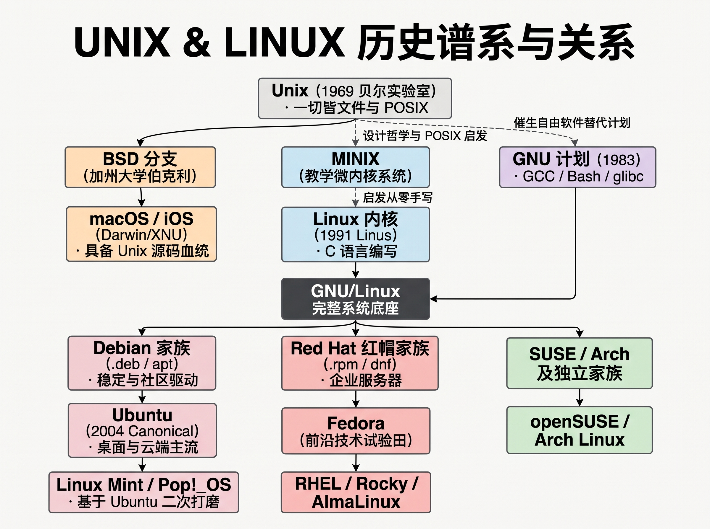

# 💯Linux内核与GNU全景

> 严格来说，**Linux 确实只是一个内核（Kernel）**，而不是一整套完整的操作系统。真正让它变成我们日常敲命令、跑服务、装软件的完整系统的，是 **C 语言**筑起的底层根基、**Unix** 传承下来的设计哲学、**GNU 计划（Bash 与 GCC）**补齐的用户态核心拼图，以及 **Ubuntu** 等发行版完成的工程化打包。

如果把构建与使用操作系统比作造车与开工厂，这几大核心角色的分工一目了然：

- **C 语言**：制造发动机的金属材料与精密加工工艺。
- **Unix**：最早画出来的发动机设计图纸与行业技术规范。
- **Linux（内核）**：按着 Unix 的设计思想，从零重新手搓出来的开源发动机（车间里轰鸣的核心动力机组）。
- **Bash 与 GCC（GNU 王牌）**：包在车间外的操控装备——**Bash 是你指挥车间的对讲机**，**GCC 是把设计图纸锻造成标准零件的数控机床**。
- **Ubuntu（发行版）**：把 Linux 发动机装进车架，配齐 GNU 工具、方向盘、仪表盘、桌面环境与软件仓库的**整车成品**。

脱掉比喻，从计算机体系结构的底层视角出发，下面把这七块拼图的位置、血缘与协作链路一次性串透。

---

## 一、Linux（内核）：夹在硬件与软件之间的“大管家”

操作系统最核心的使命，是**防止普通程序直接乱碰物理硬件**。如下图所示，计算机运行空间被硬件权限严格切分为上下两层：**Linux 内核**运行在拥有最高权限的**内核态（Kernel Space）**，往下接管所有物理硬件，内部主要干五件苦活：

  

    

      <strong>用户态（User Space）· 受限权限（Ring 3）</strong>
      普通程序与 GNU 工具活动区
    

    

      
<strong>命令行壳 Shell</strong>Bash / Zsh 解析命令

      
<strong>编译与基础工具</strong>GCC / ls / grep / cp

      
<strong>业务与桌面程序</strong>浏览器 / 数据库 / 服务进程

      
<strong>C 标准库（glibc）</strong>printf / malloc / open 封装

    

  

  
⇅ 唯一合法跨越边界通道

  
System Call Interface（系统调用接口：read / write / fork / execve / socket …）

  
⇅ 陷入内核态处理请求

  

    

      <strong>内核态（Kernel Space）· Linux Kernel 最高权限（Ring 0）</strong>
      操作系统核心引擎
    

    

      
<strong>Process Scheduler &amp; IPC</strong>CPU 时间片调度与进程通信

      
<strong>Memory Manager</strong>虚拟内存隔离与页表映射

      
<strong>VFS 虚拟文件系统</strong>统一抽象“一切皆文件”

      
<strong>Device Manager</strong>字符/块设备驱动与中断

      
<strong>Network Stack</strong>TCP/IP 封包路由与收发

    

  

  
⇅ 总线、寄存器与硬件中断

  

    

      <strong>物理硬件层（Physical Hardware）</strong>
      裸机硅片资源
    

    
CPU 核心与寄存器 · 物理内存条（DRAM） · 磁盘存储（NVMe / SSD） · 网卡与外设（NIC / Keyboard / GPU）

  

- **Process Scheduler（进程调度）与 IPC**：决定哪一毫秒让哪个程序使用 CPU，并协调不同进程之间的通信与同步。
- **Memory Manager（内存管理）**：给每个进程分配独立的虚拟地址空间，配合硬件 MMU 做页表映射，防止程序彼此踩踏数据。
- **VFS（虚拟文件系统）与 Device Manager（设备管理）**：把机械硬盘、NVMe 固态、键盘、网卡等千差万别的物理设备，统一抽象成标准“文件”来读写。
- **Network（网络协议栈）**：在内核里高效处理以太网帧与 TCP/IP 数据包的封装、拆包与转发。

平时编写的程序都运行在受保护的**用户态（User Space）**，想读一个文件或发一个网络请求，必须通过最顶层的 **System Call Interface（系统调用接口）** 向内核提出申请。光有 Linux 内核本身，连一个能敲命令的黑框都没有，普通用户是无法直接交互使用的。

---

## 二、C 语言：Unix 催生了它，它写出了 Linux

C 语言与现代操作系统几乎是相伴相生的共生关系：

1. **先有 Unix，再为它造出 C**：1969 年贝尔实验室（Bell Labs）编写第一版 Unix 时使用的是汇编语言，致命痛点是**每换一款 CPU 架构就得从头重写一遍**。为了解决跨硬件移植难题，Dennis Ritchie 在 1972 年发明了 **C 语言**，并在 1973 年用 C 重写了 Unix 内核。从此，操作系统第一次具备了跨平台可移植性。
2. **Linux 为什么用 C 写**：编写内核既需要贴近硬件的极高执行效率，又需要用指针直接操作内存地址、控制寄存器和响应硬件中断，更**绝对不能有垃圾回收（GC）带来的不可控停顿（Stop-The-World）**。C 语言几乎贴着汇编的效率运行，又能保持良好的结构化可读性，因此 Linux 内核绝大部分代码由 **C 语言**编写，只在启动引导（Boot）和极少数与特定 CPU 强绑定的上下文切换处混入**汇编**（近几年也开始在内核主线少量引入 **Rust** 来编写内存更安全的驱动模块）。

---

## 三、Unix 与 Linux：设计上师承，代码上“零血缘”

Unix 是 1970 年代确立现代操作系统范式的老祖宗，但后来逐渐走上了商业闭源与高昂授权费的路线。1991 年，芬兰赫尔辛基大学的大学生 Linus Torvalds 为了在自己的个人 PC（Intel 386）上用上类似 Unix 的系统，参考教学用微内核系统 MINIX，**自己从第一行代码写起了 Linux 内核**（早期版本限制商业收费分发），并在次年（1992 年发布的 0.12 版）正式转向 **GNU GPL 协议**完全开源。

厘清 Unix 与 Linux 的关系，只需抓住两个核心事实：

- **源码毫无血缘**：Linux 没有复用 AT&T Unix 的一行商业源代码。真正在代码血统上直接继承自 Unix 分支（BSD，伯克利软件套件）的现代主流系统，反而是苹果的 **macOS / iOS**（底层 XNU 内核融合了 Mach 与 FreeBSD 代码）。
- **思想与标准高度一致**：Linux 属于经典的 **Unix-like（类 Unix）**系统。它完整继承了 Unix 的设计哲学（如**“一切皆文件”**、用管道 `|` 组合单一职责的小工具、纯文本配置、严格的多用户权限模型），并遵循 **POSIX**（可移植操作系统接口）标准——这意味着按 Unix 标准编写的 C 程序，几乎不用改代码就能在 Linux 上重新编译运行。

---

## 四、Ubuntu 与 Linux：GNU 补齐拼图，发行版打包交付

Linus 只写出了内核，但一套能日常交互与开发构建的完整系统，除了内核外还需要命令行解释器、C 标准库、日常基础命令（如 `ls`、`grep`、`cp`、`awk`），以及将源码构建成软件的编译器（注：仅运行已编译好的程序通常无需安装编译器，开发源码或构建发行版软件包时才需要）。以 **Ubuntu** 等主流通用系统为例，这些外围角色恰巧由 Richard Stallman 在 1983 年发起的 **GNU 计划**（递归缩写：*GNU's Not Unix!*）提前备齐了——即 **Bash**、**glibc**、GNU Coreutils 与 **GCC**。内核与 GNU 拼图一拍即合，才组成了经典的自由操作系统，因此在严谨的技术语境下常被称为 **GNU/Linux**。

正因为内核与用户态工具彼此解耦，不同社区或商业公司拿来同一颗 **Linux 内核**，既可以搭配经典的 GNU 工具集，也可以按场景替换成其他轻量组件（例如容器领域常用的 **Alpine Linux** 就改用 `musl` 标准库与 `BusyBox` 工具集），再配上各自的**软件包管理器**、初始化系统（如 `systemd`）与图形桌面（GNOME / KDE），打包维护后就演化出了百花齐放的**发行版（Distribution）**：

从上面的谱系分支可以一眼看清 **Ubuntu** 所处的生态坐标：

- **Debian 家族**：以极致稳定、纯粹社区自治和 `.deb` / `apt` 包管理器著称。**Ubuntu** 正是 Canonical 公司基于 Debian 二次打磨出来的发行版，把安装流程、闭源网卡显卡驱动和桌面开箱体验做得更省心（而 Linux Mint 又是基于 Ubuntu 进一步封装的）。
- **Fedora / RHEL 家族**：红帽系，采用 `.rpm` 与 `dnf` / `yum` 包管理器，广泛统治金融、电信等企业级服务器环境（如商业版 RHEL，以及社区兼容版 Rocky Linux、AlmaLinux、早期的 CentOS）。
- **SUSE 及其他独立家族**：如欧洲企业常用的 openSUSE，以及追求极简滚动更新、让用户从零自己拼装系统的 Arch Linux 等。

无论外层叫 Ubuntu、Debian 还是 RHEL，掀开机盖看最底层，跳动的都是同一颗 **Linux 内核**。

| 概念 | 核心定位 | 诞生时间 | 关键关联 |
| :--- | :--- | :---: | :--- |
| **C 语言** | 系统级编程语言 | 1972 年 | 为重写 Unix 而诞生，也是编写 Linux 内核的主力语言 |
| **Unix** | 操作系统鼻祖与规范 | 1969 年 | 奠定了现代类 Unix 系统的设计哲学与 POSIX 接口标准 |
| **Linux** | 开源操作系统内核 | 1991 年 | 遵循 Unix 思想、用 C 从零重写的进程调度与硬件管理层 |
| **Ubuntu** | 完整 Linux 发行版 | 2004 年 | 基于 Debian，将 Linux 内核与 GNU 工具、桌面生态打包成的成品系统 |

---

## 五、Bash：包在内核外面的“命令翻译官”

接上文提到的 GNU 拼图——**Bash** 和 **GCC** 正是 GNU 计划里最核心的两大王牌软件，它们都运行在用户态，各司其职。先看下面的操作系统**同心圆层次模型**：最核心是**硬件**，往外紧包着**内核与系统调用**；再往外一层就是 **Shell 壳与标准库函数**，最外圈才是各类用户应用。

  <svg viewBox="0 0 320 320" width="270" height="270" role="img" aria-label="操作系统同心圆架构图" style="max-width:100%;height:auto;flex-shrink:0">
    <circle cx="160" cy="160" r="150" fill="rgba(167,139,250,0.10)" stroke="#a78bfa" stroke-width="1.5" stroke-dasharray="5 3"/>
    <circle cx="160" cy="160" r="112" fill="rgba(56,189,248,0.13)" stroke="#38bdf8" stroke-width="1.6"/>
    <circle cx="160" cy="160" r="74" fill="rgba(16,185,129,0.16)" stroke="#10b981" stroke-width="1.8"/>
    <circle cx="160" cy="160" r="36" fill="rgba(245,158,11,0.24)" stroke="#f59e0b" stroke-width="2"/>
    <text x="160" y="32" text-anchor="middle" fill="#a78bfa" font-size="12" font-weight="700">外圈：用户应用 (GCC / Vim / Web)</text>
    <text x="160" y="70" text-anchor="middle" fill="#38bdf8" font-size="12" font-weight="700">壳层：Shell (Bash) 与库函数 (glibc)</text>
    <text x="160" y="108" text-anchor="middle" fill="#10b981" font-size="12" font-weight="700">内核层：Linux Kernel + 系统调用</text>
    <text x="160" y="156" text-anchor="middle" fill="#f59e0b" font-size="12" font-weight="700">核心</text>
    <text x="160" y="172" text-anchor="middle" fill="#f59e0b" font-size="11" font-weight="700">物理硬件</text>
  </svg>
  

    
为什么命令解释器要叫“壳（Shell）”？

    
<strong>Kernel</strong> 本意是坚硬无比的“果核”，普通人没法直接徒手去抠果核里的系统调用接口，必须在果核外面包一层人类能摸得着的<strong>“果壳（Shell）”</strong>来做人机交互。

    
当你敲下一行命令时，Shell 先完成词法解析、通配符与环境变量展开：若是内建命令（如 <code>cd</code>）就由自己直接执行；若是外部程序（如 <code>gcc</code>、<code>./hello</code>），则通过 <code>fork()</code> + <code>execve()</code> 请求内核派生子进程干活。

  

围绕 Bash，有四个最值得记住的关键点：

- **Bash 的身世**：全称 **Bourne-Again SHell**（双关语，直译为“重生的 Bourne Shell”），它是 GNU 计划为了替代早期 Unix 里闭源的老牌解释器 `sh`（Bourne Shell）而编写的增强自由软件。如今包括 Ubuntu 在内的绝大多数 Linux 发行版，默认登录 Shell 都是 Bash（macOS 则自 Catalina 起将默认 Shell 切为了兼容度相近的 `zsh`）。
- **别把“终端（Terminal）”和“Bash”混为一谈**：你在桌面上点开的那个黑框窗口（如 Windows Terminal、GNOME Terminal、iTerm2）只是**终端模拟器**，它只是一台负责接收键盘按键、把文字和颜色画在屏幕上的“显示器”；真正藏在黑框背后读懂你的命令语法、管理后台任务的纯后台程序，才是 **Bash**。
- **这一行到底是谁执行的？（内建命令 vs 外部程序）**：把两条常见命令并排对比，最容易看透 Shell 的运行机制：
  - 敲入 `cd /tmp`（**Shell 内建命令 Builtin**）：Bash **不会**派生子进程（因为子进程改完目录一退出，父进程 Bash 还在原地），而是由 **Bash 进程自己**直接调用 `chdir()` 切换工作目录，所以下一条命令自然就在 `/tmp` 下运行。
  - 敲入 `./hello` 或 `ls`（**外部可执行程序**）：Bash 才会先通过 `fork()` 复制出子进程，再在子进程里通过 `execve()` 请求内核加载磁盘上的二进制程序运行。
- **Bash 的两大日常活计**：
  1. **交互式流水线指挥**：用管道符 `|` 和重定向 `>` 把单一职责的小命令串成数据流水线（例如 `ps aux | grep nginx`）。
  2. **自动化脚本（`.sh`）**：把繁琐的运维构建步骤配上变量、循环与条件判断，写成一键运行的批处理脚本。

---

## 六、GCC：把源码锻造成可执行文件的“总包工头”

CPU 根本看不懂 `if`、`while` 或 `printf`，它只认识一串由 `0` 和 `1` 组成的机器指令。**GCC** 全称 **GNU Compiler Collection（GNU 编译器套件）**——最早它只负责编译 C 语言（*GNU C Compiler*），后来陆续扩展出 C++（`g++`）、Fortran、Go、Ada 等前端，成为开源世界最核心的编译器基石。连 Linux 内核本身，绝大多数发行版也是用 GCC 编译出来的。

平时敲下一句 `gcc hello.c -o hello`，表面看似一步到位，其实 `gcc` 只是一个**驱动总包工头**，它在幕后按顺序串联起底层的编译与链接组件，走完了一条严密的**四阶段编译流水线**（注：现代 GCC 默认已将预处理整合进编译前端中一气呵成，不必逐个启动四个独立进程，但通过编译选项拆成四步观察最能看清每次蜕变）：

1. **预处理（参数 `gcc -E hello.c -o hello.i`）**：把 `#include <stdio.h>` 里的头文件声明原封不动复制展开，替换所有 `#define` 宏定义，顺手删光所有源码注释，产出一份体积暴涨但依然是纯文本的 C 源码文件 `hello.i`。
2. **编译（编译器前端 `cc1`，参数 `gcc -S hello.i -o hello.s`）**：最烧脑的一步。负责词法/语法/语义检查并执行中间代码优化，把高级 C 语言翻译成对应 CPU 架构（如 x86-64 或 ARM64）的文本汇编代码 `hello.s`。
3. **汇编（汇编器 `as`，参数 `gcc -c hello.s -o hello.o`）**：把助记符形式的汇编指令逐条翻译成真正的二进制机器码，打包成可重定位目标文件 `hello.o`。此时代码里调用的外部库函数（如 `printf` / `puts`）还没找到真实内存入口，只在符号表里留着未解析的空位（`UND`）。
4. **链接（链接器 `ld`，`gcc` 默认收尾执行）**：把 `hello.o` 与运行时启动文件（`crt1.o` 等）拼装起来完成内部重定位，并与系统标准 C 函数库（如 `glibc` 的 `libc.so.6`）建立关联。由于 GCC 默认采用**动态链接（Dynamically Linked）**，构建时链接器并不会把庞大的 `glibc` 塞进程序，也不会填死外部函数的最终内存地址，而是为外部调用准备好动态跳转桩（PLT/GOT）、记录依赖库与动态链接器路径，最终锻造出 **ELF 二进制可执行文件**（不加 `-o` 时按历史习惯默认命名为 `a.out`）；等到程序真正运行时，才由动态链接器加载 `glibc`，并在程序启动或首次调用时解析出函数的实际地址（除非显式加 `-static` 做静态打包）。

---

## 七、全链路合体：Bash、GCC 与 Linux 内核如何三方接力？

当你在 Ubuntu 终端里从零写下一份 `hello.c`，编译并运行 `./hello` 打印出一行字时，背后正是一场 **Bash × GCC 四阶段 × Linux 内核与动态链接器** 的精准接力。点击下方交互模拟器的各个阶段按钮，即可逐帧查看同一份代码在五个阶段中带注解的产物节选与底层动作：

  

    <strong>交互实验室：从 <code>hello.c</code> 到屏幕输出的五步蜕变</strong>
    点击查看带注解的产物节选
  

  

    <button type="button" class="tk-lnx-btn is-active" data-step="0">① 预处理 (.i)</button>
    <button type="button" class="tk-lnx-btn" data-step="1">② 编译 (.s)</button>
    <button type="button" class="tk-lnx-btn" data-step="2">③ 汇编 (.o)</button>
    <button type="button" class="tk-lnx-btn" data-step="3">④ 链接 (ELF)</button>
    <button type="button" class="tk-lnx-btn" data-step="4">⑤ Bash 调度内核运行</button>
  

  

    
<small>终端输入指令</small><code id="tk-lnx-cmd">gcc -E hello.c -o hello.i</code>

    
<small>幕后执行主角</small><strong id="tk-lnx-actor">GCC 预处理阶段 (cc1 -E / cpp)</strong>

    
<small>输入 → 产物形态</small>hello.c → 展开后的纯 C 文本 (约 800+ 行)

  

  <pre class="tk-lnx-code" id="tk-lnx-out"></pre>
  

把这场接力浓缩成三句话，就是日常敲命令编译运行外部程序的底层真相：

1. 你在**终端**窗口敲入 `gcc hello.c -o hello` 并按下回车。
2. **Bash** 识别出 `gcc` 是外部程序（而非 `cd` 那样的内建命令），通过 `fork()` + `execve()` 通知 **Linux 内核**派生子进程启动 **GCC**；**GCC** 串联走完预处理、编译、汇编、链接四个阶段，准备好针对 `glibc` 的动态链接信息，锻造出二进制文件 `hello`。
3. 你再输入 `./hello`，**Bash** 再次请求 **Linux 内核**将 `hello` 加载进独立的虚拟内存空间，由**动态链接器**加载 `glibc` 并解析出库函数的实际地址后交给 CPU 执行，最终在触发 `write` 系统调用时将结果写回终端屏幕。

| 对比维度 | Bash | GCC |
| :--- | :--- | :--- |
| **核心定位** | 命令行解释器（Shell）与自动化脚本引擎 | 源代码编译器套件（驱动四阶段编译链） |
| **英文全称** | Bourne-Again SHell | GNU Compiler Collection |
| **输入与输出** | 输入人类交互命令或 `.sh` 脚本，自理内建命令或调度内核运行外部进程 | 输入 C / C++ 等高级源码，输出 ELF 二进制可执行文件 |
| **常见同类工具** | Zsh（macOS 默认）、Fish、BusyBox ash、PowerShell | Clang / LLVM、MSVC（Windows Visual Studio） |

---

## 八、参考与延伸阅读

- [The Linux Kernel Archives](https://www.kernel.org/) — Linux 内核主线源码与发布归档官网（含 1992 年 v0.12 转向 GNU GPL 的历史发行说明）
- [The GNU Operating System and the Free Software Movement](https://www.gnu.org/) — GNU 计划、GPL 协议与自由软件历史文档
- [GNU Bash Reference Manual](https://www.gnu.org/software/bash/manual/) — Bash 官方语法、Shell 内建命令（Builtins）与脚本手册
- [GCC Online Documentation](https://gcc.gnu.org/onlinedocs/) — GCC 编译选项（`-E` / `-S` / `-c` / `-O2`）与前端机制手册
- [ld.so(8) — Linux Manual Page](https://man7.org/linux/man-pages/man8/ld.so.8.html) — Linux 动态链接器（Dynamic Linker/Loader）官方手册页
