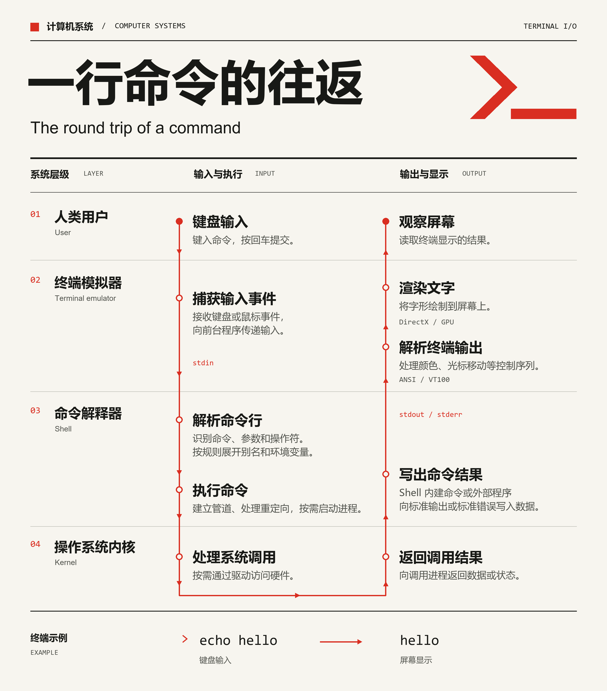
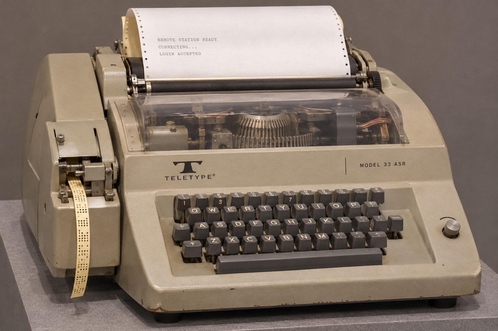
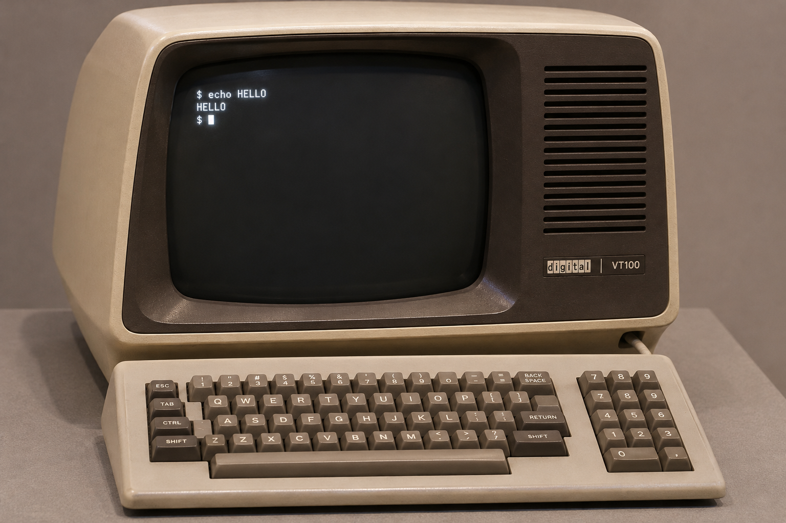
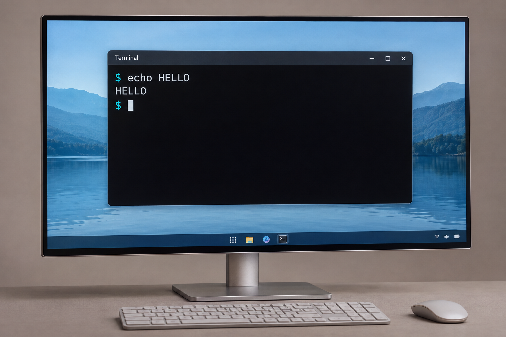
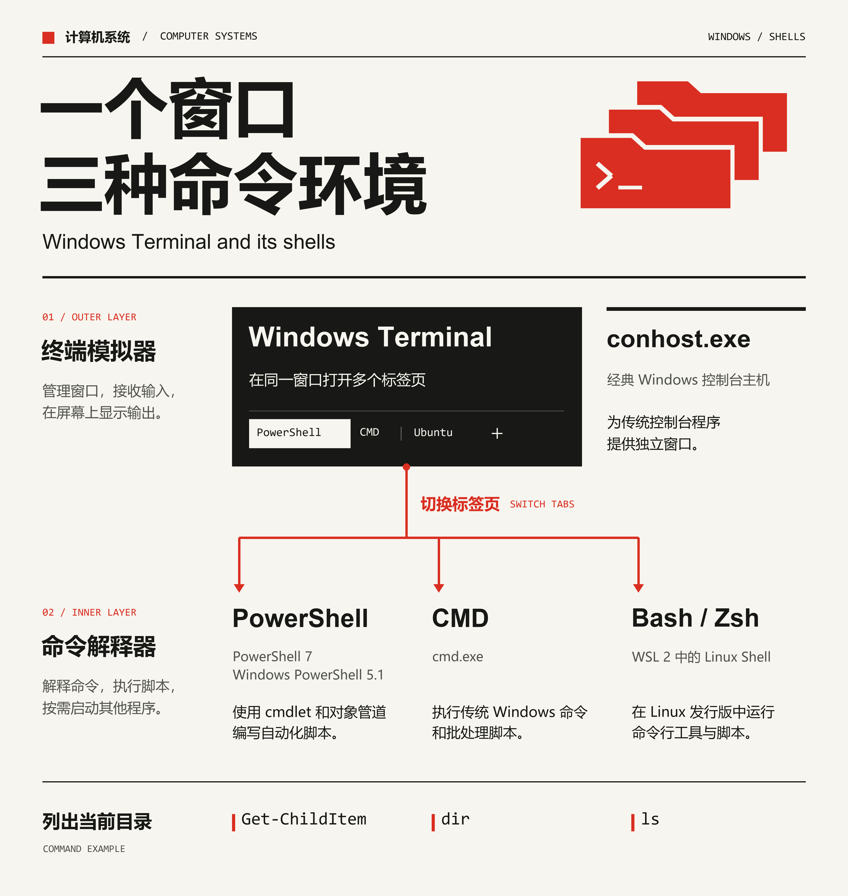

# 💯从TTY到现代Shell终端

在许多初学者的认知中，屏幕上弹出的那个黑框框、闪烁着光标等待敲代码的窗口，经常被笼统地叫做“终端”或“命令行”。而在 Windows 系统里，**CMD、PowerShell、Git Bash、WSL 以及 Windows Terminal** 更是让人眼花缭乱、傻傻分不清楚。

要彻底破除这种混乱，只需要搞懂计算机体系中一个经典的分层解耦：**“终端模拟器（Terminal Emulator）”与“命令解释器（Shell）”是两个职责完全不同的程序。**

---

## 一、 经典解耦：终端与 Shell 的“电视机与游戏机”关系

我们可以用一个最直观的客厅娱乐比喻来理清它们的分工：

- **终端模拟器（Terminal Emulator）**：就像桌上的**电视机（显示屏 + 手柄信号接收器）**。它只负责窗口管理、捕获键盘与鼠标输入、解析颜色与光标控制指令，并把文字漂亮地渲染在屏幕上；它自己完全不懂任何命令语法，也不负责执行业务逻辑。
- **命令解释器（Shell）**：就像插在电视后面的**游戏机主机（如 Switch、PS5 或 Xbox）**。它是一个**没有自身图形窗口界面的命令行程序**，负责解析你输入的命令语法、展开环境变量与别名，直接执行内建命令或请求系统启动其他程序，再把输出结果交回终端去显示。

用一句话划清完整的系统三层边界（对应下图）：**终端模拟器**负责接收输入与绘制画面，**命令解释器（Shell）**负责解释命令与编排执行，而底层的**操作系统内核（Kernel）**才真正负责系统调用、进程调度与硬件驱动。你在同一个窗口里把 CMD 切换成 PowerShell，只是给同一台电视换接了一台游戏机，绝不是换掉了操作系统内核。



---

## 二、 历史回眸：从物理电传打字机到软件模拟

理解了分工，再看一眼历史，你就能明白标题里“从 TTY 到现代终端”究竟跨过了哪三步：

### 1. 纸卷电传打字机时代（TTY 的诞生）

- 在 20 世纪 60 年代的大型机时代，计算机体积堪比几个大衣柜且极其昂贵，操作员无法直接围在主机前工作，而是在不同房间使用一种叫 **TTY（Teletypewriter，电传打字机，如著名的 ASR-33）** 的纯物理外设。
- 那时的 TTY 只有**一个机械键盘和一卷打印纸**，通过串行线缆（Serial Cable）连接到远方的主机：敲下一个按键，电信号顺着线缆传给主机；主机计算完把结果传回，驱动打印针头在纸上“咔哒咔哒”打出字符。今天 Linux 与 macOS 中仍将终端设备命名为 `/dev/tty`，正是这段历史的活化石。
  
### 2. CRT 视频字符终端时代（从纸卷到屏幕）

- 到了 70 年代末，以经典的 **DEC VT100** 为代表的**视频终端（Video Terminal）**用阴极射线管（CRT）荧光屏取代了不可擦写的打印纸卷。
- 既然字符显示在了屏幕上，人们自然需要“移动光标、清空屏幕、给文字变换颜色”。于是诞生了一套嵌在文本流里的特殊控制编码——也就是沿用至今的 **ANSI / VT100 控制序列**（对应上图中终端模拟器“解析终端输出”那一步）。
  
### 3. 桌面软件模拟器时代（Terminal Emulator）

- 进入个人电脑与图形界面（GUI）时代后，笨重的独立物理终端彻底退出历史舞台。
- 现代操作系统直接用软件在桌面上画出一个窗口，用来模拟当年物理视频终端“捕获按键输入 + 解析 `ANSI / VT100` 控制序列 + 渲染字符画面”的工作，这就是我们今天每天打交道的**终端模拟器（Terminal Emulator）**。
  
---

## 三、 彻底厘清 Windows 中的“多与杂”

为什么许多初学者会觉得 Windows 里的命令行工具格外混乱？因为大家常常把**外层窗口（终端模拟器）**和**内层解释器（Shell）**这两个维度的排列组合混为一谈。只要把两层拆开看，所有名词瞬间各归其位：

### 1. 外层窗口：终端模拟器（Terminal Emulator）的演进

负责窗口外观、多标签页、分屏管理与 GPU 字体渲染：

| 终端模拟器 | 演进节点 | 核心技术特征 | 当前定位与评价 |
| :--- | :---: | :--- | :--- |
| **Console Host (`conhost.exe`)** | Windows 7 拆分为独立进程<br>（经典外观源自早期 Windows NT） | Windows 传统内置控制台宿主（Win7 将其从系统进程 `csrss.exe` 剥离以保障安全；Win10 1703 起已补齐 VT 控制码与 24 位真彩色）。但传统窗口缺乏标签页与分屏（Win10 及更早），GDI 渲染与旧式 16 色调色板设置面板体验较为陈旧。 | ⚙️ **底层兼容基石**：日常窗口交互已让位于现代终端，但同源的伪终端服务（ConPTY）仍在幕后承担传统 Win32 控制台 API 的兼容转换。 |
| **Windows Terminal (`wt.exe`)** | Windows 10 / 11 现代重构 | **微软现代官方主力终端**。基于 DirectWrite / DirectX GPU 硬件加速渲染，原生支持多标签与自由分屏、24 位真彩色、Emoji、Nerd Font 编程图标及亚克力/云母毛玻璃特效。 | 🏆 **现代推荐首选**：Windows 11 支持将其设为系统默认终端，体验全面看齐 macOS 与 Linux。 |
| **mintty (`mintty.exe`)** | Git for Windows 标配 | 轻量级类 Unix 终端模拟器。安装 Git 后桌面出现的 **“Git Bash”** 图标，默认就是用 `mintty` 作为外层窗口。对 POSIX 终端特性支持好，但与部分原生 Windows 交互程序的兼容性弱于 ConPTY 方案。 | 🧩 **套件自带外壳**：随 Git 开箱即用；你也可以把里面的 Bash 直接配置进 Windows Terminal 统一管理。 |
| **第三方极客终端 (WezTerm / Alacritty)** | 现代开源跨平台生态 | 基于 Rust 编写，主打纯 GPU 渲染、极速响应，以及跨 Windows / macOS / Linux 完全一致的配置文件体验。 | 🚀 **进阶极客之选**：适合多系统办公、追求配置代码化的开发者。 |

### 2. 内层引擎：命令解释器（Shell）的演进

负责命令语法解析、内建命令执行、管道重定向与自动化脚本：

- **CMD (`cmd.exe`)**：
  - Windows NT 为兼容早期 MS-DOS（`COMMAND.COM`）语法而打造的传统命令解释器。语法较为简陋，字符串与变量处理生硬。微软至今完整保留它，主要是为了让全球企业数十年来积累的 `.bat` / `.cmd` 批处理脚本与老旧构建工具依然能原样运行。
- **PowerShell (`powershell.exe` / `pwsh.exe`)**：
  - 微软基于 .NET 打造的现代命令解释器。与传统 Shell 在管道里传递“纯文本字符流”不同，**PowerShell 管道传递的是结构化的 .NET 对象（Object）**——你可以直接读取对象的属性、调用方法，具备工业级的系统管理与自动化能力。
  - *新手避坑提示*：Windows 10 / 11 出厂自带的是旧版 **Windows PowerShell 5.1（`powershell.exe`）**；而跨平台重构、性能更快且持续更新的现代版叫 **PowerShell 7（`pwsh.exe`）**，需要单独安装，两者在系统中互不冲突。
- **Windows 上常见的两种 Bash（彻底分清 Git Bash 与 WSL）**：
  - **Git Bash（MSYS2 `bash.exe`）**：来自 **Git for Windows**。它并不是虚拟机，而是把 GNU Bash 与常用工具（`git`、`ssh`、`grep` 等）重新编译成 Windows 原生程序，配合轻量兼容层运行。优点是启动极快、直接读写本地盘符，最适合日常敲 Git 命令；默认套在 `mintty` 窗口里运行，也能直接放进 Windows Terminal 打开。
  - **WSL 中的 Linux Shell（由 `wsl.exe` 进入的 `bash` / `zsh`）**：依托 **WSL（Windows 的 Linux 子系统）** 运行在轻量级真实 Linux 内核（WSL 2）之上。现代 Windows 的标准入口命令是 **`wsl.exe`**（早期遗留的 `System32\bash.exe` 已弃用），进入 Ubuntu / Debian 等发行版后，里面跑的是 100% 纯正的 Linux 原生 `bash` 或 `zsh`，可直接运行 Docker 容器与 Linux 服务端编译环境。

### 3. 30 秒亲手实验：同一个窗口，不同的“灵魂”

光看定义不如亲手验证一次。现在打开 **Windows Terminal**，在**同一个窗口**里分别打开一个 **“命令提示符（CMD）”** 标签页和一个 **“PowerShell”** 标签页，在两边分别输入完全相同的三个字母并回车：

```text
ver
```

你会立刻看到截然相反的结果：

- **CMD 标签页**：正常打印出 `Microsoft Windows [版本 10.0.xxxxx]`——因为 `ver` 是 `cmd.exe` 专属的**内建命令**（系统里并不存在一个叫 `ver.exe` 的外部程序）。
- **PowerShell 标签页**：直接红字报错，提示找不到名为 `ver` 的命令。（注：如果你平时在 PowerShell 里敲 `dir` 或 `ls` 能正常列出文件，只是因为 PowerShell 贴心地把它们预设成了原生命令 `Get-ChildItem` 的**别名 Alias**，但它并没有给 `ver` 设别名。）

这个 30 秒实验比任何定义都直观：**外面的窗口（终端模拟器）是同一个，但一句命令到底算不算数、该怎么执行，完全由当前标签页背后的命令解释器（Shell）决定。**

---

## 四、 一个窗口，多种环境：现代高效开发搭配



### Windows 11 推荐配置姿势

理清了终端与 Shell 的边界后，当下在 Windows 11 上最清爽、最高效的日常配置只需四步：

1. **统一外层终端窗口**：以 **Windows Terminal (`wt.exe`)** 作为唯一主力前端，并在系统 `设置 → 隐私和安全性 → 开发者选项`（或 Windows Terminal 设置的“启动”页）中，将 **“默认终端应用程序”** 设为 **Windows Terminal**。这样双击运行脚本时也会自动收进现代标签页窗口，日常彻底告别老旧的独立黑框（同时让底层的 ConPTY 继续在幕后安静处理兼容服务）。
2. **升级日常主力 Shell**：通过微软商店或终端命令 `winget install Microsoft.PowerShell` 安装现代版 **PowerShell 7**，然后在 Windows Terminal 设置里将“默认配置文件”设为 **PowerShell**（黑底图标的 `pwsh.exe`，而非系统自带蓝底图标的 `Windows PowerShell 5.1`），负责日常文件操作与脚本自动化。
3. **按场景一键切换标签页**：仅需在本地仓库顺手跑类 Unix 命令时，可在下拉菜单打开 **Git Bash** 标签页；一旦涉及 Linux 部署、C/C++ 编译或 Docker 容器开发，直接新建一个 **WSL 2 Ubuntu** 标签页（通过 `wsl.exe` 接入原生 `bash` / `zsh`）。
4. **一套交互习惯通吃全局**：无论底层标签页里跑的是 PowerShell、CMD、Git Bash 还是 WSL，外层的快捷键分屏（`Alt + Shift + D`）、剪贴板交互、字体连字与配色主题全部由 Windows Terminal 统一接管，真正做到“一个窗口，驾驭所有命令环境”。
