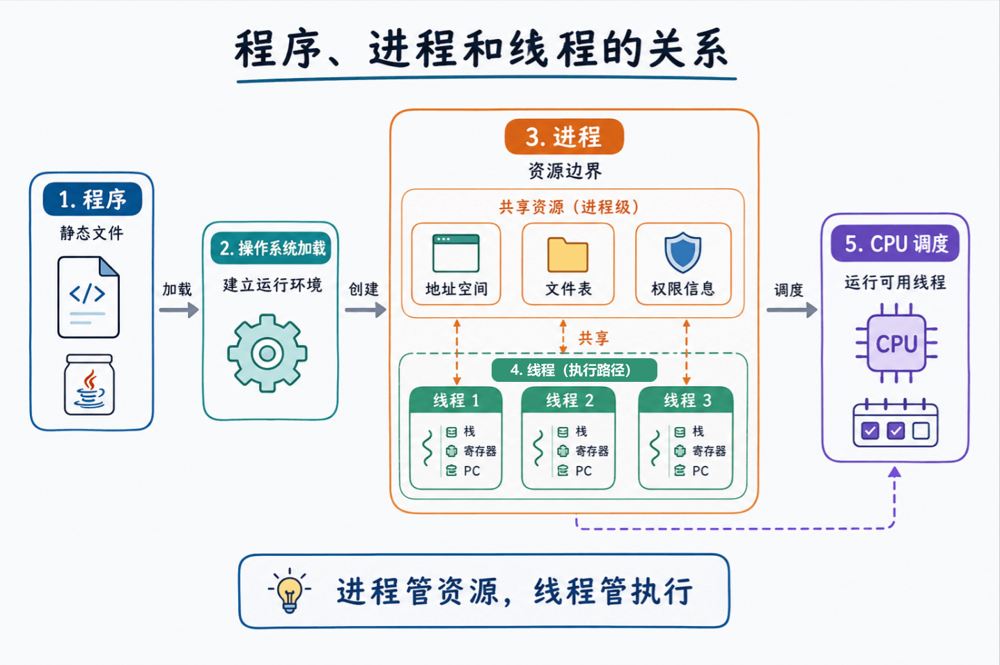

# 💯程序进程与线程

在操作系统与软件工程领域，**程序（Program）**、**进程（Process）**与**线程（Thread）**是绕不开的三块基石。初学者常常把它们混为一谈，其实只要抓住操作系统设计里最核心的一条原则，三者的边界就会瞬间清晰：

> **程序是静态的图纸，进程是隔离的资源容器，线程是真正干活的执行路径。**

简言之，**进程管资源，线程管执行**。



下面我们顺着上图的演进脉络（从 `1. 程序` 到 `5. CPU 调度`），以一份代码从“躺在硬盘”到“跑在 CPU 上”的完整生命周期为线索，把这三者彻底拆解清楚。

---

## 一、程序（Program）：沉睡在硬盘上的静态蓝图

结合图左侧的 **“1. 程序”**，程序本质上是存储在硬盘（或其他非易失性存储介质）上的**静态文件集合**。图中展示了两种典型的程序载体：一种是编译器直接生成的原生可执行文件（如 Windows 下的 `.exe`、Linux 下的 `ELF` 二进制文件），另一种是面向虚拟机运行时的字节码归档包（如 Java 的 `.jar` 文件）。

剖析一个编译产物的内部结构，里面封装的核心内容主要有两类：

* **指令段（Code / `.text`）**：编译器翻译好的机器码或字节码，严格规定了“第一步算什么、第二步跳向哪里”。
* **静态数据与元信息（Data & Header）**：程序中写死的字符串字面量、全局/静态变量的初始值（如 `.rodata`、`.data` 段），以及供加载器识别的文件头元信息（入口地址、段表、依赖库列表等）。

程序的关键特征是**静态性**与**持久性**。只要你不去启动它，它就只是磁盘上静默躺着的一串二进制字节——不占用物理内存，不消耗 CPU 时间片，也不会因为断电关机而消失。无论是操作系统直接装载 `.exe`，还是由 JVM（`java` 进程）加载 `.jar` 字节码，同一份程序文件都可以被同时启动多次，衍生出多个互不干扰的运行实例。

---

## 二、进程（Process）：操作系统划出的独立资源容器

当你在桌面双击图标或在终端敲下回车，操作系统就会派出加载器（Loader），把硬盘上的程序装载进内存并建立运行环境（如上图 **“2. 操作系统加载”**），最终创建出 **“3. 进程”**。这个**处于运行期的程序动态实例**，就是进程。

进程是操作系统**分配和隔离资源的基本单位**。每创建一个进程，内核都会为它在内核空间建立一份专属档案——**进程控制块（PCB, Process Control Block）**，并划出一整套受保护的资源边界：

1. **独立的虚拟地址空间**：包含代码段、数据段、动态伸缩的堆区（Heap）、内存映射区以及栈区（Stack）。每个进程看到的都是独享的连续地址，底层由内核页表配合硬件 MMU（内存管理单元）映射到真实的物理内存。
2. **文件表（打开文件描述符表）**：记录该进程当前打开了哪些本地文件、匿名管道、设备或网络 Socket 连接。
3. **权限与身份信息**：进程号（PID）、父进程号（PPID）、所属用户与权限组（UID/GID）、环境变量及安全上下文等。

在图中的进程边界内，这些被统称为 **“共享资源（进程级）”**——意味着归属于该进程的所有执行活动，都共同使用这一套地址空间、文件表和权限凭证。

### 为什么必须要有“进程”这一层？

核心答案只有两个字：**隔离**。

早期计算机缺乏硬件级内存保护，一个程序写飞了指针，就可能直接踩坏另一个程序甚至操作系统内核的数据，导致整机死机。进程机制借由独立的页表与虚拟地址空间筑起了高墙：进程 A 无法直接读写进程 B 的内存；即便进程 A 发生致命崩溃，内核也能干净利落地回收它的全部内存页和文件句柄，绝不拖垮其他正在运行的软件。

但强隔离是有代价的：

* **创建与销毁成本较高**：即便现代操作系统普遍采用**写时复制（Copy-on-Write, COW）**技术，避免了 `fork` 创建子进程时立即拷贝全部物理内存，内核仍需复制页表、文件描述符表与 PCB 等结构，开销依然可观。
* **上下文切换偏重**：在不同进程间切换时，CPU 必须切换页表基址寄存器（如 x86-64 的 `CR3`），这会导致地址转换快表（TLB）刷新，并降低 CPU 缓存命中率。
* **跨界通信繁琐**：由于虚拟内存彼此隔绝，进程间若要交换数据，必须借助管道、共享内存、消息队列或 Socket 等**进程间通信（IPC）**机制，频繁跨越内核态与用户态的拷贝让高频协作成本居高不下。

---

## 三、线程（Thread）：真正在 CPU 上干活的执行路径

随着现代软件交互日益复杂，单纯依赖“进程”开始捉襟见肘。试想一个日常使用的桌面软件：它既要毫秒级响应鼠标点击与界面重绘，又要在后台自动保存大文件，同时还得维持长连接接收云端推送。

如果把这些任务拆成多个独立进程，它们之间高频同步同一份文档状态就要承受繁重的 IPC 开销；如果全部塞进单进程的单条执行流里排队运行，只要后台写盘卡顿两秒，整个界面就会彻底冻住。

于是，操作系统在进程内部引入了更轻量的并发抽象——**线程**。

如上图 “3. 进程” 下半部分的 **“4. 线程（执行路径）”** 所示，线程依附于进程存在，是 **CPU 调度和执行的最小单位**。右侧 **“5. CPU 调度”** 真正在内核运行队列里挑选并分派时间片的对象，正是这一条条可用线程，而非笨重的进程容器本身（在 Linux 内核中，线程甚至直接复用了进程的 `task_struct` 结构，本质上就是通过 `clone()` 创建、共享同一套地址空间与资源表的轻量级执行体）。一个进程启动时默认至少包含一条**主线程**，随后可按需派生出多条并发工作的子线程。

### 线程的精髓：哪些共享，哪些私有？

吃透多线程编程，最关键的是厘清同一进程内各线程之间的内存边界：

* **所有线程共享进程级资源**：包括代码段、全局/静态数据段、堆区（`malloc` / `new` 分配的对象）以及进程打开的文件表与网络连接。正因为身处同一片虚拟地址空间，线程之间传递数据几乎是“零拷贝成本”的，拿着指针就能读写同一块内存。
* **每条线程（线程 1、2、3）仅独占极轻量的执行上下文**：
    * **独立的栈（Stack）**：用于保存各自的函数调用链、形参与局部变量。
    * **寄存器（Registers）与程序计数器（PC）**：记录“我当前算到了哪一步、下一条该取哪行指令”，以便在时间片耗尽被挂起后，下次调度时能无缝恢复现场。
    * **线程局部存储（TLS）**：如 C11 的 `_Thread_local` 或 Java 的 `ThreadLocal`，专为单条线程开辟的私有状态槽位。

> **底层冷知识：线程的“私有栈”有硬件隔离吗？**
> 进程间的隔离靠硬件 MMU 和独立页表“硬隔离”；而同一进程内多条线程的栈，其实是划分在**同一个虚拟地址空间**的不同区段里的。所谓“线程栈私有”，只是因为各线程的栈指针寄存器各指各的区域、正常局部变量寻址互不干扰，底层**并没有页表级的访问封锁**——如果线程 1 把自己栈上局部变量的地址传给线程 2，线程 2 在内存层面依然可以直接读写它（一旦线程 1 函数返回销毁栈帧，就会酿成经典的悬垂指针灾难）。

下面用一段标准的 C11 多线程代码，直观验证“全局数据段共享同一地址”与“各线程栈地址彼此独立”：

```c
#include <stdio.h>
#include <stdatomic.h>
#include <pthread.h>

// 位于进程的全局数据段：同一进程内的所有线程共享同一份内存
// 这里使用 C11 原子类型保证并发自增的确定性（第 六 节会剖析去掉原子保护的后果）
atomic_int shared_counter = 0;

void* worker(void* arg) {
    // 位于各自线程的私有栈：每条线程在各自的栈帧上独立拥有一份
    int local_id = *(int*)arg;
    int current = atomic_fetch_add(&shared_counter, 1) + 1;

    printf("线程 %d | 私有栈变量地址: %p | 共享变量地址: %p | 共享计数: %d\n",
           local_id, (void*)&local_id, (void*)&shared_counter, current);
    return NULL;
}

int main(void) {
    pthread_t t1, t2;
    int ids[2] = {1, 2};

    pthread_create(&t1, NULL, worker, &ids[0]);
    pthread_create(&t2, NULL, worker, &ids[1]);

    pthread_join(t1, NULL);
    pthread_join(t2, NULL);
    return 0;
}
```

编译并运行这段程序（`gcc demo.c -std=c11 -pthread && ./a.out`），你会看到类似下面的输出：

```text
线程 1 | 私有栈变量地址: 0x7f8b4fc00ef4 | 共享变量地址: 0x55d9a2004014 | 共享计数: 1
线程 2 | 私有栈变量地址: 0x7f8b4f400ef4 | 共享变量地址: 0x55d9a2004014 | 共享计数: 2
```

结果一目了然：两条线程的局部变量 `&local_id` 相隔数兆字节（各自位于独立的线程栈区），而它们读写的 `&shared_counter` 却分毫不差地指向同一个虚拟内存地址。

也正因为同一进程内的线程切换**无需更换虚拟地址空间和页表**，CPU 缓存与 TLB 依然温热，只需保存并恢复少量寄存器与栈指针，所以**线程的创建、销毁与上下文切换开销远小于进程**。

---

## 四、把三者放进同一个真实场景

以你每天都在使用的桌面办公软件或本地客户端为例：

* **程序**：静静躺在安装目录里的 `.exe` 或应用包文件。
* **进程**：双击启动后，操作系统为它划出的一整块独立内存沙箱与运行环境。如果你双开两个完全独立的软件实例，系统任务管理器里就会出现两个拥有不同 PID 的进程。
* **线程**：在同一个软件进程内部并行不悖的多条工作流水线：
    * **UI 主线程**：专门负责监听键鼠事件、计算布局与绘制窗口画面。
    * **I/O 后台线程**：负责读写本地大文件、执行自动保存或扫描工程目录。
    * **计算/网络线程**：负责语法解析、拼写检查或后台同步云端数据。

这也是所有客户端与前端框架通用的一条铁律：**绝对不要在 UI 主线程里执行耗时的磁盘读写或同步网络请求**。一旦主线程被阻塞，消息循环与界面重绘就会瞬间停摆，操作系统便会弹出令人头疼的“程序未响应（ANR）”。

---

## 五、全景对比：一张表看清核心差异

| 对比维度 | 程序（Program） | 进程（Process） | 线程（Thread） |
| --- | --- | --- | --- |
| **核心定位** | 静态的指令与数据文件 | 操作系统分配和隔离资源的基本单位 | CPU 调度与执行的基本单位 |
| **存在形态** | 持久静默存放于磁盘 | 动态运行于内存的独立实例 | 动态运行于内存，依附于所属进程 |
| **资源归属** | 不占运行期系统资源 | 独占虚拟地址空间、页表、文件表与权限 | 共享进程资源，仅私有栈、寄存器、PC 与 TLS |
| **创建/切换开销** | 无 | 大（需维护 PCB/页表，切换刷新 TLB） | 小（共享页表，仅切换寄存器与栈指针） |
| **通信方式** | 无 | 较重，需借助管道、共享内存、Socket 等 IPC | 极轻，直接读写进程内的共享内存 |
| **隔离与容错** | 永久静态存在 | MMU 硬隔离，单进程崩溃不影响其他进程 | 无硬件内存隔离，单线程致命错误常拖垮整个进程 |

---

## 六、工程实战的两面刃：共享的代价与架构演进

线程通过共享内存换来了极致的性能与协作便利，但也亲手打开了并发编程的潘多拉魔盒：

1. **竞态条件（Race Condition）与数据竞争**：如果在前面 C 代码里去掉原子保护，直接写一句看似无害的 `shared_counter++`，在机器指令层面它其实会被拆解为 **“内存读取（Load）→ 寄存器加一（Add）→ 写回内存（Store）”** 三步。两条线程一旦交错执行，后写入的结果就会覆盖先写入的结果（且在 C/C++ 标准中直接构成未定义行为）。为了守住数据一致性，工程师必须引入**原子指令（CAS）**、**互斥锁（Mutex）**或**读写锁**；而锁粒度过粗会拖慢并发吞吐，加锁顺序失控又会诱发致命的**死锁（Deadlock）**。
2. **一损俱损的稳定性风险**：由于所有线程共处同一片虚拟地址空间、彼此之间没有 MMU 护栏，只要其中一条线程触发了非法内存访问（如空指针解引用引发段错误 `SIGSEGV`），操作系统默认会直接终止整个进程，导致同进程内的所有健康线程集体陪葬。

因此，现代工业级软件架构从不盲目迷信单一模型，而是根据业务痛点做精准组合与演进：

* **追求强隔离与高可用，选多进程（或多进程 + 多线程混合）**：例如现代浏览器（Chrome）与桌面框架（VS Code）将主控、渲染标签页与扩展插件拆进不同进程——某个网页脚本内存泄漏或崩溃，只需销毁对应渲染进程，整个应用依然稳如泰山；Nginx 同样采用 `Master + Worker` 多进程架构配合异步事件驱动，单个 Worker 异常退出可由 Master 秒级拉起。
* **追求高频内存共享与多核吞吐，选多线程 + 线程池**：例如数据库存储引擎（MySQL InnoDB）、3A 游戏引擎与音视频编解码器，在同一进程内利用固定规模的线程池复用线程，既免去频繁创建销毁的开销，又能零拷贝共享海量内存缓存，榨干多核 CPU 算力。
* **面对百万级高并发 I/O，继续向用户态协程演进**：操作系统内核线程的默认栈空间通常达到 MB 级别（如 Linux 默认栈上限常见为 8 MB，JVM 线程栈默认约 1 MB），且每次阻塞唤醒都要陷入内核态切换；一旦直接开启数万条内核线程，内存与调度器就会不堪重负。为此，现代语言运行时在操作系统线程之上进一步演化出了**用户态协程或虚拟线程**（如 Go 的 `Goroutine` 初始栈仅 2 KB、Java 21+ 的 `Virtual Threads`），由语言调度器在用户态将成千上万个超轻量任务多路复用到少量内核线程上（`M:N` 调度模型），把并发成本压到了新的极致。

---

回到最初的直觉：如果把**程序**看作安静摆在书架上的菜谱，那么**进程**就是按菜谱配齐了独立灶台、厨具与食材的一间厨房，而**线程**就是厨房里同时切菜、熬汤、翻炒的厨师。厨房与厨房之间筑有防火墙互不干扰；同一间厨房里的厨师共享同一批食材与厨具，却各自在脑海里记着自己的工序进度——看透了这层“隔离与共享”的权衡艺术，操作系统并发世界的大门也就真正向你敞开了。
