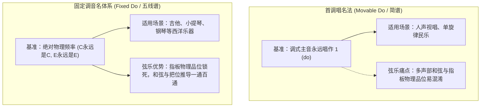
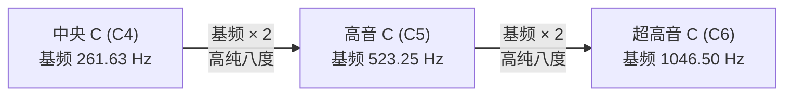
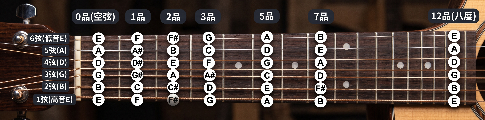
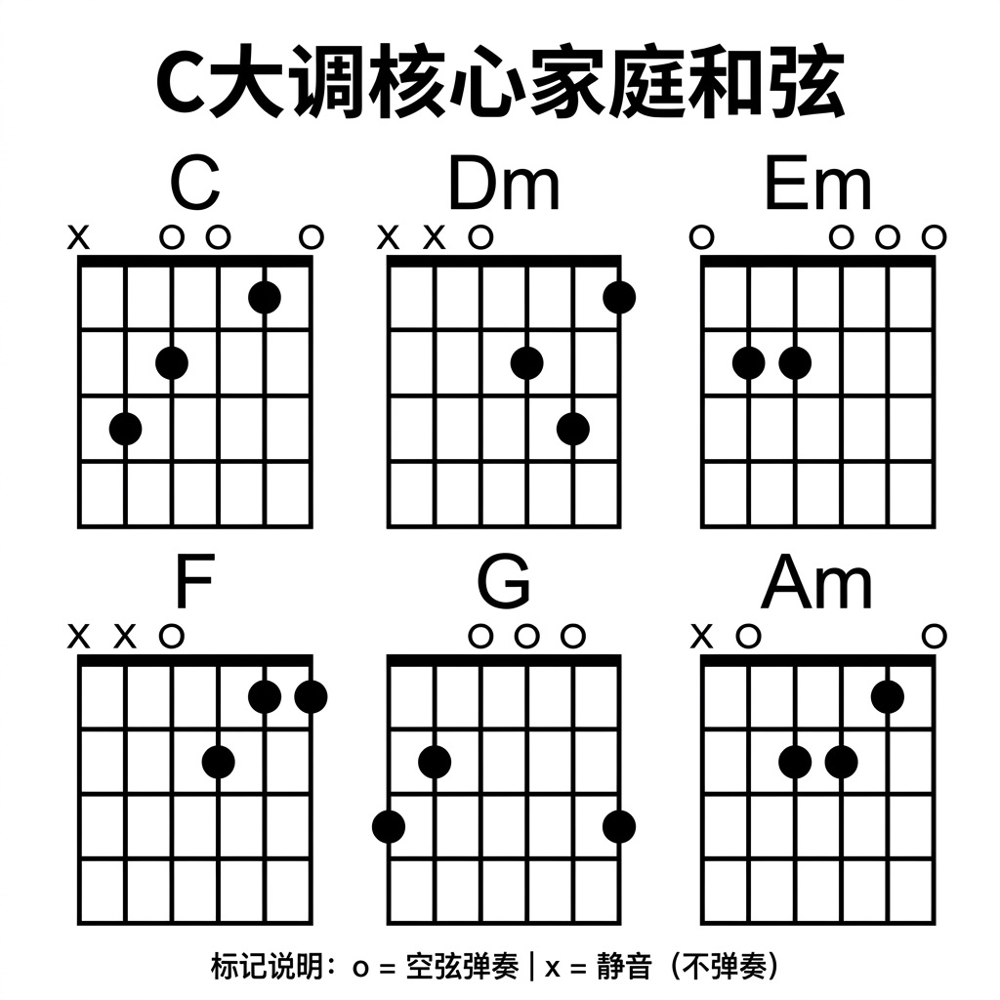
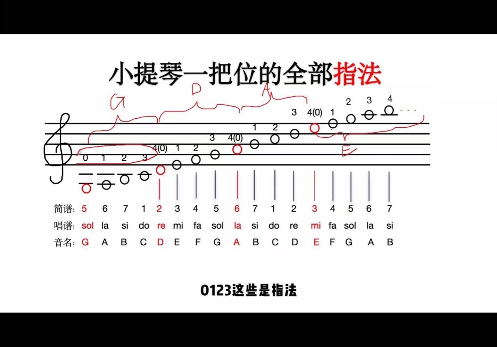

# 西洋弦乐与吉他通用乐理

> **核心声学公理**：
> “**位置决定长短，长短决定高低，高低决定名字。**”
> 音乐绝非玄学，西洋弦乐器（吉他、小提琴）与键盘（钢琴）的底层，是一套基于物理声学、频率倍率与严密数学分割的通用秩序。

---

## 目录
- [一、声学基石：音名、唱名与八度的物理本质](#一声学基石音名唱名与八度的物理本质)
  - [1.1 音名体系：绝对物理频率的代号](#11-音名体系绝对物理频率的代号)
  - [1.2 唱名体系：旋律层级的相对度量](#12-唱名体系旋律层级的相对度量)
  - [1.3 乐理认知：固定调 vs 首调（为何学弦乐必须认音名）](#13-乐理认知固定调-vs-首调为何学弦乐必须认音名)
  - [1.4 八度（Octave）的声学本质：频率翻倍与听觉周期](#14-八度octave的声学本质频率翻倍与听觉周期)
- [二、音律秩序：十二平均律与全半音规律](#二音律秩序十二平均律与全半音规律)
  - [2.1 十二平均律：音乐世界的等距刻度尺](#21-十二平均律音乐世界的等距刻度尺)
  - [2.2 天然半音两兄弟：E-F 与 B-C](#22-天然半音两兄弟e-f-与-b-c)
  - [2.3 自然大调音阶法则：“全全半全全全半”](#23-自然大调音阶法则全全半全全全半)
- [三、乐器实战（一）：吉他指板与和弦结构](#三乐器实战一吉他指板与和弦结构)
  - [3.1 吉他标准定弦与弦序规律](#31-吉他标准定弦与弦序规律)
  - [3.2 品格（Fret）移动的物理声学机制](#32-品格fret移动的物理声学机制)
  - [3.3 C 大调核心家庭和弦图解与功能色彩](#33-c-大调核心家庭和弦图解与功能色彩)
- [四、乐器实战（二）：小提琴一把位指法全景](#四乐器实战二小提琴一把位指法全景)
  - [4.1 纯五度定弦智慧（G - D - A - E）](#41-纯五度定弦智慧g---d---a---e)
  - [4.2 一把位全部指法与“4 指同音换弦”奥秘](#42-一把位全部指法与4-指同音换弦奥秘)
- [五、跨界贯通：钢琴、吉他与小提琴的三维映射](#五跨界贯通钢琴吉他与小提琴的三维映射)

---

## 一、声学基石：音名、唱名与八度的物理本质

### 1.1 音名体系：绝对物理频率的代号
现代音乐使用 7 个英文字母作为最基本的音级名称：
$$\mathbf{C \quad D \quad E \quad F \quad G \quad A \quad B}$$

- **本质属性**：**绝对音高（Absolute Pitch）**。
- **物理对应**：每一个音名直接锁死声学中的**固定振动频率**。
  - 例如国际标准音高：$\text{A}_4 = 440\text{ Hz}$。无论在吉他、小提琴还是三角钢琴上，只要发出 $\text{A}_4$ 这个音，发声体的振动频率必须严格维持在每秒 440 次。

---

### 1.2 唱名体系：旋律层级的相对度量
人类在用人声歌唱旋律时，习惯使用单音节唱名，与简谱数字一一对应：

| 简谱数字 | 1 | 2 | 3 | 4 | 5 | 6 | 7 |
| :---: | :---: | :---: | :---: | :---: | :---: | :---: | :---: |
| **国际唱名** | **do** | **re** | **mi** | **fa** | **sol** | **la** | **si (ti)** |

- **本质属性**：**相对音高（Relative Pitch / 调式音级）**。
- **物理对应**：唱名没有固定的物理振动频率，它只表示某个音在特定调式中“排在第几级”（如主音、属音、导音等）。

---

### 1.3 乐理认知：固定调 vs 首调（为何学弦乐必须认音名）

在器乐学习中，清楚区分两种唱名思维至关重要：



---

### 1.4 八度（Octave）的声学本质：频率翻倍与听觉周期

当我们将音阶从低音 do 唱到高音 $\text{do}^\nearrow$ 时，音调明显变高、变清亮。其声学物理本质如下：



> **人类听觉的谐波共振机制**：
> 人类内耳耳蜗在接收到基频呈 $2:1$ 整数比的声波时，会识别出完全重合的谐波成分。大脑会把频率翻倍的两个音感知为“同一个音在更高维度的螺旋再生”，因此唱名重新回到 do。每一个八度区间内，刚好容纳了十二平均律的 12 个等距台阶。

---

## 二、音律秩序：十二平均律与全半音规律

### 2.1 十二平均律：音乐世界的等距刻度尺

现代乐律学的基石是**十二平均律（12 Equal Temperament）**：将一个纯八度（频率翻倍区间）在对数尺度上均分为 **12 个等比区间**，每一个区间称为一个**半音（Semitone）**。

$$\text{C} \xrightarrow{半} \text{C}^\sharp/\text{D}^\flat \xrightarrow{半} \text{D} \xrightarrow{半} \text{D}^\sharp/\text{E}^\flat \xrightarrow{半} \text{E} \xrightarrow{半} \text{F} \xrightarrow{半} \text{F}^\sharp/\text{G}^\flat \xrightarrow{半} \text{G} \xrightarrow{半} \text{G}^\sharp/\text{A}^\flat \xrightarrow{半} \text{A} \xrightarrow{半} \text{A}^\sharp/\text{B}^\flat \xrightarrow{半} \text{B} \xrightarrow{半} \text{C}$$

- **全音与半音的换算关系**：
  $$\mathbf{1 \text{ 全音 (Whole Tone)} = 2 \text{ 半音 (Semitones)}}$$
  - $\text{C} \rightarrow \text{C}^\sharp$ 跨越 1 个半音；
  - $\text{C} \rightarrow \text{D}$ 跨越 2 个半音（中间隔着 $\text{C}^\sharp/\text{D}^\flat$），因此是一个全音。

---

### 2.2 天然半音两兄弟：E-F 与 B-C

在 7 个基础自然音级中，绝大多数相邻音之间都相隔一个全音，唯独两对音是**天生相邻的半音**：
- **E 与 F 之间**：天然相隔**半音**（钢琴上没有黑键，吉他上无需隔品）。
- **B 与 C 之间**：天然相隔**半音**（钢琴上没有黑键，吉他上无需隔品）。
- 其余相邻音（C-D、D-E、F-G、G-A、A-B）：全部相隔**全音**。

---

### 2.3 自然大调音阶法则：“全全半全全全半”

为什么大调听起来总是充满阳光、明快、稳定的色彩？这是因为它严格遵守从主音出发的音程排列公式：

$$\text{根音 (1)} \xrightarrow{\text{全}} \text{二级 (2)} \xrightarrow{\text{全}} \text{三级 (3)} \xrightarrow{\text{半}} \text{四级 (4)} \xrightarrow{\text{全}} \text{五级 (5)} \xrightarrow{\text{全}} \text{六级 (6)} \xrightarrow{\text{全}} \text{七级 (7)} \xrightarrow{\text{半}} \text{高八度 (1)}$$

以 **C 自然大调** 为例：
$$\text{C} \xrightarrow{全} \text{D} \xrightarrow{全} \text{E} \xrightarrow{半} \text{F} \xrightarrow{全} \text{G} \xrightarrow{全} \text{A} \xrightarrow{全} \text{B} \xrightarrow{半} \text{C}$$

```mermaid
flowchart LR
    C["C (1)<br/>主音"] -->|全音| D["D (2)<br/>上主音"]
    D -->|全音| E["E (3)<br/>中音"]
    E -->|半音 (天然)| F["F (4)<br/>下属音"]
    F -->|全音| G["G (5)<br/>属音"]
    G -->|全音| A["A (6)<br/>下中音"]
    A -->|全音| B["B (7)<br/>导音"]
    B -->|半音 (天然)| C2["C (1)<br/>高八度"]
```

- 这一规则天然契合了 E-F 和 B-C 的半音位置，使 C 大调完美避开所有升降号，全部落在纯白键上。

---

## 三、乐器实战（一）：吉他指板与和弦结构

### 3.1 吉他标准定弦与弦序规律

吉他是典型的十二平均律弦乐器。琴弦从粗到细、从低音到高音的标准定音如下：

```mermaid
flowchart LR
    E6["6弦 (最粗)<br/>E2 (82.4 Hz)"] -->|纯四度 (5半音)| A5["5弦<br/>A2 (110.0 Hz)"]
    A5 -->|纯四度 (5半音)| D4["4弦<br/>D3 (146.8 Hz)"]
    D4 -->|纯四度 (5半音)| G3["3弦<br/>G3 (196.0 Hz)"]
    G3 -->|大三度 (4半音)| B2["2弦<br/>B3 (246.9 Hz)"]
    B2 -->|纯四度 (5半音)| E1["1弦 (最细)<br/>E4 (329.6 Hz)"]
```

- **定音记忆口诀**：
  - 从 6 弦到 1 弦（粗 $\rightarrow$ 细）：**E - A - D - G - B - E**
  - 从 1 弦到 6 弦（细 $\rightarrow$ 粗）：**E - B - G - D - A - E**
- **八度关系**：6 弦空弦音（低音 E）与 1 弦空弦音（高音 E）跨越了整整**两个八度**，振动频率整整相差 4 倍。

---

### 3.2 品格（Fret）移动的物理声学机制

吉他指板上的品丝（Fret Wire）是十二平均律的实体化投影：



- **物理位移公式**：
  - **在同一根琴弦上向琴桥方向移动 1 品** $=$ **升高 1 个半音**；
  - **在同一根琴弦上向琴桥方向移动 2 品** $=$ **升高 1 个全音**；
  - **反向移动**同理对应音高降低。

```
【单弦找音实战推演】
1. 在 1 弦（空弦音为 E）上：
   - 想要弹 F 音：因为 E 与 F 是天然半音，手指按在第 1 品；
   - 想要弹 G 音：因为 F 到 G 是全音，手指从第 1 品往右挪 2 格按在第 3 品。

2. 在 5 弦（空弦音为 A）上：
   - 第 3 品为 C 音；
   - 想要弹 D 音：因为 C 到 D 是全音，手指往右挪 2 格按在第 5 品。
```

---

### 3.3 C 大调核心家庭和弦图解与功能色彩

和弦是乐曲骨架，C 自然大调中最基础的 6 个顺阶核心家庭和弦如下：



#### 和弦功能档案与声学色彩
1. **C 和弦（一级主和弦，I）**：
   - 构成音：C - E - G
   - 色彩：极其稳定、明亮、宽阔，常作为乐段的起点与最终归宿。
2. **Dm 和弦（二级小和弦，ii）**：
   - 构成音：D - F - A
   - 色彩：柔和抒情，常作下属功能替代，连接至 G 或 Em。
3. **Em 和弦（三级小和弦，iii）**：
   - 构成音：E - G - B
   - 色彩：幽暗、叙事感强，用于承接主和弦的弱化过渡。
4. **F 和弦（四级下属和弦，IV）**：
   - 构成音：F - A - C
   - 色彩：开扬外展，具有向外推动的动力感。
5. **G 和弦（五级属和弦，V）**：
   - 构成音：G - B - D
   - 色彩：充满紧张与张力，包含调式导音 B，具有极强的倾向要解决回主和弦 C。
6. **Am 和弦（六级副主和弦，vi）**：
   - 构成音：A - C - E
   - 色彩：暗淡、忧伤，是 C 大调的关系小调主和弦。

> **吉他和弦图识读规范**：
> - 6 条竖线自左向右代表 6 弦至 1 弦；
> - 横向方格代表品位（自上而下为 1 品、2 品、3 品）；
> - 弦顶的 `o` 代表空弦弹奏，`x` 代表手指轻触静音（不发声）。

---

## 四、乐器实战（二）：小提琴一把位指法全景

### 4.1 纯五度定弦智慧（G - D - A - E）

小提琴指板没有品丝，依靠手指位置截断琴弦控制振动长度。四根琴弦采用严格的**纯五度（相隔 7 个半音）**定弦：

```mermaid
flowchart LR
    G["G 弦 (低音弦)<br/>G3 (196.0 Hz)"] -->|纯五度 (7个半音)| D["D 弦<br/>D4 (293.7 Hz)"]
    D -->|纯五度 (7个半音)| A["A 弦 (标准音)<br/>A4 (440.0 Hz)"]
    A -->|纯五度 (7个半音)| E["E 弦 (高音弦)<br/>E5 (659.3 Hz)"]
```

---

### 4.2 一把位全部指法与“4 指同音换弦”奥秘

一把位（First Position）是小提琴的基石指位，涵盖了两个半八度的音域：



```
【一把位指法全景表（0=空弦，1=食指，2=中指，3=无名指，4=小指）】

 G 弦（低音弦）：
   0 空弦 = G (低音 sol)
   1 指   = A (低音 la)
   2 指   = B (低音 si)
   3 指   = C (中央 do)   <-- 2指与3指贴紧（B-C 半音）
   4 指   = D (re)        <-- 频率完全等于 D 弦空弦音！

 D 弦：
   0 空弦 = D (re)
   1 指   = E (mi)
   2 指   = F (fa)        <-- 1指与2指贴紧（E-F 半音）
   3 指   = G (sol)
   4 指   = A (la)        <-- 频率完全等于 A 弦空弦音！

 A 弦：
   0 空弦 = A (la)
   1 指   = B (si)
   2 指   = C (高音 do)   <-- 1指与2指贴紧（B-C 半音）
   3 指   = D (高音 re)
   4 指   = E (高音 mi)   <-- 频率完全等于 E 弦空弦音！

 E 弦（高音弦）：
   0 空弦 = E (高音 mi)
   1 指   = F (高音 fa)   <-- 1指靠紧琴枕（E-F 半音）
   2 指   = G (高音 sol)
   3 指   = A (高音 la)
   4 指   = B (高音 si)
```

> **小提琴的工程力学精粹**：
> 观察指法图上的 **`4(0)` 标记**：
> 每一根低音弦的 **4 指（小指）**，与相邻高音弦的 **0 指（空弦）** 音高完全相同（同音同高，Unison）！
> 演奏快速跑动旋律时，使用 4 指能够免去琴弓换弦的动作与杂音，保持旋律线条的一气呵成。


---

## 五、跨界贯通：钢琴、吉他与小提琴的三维映射

钢琴键盘是乐理最直观的“物理透视图”：

```
       ┌───┬───┐       ┌───┬───┬───┐
       │C# │D# │       │F# │G# │A# │   <-- 5 个黑键 (变化半音)
       │Db │Eb │       │Gb │Ab │Bb │
     ┌─┴─┬─┴─┬─┴─┬───┬─┴─┬─┴─┬─┴─┬─┴─┐
     │ C │ D │ E │ F │ G │ A │ B │ C │ <-- 7 个白键 (自然全音阶)
     └───┴───┴───┴───┴───┴───┴───┴───┘
                  ▲               ▲
              E-F 之间        B-C 之间
              无黑键！        无黑键！
```

- **两黑夹三白，三黑夹四白**：黑键的缺失位置，精准指出了 E-F 与 B-C 的半音缝隙；
- **各乐器三维空间映射**：
  1. 钢琴上任意相邻两个琴键（无论黑白）的距离，对应吉他指板上的 **1 个品格**；
  2. 钢琴上白键的音高分布，对应小提琴一把位自然音阶的指位落点；
  3. 掌握了音名与十二平均律，便能瞬间穿透键盘、品丝与把位的表面差异，洞见所有西洋乐器同源共鸣的声学本体。
