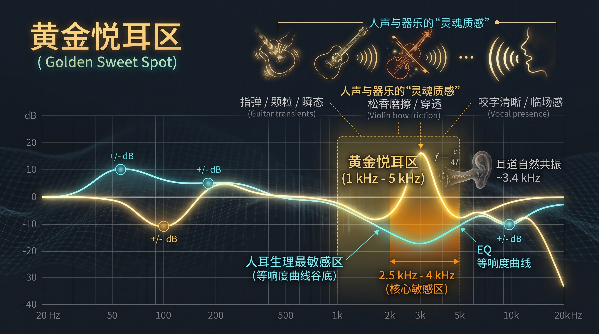

# 黄金悦耳区

在心理声学与混音工程中，**“黄金悦耳区”**（Golden Sweet Spot，又称核心临场感频段）通常指 **1 kHz – 5 kHz** 的中高音频段（核心敏感区集中在 **2 kHz – 4 kHz**）；若从广义的音乐表现力来看，它也常延伸至包含基音与泛音过渡的 **500 Hz – 4 kHz** 中频核心区。

  

这一频段之所以被称为“黄金区”，是因为它恰好处于**人类听觉生理最敏感的谷底**与**乐器、人声泛音最密集的交汇点**——声音的清晰度、贴耳度（Presence）与乐器的生命力几乎都由它决定。

### 一、 为什么它是生理上的“黄金区”？

观察上图的**等响度曲线（Fletcher-Munson Curves / ISO 226）**，横轴代表频率（Hz），纵轴代表达到相同主观响度（phon）所需的物理声压级（dB）。可以看到所有曲线在 **1000 Hz 到 5000 Hz** 之间都出现了一个明显的**下凹谷底**（尤其在 3 kHz – 4 kHz 处最低）：

  

1. **耳道共鸣管效应（物理放大器）**
    
    成年人的外耳道平均长度约为 $2.5\text{ cm}$，在声学上相当于一根一端封闭、一端开口的**四分之一波长共鸣管**。根据声学共振公式：
    
      
    
    $$f = \frac{c}{4L}$$
    
    （其中声速 $c \approx 343\text{ m/s}$，耳道长度 $L \approx 0.025\text{ m}$），计算出的自然共振中心频率恰好落在 **3.4 kHz** 左右。这意味着外耳道会对进入的 **2.5 kHz – 4 kHz** 声波产生约 **10 dB – 12 dB** 的天然物理增益。
    
      
    
2. **极致的微动态捕捉**
    
    因为只需要极低的物理声压级就能被耳膜清晰感知，人耳在这一频段对**瞬态响应（Transients）**、微小的音量起伏和空间相位变化最为敏锐。
    
      
    
3. **进化留下的语言解码区**
    
    人类语言中决定“听得清不清”的辅音（爆破音、摩擦音）以及婴儿啼哭、求救信号的核心共振峰（Formants）全部集中于此。
    
      
    

### 二、 器乐与人声在黄金区的“灵魂质感”

在音乐录制与回放中，500 Hz 以下提供“厚度与力量”，10 kHz 以上提供“空气感”，而 **1 kHz – 5 kHz 决定了声音的辨识度与距离感**：

  

- **原声吉他（指弹与拨弦）**：琴体共鸣的温暖感在 200 Hz – 400 Hz，但指尖、指甲或拨片触碰钢弦瞬间的清脆颗粒感与瞬态爆发力（Attack）正好落在 **2 kHz – 3.5 kHz**。适度突出这一区域，独奏曲中的轮指、拍泛音与勾弦细节会立刻像在面前演奏一样鲜活。
    
      
    
- **小提琴与弦乐**：小提琴极强的音乐厅穿透力（即俗称的“琴声能立住”）正是依赖 **2.5 kHz – 4 kHz** 的高频泛音群（歌手共振峰 / Singer's Formant 同频段）。弓毛摩擦琴弦的松香颗粒感与张力都在这里呈现。
    
      
    
- **人声（Vocals）**：人声的基音虽然在 100 Hz – 400 Hz，但唇齿开合的咬字清晰度、嗓音的沙哑颗粒感以及“歌手站在你耳边唱歌”的贴耳临场感（Presence）全部由 **1.5 kHz – 4 kHz** 掌控。
    
      
    

### 三、 黄金悦耳区细分频段与调音把控

正因为人耳对 **1 kHz – 5 kHz** 极度敏感，它在均衡器（EQ）调节与耳机/音箱调音中是一把**双刃剑**——给得恰当叫“通透抓耳”，给多了则会瞬间变成“刺耳、轰头”并引发听觉疲劳。

  

|**细分频段**|**声学特征与主要成分**|**适度提升（+1 至 +3 dB）**|**过度堆积（大于 +4 dB）的负面听感**|
|---|---|---|---|
|**800 Hz – 1.5 kHz**|中频骨架、乐器结像核心|声音更有肉感、结像扎实居中|产生“喇叭味/电话音”（Nasal/Honky），听感生硬|
|**1.5 kHz – 2.5 kHz**|咬字清晰度、拨弦冲击力|乐器线条突出，能在嘈杂混音中透出来|声音干瘪、有金属刮擦感，容易掩盖底鼓与贝斯|
|**2.5 kHz – 4 kHz**|**核心黄金临场区**（耳道共振峰）|极佳的贴耳感、指弹瞬态鲜活、琴弓摩擦质感清晰|**极易引发听觉疲劳**，听感尖锐刺耳（Harshness）|
|**4 kHz – 5 kHz**|泛音边缘、齿音过渡带|增加明亮度与乐器表面光泽感|唇齿音（Sibilance，“嘶、呲”声）炸耳|

**实战听音与调音法则：**

  

- **拉近距离靠微升，推远声场靠微降**：想让一把木吉他或主唱从伴奏中“走上前台”，在 **2.5 kHz – 3.2 kHz** 用较宽的 Q 值轻轻推高 **1.5 dB – 2 dB** 即可；反之，想让背景铺垫乐器退居幕后，只需在该频段衰减 **2 dB**，空间纵深感立刻显现。
    
      
    
- **优先“做减法”消除疲劳**：如果一首曲子听上十分钟就觉得耳朵发紧，90% 的原因是 **2.8 kHz – 3.8 kHz** 能量过载，用动态 EQ（Dynamic EQ）在该区域做按需压制，既能保留悦耳的瞬态细节，又能做到久听不累。