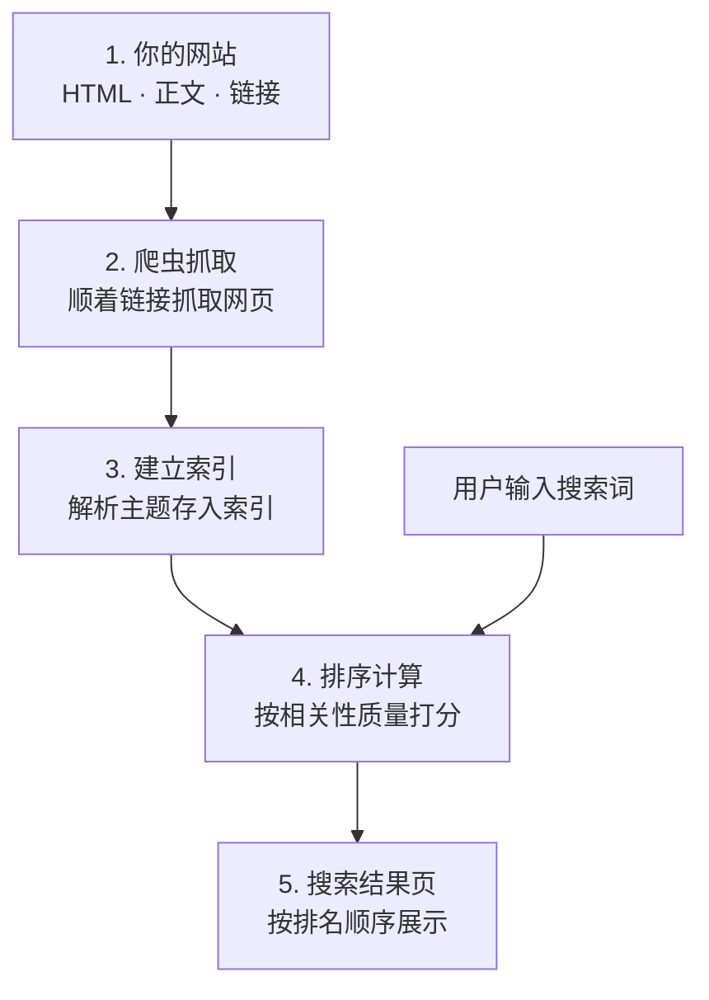

# SEO搜索引擎优化原理解析

> **SEO** 是 **Search Engine Optimization** 的缩写，中文称为**搜索引擎优化**。  
> 简单来说，SEO 就是通过优化网站的**内容质量、HTML 代码语义、站内结构与访问性能**，让网页更容易被 Google、百度、必应（Bing）等搜索引擎发现和理解，从而在搜索结果中获得更靠前的**自然排名**。

如果把整个互联网比作一座超级图书馆，搜索引擎就是每天巡检书架的“图书管理员”。**SEO 要做的，就是把你的网页贴上清晰准确的书名、目录与摘要标签**——当读者来找相关主题的书时，管理员才能第一时间把你的页面推到最前面。

---

## 一、举个生活中的例子

假设你开发了一款实用软件 **PyKuai**，并把它发布在自己的网站 `土块.art` 上。

当网友在 Google 或必应搜索下面这些关键词时：

- `Python 自动化工具`
- `PyKuai 下载`
- `Windows 实用工具`
- `土块 Studio`

你当然希望自己的官网能够直接出现在搜索结果的第一页甚至前几名。

- **没做 SEO 时**：搜索引擎可能根本没收录你的页面，或者不知道这个页面究竟讲什么，只能靠别人手动输入网址访问；
- **做好 SEO 后**：搜索引擎不仅能准确收录，还能把标题、简介展示得清清楚楚，源源不断地为你带来**免费、精准、可持续的自然搜索流量**。

---

## 二、SEO 是怎么工作的？

从你发布网页，到用户搜出你的网站，搜索引擎在后台大致会经历 **抓取 → 索引 → 排序 → 展示** 四个阶段：



1. **抓取（Crawling）**：搜索引擎派出自动程序（俗称“蜘蛛 / 爬虫”，如 Googlebot、Baiduspider），顺着网页之间的超链接和站点地图（Sitemap）不断爬取新页面。
2. **索引（Indexing）**：爬虫把页面带回后，搜索引擎会提取标题、正文、图片说明与结构信息，理解“这页内容主要讲什么”，并放进庞大的倒排索引库里等待检索。
3. **排序（Ranking）**：当用户输入关键词搜索时，算法会在几毫秒内从索引库里筛选出匹配页面，根据**内容相关性、权威度、页面加载速度、移动端适配**等数百项信号决定谁排第 1、谁排第 10。

---

## 三、网页开发中最基础的 SEO 代码长什么样？

最直观的页面级 SEO 信息，通常放在 HTML 的 `<head>` 头部与语义化的 `<body>` 主体中：

```html
<!DOCTYPE html>
<html lang="zh-CN">
<head>
  <meta charset="UTF-8">

  <!-- 1. 网页标题：搜索结果中最醒目的蓝色大字 -->
  <title>PyKuai - Python 自动化工具 | 土块 Studio</title>

  <!-- 2. 网页描述：搜索结果标题下方的摘要介绍 -->
  <meta name="description"
        content="PyKuai 是一款轻量高效的 Windows Python 自动化工具，提供一键脚本执行与常见效率辅助功能。">

  <!-- 3. 爬虫索引指令：允许收录当前页面并跟踪页面上的链接 -->
  <meta name="robots" content="index, follow">

  <!-- 4. 移动端视口适配：移动端友好度是现代 SEO 的核心指标之一 -->
  <meta name="viewport"
        content="width=device-width, initial-scale=1.0">
</head>
<body>
  <main>
    <!-- 5. 页面主标题：帮助搜索引擎一眼抓住文章中心主题 -->
    <h1>PyKuai - Python 自动化工具</h1>
    <p>了解 PyKuai 的核心功能、快速上手指南与最新版下载方式。</p>
    <!-- 6. 图片替代文本：告诉搜索引擎图片里画了什么 -->
    
  </main>
</body>
</html>
```

这里最核心的四个基础要素分别是：

1. **网页标题（`<title>`）**：告诉搜索引擎“这页叫什么”，同时也是浏览器标签页名字和搜索结果主标题的主要来源，建议控制在简练、包含核心关键词的范围内。
2. **网页描述（`<meta name="description">`）**：页面内容摘要。搜索引擎经常会直接抓取这段话，展示在搜索结果标题下方，直接影响用户**愿不愿意点进来**（点击率）。
3. **主标题（`<h1>`）与标题层级**：每个页面通常只放一个 `<h1>` 作为核心主标题，配合 `<h2>`、`<h3>` 梳理文章脉络，相当于给爬虫看的大纲目录。
4. **图片替代文本（`alt` 属性）**：搜索引擎看不懂纯像素，通过 `alt` 文字描述才能理解图片内容并纳入图片搜索索引。

> **重要提醒**：写全这些基础 HTML 标签，只是“让搜索引擎能看懂页面”的**入场券**，并不代表写了标签排名就一定会靠前。

---

## 四、真正专业的 SEO 包括哪些维度？

现代 SEO 是一套系统工程，通常可以拆解为以下五个维度：

| 优化维度 | 关注重点与典型做法 | 一句话理解 |
| :--- | :--- | :--- |
| **内容 SEO** | 紧扣用户真实搜索意图、写出有深度且原创的优质内容、自然布局关键词 | **让内容真的能解决用户的问题** |
| **页面 SEO** | 规范编写 `title`、`description`、`h1`、语义化标签、图片 `alt`、合理的站内互链 | **把每一页的重点标注清楚** |
| **技术 SEO** | 配置 `sitemap.xml`、`robots.txt`、`canonical` 规范网址、结构化数据（JSON-LD）、HTTPS | **确保爬虫进得来、读得懂、不重复收录** |
| **性能与体验 SEO** | 提升首屏加载速度、移动端适配、核心网页指标（Core Web Vitals：LCP / INP / CLS） | **打开快、不卡顿、手机端好用** |
| **站外 SEO** | 高质量外部网站引用与推荐（外链 / Backlinks）、品牌曝光与口碑 | **别人越常引用你，搜索引擎越信任你** |

---

## 五、前端架构避坑：CSR、SSR 与 SSG 对 SEO 的影响

对于现代前端开发者而言，SEO 远远不只是“往 `<head>` 里加几个标签”，**渲染架构的选型**往往直接决定了搜索引擎能不能顺利抓到你的正文：

| 渲染模式 | 代表框架 / 方案 | 搜索引擎看到的初始 HTML | SEO 友好度与适用场景 |
| :--- | :--- | :--- | :--- |
| **CSR（客户端渲染）** | 纯 Vue / React 单页应用、Docsify | 初始只有一个空壳 `<div id="app"></div>`，正文要等 JS 运行后才动态生成 | **相对较弱。** 百度等部分爬虫对复杂 JS 渲染支持有限，Google 虽能执行 JS 但存在二次渲染延迟；适合后台管理系统或无需依赖搜索流量的个人站点。 |
| **SSR（服务端渲染）** | Next.js、Nuxt.js | 用户或爬虫每次访问时，服务器实时拼好完整 HTML 内容再返回 | **极佳。** 爬虫请求即得完整正文与动态 Meta 信息；适合资讯站、电商、社区等高频更新内容。 |
| **SSG（静态站点生成）** | VitePress、Astro、Hugo | 在打包构建阶段就提前把所有页面生成为纯静态 `.html` 文件 | **极佳且最快。** 既能直接吐出完整 HTML 给爬虫，又能配合 CDN 秒开；最适合博客、文档站与产品官网。 |

---

## 六、SEO 和 SEM 有什么区别？

在实际网站运营和产品推广中，经常会同时听到 **SEO** 和 **SEM** 两个词：

| 对比项 | SEO（搜索引擎优化） | SEM（搜索引擎营销） |
| :--- | :--- | :--- |
| **获取方式** | 优化内容与技术结构，争取**免费的自然排名** | 主要通过关键词**竞价广告（PPC）**购买靠前广告位 |
| **资金成本** | 不按点击收费，投入主要是内容与开发维护精力 | 按点击次数或曝光持续付费，停投后流量立刻消失 |
| **见效速度** | **慢热型**：需要爬虫收录与信任积累（通常数周到数月） | **立竿见影**：审核通过并充值后即可立即展示在顶部 |
| **长期价值** | 一旦排名稳固，可长期带来高信任度的免费自然流量 | 适合新品冷启动、活动促销或短期精准获客，两者常配合使用 |

---

## 七、总结

如果你想让 `土块.art` 在搜索“土块”、“PyKuai”、“ToolKit”等关键词时稳步排在前面，不妨记住一个最朴素的本质：

- **技术与结构**（语义化 HTML、快速加载、合理的渲染架构、Sitemap 等）决定了搜索引擎**能不能顺利读懂你**；
- **真实优质的内容**（解决真实痛点、结构清晰、持续沉淀）决定了搜索引擎**愿不愿意把你排在前面**。

**把网页写得对机器友好，把内容写得对读者有用，这就是全部 SEO 的核心。**
