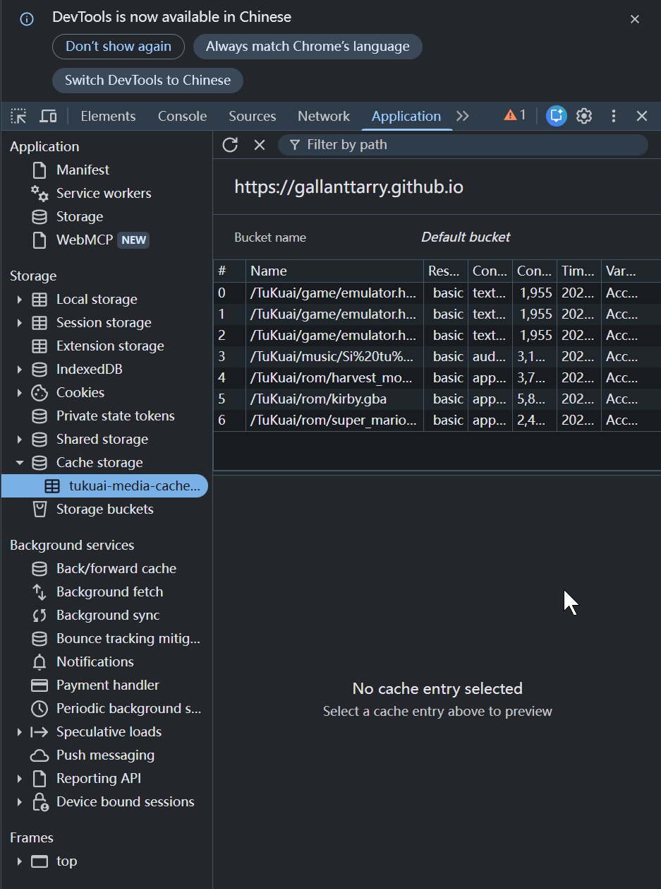

# SW三级缓存与离线化实战

```sw.js
// 以后只有当你希望强制清空所有老用户的全站缓存时，才需要修改这个版本号
const CACHE_VERSION = 'v1.0.3';
const CACHE_NAME = `tukuai-smart-cache-${CACHE_VERSION}`;

// 1. 安装时立即接管
self.addEventListener('install', event => {
    self.skipWaiting();
});

// 2. 激活时：立即控制所有页面 + 自动清理旧版本的废弃缓存
self.addEventListener('activate', event => {
    event.waitUntil(
        caches.keys().then(keys => {
            return Promise.all(
                keys.map(key => {
                    if (key !== CACHE_NAME) {
                        console.log('[SW] 清理旧版本缓存:', key);
                        return caches.delete(key);
                    }
                })
            );
        }).then(() => clients.claim())
    );
});

// 3. 核心智能路由
self.addEventListener('fetch', event => {
    const req = event.request;
    const url = new URL(req.url);

    // 【排除项】非 GET 请求、浏览器插件、统计探针、API 接口以及带 Range 头的流媒体（如 <audio> 音乐）
    // 注：将 Range 音频请求直接交由浏览器原生 HTTP 磁盘缓存与 Cloudflare 处理，既支持进度条拖拽又防 Safari 崩溃
    if (req.method !== 'GET' ||
        req.headers.has('range') ||
        url.protocol.startsWith('chrome-extension') ||
        url.hostname.includes('google-analytics.com') ||
        url.hostname.includes('googletagmanager.com') ||
        url.hostname.includes('tukuai-kv') ||
        url.pathname.includes('/api/')
    ) {
        return; // 直接放行，走浏览器原生网络与流式缓存
    }

    // =========================================================================
    // 策略 A：网页框架 (HTML) -> 【网络优先，缓存兜底】
    // =========================================================================
    if (req.mode === 'navigate' || url.pathname.endsWith('.html')) {
        event.respondWith(
            fetch(req)
                .then(networkRes => {
                    // 仅在状态码为 200-299 时写入缓存，防止 502/404 错误页污染离线兜底
                    if (networkRes && networkRes.ok) {
                        const clone = networkRes.clone();
                        caches.open(CACHE_NAME).then(cache => cache.put(req, clone));
                    }
                    return networkRes;
                })
                .catch(async () => {
                    // 离线兜底：忽略 ?rom=xxx 参数以复用 emulator.html 缓存，极端情况回退首页
                    const cached = await caches.match(req, { ignoreSearch: true });
                    return cached || caches.match('./index.html') || caches.match('/');
                })
        );
        return;
    }

    // =========================================================================
    // 策略 B：大体积资产 (游戏 ROM、3D 模型、字体、模拟器内核) -> 【绝对缓存优先】
    // 已补全：nds/nes/gb/gbc 游戏格式 + glb/gltf/bin/hdr/ktx2 等 3D 模型格式
    // =========================================================================
    const isHeavyAsset = url.pathname.match(/\.(gba|sfc|smc|nds|nes|gb|gbc|glb|gltf|bin|hdr|ktx2|ttf|woff2|wasm|zip)$/i) ||
        url.pathname.includes('/emulator_data/');

    if (isHeavyAsset) {
        event.respondWith(
            // 注意：这里不加 ignoreSearch，保留你通过 ?v=2 更新单个大文件的能力
            caches.match(req).then(cachedRes => {
                if (cachedRes) return cachedRes;

                return fetch(req).then(networkRes => {
                    if (networkRes && networkRes.status === 200) {
                        const clone = networkRes.clone();
                        caches.open(CACHE_NAME).then(cache => cache.put(req, clone));
                    }
                    return networkRes;
                });
            })
        );
        return;
    }

    // =========================================================================
    // 策略 C：普通静态资源 (JS, CSS, 图片, SVG) -> 【Stale-While-Revalidate 异步热更新】
    // =========================================================================
    event.respondWith(
        caches.match(req).then(cachedRes => {
            const networkFetch = fetch(req)
                .then(networkRes => {
                    if (networkRes && networkRes.status === 200) {
                        const clone = networkRes.clone();
                        caches.open(CACHE_NAME).then(cache => cache.put(req, clone));
                    }
                    return networkRes;
                })
                .catch(err => {
                    // 若已有缓存则静默返回旧缓存；若无缓存则抛出原始错误，防止向 respondWith 传入 undefined
                    if (cachedRes) return cachedRes;
                    throw err;
                });

            return cachedRes || networkFetch;
        })
    );
});
```


```前端index唤醒
<script>  
    if ('serviceWorker' in navigator) {  
        window.addEventListener('load', () => {  
            navigator.serviceWorker.register('./sw.js')  
                .then(registration => {  
                    console.log('Tukuai OS 核心管家已接管系统. 作用域:', registration.scope);  
  
                    // 监听后台版本更新，如果发现新版本，自动强制刷新页面  
                    registration.addEventListener('updatefound', () => {  
                        const newWorker = registration.installing;  
                        newWorker.addEventListener('statechange', () => {  
                            if (newWorker.state === 'activated' && navigator.serviceWorker.controller) {  
                                console.log('检测到核心引擎更新，系统正在热重载...');  
                                window.location.reload();  
                            }  
                        });  
                    });  
                })  
                .catch(error => {  
                    console.error('核心管家唤醒失败:', error);  
                });  
        });  
    }  
</script>
```

F12可见Tukuai OS 核心管家已接管系统. 作用域: https://gallanttarry.github.io/TuKuai/




这是一个 **Service Worker (服务工作线程)** 脚本，相当于在你的浏览器和服务器之间设立了一个运行在后台的“智能网络代理”。它的核心作用是**接管网站的所有网络请求，通过定制化的缓存策略来极大提升网页的加载速度，降低流量消耗，并赋予网页断网离线使用的能力**。

  

结合代码中的具体逻辑，它的功能被精细划分为了以下几个机制：

  

- **无缝接管页面：** 代码在 `install` 和 `activate` 阶段使用了 `skipWaiting()` 和 `clients.claim()`，强制要求浏览器在加载该脚本后立即生效并接管当前页面的网络请求，无需用户二次刷新或等待。
    
      
    
- **探针与跨域放行：** 脚本会识别并放行所有非 `GET` 请求，以及谷歌分析(Google Analytics)、不蒜子(busuanzi)和浏览器插件的请求。这意味着网站的访问量统计数据会直接走真实网络，保证统计的准确性，不被本地缓存干扰。
    
      
    
- **策略 A(针对 HTML 网页)：网络优先，缓存兜底**
    
      
    
      
    - 每次访问都会优先向服务器端拉取最新的 HTML 页面。
        
          
        
    - 作用：确保用户永远能看到最新部署的网页结构，只有在设备彻底断网请求失败时，才会调取本地缓存的旧页面作为保底。
        
          
        
- **策略 B(针对 游戏 ROM、音乐、字体、模拟器内核)：绝对缓存优先**
    
      
    
      
    - 针对带有 `.mp3`, `.gba`, `.sfc`, `.wasm` 后缀的大文件，以及 `/emulator_data/` 目录下的模拟器底层文件，只要本地硬盘曾经下载过，就直接从本地瞬间读取，完全阻断网络请求。
        
          
        
    - 作用：实现了“下载一次，终身秒进”。极大地节省了服务器带宽，这也是为什么你的复古游戏引擎和电子音乐终端能够在断网状态下依然流畅运行的底层原因。
        
          
        
- **策略 C(针对 普通 JS、CSS、图片)：异步热更新**
    
      
    
      
    - 当请求普通静态资源时，会立刻返回本地的缓存文件以实现页面的“秒开”，与此同时，它会在后台静默向服务器发起请求，拉取最新版本并偷偷替换掉本地的旧缓存。
        
          
        
    - 作用：用户在当前能享受到极致的加载速度，而当他们下次再打开该网页时，就会自动应用后台刚刚静默更新好的新版本内容。
        
          
        

这段代码(`tukuai-smart-cache`)本质上是为了将普通的静态网页升级为具备极速响应和弱网/无网生存能力的现代化 PWA (Progressive Web App)。