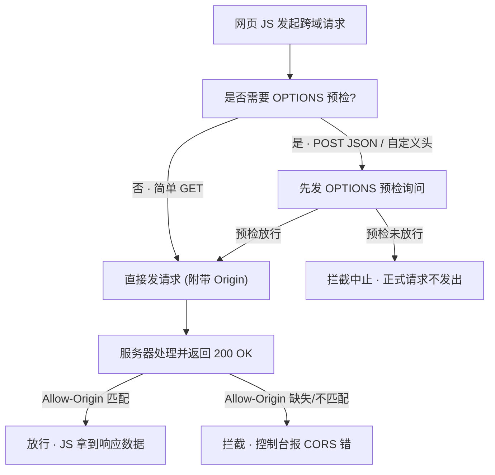

# 浏览器CORS跨域原理与排错指南

> **CORS**（Cross-Origin Resource Sharing，**跨源资源共享**）是浏览器的一套安全放行机制。  
> 当网页试图向另一个“不同源”的服务器发起请求并**读取返回数据**时，浏览器默认会出于安全考虑拦下响应；只有当目标服务器在 HTTP 响应头里明确返回许可声明时，浏览器才会把数据交给前端代码。

很多同学第一次遇到红色 `CORS error` 时，常常误以为是“服务器拒绝了我”——其实恰恰相反：**往往是服务器已经正常处理并回复了 `200 OK`，但站在门口安检的“浏览器”发现响应头里没有放行条，于是把数据扣了下来。**

---

## 一、怎样才算“跨域”？（同源三要素）

假设你当前打开的网页地址是 `https://app.example.com/today`。  
浏览器判断网页与目标接口是否属于**同源（Same-Origin）**，只看 URL 最前面的三个部分：**协议（Protocol）、主机名（Host）、端口（Port）**。

**三项完全一致才是同源；只要任意一项不同，就是跨源（开发中常简称为“跨域”）。**

| 网页要请求的接口地址 | 是否同源 | 判断原因 |
| :--- | :--- | :--- |
| `https://app.example.com/weather` | **同源** | 协议、主机名、端口完全一致，仅路径 `/weather` 不同 |
| `https://api.example.com/weather` | **跨域** | 主机名不同（`app.example.com` vs `api.example.com`） |
| `https://app.example.com:8443/weather` | **跨域** | 端口不同（HTTPS 默认端口 `443` vs `8443`） |
| `http://app.example.com/weather` | **跨域** | 协议不同（`https` vs `http`） |
| `http://localhost:8080` 调 `http://127.0.0.1:8080` | **跨域** | 即使指向同一台电脑，主机名字符串也不同 |

### 为什么浏览器要限制跨域读取？

试想一下：你在同一个浏览器里刚登录了自己的网银或邮箱（浏览器保存了你的登录 Cookie），紧接着又点开了一个陌生网站。如果陌生网页里的 JavaScript 可以随意向你的邮箱接口发请求并**读取响应内容**，你的私人邮件就会被窃取。

因此，浏览器设计了最底层的安全护栏——**同源策略（Same-Origin Policy, SOP）**：默认禁止页面脚本跨源读取其它站点的敏感响应。而 **CORS**，就是用来在“确实需要前后端分离或跨站共享数据”时，由服务器主动签发通行证的标准协议。

---

## 二、一次跨域请求是怎么完成的？（简单请求 vs 预检请求）

浏览器在发起跨域请求时，会根据请求的“危险程度”，走两条不同的流程：



### 场景 1：简单请求（直接发送 + 安检核对）

当天气网页向 `https://api.example.com/weather` 发送一个普通 `GET` 请求查询气温时，整个通信只需要 3 步：

1. **浏览器自动标明来源**：在请求头中自动附带当前页面的源信息（不包含页面路径 `/today`）：

```http
GET /weather HTTP/1.1
Host: api.example.com
Origin: https://app.example.com
```

2. **服务器返回许可头**：后端在响应数据时，在响应头里明确写明允许哪个源读取：

```http
HTTP/1.1 200 OK
Access-Control-Allow-Origin: https://app.example.com
Content-Type: application/json
```

3. **浏览器核对放行**：浏览器比对请求里的 `Origin` 与响应里的 `Access-Control-Allow-Origin`。两者匹配，前端 JS 就能顺利读到 `"今天 25℃"`；如果不匹配或缺失，浏览器就会直接销毁响应数据并在控制台抛出 CORS 报错。

> **为什么 F12 网络面板看到 `200 OK`，控制台却报 CORS 错误？**  
> 因为在简单请求下，请求**已经到达服务器并成功执行了**，服务器也吐回了 `200 OK`；只是浏览器在最后一步“把结果交还给 JS 代码前”查不到合法的 `Access-Control-Allow-Origin`，才把数据拦了下来。

### 场景 2：预检请求（先发 `OPTIONS` 问路）

现在换一个修改操作：用户点击“保存默认城市”，前端需要跨域发送 `POST` 请求，并携带 `Content-Type: application/json` 或自定义鉴权头（如 `Authorization`）。这类请求可能对服务器数据产生实质修改，浏览器会先触发 **Preflight（预检）** 机制：

1. **浏览器先发 `OPTIONS` 预检**：先不传业务数据，只问一句：“我是 `app.example.com`，待会儿能用 `POST` 方法并带着 `Content-Type` 头过来提交吗？”
2. **服务器回复预检许可**：服务器如果同意，返回允许的源、方法、请求头以及缓存有效期（`Max-Age` 期间内不用反复预检）：

```http
HTTP/1.1 204 No Content
Access-Control-Allow-Origin: https://app.example.com
Access-Control-Allow-Methods: GET, POST, OPTIONS
Access-Control-Allow-Headers: Content-Type, Authorization
Access-Control-Max-Age: 86400
```

3. **正式发送业务请求**：只有预检通过，浏览器才会真正发出后面的 `POST` 请求；如果 `OPTIONS` 预检失败，浏览器会直接中止，业务 `POST` 根本不会发出。

---

## 三、交互演示：CORS 浏览器安检模拟器

亲自切换“目标接口地址”、“请求类型”与“服务器响应头”，观察浏览器在背后是否触发 `OPTIONS` 预检、请求能否到达服务器以及最终为什么放行或拦截：

<style>
.tk-cors {
  --cs-bg: rgba(24, 24, 27, 0.72);
  --cs-panel: rgba(39, 39, 42, 0.55);
  --cs-border: rgba(255, 255, 255, 0.1);
  --cs-accent: #10b981;
  --cs-accent-soft: rgba(16, 185, 129, 0.14);
  --cs-warn: #f59e0b;
  --cs-err: #ef4444;
  --cs-err-soft: rgba(239, 68, 68, 0.14);
  --cs-text: #f4f4f5;
  --cs-muted: #a1a1aa;
  --cs-code-bg: #0d0d10;
  box-sizing: border-box;
  margin: 20px 0 24px;
  padding: 20px;
  border: 1px solid var(--cs-border);
  border-radius: 16px;
  background: var(--cs-bg);
  color: var(--cs-text);
  font-family: 'Inter', -apple-system, BlinkMacSystemFont, "PingFang SC", "Microsoft YaHei", sans-serif;
  box-shadow: 0 12px 32px rgba(0, 0, 0, 0.35);
}
body.theme-light .tk-cors {
  --cs-bg: rgba(255, 250, 253, 0.8);
  --cs-panel: rgba(243, 232, 255, 0.5);
  --cs-border: rgba(236, 72, 153, 0.22);
  --cs-accent: #ec4899;
  --cs-accent-soft: rgba(236, 72, 153, 0.12);
  --cs-warn: #d97706;
  --cs-err: #dc2626;
  --cs-err-soft: rgba(220, 38, 38, 0.1);
  --cs-text: #2e1065;
  --cs-muted: #6d597a;
  --cs-code-bg: rgba(245, 243, 255, 0.92);
  box-shadow: 0 12px 32px rgba(167, 139, 250, 0.16);
}
.tk-cors, .tk-cors *, .tk-cors *::before, .tk-cors *::after { box-sizing: border-box; }
.tk-cors-head {
  display: flex;
  flex-wrap: wrap;
  align-items: center;
  justify-content: space-between;
  gap: 8px;
  margin-bottom: 16px;
  padding-bottom: 12px;
  border-bottom: 1px solid var(--cs-border);
}
.tk-cors-title {
  font-size: 15px;
  font-weight: 700;
  color: var(--cs-text);
  display: flex;
  align-items: center;
  gap: 8px;
}
.tk-cors-dot {
  width: 8px;
  height: 8px;
  border-radius: 50%;
  background: var(--cs-accent);
  box-shadow: 0 0 10px var(--cs-accent);
}
.tk-cors-status {
  font-size: 12px;
  font-weight: 700;
  padding: 3px 11px;
  border-radius: 999px;
  border: 1px solid var(--cs-accent);
  background: var(--cs-accent-soft);
  color: var(--cs-accent);
}
.tk-cors-status.is-fail {
  border-color: var(--cs-err);
  background: var(--cs-err-soft);
  color: var(--cs-err);
}
.tk-cors-grid {
  display: grid;
  grid-template-columns: repeat(3, minmax(0, 1fr));
  gap: 10px;
  margin-bottom: 14px;
}
.tk-cors-field {
  display: flex;
  flex-direction: column;
  gap: 6px;
  padding: 10px 12px;
  border-radius: 12px;
  background: var(--cs-panel);
  border: 1px solid var(--cs-border);
}
.tk-cors-label {
  font-size: 12px;
  color: var(--cs-muted);
  font-weight: 600;
}
.tk-cors-select {
  width: 100%;
  padding: 7px 9px;
  border-radius: 8px;
  border: 1px solid var(--cs-border);
  background: var(--cs-code-bg);
  color: var(--cs-text);
  font-size: 12.5px;
  font-family: inherit;
  outline: none;
  cursor: pointer;
}
.tk-cors-select:focus { border-color: var(--cs-accent); }
.tk-cors-flow {
  display: flex;
  flex-direction: column;
  gap: 8px;
  padding: 14px;
  border-radius: 12px;
  background: var(--cs-code-bg);
  border: 1px solid var(--cs-border);
  margin-bottom: 12px;
}
.tk-cors-step {
  display: flex;
  align-items: flex-start;
  gap: 10px;
  font-size: 13px;
  line-height: 1.55;
}
.tk-cors-tag {
  flex-shrink: 0;
  font-family: 'JetBrains Mono', Consolas, monospace;
  font-size: 11px;
  font-weight: 700;
  padding: 2px 7px;
  border-radius: 6px;
  margin-top: 2px;
}
.tk-cors-tag.is-ok { background: var(--cs-accent-soft); color: var(--cs-accent); }
.tk-cors-tag.is-warn { background: rgba(245, 158, 11, 0.16); color: var(--cs-warn); }
.tk-cors-tag.is-err { background: var(--cs-err-soft); color: var(--cs-err); }
.tk-cors-step-txt { color: var(--cs-text); word-break: break-word; }
.tk-cors-diag {
  padding: 12px 14px;
  border-radius: 12px;
  background: var(--cs-panel);
  border-left: 4px solid var(--cs-accent);
  font-size: 13px;
  line-height: 1.6;
  color: var(--cs-text);
}
.tk-cors-diag.is-fail { border-left-color: var(--cs-err); }
.tk-cors-mono {
  font-family: 'JetBrains Mono', Consolas, monospace;
  font-size: 12px;
  color: var(--cs-accent);
}
.tk-cors-diag.is-fail .tk-cors-mono { color: var(--cs-err); }
@media (max-width: 720px) {
  .tk-cors { padding: 14px; }
  .tk-cors-grid { grid-template-columns: 1fr; }
}
</style>

<section id="tk-cors-sim" class="tk-cors" aria-label="CORS 浏览器跨域安检模拟器">
  <div class="tk-cors-head">
    <div class="tk-cors-title"><span class="tk-cors-dot"></span><span>CORS 请求模拟器（当前网页：https://app.example.com）</span></div>
    <span id="tk-cors-badge" class="tk-cors-status">同源直连 · 放行</span>
  </div>
  <div class="tk-cors-grid">
    <label class="tk-cors-field">
      <span class="tk-cors-label">1. 目标接口地址</span>
      <select id="tk-cors-target" class="tk-cors-select">
        <option value="same">app.example.com（同源）</option>
        <option value="sub" selected>api.example.com（换域名）</option>
        <option value="port">app.example.com:8443（换端口）</option>
        <option value="proto">http://app.example.com（换协议）</option>
      </select>
    </label>
    <label class="tk-cors-field">
      <span class="tk-cors-label">2. 请求方式</span>
      <select id="tk-cors-req" class="tk-cors-select">
        <option value="simple">普通 GET（简单请求）</option>
        <option value="json" selected>POST + JSON（触发预检）</option>
        <option value="cred">GET + Cookie（携带凭据）</option>
      </select>
    </label>
    <label class="tk-cors-field">
      <span class="tk-cors-label">3. 服务器 CORS 响应头</span>
      <select id="tk-cors-srv" class="tk-cors-select">
        <option value="none">未配置 CORS 响应头</option>
        <option value="exact" selected>匹配源 app.example.com</option>
        <option value="star">通配符 *（未开凭据）</option>
        <option value="other">允许源 other.com（不匹配）</option>
      </select>
    </label>
  </div>
  <div id="tk-cors-flow" class="tk-cors-flow"></div>
  <div id="tk-cors-diag" class="tk-cors-diag"></div>
</section>

<script>
(function () {
  var root = document.getElementById('tk-cors-sim');
  if (!root || root.dataset.ready === '1') return;
  root.dataset.ready = '1';
  var targetEl = document.getElementById('tk-cors-target');
  var reqEl = document.getElementById('tk-cors-req');
  var srvEl = document.getElementById('tk-cors-srv');
  var badgeEl = document.getElementById('tk-cors-badge');
  var flowEl = document.getElementById('tk-cors-flow');
  var diagEl = document.getElementById('tk-cors-diag');
  if (!targetEl || !reqEl || !srvEl || !flowEl || !diagEl) return;

  var targetNames = {
    same: 'https://app.example.com/weather',
    sub: 'https://api.example.com/weather',
    port: 'https://app.example.com:8443/weather',
    proto: 'http://app.example.com/weather'
  };

  function addStep(tagText, tagCls, text) {
    var row = document.createElement('div');
    row.className = 'tk-cors-step';
    var tag = document.createElement('span');
    tag.className = 'tk-cors-tag ' + tagCls;
    tag.textContent = tagText;
    var body = document.createElement('span');
    body.className = 'tk-cors-step-txt';
    body.textContent = text;
    row.appendChild(tag);
    row.appendChild(body);
    flowEl.appendChild(row);
  }

  function update() {
    var t = targetEl.value;
    var r = reqEl.value;
    var s = srvEl.value;
    var url = targetNames[t];
    flowEl.innerHTML = '';

    if (t === 'same') {
      badgeEl.textContent = '✅ 同源直连 · 放行';
      badgeEl.classList.remove('is-fail');
      diagEl.classList.remove('is-fail');
      addStep('SAME-ORIGIN', 'is-ok', '协议（https）、主机名（app.example.com）、端口（443）完全一致，属于同源请求。');
      addStep('REQUEST', 'is-ok', '浏览器直接发送请求到 ' + url + '，无需预检，也不检查 CORS 响应头。');
      addStep('RESULT', 'is-ok', '200 OK：前端 JavaScript 顺利读取响应数据。');
      diagEl.textContent = '诊断结论：同源请求不受跨源策略限制，无论服务器是否返回 Access-Control-Allow-Origin，浏览器都会放行。';
      return;
    }

    var isPreflight = (r === 'json');
    var isCred = (r === 'cred');
    var allowOriginOk = (s === 'exact') || (s === 'star' && !isCred);

    addStep('CROSS-ORIGIN', 'is-warn', '目标地址 ' + url + ' 与当前页面 https://app.example.com 不同源，浏览器启动 CORS 检查。');

    if (isPreflight) {
      addStep('OPTIONS', 'is-warn', '由于携带 Content-Type: application/json，浏览器先发 OPTIONS 预检请求（带 Origin 与 Access-Control-Request-Method: POST）。');
      if (allowOriginOk) {
        addStep('PREFLIGHT OK', 'is-ok', '预检通过：服务器返回匹配的 Access-Control-Allow-Origin 与允许的方法/请求头。');
        addStep('POST 200', 'is-ok', '浏览器随后正式发出 POST 请求，服务器返回 200 OK，前端顺利拿到结果。');
        badgeEl.textContent = '✅ 预检通过 · 放行';
        badgeEl.classList.remove('is-fail');
        diagEl.classList.remove('is-fail');
        diagEl.textContent = '诊断结论：预检（OPTIONS）与正式请求（POST）的 CORS 头均合法，跨源提交成功。';
      } else {
        addStep('BLOCKED', 'is-err', '预检失败：' + (s === 'none' ? '缺少 Access-Control-Allow-Origin 响应头。' : 'Access-Control-Allow-Origin 与当前源不匹配。'));
        addStep('ABORTED', 'is-err', '真正的 POST 业务请求根本不会发出，控制台抛出 CORS preflight 错误。');
        badgeEl.textContent = '❌ 预检失败 · 已中止';
        badgeEl.classList.add('is-fail');
        diagEl.classList.add('is-fail');
        diagEl.textContent = '诊断结论：Network 面板里只能看到失败的 OPTIONS 请求，看不到 POST。请先修复服务端对 OPTIONS 方法的放行响应头。';
      }
      return;
    }

    addStep('REQUEST', 'is-warn', '浏览器直接发出 GET 请求，并在请求头自动附带 Origin: https://app.example.com' + (isCred ? ' 与 Cookie 凭据。' : '。'));
    addStep('SERVER 200', 'is-ok', '服务器正常收到请求并处理完成，返回 HTTP 200 OK 业务数据。');

    if (allowOriginOk && !isCred) {
      addStep('PASS', 'is-ok', '响应头中的 Access-Control-Allow-Origin 验证通过，浏览器将响应交给前端 JS。');
      badgeEl.textContent = '✅ 核对通过 · 放行';
      badgeEl.classList.remove('is-fail');
      diagEl.classList.remove('is-fail');
      diagEl.textContent = '诊断结论：简单请求直接发送并核对响应头成功，前端顺利读取返回内容。';
    } else if (isCred && s === 'exact') {
      addStep('PASS*', 'is-ok', '若服务器同时返回 Access-Control-Allow-Credentials: true 且明确指定 Origin（非 *），浏览器才允许 JS 读取带 Cookie 的响应。');
      badgeEl.textContent = '✅ 需配合 Allow-Credentials';
      badgeEl.classList.remove('is-fail');
      diagEl.classList.remove('is-fail');
      diagEl.textContent = '诊断结论：携带 Cookie 时，响应头不仅要精确匹配 Origin，还必须加上 Access-Control-Allow-Credentials: true。';
    } else {
      var reason = s === 'star' && isCred
        ? '携带 Cookie（credentials: include）时，Access-Control-Allow-Origin 绝对不能写通配符 *！'
        : (s === 'none' ? '响应头缺少 Access-Control-Allow-Origin。' : '允许源 other.com 与当前网页 app.example.com 不一致。');
      addStep('BLOCKED', 'is-err', '浏览器拦截了响应数据：' + reason);
      badgeEl.textContent = '❌ 响应被拦截';
      badgeEl.classList.add('is-fail');
      diagEl.classList.add('is-fail');
      diagEl.textContent = '诊断结论：经典现象——Network 里能看到 200 OK，但 Console 报错且 JS 拿不到数据。原因是浏览器在最后一步拦截了响应。';
    }
  }

  targetEl.addEventListener('change', update);
  reqEl.addEventListener('change', update);
  srvEl.addEventListener('change', update);
  update();
})();
</script>

---

## 四、开发中最常踩的 4 个跨域深坑

1. **带 Cookie 请求时写了 `Access-Control-Allow-Origin: *`**
   - 当 `fetch(..., { credentials: 'include' })` 或 `axios` 开启 `withCredentials: true` 时，浏览器出于安全禁止使用通配符 `*`。后端必须精确返回请求的 `Origin`（如 `https://app.example.com`），并补上 `Access-Control-Allow-Credentials: true`。
2. **用 Postman / `curl` 测得通，网页一调就报 CORS**
   - 同源策略与 CORS 是**浏览器的专属行为**。`curl`、Postman、Python `requests` 或后端服务器之间发 HTTP 请求根本不执行同源安检，所以能直接通；这并不代表你的接口配置了 CORS。
3. **为什么 `` 或 `<script>` 引入外链图片/JS 不报 CORS？**
   - HTML 标签加载图片、样式、脚本时默认允许**嵌入展示**；同源策略主要限制的是 **JavaScript 代码以编程方式读取跨源返回的原始数据**（不过一旦你要把跨域图片画进 `<canvas>` 并调用 `toDataURL()` 读取像素时，同样需要图片带有 `crossorigin="anonymous"` 和 `Access-Control-Allow-Origin` 许可）。
4. **Nginx 和后端框架重复配置，导致报错 `"contains multiple values '*, *'"`**
   - 如果你在 Nginx 网关层加了一遍 `Access-Control-Allow-Origin`，同时 Spring Boot 等后端代码里又加了一遍，响应头就会出现两个重复值，浏览器照样直接报错拒绝。**只选一层统一管理 CORS 即可。**

---

## 五、工程上如何解决跨域？（常用方案速查）

| 所处阶段 / 架构 | 推荐解决方案 | 核心原理与优缺点 |
| :--- | :--- | :--- |
| **本地前端开发** | **Vite / Webpack `server.proxy`** | 浏览器只请求本地同源的 `localhost:5173`，由本地开发服务器在后端代发请求；**零后端改动、只在本地开发生效**。 |
| **生产环境部署** | **Nginx 反向代理收口同源** | 将前端静态资源 `/` 与接口 `/api` 挂在同一个域名下，让浏览器眼中根本不存在“跨源”；**最彻底、性能无预检损耗**。 |
| **独立 API / 多端调用** | **服务端配置 CORS 响应头** | 在后端（如 Spring Boot `@CrossOrigin`）或边缘网关（Nginx / Cloudflare Workers）动态校验白名单 `Origin` 并返回 `Allow-*` 响应头，同时放行 `OPTIONS` 预检。 |

### 一句话排错口诀

打开浏览器 F12 **Network（网络）面板**先看请求走到了哪一步：
- 如果 **`OPTIONS` 直接飘红**，后面没有业务请求 → 优先检查服务端是否处理了 `OPTIONS` 预检及 `Allow-Methods` / `Allow-Headers`；
- 如果业务请求**已经返回 `200 OK`**，但控制台红字且 JS 读不到数据 → 优先检查业务响应头里有没有精确匹配的 `Access-Control-Allow-Origin`（以及带 Cookie 时是否误用了 `*`）。

---

参考资料：[MDN Web Docs：跨源资源共享（CORS）](https://developer.mozilla.org/zh-CN/docs/Web/HTTP/CORS)、[MDN Web Docs：浏览器的同源策略](https://developer.mozilla.org/zh-CN/docs/Web/Security/Same-origin_policy)。
