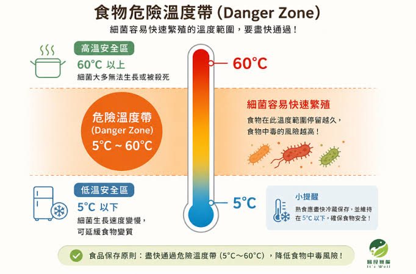

# 食堂打包饭菜冷藏贮存指南与食品安全原理解析

> **核心结论：** 小王从食堂打回来的熟食放进冰箱冷藏层（0°C 至 4°C）后，**绿叶蔬菜最多存放 12 至 24 小时（建议当天吃完，绝不隔夜）**；**水产海鲜与豆制品不超过 24 小时**；**米饭面食建议 24 至 48 小时内吃完**；**红烧肉、鸡鸭等炖煮肉类密封冷藏可存放 1 至 2 天（安全极限不超过 72 小时）**。
> 
>   

如果把家用冰箱的冷藏室比作微生物的“减速带”，那么它只能通过低温让绝大部分细菌进入“慢动作模式”，而不能像冷冻室或高温高压锅那样彻底杀灭细菌。**尤其是食堂大锅菜，在打回家的路上就已经历了一轮细菌扩增，贮存时限比家里现炒现装的饭菜缩短约三分之一。**

  

## 一、为什么食堂打回来的饭菜比家里现炒的更不耐放？

判断熟食在冷藏室能放多久，关键取决于食物进冰箱前的**初始菌落基数（Initial Bacterial Load）**。食堂饭菜从出锅到进入小王的冰箱，往往经历了一条高风险链路：

  

1. **大锅保温期的细菌潜伏**：食堂饭菜通常在开餐前 1 至 2 小时就已出锅，敞口摆放在售卖台的保温槽中。此时菜品表面温度往往掉到了 35°C 至 50°C 之间，空气中的微生物、打菜勺的反复接触都会引入初始菌群。
    
      
    
2. **跨越“食物危险温度带”**：从小王打包、拎回宿舍或工位，再到室温搁置后放进冰箱，饭菜长时间停留在最适合细菌裂变的温区。
    

    

如上图所示，食品安全学将温度划分为三个核心区间：

  

- **高温安全区（60°C 以上）**：绝大多数致病菌无法生长或被直接杀死。
    
      
    
- **危险温度带（5°C 至 60°C）**：细菌极易快速繁殖的温区，在 20°C 至 40°C 的核心段，细菌每 15 至 20 分钟就能分裂繁殖一代。食物在此温度范围停留越久，产毒与变质风险越高。
    
      
    
- **低温安全区（5°C 以下）**：细菌生长速度显著变慢，可有效延缓食物腐败。因此食堂熟食打包回来后，核心原则就是**尽快跨过 5°C 至 60°C 的危险温度带，送入 5°C 以下的冷藏层**。
    
      
    

## 二、冷藏室（0°C 至 4°C）各类食堂饭菜贮存时限一览

不同食材的蛋白质含量、水分活度（Water Activity）以及硝酸盐水平差异巨大，在冷藏层的寿命也截然不同：

  

|**菜品类别**|**常见食堂代表**|**最佳食用期**|**安全极限期**|**核心风险源**|
|---|---|---|---|---|
|**绿叶蔬菜**|炒青菜、蒜蓉菠菜|6 至 12 小时|24 小时|亚硝酸盐、叶片腐烂|
|**根茎与茄果菜**|土豆丝、红烧茄子|24 小时内|48 小时|淀粉老化、酸败菌|
|**红肉与禽肉**|红烧肉、黄焖鸡|24 至 48 小时|72 小时|李斯特菌、沙门氏菌|
|**水产河海鲜**|清蒸鱼、辣炒蛤蜊|12 至 24 小时|24 小时|组胺、副溶血性弧菌|
|**豆制品与禽蛋**|麻婆豆腐、卤鸡蛋|12 至 24 小时|36 小时|蛋白质酸败、产气菌|
|**主食淀粉类**|白米饭、炝面、炒饭|24 小时内|48 小时|蜡样芽孢杆菌|

针对上述分类，小王在规划每天的打饭量时可以遵循以下优先级：

  

- **第一梯队（当天必须消灭）：绿叶菜、海鲜、凉拌菜。** 食堂的炒青菜、油麦菜一旦隔夜，不仅口感发黄软烂，亚硝酸盐含量也会随细菌还原作用显著上升；而食堂凉拌菜未经二次高温灭菌，哪怕放进冷藏室也不建议留到第二天。
    
      
    
- **第二梯队（次日中午或晚上吃完）：豆制品、根茎蔬菜、米面主食。** 豆腐、千张等富含植物蛋白和水分，极易成为细菌的培养基，超过 24 小时容易发酸发粘；土豆、胡萝卜、莲藕等硝酸盐含量较低，冷藏可撑到第二天。
    
      
    
- **第三梯队（可存 2 天，极限 3 天）：炖煮或红烧的纯肉菜。** 食堂的红烧排骨、卤牛肉、把子肉经过长时间高温炖煮，且高盐高油环境能在一定程度上抑制杂菌，只要密封得当、未沾染口水，在冷藏室放 48 小时依然安全。
    
      
    

## 三、食堂剩菜变质的两大隐形杀手：亚硝酸盐与嗜冷菌

很多人以为“只要闻起来没馊、热一热就能吃”，但冷藏室里的食品安全隐患往往没有明显异味：

  

1. **细菌硝酸还原酶与亚硝酸盐（蔬菜杀手）** 绿叶蔬菜天生吸收土壤中的氮肥，富含硝酸盐。硝酸盐本身无毒，但在食堂备菜、打饭及慢速降温过程中，混入菜里的细菌会分泌**硝酸还原酶**，把硝酸盐转化为**亚硝酸盐**。冷藏虽能抑制酶的活性，但超过 24 小时后转化量仍会迎来爬坡。
    
      
    
2. **单核细胞增生李斯特菌（肉类与奶制品杀手）** 绝大多数细菌在低于 5°C 时会停止繁殖，但**李斯特菌（Listeria monocytogenes）**是典型的“嗜冷菌”，在 0°C 至 4°C 的冷藏室里依然能缓慢增殖，最喜欢藏在未密封的熟肉、卤味中。不过它的弱点是不耐热，只要吃前**中心温度加热到 70°C 以上并持续 2 分钟**就能将其彻底灭活。
    
      
    
3. **蜡样芽孢杆菌（剩米饭与面食杀手）** いわゆる“炒饭综合征”的元凶。食堂米饭或面条如果在室温下放太久才进冰箱，蜡样芽孢杆菌会大量繁殖并产生**呕吐型肠毒素**。这种毒素极其耐热，哪怕后续放进微波炉叮透（100°C 加热 20 分钟）也无法完全破坏毒素结构。
    
      
    

## 四、小王每天去食堂打包的 4 个黄金保鲜操作

为了让从食堂打回来的肉和菜安全度过冷藏期，小王只需要改变四个微小习惯，就能把变质风险降到最低：

  

1. **趁热直接密封进冰箱，别等彻底放凉** “热菜放冰箱会弄坏冰箱”是上世纪老式冰箱时代的过时观念。现代冰箱的制冷压缩机完全能轻松应对一两盒热饭菜的水汽负荷。把饭菜敞着盖子放在桌上晾凉 2 小时，等于主动把食物送进 **5°C 至 60°C 的危险温度带** 养细菌。打包回来只要不烫手（约 50°C 至 60°C），就应立刻盖紧放进冷藏室。
    
      
    
2. **执行“餐前分拨法”，拒绝口水筷子翻动** 如果小王买了一份大荤大素打算分两顿吃，**一定要在动筷子吃之前，先用干净的勺子或公筷把要存冰箱的那一半拨进独立保鲜盒**。一旦用沾有唾液的筷子在饭盒里反复翻动，口腔里的淀粉酶和杂菌会加速菜汤水化与腐败，保质期直接腰斩。
    
      
    
3. **换掉一次性塑料袋，荤素分盒放进冷藏室中上层** 食堂的薄塑料袋和简易泡沫盒无法隔绝氧气与冰箱杂菌。建议常备两个带硅胶密封圈的 **玻璃或食品级 PP 保鲜盒**（肉菜一盒、素菜一盒，避免菜汤浸泡肉块）。放入冰箱时，避开温度波动最大的冰箱门架，放在温度恒定在 2°C 至 4°C 的**冷藏室中上层靠里位置**。
    
      
    
4. **“只复热一次”原则，中心温度须达 75°C 以上** 冷藏熟食取出后，必须执行彻底的二次加热：用微波炉加热时，中途需拿出来翻拌一次以消除冷点，确保整盒饭菜冒出滚烫热气（中心温度高于 75°C）；若是带汤汁的炖肉，最好倒进小锅煮沸 3 分钟。**已经复热过一次却没吃完的剩菜，无论肉还是菜，都应直接丢弃，切勿再次放回冷藏室循环加热。**
    
      
    

只要守住“绿叶菜当天清零、肉菜密封分装不过两日、不晾凉直接冷藏、吃前彻底热透”这四条铁律，小王每天去食堂打饭备餐既能省去下厨的繁琐，又能稳稳守住肠胃安全。