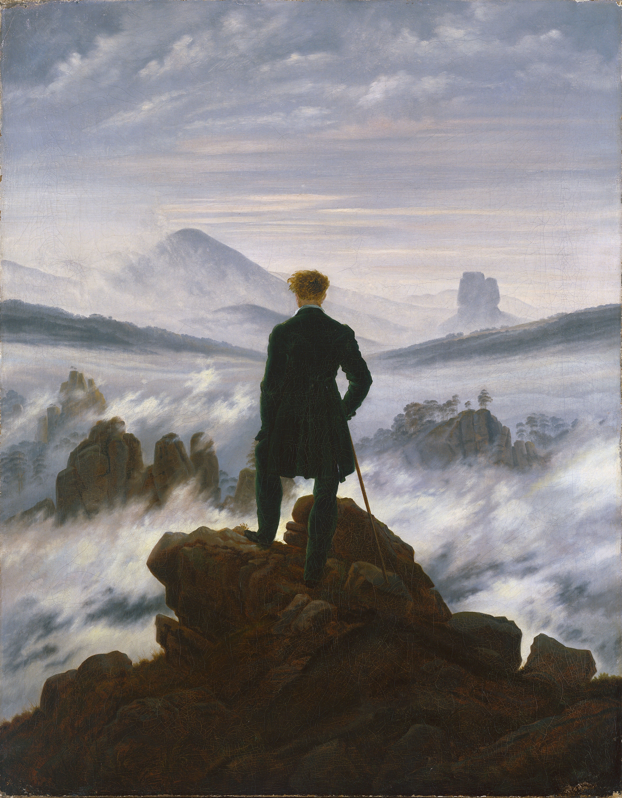
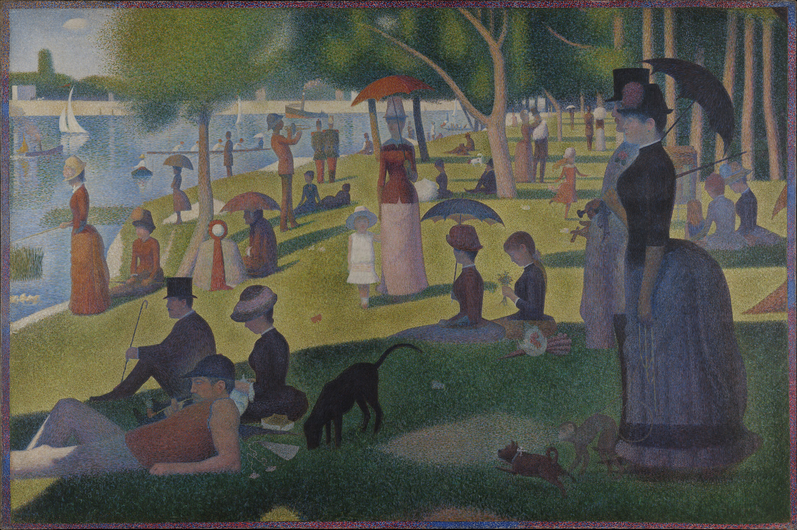
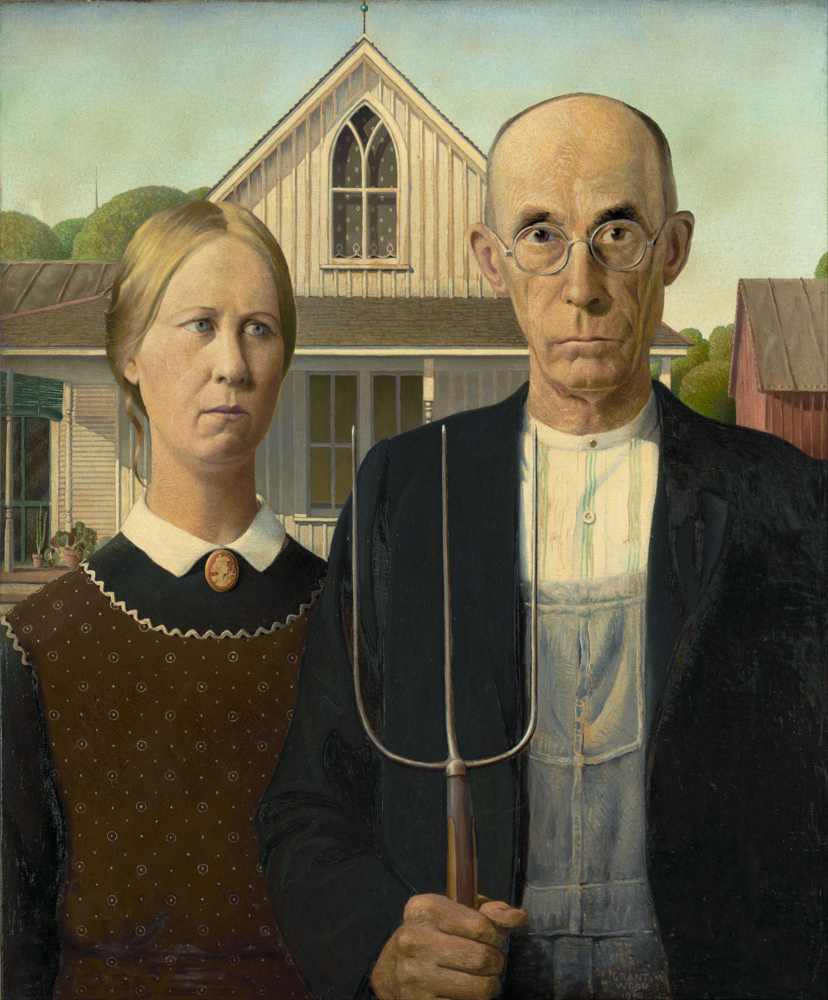
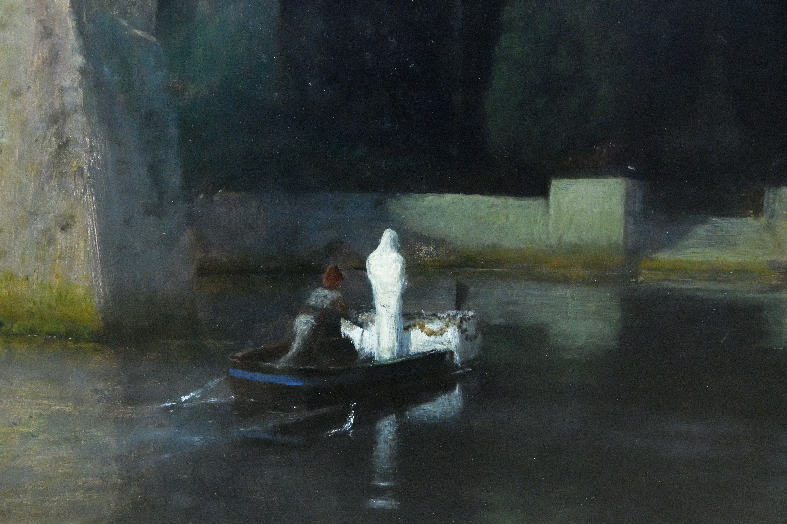
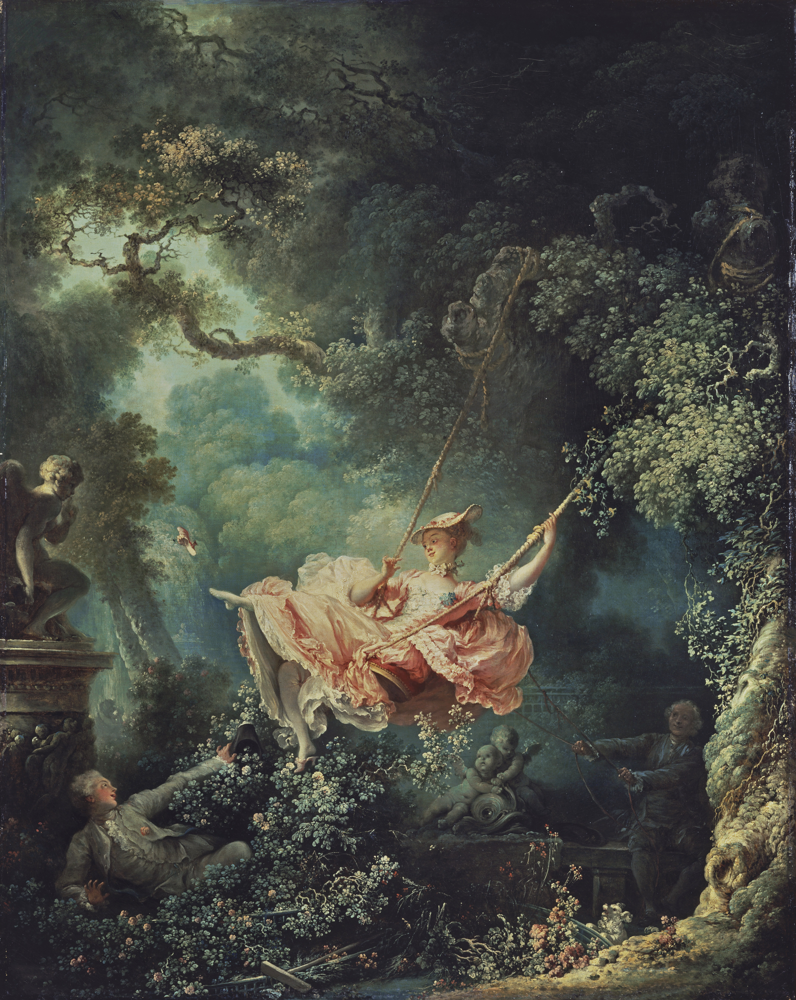
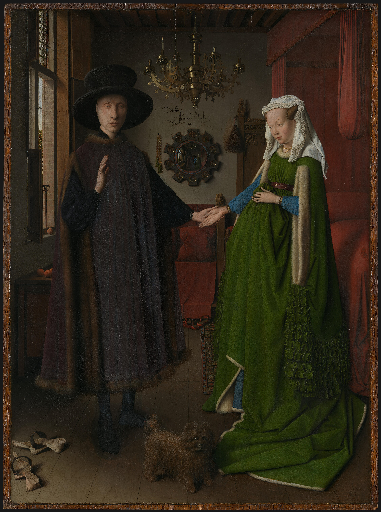
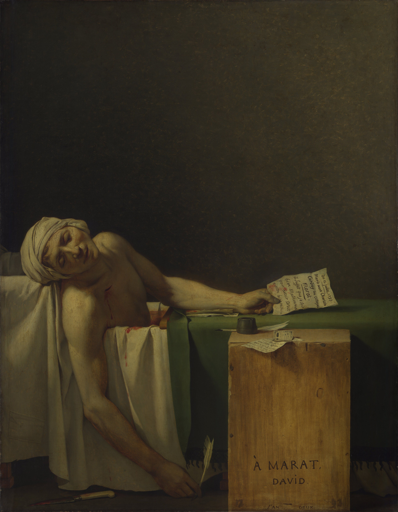
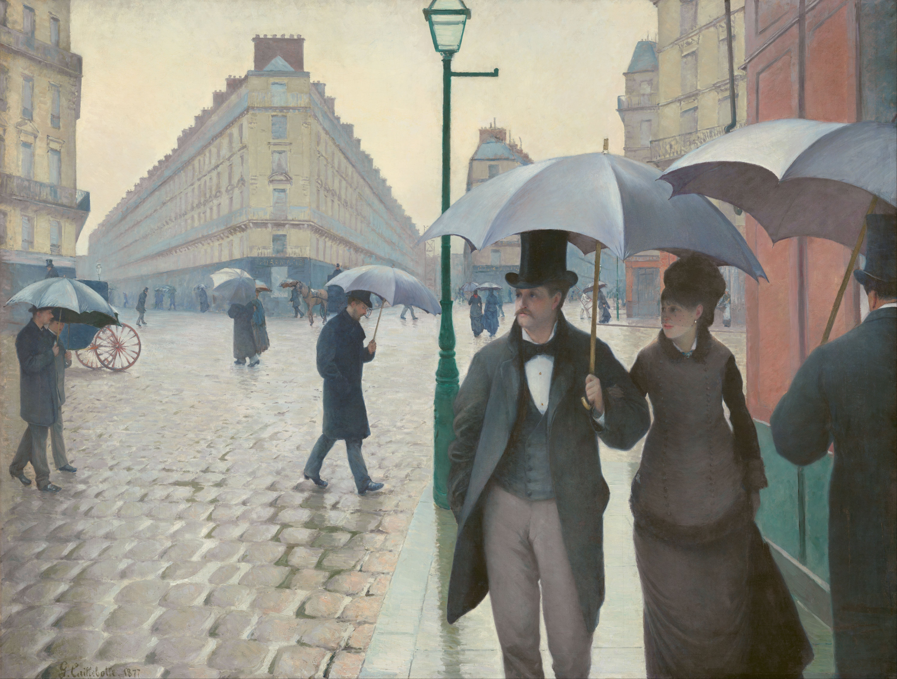
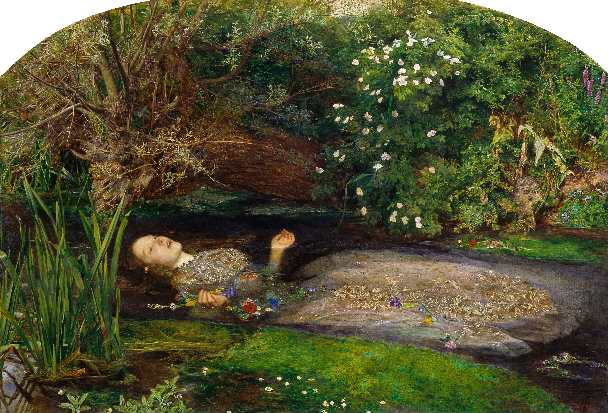
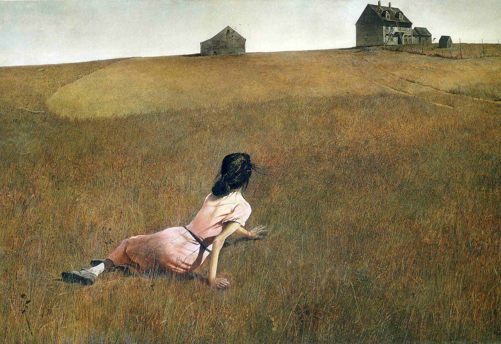

# 世界名画

本文档整理收录了西方绘画史上十位代表性画家的关键作品，跨越早期北方文艺复兴、洛可可、新古典主义、浪漫主义、象征主义、点彩派、前拉斐尔派，以及二十世纪美国地方主义等重要历史时期。内容涵盖艺术家的经典论述、创作历史背景，以及画面技法与图像学内涵的客观解析。

---

## 卡斯帕·大卫·弗里德里希 (Caspar David Friedrich, 1774-1840)

> *“画家不仅要画他眼前所见之物，更要画他内心所见之景。若内心空无一物，那就放下画笔，别去画眼前所见。”*
>
> *(The painter should paint not only what he has in front of him, but also what he sees inside him. If he sees nothing within him, then he should also omit painting what he sees before him.)*

弗里德里希是19世纪德国浪漫主义风景画的核心代表。他打破了古典风景画作为宗教或历史题材附属背景的地位，通过象征性的自然景观表达个体的哲学沉思与崇高感。

**《雾海之上的旅行者》 (Wanderer above the Sea of Fog, 1818)**

- **创作背景：** 约作于1818年。拿破仑战争结束后，德意志各邦国处于政治复辟与秩序重组时期。弗里德里希在同年结婚，并在这一阶段创作了这幅具有浪漫主义象征意味的代表作。
- **艺术手法与内涵：** 画作采用了德国风景画传统的“背影人物”(Rückenfigur)构图。前景中央的男子身着当时带有自由主义象征意味的传统大衣，手拄手杖伫立于岩石之巅，背对观众俯瞰脚下漫卷的云海与远山。背影视角将观众视线引向宏大深远的自然空间，呈现出有限个体面对浩瀚自然时的静思与疏离感。画面的金字塔式三角形构图稳固，远景的淡蓝冷调与前景暗色岩石形成了清晰的空间景深。

---

## 乔治·修拉 (Georges Seurat, 1859-1891)

> *“有些人自称在我的画作中看到了诗意，而我看到的只是科学。”*
>
> *(Some say they see poetry in my paintings; I see only science.)*

乔治·修拉是后印象派代表画家及新印象派（点彩画派/分色主义）的创始人。他将当时谢弗勒尔等科学家的色彩对比理论与光学原理引入绘画，试图为印象派的直觉式笔触建立严谨的理性与秩序体系。

**《大碗岛的星期天下午》 (A Sunday on La Grande Jatte, 1884-1886)**

- **创作背景：** 作品创作于1884年至1886年。大碗岛位于巴黎西北部塞纳河畔，是当时巴黎中产阶层与市民的周末度假休闲地。修拉在此进行了数十幅油画写生与数百幅素描准备，历时近两年完成这幅大幅油画。
- **艺术手法与内涵：** 修拉摒弃了在调色板上预先调和颜料的传统技法，采用细小密集的纯色色点并置排列，利用人眼视网膜在一定距离上的生理特性产生“光学混合效果”，从而保持色彩的纯度与明度。画面描绘了不同社会阶层人物在草坪和河畔休憩的场景，人物造型具有几何式的简化与静止感，构图严格遵循古典透视与黄金分割法则，呈现出一种近乎古典壁画的纪念碑式秩序。

---

## 格兰特·伍德 (Grant Wood, 1891-1942)

> *“所有我真正受用一生的好灵感，都是我在挤牛奶的时候冒出来的。”*
>
> *(All the good ideas I'd ever had came to me while I was milking a cow.)*

格兰特·伍德是20世纪30年代美国地方主义（Regionalism）艺术运动的关键代表人物。在欧洲现代派抽象主义盛行的背景下，他主张立足美国本土经验，以写实手法描绘美国中西部农村的现实生活与文化风貌。

**《美国哥特式》 (American Gothic, 1930)**

- **创作背景：** 创作于1930年美国大萧条初期。伍德在爱荷华州埃尔登发现了一座具有木骨架哥特复兴式尖顶窗的小农舍（迪布尔屋）。他以自己的妹妹纳恩和当地牙医拜伦·麦基比为模特，构思并绘制了这幅肖像作品。
- **艺术手法与内涵：** 画面构图严谨规整，前景并立的两位人物神情肃穆，男人手持三叉草耙，其竖向线条与男子的条纹衬衫、工装裤背带以及背景房屋的哥特式尖顶窗形成纵向呼应。画家采用平光和高度细腻平滑的笔法，受到北方文艺复兴细密画风的影响。这幅作品常被解读为对美国清教徒传统保守与顽固价值观的审视，同时也体现了经济大萧条时期中西部居民面对困境的坚韧特质。

---

## 阿诺德·勃克林 (Arnold Böcklin, 1827-1901)

> *“一幅真正的画，应当如同一首悠扬的乐曲，必须在观众心中唤起一种沉静而深远的冥想。”*
>
> *(A picture must tell something, it must make the spectator think, like a poem, and leave him with an impression like a piece of music.)*

阿诺德·勃克林是19世纪下半叶瑞士象征主义画派的重要代表。其作品多取材于神话意象与梦境隐喻，注重营造沉郁神秘的精神氛围，对后来的超现实主义（如基里科、达利）及形而上画派产生了深远影响。

**《死之岛》 (Isle of the Dead / Die Toteninsel, 1883)**

- **创作背景：** 勃克林在1880年至1886年间共绘制了五个版本的《死之岛》（其中第四版在二战中毁损），本作为1883年的第三版。最初受丧夫的富商遗孀玛丽·贝尔纳委托构思，意在创作一幅寄托哀思、引人静默冥想的画作。
- **艺术手法与内涵：** 画面中央为一座矗立在静止海面上的岩石孤岛，岛内密植象征哀悼的高耸黑柏树，沿岸石壁开凿出多处阶梯状家族墓穴。一叶孤舟由摆渡人划向岛屿，船头立有一位全身披裹白衣的身影，前方置有覆以花环的棺木。作品融合了古希腊神话中冥河渡神卡隆的隐喻与北方象征主义的静谧死亡主题，用克制的冷色调与横纵交错的几何轮廓强化了永恒与沉寂的视觉意向。

---

## 让-奥诺雷·弗拉戈纳尔 (Jean-Honoré Fragonard, 1732-1806)

> *“艺术是一场永不落幕的游戏，而美就是生命对欢愉最放肆的邀请。”*
>
> *(Art is a game that never ends, and beauty is life's most lavish invitation to pleasure.)*

弗拉戈纳尔是18世纪法国洛可可（Rococo）晚期最重要的代表画家之一。其画风承袭弗朗索瓦·布歇，以笔触轻快灵动、色彩柔和明丽、善于捕捉世俗欢愉与戏剧性场景著称。

**《秋千》 (The Swing / Les Hasards heureux de l'escarpolette, 1767)**

- **创作背景：** 创作于1767年。据文献记载，此画最初由法国宫廷贵族圣朱利安男爵委托画家加布里埃尔·弗朗索瓦·杜瓦尔，杜瓦尔认为题材带有过多的艳情暗示而婉拒，转由弗拉戈纳尔接手完成。
- **艺术手法与内涵：** 画面构图呈对角线动态，穿戴粉红色精致长裙的年轻女子在秋千荡起的顶端扬落一只绣花鞋；左下方灌木丛中隐匿着青年贵族情人仰面观望；右后方阴影处则为推荡秋千的年长男子。左侧树丛立有法尔科内雕塑《含蓄的丘比特》（食指抵唇示意保密）。画作运用了洛可可时期典型的S形曲线与斑驳逆光，以花园自然的繁密生机烘托世俗游戏的轻快与私密情调。

---

## 扬·范·艾克 (Jan van Eyck, c. 1390-1441)

> *“尽我所能，不违其真。”*
>
> *(Als ich kan / As best I can.)*

扬·范·艾克是15世纪早期弗兰德斯画派（早期北方文艺复兴）的奠基人物。他改良并推广了快干植物油调和色粉的油彩媒介体系，使画面的透明度、微距写实精度和光影质感达到了划时代的技术高度。

**《阿尔诺芬尼夫妇像》 (The Arnolfini Portrait, 1434)**

- **创作背景：** 完成于1434年布鲁日。画中人物为当时移居弗兰德斯的意大利卢卡布商乔瓦尼·迪·尼古拉奥·阿尔诺芬尼与其妻子（一说为其第一任亡妻康斯坦萨·特伦塔的悼亡纪念画像）。
- **艺术手法与内涵：** 画作以严谨的早期单点透视与精细的写实技法展现室内空间，包含了丰富的世俗与宗教象征物：枝形吊灯上单只燃烧的蜡烛常指涉上帝之眼；散落的木屐暗示神圣誓约之所；脚边的猎犬象征忠诚；床柱顶端雕刻有产妇守护圣人圣玛格丽特像。背景中央的圆形凸面镜完整倒映了室内的背部全景及门口的两位见证者，镜框边缘绘有十幅基督受难微缩图景，上方题有拉丁文铭文“Johannes de eyck fuit hic 1434”（扬·范·艾克曾在此）。

---

## 雅克-路易·大卫 (Jacques-Louis David, 1748-1825)

> *“在艺术中，唯有理性能够赋予画笔灵魂；纯粹的激情若是没有严谨的秩序，终将沦为荒唐。”*
>
> *(In the arts, reason alone can give soul to the brush; pure passion without rigorous order will end in absurdity.)*

雅克-路易·大卫是18世纪末至19世纪初法国新古典主义绘画的代表人物，曾先后担任法国大革命时期的国民公会代表及拿破仑帝国的官方首席画师。其艺术主张遵循古希腊罗马古典法则，强调素描轮廓、几何严谨性与理性道德寓意。

**《马拉之死》 (The Death of Marat, 1793)**

- **创作背景：** 创作于1793年。同年7月13日，雅各宾派领袖让-保尔·马拉在因严重皮肤病需常年药浴的浴缸中，被吉伦特派支持者夏洛特·科黛刺杀身亡。大卫受国民公会委托，以政治纪实与殉道悼念为目的迅速完成了该作。
- **艺术手法与内涵：** 大卫在构图上进行了高度提炼：摒弃了凶杀现场的骚乱细节与凶手形象，将画面上半部分处理为纯净沉郁的无物象暗色背景，右侧强光投射在垂首受难的马拉身上。马拉手中仍执羽毛笔与刺客留下的请愿便条，右臂下垂的姿态借鉴了古典受难像（如卡拉瓦乔《基督下葬》与米开朗基罗《哀悼基督》）。前方旧木箱被处理为简朴的墓碑形式，题刻有“献给马拉，大卫”。整幅作品通过严格的几何水平线与垂直线，将残酷的政治暗杀升华为了古典英雄式的殉难肖像。

---

## 居斯塔夫·卡耶博特 (Gustave Caillebotte, 1848-1894)

> *“我只想用最诚实的目光去记录我所生活的时代，无论那是阴雨泥泞的街道，还是人们匆匆掠过的背影。”*
>
> *(I try to paint the world as honest as I can see it, whether it is a rainy muddy street or the hurried backs of passersby.)*

居斯塔夫·卡耶博特既是印象派画展的重要组织者与赞助人，也是一位极具现代视角的印象派画家。他将印象派对瞬息自然光色与水汽的敏锐观察，与学院派严谨的线性透视法则及早期摄影的景深抓拍构图相结合，主要聚焦19世纪后半叶巴黎现代化都市空间。

**《雨天的巴黎街道》 (Paris Street; Rainy Day, 1877)**

- **创作背景：** 展出于1877年第三届印象派画展。画作以奥斯曼男爵主持的巴黎市政改造为时代背景，取景于巴黎第八区都柏林广场北侧的多条放射状林荫大道交汇处，记录了现代化改造后秩序井然的巴黎街景。
- **艺术手法与内涵：** 画作采用全景式的宽幅透视构图。画面中央的铸铁煤气路灯构成了垂直分割轴，将近景打伞漫步的资产阶级夫妇与中远景分散行走的市民群体自然分流。前景男子的右半侧身躯被画框边缘直接裁切，显示出早期快照摄影的瞬间捕捉构图特征。画家以细腻的渐变灰色与冷色调，表现出湿润石板路的漫反射高光与阴雨天空的漫射光线，客观记录了现代都市中个体并存却互不交集的疏离状态。

---

## 约翰·埃弗里特·米莱斯 (John Everett Millais, 1829-1896)

> *“真正的艺术不该是对古典法则的生搬硬套，而应当回到自然面前，虔诚地描绘每一片叶子、每一朵鲜花的呼吸。”*
>
> *(True art should not be a slavish copy of classic formulas, but should return to nature and devoutly record the breath of every leaf and flower.)*

约翰·埃弗里特·米莱斯是19世纪英国前拉斐尔派兄弟会（Pre-Raphaelite Brotherhood）的创始人之一。该流派主张摆脱学院派陈旧构图程式的束缚，回归拉斐尔之前早期文艺复兴艺术对大自然真实物象的虔诚摹写与文学象征意蕴。

**《奥菲莉亚》 (Ophelia, 1851-1852)**

- **创作背景：** 创作于1851年至1852年。题材源自莎士比亚戏剧《哈姆雷特》第四幕中王后格特鲁德对奥菲莉亚失常溺亡情景的描述。米莱斯在萨里郡霍格斯米尔河畔进行了数月的实地自然写生，随后在画室中以画家兼诗人伊丽莎白·西达尔（Elizabeth Siddal）为模特绘制人物。
- **艺术手法与内涵：** 画作严格贯彻了前拉斐尔派的自然主义写生原则，对河畔植物群落（如垂柳、荨麻、雏菊、紫罗兰、罂粟与毛茛）进行了植物学级别的精确刻画，并赋予了莎翁戏剧中的花语隐喻（如紫罗兰象征忠诚，红色罂粟象征安眠与死亡）。奥菲莉亚平躺于水面、双臂微张的姿态结合繁密清澈的水生植物，将悲剧死亡场景置于大自然茂盛生机的复杂对照之中。

---

## 安德鲁·怀斯 (Andrew Wyeth, 1917-2009)

> *“如果我的作品能够让你感受到灵魂的战栗，那绝不是因为我画了什么惊天动地的事物，而是因为在最平凡的土地上，我找到了人类彻骨的孤寂。”*
>
> *(If you want to know what my work is about, it's about life and death, an acute sense of loneliness and mortality.)*

安德鲁·怀斯是20世纪美国重要的写实主义（常被称为魔幻现实主义或区域主义）画家。在二战后抽象表现主义占据主流的美国艺术界，怀斯始终坚持以宾夕法尼亚州查兹福特及缅因州库欣的乡村景观与邻人为题材，善于运用蛋彩画（Egg Tempera）与干画笔水彩等细密画技法。

**《克里斯蒂娜的世界》 (Christina's World, 1948)**

- **创作背景：** 创作于1948年。灵感源自画家在缅因州库欣时期的邻居安娜·克里斯蒂娜·奥尔森（Anna Christina Olson）。奥尔森患有进行性神经肌肉疾病（被诊断为沙眼肌营养不良症），下肢丧失行走能力，但她坚持不使用轮椅而在田野间爬行劳作。怀斯偶见其爬越干草斜坡的场景后深受触动，绘制了这幅作品。
- **艺术手法与内涵：** 画面采用了低视平线与大面积倾斜地平线的特殊透视构图，大篇幅留白给干燥枯黄的草坡。前景女子背向观众、斜倚在草地上，纤弱的手臂支撑着身体，目光投向远方山岗上的奥尔森农舍与谷仓。怀斯利用蛋彩画层层平涂与干细画笔技术，精细地描摹了成千上万根枯草茎的质感与木制房屋的风化裂痕，在写实具体的田园场景中营造出心理学层面普遍存在的距离感、身体限制与坚韧意象。
