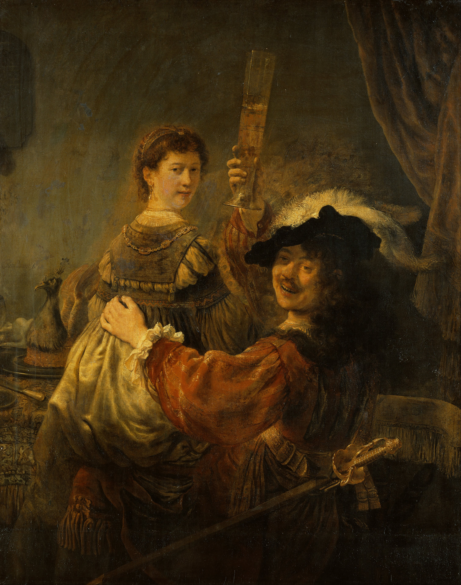
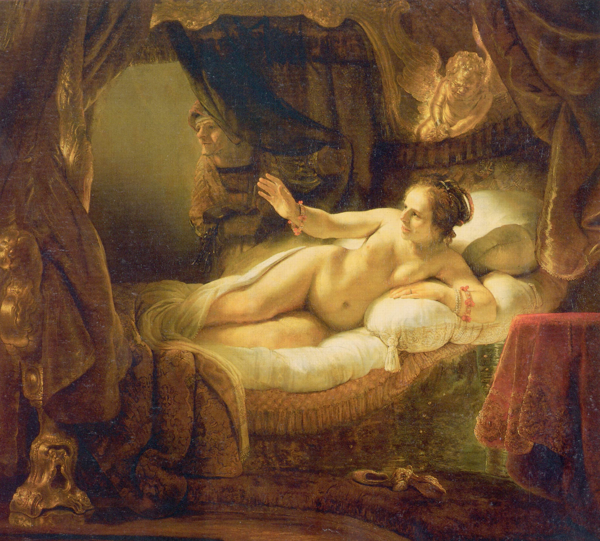
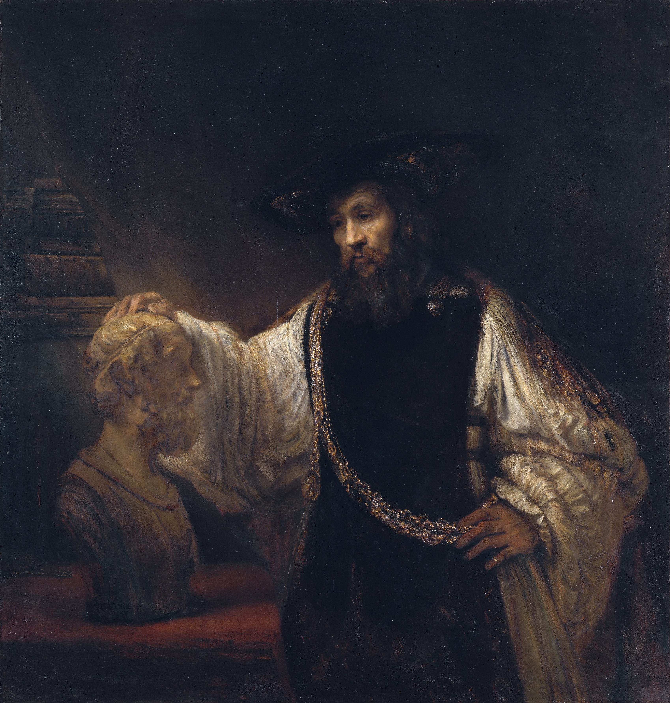
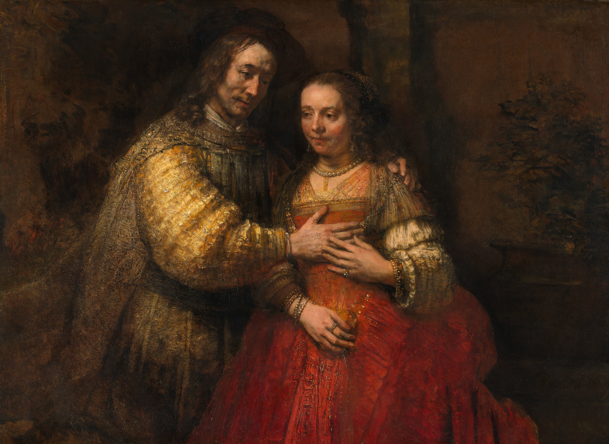
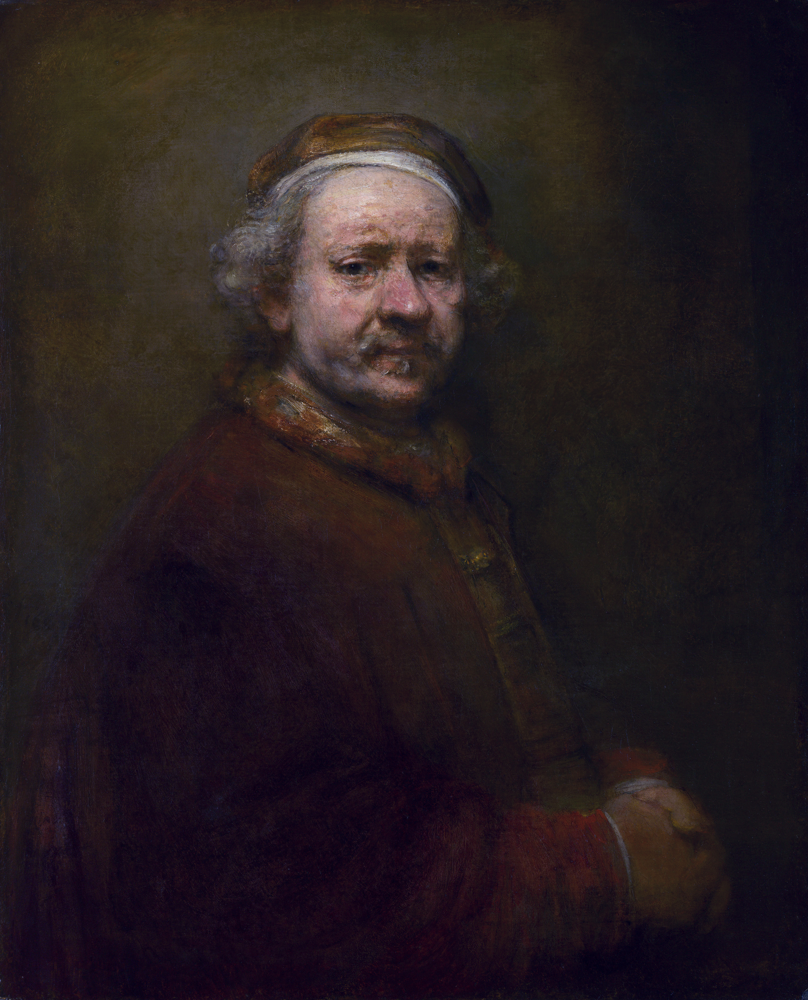

# 伦勃朗·梵·莱茵

>*“把你所知道的付诸实践，它会帮你厘清你现在还不明白的事物。”*
>
>*(Practice what you know, and it will help to make clear what now you do not know.)*

在17世纪荷兰黄金时代的艺术苍穹中，伦勃朗·哈尔曼松·梵·莱茵(Rembrandt van Rijn, 1606–1669)代表着巴洛克绘画现实主义精神的最深沉维度。与其他同时代画家沉醉于描绘商业共和国繁华表象不同，伦勃朗不仅以出神入化的明暗对照法(Chiaroscuro，后世称“伦勃朗光”)重构了戏剧化空间，更以近乎残酷的心理洞察力剖开了人类灵魂的内在肌理。

他的一生呈现出一种经典的莎士比亚式悲剧弧线：从年少成名、订单如云的阿姆斯特丹新贵，到因坚持艺术探索与雇主审美冲突而导致的破产清算；从挥金如土、家庭美满的巅峰，到亲人相继离世、在贫困孤寂中终老的黄昏。他的艺术风格也同步完成了蜕变——从早年炫技般的精细光洁，演变为晚期如泥土雕塑般的粗粝厚涂(Impasto)。以下十幅核心名作，记录了他从世俗狂热走向精神澄澈的历史轨迹。

---

## 一、荣光初升：阿姆斯特丹的新贵时代 (1632 - 1635)

17世纪30年代初，26岁的伦勃朗离开故乡莱顿来到繁华的贸易中心阿姆斯特丹。凭借精湛的肖像画技巧与对戏剧性瞬间的捕捉能力，他迅速打破了当地僵化的行会群像传统，成为上流社会争相追逐的宠儿。

**1. 《杜尔普医生的解剖课》 (The Anatomy Lesson of Dr. Nicolaes Tulp, 1632)**

  

- **历史背景：** 这是年轻的伦勃朗初抵阿姆斯特丹接到的首个重大行会委托。当时传统的行业群像画通常遵循刻板的“排坐平分”模式，出资者按缴费金额依次排列面部。
- **形式与心理剖析：** 伦勃朗彻底颠覆了陈规，构筑了一个充满动势的科学探究现场。杜尔普医生正用镊子剥离前臂屈肌腱，七名学者围拢在解剖台周围，通过眼神、倾身与交谈形成紧凑的心理弧线。强烈的冷光自左上方投射在苍白的尸体与专注的面孔上，科学启蒙的理智光辉与死亡的冷峻在此交汇。这幅作品不仅奠定了他在阿姆斯特丹画坛的领军地位，更为近代群体肖像注入了前所未有的戏剧张力。

**2. 《扮作花神的萨斯基亚》 (Flora, 1634)**

  

- **历史背景：** 1634年，伦勃朗迎娶了吕伐登市长之女萨斯基亚(Saskia van Uylenburgh)。这段门当户对的婚姻不仅带来了丰厚的嫁妆，更使画家真正融入了阿姆斯特丹的贵族阶层。
- **形式与心理剖析：** 此时的伦勃朗正处于世俗幸福的最顶点。他将新婚妻子塑造成罗马神话中掌管繁衍与春天的花神弗洛拉。画面中极其繁丽的刺绣绿缎、繁复的蕾丝质感以及盛开的花冠，展现了他对物质细节近乎炫耀的刻画功力；萨斯基亚脸上含蓄而微显羞涩的从容神态，折射出画家面对未来生活时毫无阴霾的自豪与深情。

**3. 《酒馆里的浪子》 (The Prodigal Son in the Brothel, 1635)**

  

- **历史背景：** 伦勃朗与萨斯基亚的罕见双人自画像。此时画家收入丰厚，在阿姆斯特丹买下豪宅，并热衷于在拍卖行疯狂搜购奇珍异宝、盔甲与东方织物。
- **形式与心理剖析：** 画面借用圣经中“浪子挥霍家产”的寓言，却全无道德忏悔的意味，反而洋溢着世俗享乐的狂喜。身着华丽羽冠天鹅绒服的伦勃朗将萨斯基亚揽坐在膝头，高举巨大的孔雀高脚酒杯回望观者，嘴角带着不可一世的傲慢笑意。这种充满官能诱惑与自我膨胀的戏剧化构图，如实记录了画家在声名鼎盛时期狂热、放纵的精神状态。

---

## 二、巅峰跌宕：艺术反叛与命运的断裂 (1636 - 1643)

40年代初构成了伦勃朗人生与艺术的双重转折点。一方面，他对画作内在动态与光影实验的极致追求，开始与荷兰布尔乔亚保守的审美取向产生严重脱节；另一方面，家庭连续的丧子之痛与爱妻的早逝，彻底摧毁了他的世俗堡垒。

**4. 《夜巡》 (The Night Watch, 1642)**

  

- **历史背景：** 接到阿姆斯特丹第二区民兵火枪手公会的巨额赞助委托。就在同年，长期患病的萨斯基亚在留下独子提图斯后病逝，年仅29岁。
- **形式与心理剖析：** 伦勃朗彻底决绝了传统行会群像中人物必须“同等受光、同等清晰”的商业妥协。他将原本呆板的检阅队伍，描绘成士兵们在班宁·科克队长带领下突然闻声出动的宏大动态瞬间。光线如舞台探照灯般极不均匀地切割画面，将队长、副官与一名象征行会荣誉的神秘发光少女推向前台，而其余出资者则大部分隐没在深邃的阴影与次要动态中。这一旷世杰作在艺术史上确立了光影赋形的新法度，却在现实中激怒了出资会员，导致其订单自此锐减，成为其职业生涯由盛转衰的关键分水岭。

**5. 《达娜厄》 (Danaë, 1636 - 1643)**

  

- **历史背景：** 历时数年完成。最初是以妻子萨斯基亚为原型，而在妻子去世后，伦勃朗在极度的情感虚空中重绘了女子的面容，融入了新情人海尔吉的特征。
- **形式与心理剖析：** 伦勃朗舍弃了提香等文艺复兴大师将宙斯具象化为“金币雨”的古典传统，而是将其升华成一束倾泻在床榻帷幔间的温热金光。卧于榻上的女子面带欣喜与期盼伸出右手，躯体不再是无瑕的古典雕塑，而是带有腹部褶皱与真实皮肤质感的凡人形态。这幅叠印着两任爱人容颜的画布，记录了画家在妻子离世后的苦涩挣扎，以及在幽暗画室中对光明的渴望。

---

## 三、幽暗沉潜：财务危机与自省哲思 (1653 - 1654)

50年代，因长期入不敷出与订单匮乏，伦勃朗在财务上走向绝境，最终被迫申请阿姆斯特丹最高法院破产保护，所有收藏品与房产被公开拍卖。在世俗社会的排挤中，他的画笔彻底脱离了装饰功能，转而沉降至形而上的哲学反思。

**6. 《凝视荷马半身像的亚里士多德》 (Aristotle with a Bust of Homer, 1653)**

  

- **历史背景：** 西西里贵族安东尼奥·鲁弗的私人订件。此时伦勃朗已身陷严重的债务诉讼泥潭，面临名誉与财产的双重覆灭。
- **形式与心理剖析：** 画中散发着深邃沉重的历史沉思。哲学家亚里士多德身着昂贵宽大的深色天鹅绒长袍，身上佩戴着亚历山大大帝赐予的沉重金链——象征着世俗的权力、财富与功名；他的手却轻轻抚摸着盲眼诗人荷马冰冷的大理石雕像——象征着不受时间侵蚀的诗性与不朽智慧。在破产边缘的伦勃朗借古希腊先哲之躯，完成了一次对自我命运的冷峻自省：在瞬息即逝的物质繁华与孤独永恒的艺术创造之间，灵魂究竟应归于何处。

**7. 《沐浴的拔示巴》 (Bathsheba at Her Bath, 1654)**

  

- **历史背景：** 画中模特是陪伴他后半生的忠诚伴侣亨德里治(Hendrickje Stoffels)。当时怀有身孕的亨德里治因未婚同居被归正教会严厉传唤，定罪为“与画家生活作风败坏”，承受着巨大的社会污名。
- **形式与心理剖析：** 伦勃朗完全摒弃了传统神话与宗教画将拔示巴塑造成诱惑大卫王之红颜祸水的刻板图式。画中的拔示巴手握国王逼令入宫的信件，神态毫无骄纵，低垂的眼帘中盛满了无奈、悲凉与内心的道德撕裂。暖调的柔光笼罩着她略显松弛成熟的肉体，呈现出一种近乎神圣的脆弱性。这幅画作是对强权支配下凡人命运的深沉悲悯，亦是画家对伴侣所受不公待遇的无声抗议。

---

## 四、繁华落尽：极致厚涂与精神救赎 (1665 - 1669)

步入花甲之年的伦勃朗几乎失去了一切：伴侣亨德里治与独子提图斯相继感染瘟疫离世。在生命的最后岁月，他彻底放弃了对物象光滑质感的执念，转向了以大号调色刀与粗粝厚涂为特征的画风，画作中沉淀出超越苦难的精神安详。

**8. 《犹太新娘》 (The Jewish Bride, 1665 - 1667)**

  

- **历史背景：** 晚年穷困潦倒的伦勃朗在阿姆斯特丹约丹犹太贫民区创作。画中描绘了一对圣经人物（可能为以撒与利百加）的亲密瞬间。
- **形式与心理剖析：** 梵高曾坦言愿用十年寿命换取在这幅画前坐上两周。伦勃朗在人物衣袍上使用了惊人的厚涂技法，颜料层叠如泥浆雕塑，在光线下折射出如熔岩凝固般的黄金与绯红。画中男子的一只手极其轻柔地贴在女子胸前，女子的指尖优雅地给予回触。在经历了死亡、背叛与剥夺之后，画家的笔触中没有怨毒，唯余一种沉重、克制却无比深邃的人间温情。

**9. 《浪子回头》 (The Return of the Prodigal Son, 1668 - 1669)**

  

- **历史背景：** 27岁的独子提图斯死后不久，伦勃朗在垂暮之年完成了这幅堪称西方人文主义顶峰的绝唱之作。
- **形式与心理剖析：** 画面摈弃了一切戏剧性的喧嚣，聚焦于永恒的和解时刻。跪倒在地、衣衫褴褛、鞋底磨穿的幼子将头深埋在父亲腹部；年迈盲眼的父亲身披宽大红袍，以苍老颤抖的双手抚按着儿子的肩背。细察之下，父亲的左右两手形态不同：左手粗大骨感，代表父性的宽恕与承受；右手纤细柔和，代表母性的抚慰与包容。光线完全敛聚于父子相拥的焦点，周遭观者在暗影中肃立。这是伦勃朗历尽沧桑后，向命运与神明做出的终极托付。

**10. 《63岁自画像》 (Self-Portrait at the Age of 63, 1669)**

  

- **历史背景：** 伦勃朗去世当年的最后几幅自画像之一。数周后，他在贫民窟的一间简陋住宅中悄然离世，被安葬在西教堂一处租来的无名墓穴中。
- **形式与心理剖析：** 粗犷的笔触毫不留情地记录下衰老与贫病：浮肿的眼袋、松弛的颊肉、深陷的皱纹与灰白的乱发。然而他的双手平静地交叠在身前，眼神中既无早年的傲慢轻狂，亦无破产时期的迷惘苦痛，而是呈现出一种洞察了生死悲欢后的超然与通透。这位被时代抛弃的老人直视着画布外的世界，宣告了一个伟大肉体的终结与不朽精神形式的确立。

---

## 结语：暗夜中的精神微光

纵观伦勃朗·梵·莱茵的一生，他的艺术轨迹实际上是一个不断剥离世俗附加物的过程。从早年在商业赞助体制下的精准炫技，到中后期对光影戏剧性与群像构图的颠覆性重构，再到晚年用厚重颜料雕刻人类精神的苦难与救赎，伦勃朗将绘画从简单的外物再现，提升到了灵魂自我拷问的高度。正如艺术史家所评述的那样：伦勃朗在黑暗中发现了光，而那道光所照亮的，始终是人类人性中最隐秘也最崇高的本质。
