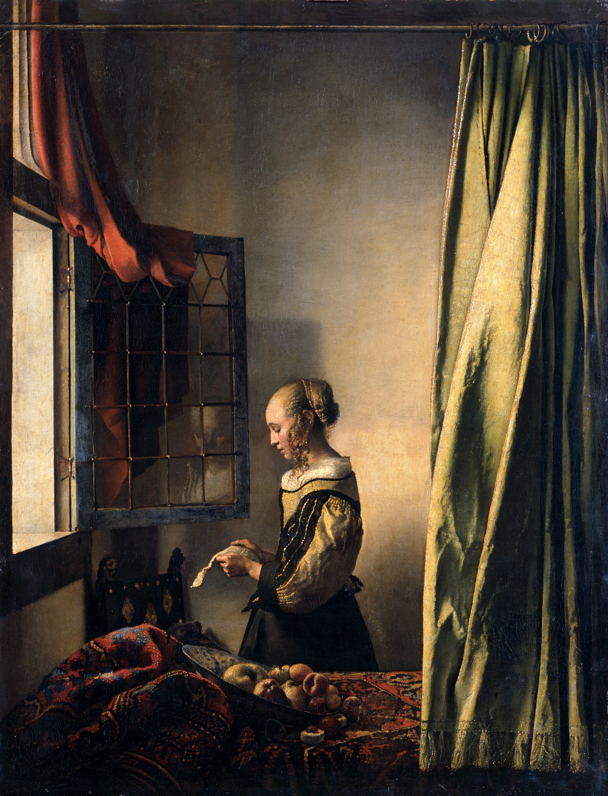
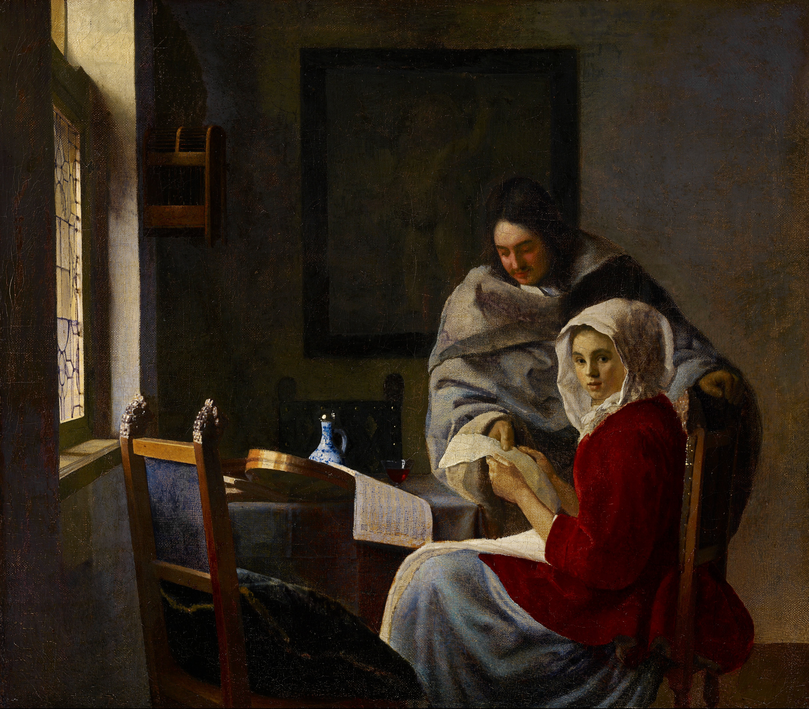
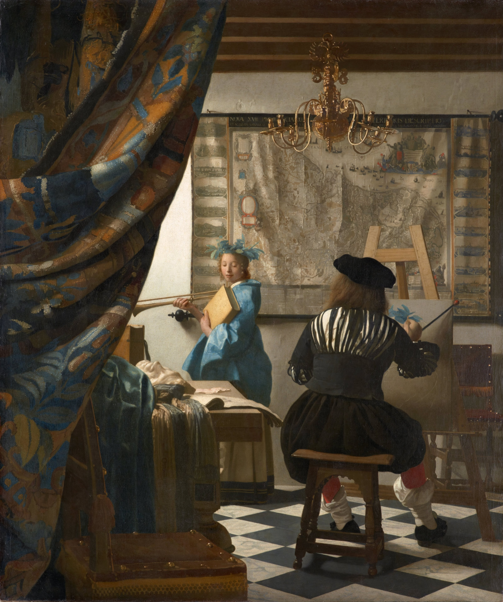
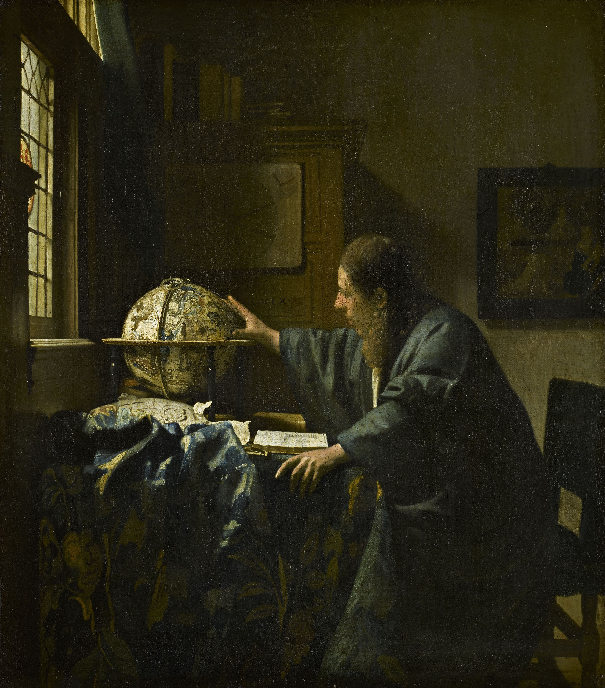
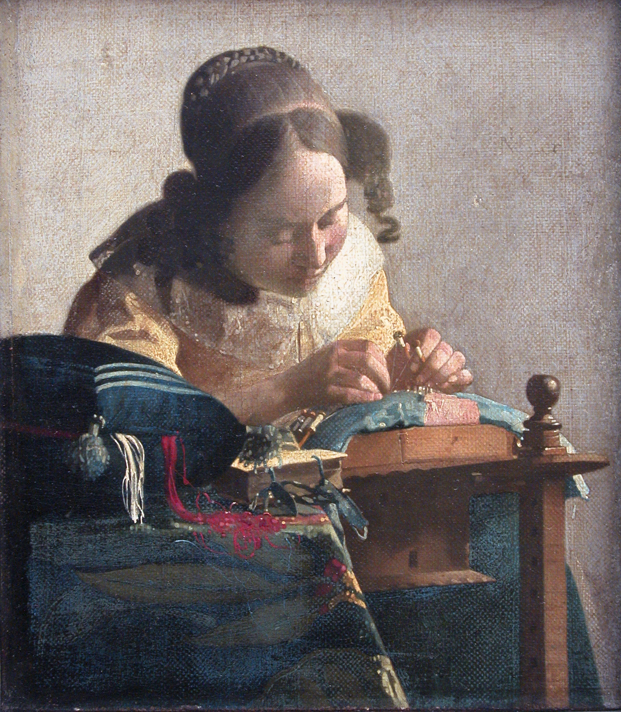

# 翰内斯·维米尔

约翰内斯·维米尔(Johannes Vermeer, 1632–1675)在艺术史上被称为“代尔夫特的斯芬克斯”(The Sphinx of Delft)。**他一生未曾留下日记、书信或理论手稿，因而未留下任何自述性名言。** 他的全部世界观与美学哲学，完全凝固在画布上那静谧的光影与秩序井然的空间之中。

关于维米尔的艺术高度，后世最常引用的是法国作家马塞尔·普鲁斯特(Marcel Proust)在《追忆似水年华》中凝视其代表作《代尔夫特风景》时的经典论述：

> *“我的文字也应如此……用几层色彩涂抹，让语言本身变得无比珍贵，就像那一点点黄色的墙面。”*
> 
> *(That is how I ought to have written... made my language precious in itself, like this little patch of yellow wall.)*

相较于莫奈对室外瞬息光影的印象式捕捉，维米尔走向了截然相反的美学维度——他如同在光学暗箱中探索形而上的炼金术士，将荷兰市民阶层最平淡无奇的室内起居，提纯为具有永恒神圣感的空间标本。在他那间代尔夫特的画室里，光线不仅是照明工具，更是最严谨的空间建构者与叙事媒介。

---

### 一、日常的崇高化：风俗图景与室内光的启蒙 (1650年代末)

17世纪中叶的荷兰共和国正值黄金时代。新兴市民阶层对宏大的宗教和神话主题需求渐趋衰减，风俗画开始转向家庭内部的客厅、书房与后厨。维米尔早期的探索，正是从世俗烟火中提炼出了古典式的崇高感。

* **《倒牛奶的女仆》 (The Milkmaid, 约1657 - 1658)**
  
  画面聚焦于荷兰家庭中最基础的日常劳作。晨光穿透左上方破碎的窗玻璃，洒落在粗麦面包、粗陶奶罐与女仆坚实的围裙上。维米尔摒弃了传统风俗画对劳动底层平庸或粗鄙的戏谑刻画，以金字塔式的严密构图与厚重的雕塑感，赋予了劳动者不可动摇的体量与尊严。悬挂于半空的一缕纤细牛奶，与周遭静止的物象形成微小的时间停滞感，将瞬息劳作固化为永恒。

* **《窗前读信的女孩》 (Girl Reading a Letter at an Open Window, 约1657 - 1659)**
  
  此作标志着维米尔“左侧自然侧光”图式的正式确立。画面通过前景帷幔、倾斜果盘与沉重桌毯构建出物理屏障，营构出一个高度私密且不容窥探的心理结界。窗玻璃上隐约映出少女模糊的倒影，画中人专注读信时微妙的情感起伏，被完全隐匿在静谧无声的表象之下，展现出画家对人物内在情感空间克制而精准的把控力。

---

### 二、空间几何与世俗哲思的张力 (1660年代初)

随着对透视学与光学透镜（暗箱，Camera Obscura）理解的深入，维米尔开始借助极端精准的几何视轴，在物理空间内部编织关于道德、欲望与故土的形而上隐喻。

* **《代尔夫特风景》 (View of Delft, 约1660 - 1661)**
  
  这是维米尔传世极少的外景作品之一，也是近代城市风景画史上的里程碑。画面如同高精度的定格长镜头，记录了雨后初晴的代尔夫特港湾。暗云正从天际退去，阳光洒在红砖钟楼与桥梁边缘，水面的倒影泛着粼粼的颗粒光泽。维米尔以近乎光学测量的客观冷峻，记录下了家乡城市的呼吸感与时空标本。

* **《持天平的女人》 (Woman Holding a Balance, 约1662 - 1664)**
  
  作品在静谧的世俗表象下注入了深沉的宗教道德寓意。幽暗的室内，一名身怀六甲的女子静候手中的天平归于绝对水平；她身后的墙上悬挂着一幅宏大的《最后的审判》油画，桌上则散落着黄金与珍珠。世俗财富的称量与神圣灵魂的裁决在此形成空间对位。维米尔以极度超然的笔触，叩问了人类在物质享受与精神操守之间寻求平衡的永恒命题。

* **《音乐课》 (The Music Lesson, 约1662 - 1665)**
  
  在17世纪的荷兰视觉象征系统中，乐器通常是两性吸引与社交礼仪的代名词。维米尔在此化身为冷静的几何观察者：深远的单点透视地砖严格引导视线，琴盖上方斜悬的镜面不仅反射出女琴手的侧脸，更倒映出画架的一角。这种通过复杂光学反射构筑的多维空间，不动声色地解析了男女之间微弱试探的情感张力。

---

### 三、面部习作与绘画本体论的巅峰 (1665 - 1668)

60年代中后期，维米尔的艺术实验抵达成熟之境。他进一步简化了复杂的叙事背景，将目光投向极致的人物神态与绘画艺术自身的哲学宣言。

* **《戴珍珠耳环的少女》 (Girl with a Pearl Earring, 约1665)**
  
  该作并非特定人物的订制肖像，而是一幅典型的“特罗尼”(Tronie，即强调特殊表情或异域服饰的面部习作)。维米尔完全抹去了标志性的窗户与室内空间，代之以深不见底的黑色背景，令少女回眸凝望的瞬间具有了悬浮于时空之外的纯粹感。柔和的侧光在浑圆剔透的珍珠耳坠、微启的湿润双唇与纯白衣领间形成精妙的高光跃动，成为西方肖像画史上最克制亦最动人心魄的视觉定格之一。

* **《绘画艺术》 (The Art of Painting, 约1666 - 1668)**
  
  这幅作品被维米尔终生珍藏于画室，从未用于商业出售。画中描绘了一名身着古典盛装的画家背影，正在画布上描摹头戴月桂冠、象征历史与名望的缪斯女神克利俄(Clio)；背景墙面上悬挂着精细绝伦的尼德兰十七省旧地图。这不仅是对荷兰历史辉煌的凝眸，更是维米尔对绘画这门科学——如何在二维平面中记录历史、凝固光线、创造不朽——所做出的最高形式宣言。

---

### 四、科学求知与微观秩序的收敛 (1668 - 1670)

在创作的晚期，维米尔的题材在宏观的时代科学探索与微观的极致专注之间切换，折射出大航海时代与显微科学兴起对荷兰知识分子精神世界的深刻烙印。

* **《天文学家》 (The Astronomer, 约1668) 与 《地理学家》 (The Geographer, 约1668 - 1669)**
  
  
  两幅作品构成了大航海时代科学探索精神的姊妹互文。《地理学家》中手持分规、若有所思望向窗外的学者，代表了人类测量经纬、丈量陆地疆域的理性雄心；而《天文学家》中专注转动天球仪的手指，则体现了对浩瀚宇宙天体运行规律的沉思与敬畏。侧窗的光线不再仅仅勾勒家庭日常，而是化作照亮理智与求知欲的真理之光。

* **《花边女工》 (The Lacemaker, 约1669 - 1670)**
  
  在探索了宏大知识领域后，维米尔在尺幅仅有 24×21 厘米的极小画布上，完成了对微观专注的终极捕捉。女工俯首操作骨针的眼神高度收敛，画家极具开创性地将前景散乱的红白丝线进行了类似现代摄影焦外成像的虚化处理，从而将观者的视线绝对聚焦于双手交错的精密焦点。这种对微观劳作秩序的深度尊重，呈现出一种近乎冥想的澄澈宁静。

---

### 结语：停滞在代尔夫特的永恒之光

1672年，法国入侵引发的“灾难年”(Rampjaar)重创荷兰经济，艺术市场迅速崩溃。深陷财务危机的维米尔于1675年骤然离世，年仅43岁。在随后近两个世纪的时间里，由于传世作品极少（仅约35幅）且缺乏文字记录，他的名字几乎被艺术史淡忘。

然而，维米尔在代尔夫特画室中所创造的光学奇迹，超越了特定时代的繁华与凋零。他不依赖喧闹的戏剧冲突与过剩的情感宣泄，而是凭借冷峻的几何秩序、对漫射光的绝对掌控以及对凡俗事物神圣化的敏锐直觉，将人类生活中最易逝的片刻，凝固成了西方艺术史中最耐人寻味的永恒标本。
