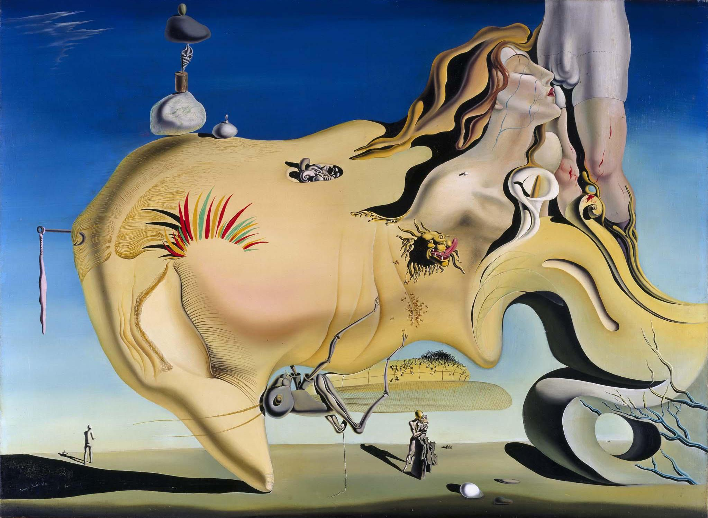
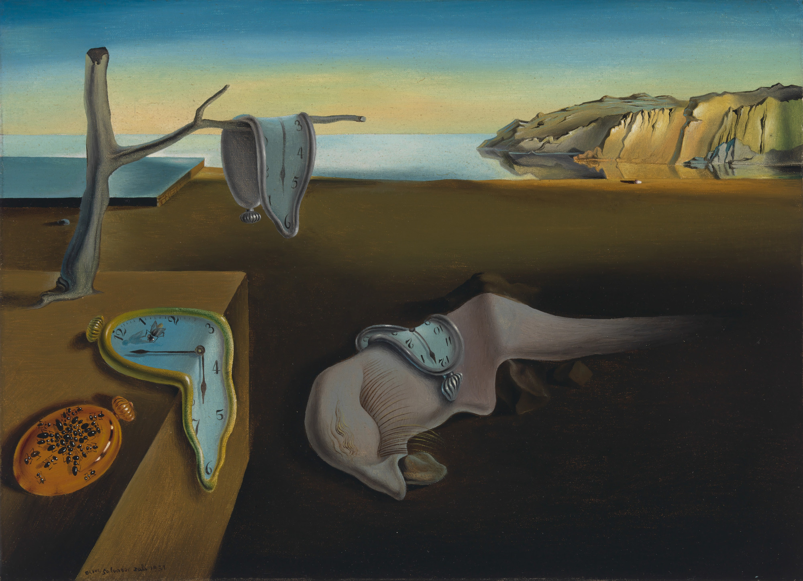
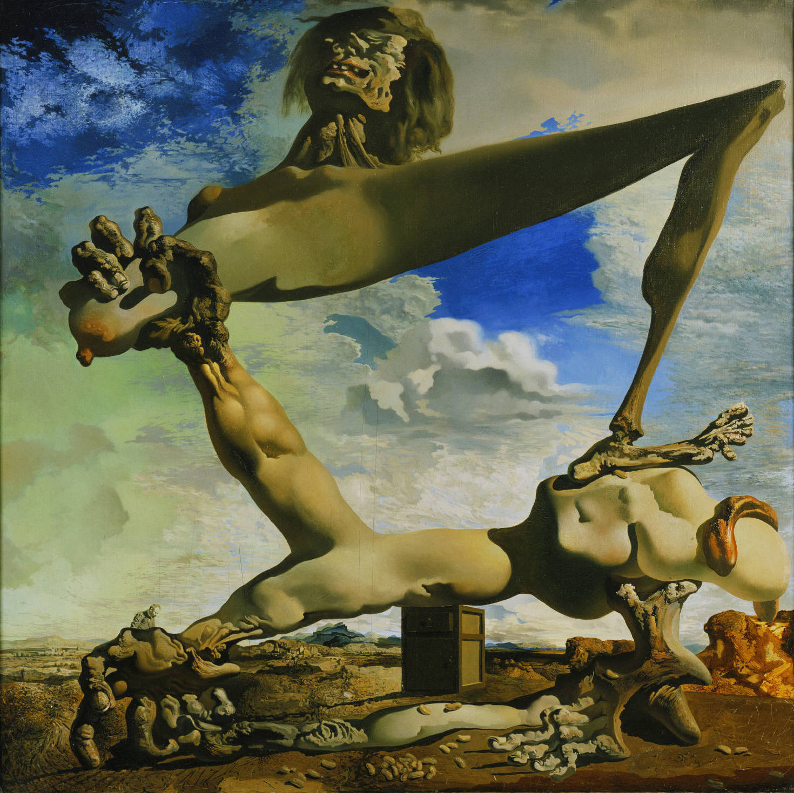
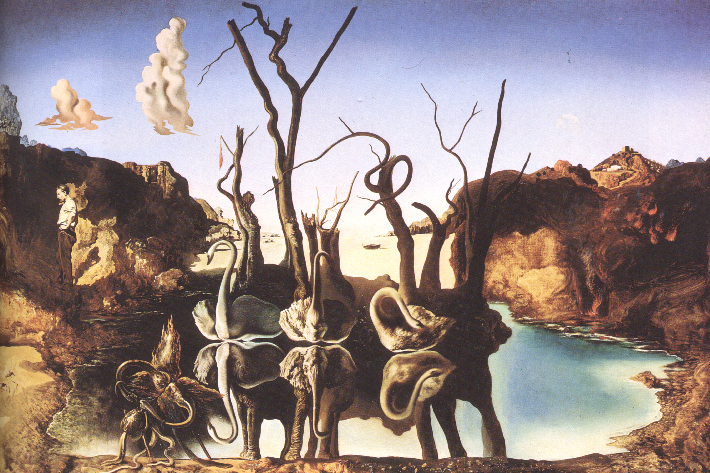
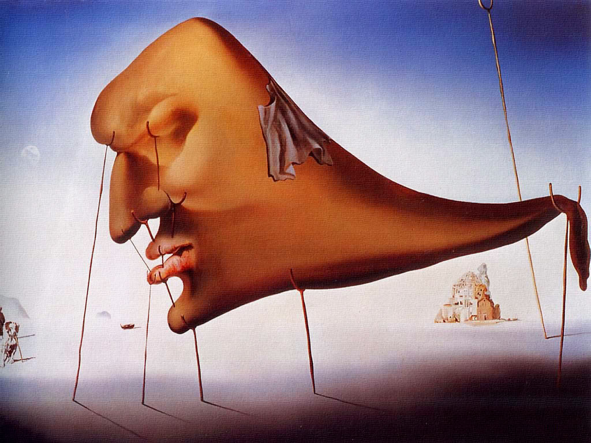
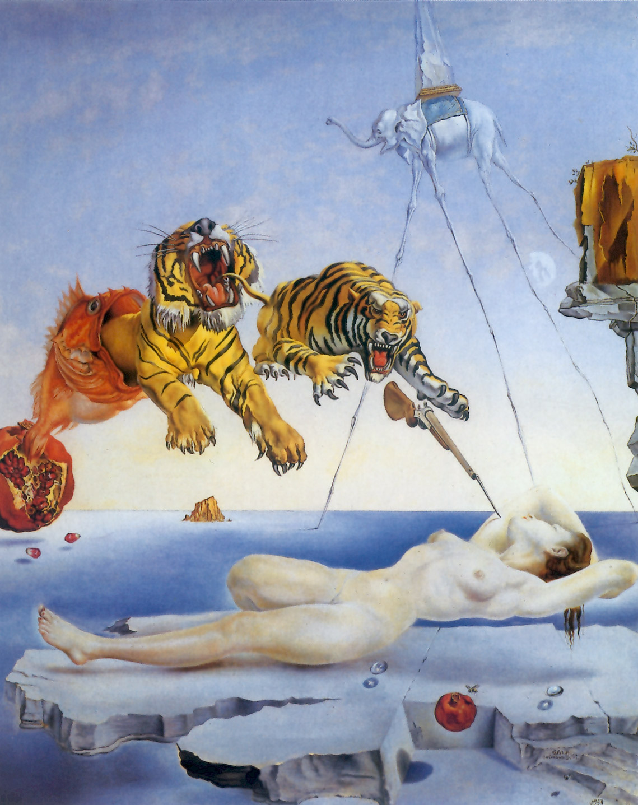
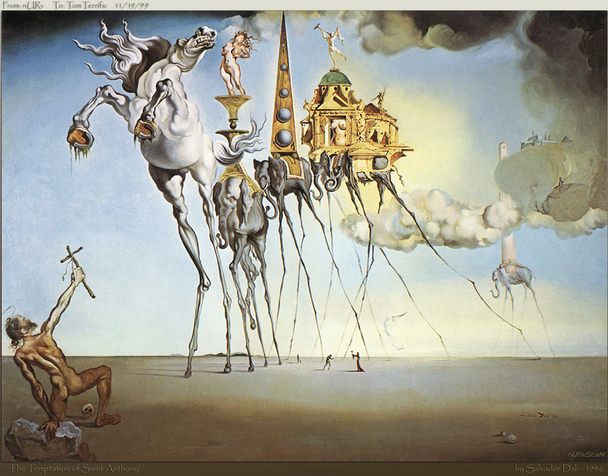
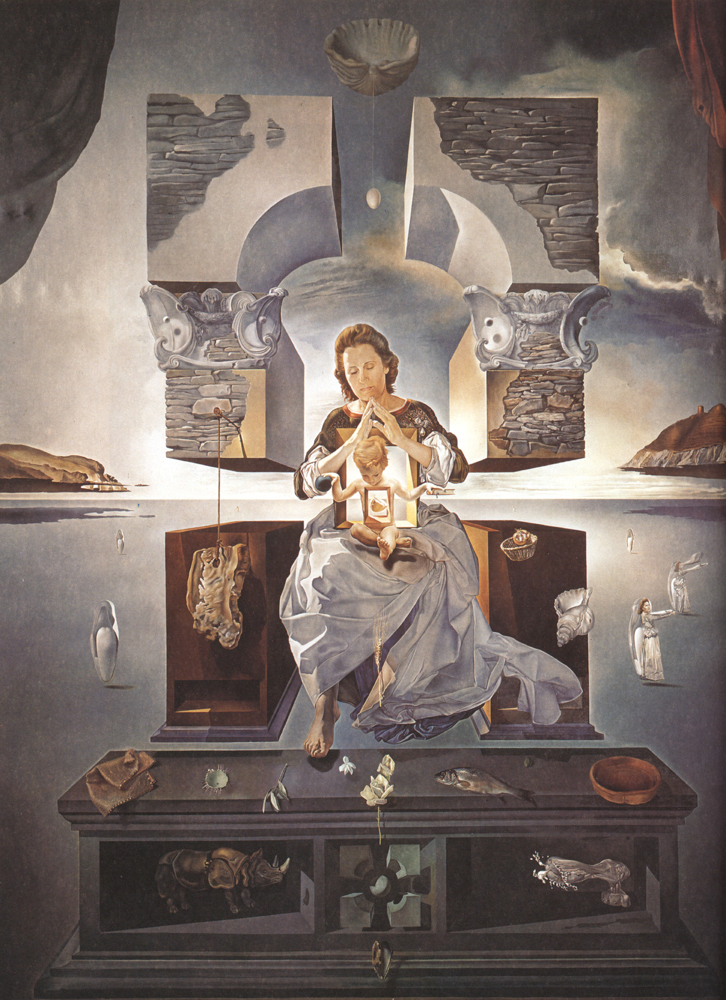
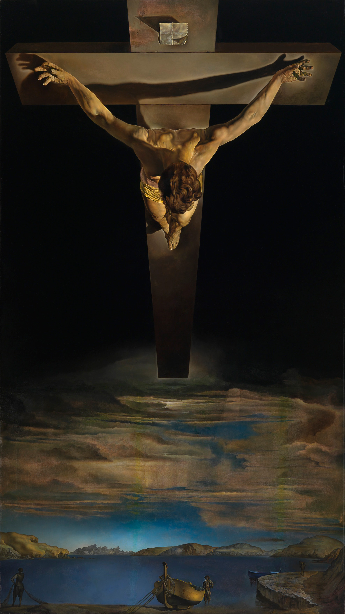
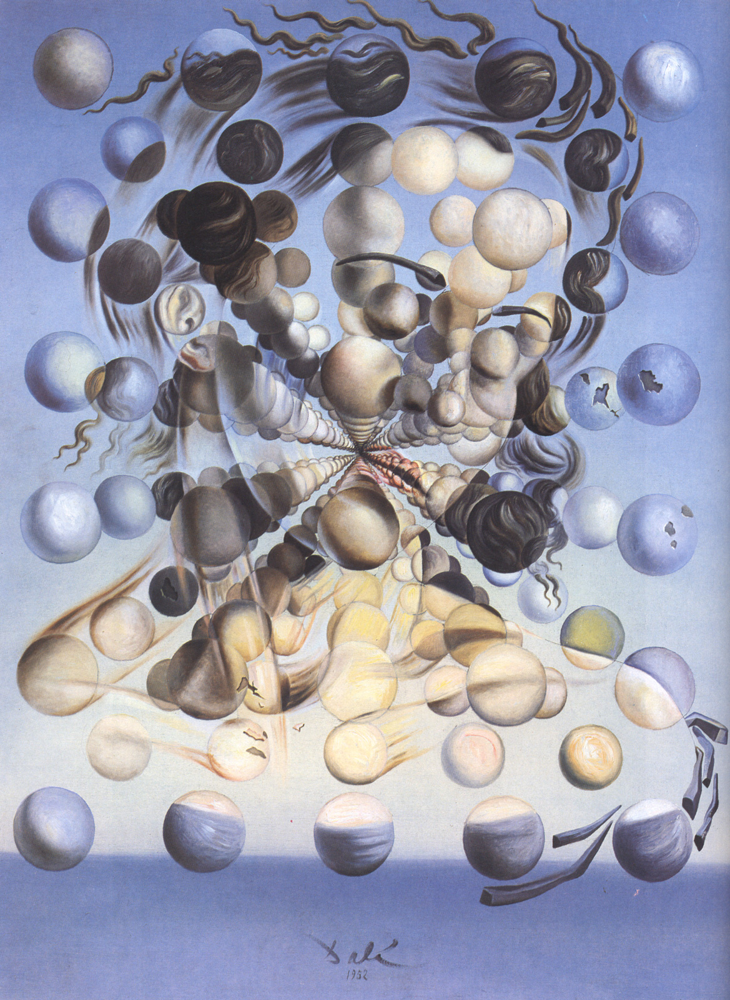

# 萨尔瓦多·达利

>*“我与疯子的唯一区别，在于我没有疯。”*
> 
>*(The only difference between me and a madman is that I am not mad.)*

在20世纪现代艺术的坐标系中，萨尔瓦多·达利(Salvador Dalí)始终是一个难以被单一流派完整归类的异质存在。作为超现实主义运动最具辨识度的实践者，他将弗洛伊德的精神分析学说转化为极其严密具象的视觉语言，并由此确立了其标志性的“偏执狂批判法”(Paranoiac-Critical Method)——一种以高度理性、甚至近乎冷酷的古典具象技法，精确复刻非理性潜意识幻象的创作机制。

达利一生的创作演进与其个人心理危机、婚姻关系、地缘政治动荡紧密咬合。从早年受性压抑与精神分裂危机困扰的自剖，到西班牙内战与二战流亡时期的政治隐喻，再到晚年结合量子力学与天主教神学的“核神秘主义”重构，他始终以手术刀般精细入微的笔触，解构着人类深层的恐惧、欲望、衰老与永恒。以下十幅经典代表作，构成了理解达利精神演化与形式实验的完整脉络。

---

### 一、欲望压抑与偏执狂临界态 (1929 - 1931)

20年代末至30年代初，初涉巴黎先锋艺术圈的达利，将深层的性焦虑、恋母情结与童年创伤转化为创作的核心驱动力。这一时期画作的色调明朗干燥，洋溢着加泰罗尼亚海湾岩石的硬朗质感，充满了弗洛伊德式的具象梦境符号。

**1. 《伟大的自慰者》 (The Great Masturbator, 1929)**

  

- **历史背景：** 1929年夏，25岁的达利在卡达克斯邂逅了诗人保罗·艾吕雅的妻子加拉(Gala)。达利对她陷入疯狂的依恋，然而童年关于性病的恐吓教育与长期的社交自闭，令他在面对真实肉体接触时产生了剧烈的生理排斥与精神崩溃边缘的焦虑。
- **形式与心理剖析：** 这是达利早期最具自白性质的心灵切片。画面中央那张巨大、苍白、闭目倒伏的蜡质侧脸是他自身的投射；紧贴面颊的巨大蚂蚱，隐喻着他自幼对昆虫与肉体溃烂的病态恐惧，也是性无能焦虑的具象化；上方从岩石中升腾出的加拉面容与昂首的狮子，则代表着侵入其封闭世界的欲望冲击。画家以极端客观的透视网格与严密的阴影，将一次剧烈的精神危机冻结为冰冷的心理标本。

**2. 《记忆的永恒》 (The Persistence of Memory, 1931)**

  

- **历史背景：** 创作该画时达利正受偏头痛折磨，在等待加拉归家的间隙，餐桌上一块受热软化的卡门培尔奶酪触发了他的联想。他打破了两个世纪以来机械工业对时间坚硬、均匀、绝对流逝的理性设定，在画中将钟表还原为可融化、可拉伸的有机物质。
- **形式与心理剖析：** 画面呈现出一种绝对窒息的死寂。三只瘫软在枯枝、台面与异形生物背上的怀表，彻底丧失了计时工具的物理尊严；封闭的金属表壳上聚集着吞噬死物的蚂蚁，指向不可逆的腐朽与死亡；地平线上陡峭的克雷乌斯角岩壁在强光照射下呈现永恒不变的坚硬，与前景融化的机械时间构成了残酷的哲学对照。这幅尺幅极小（仅 24×33 厘米）的作品，完成了对客观时间概念最冷酷的视觉解构。

---

### 二、战火阴霾与双重影像的裂变 (1936 - 1937)

30年代中后期，西班牙内战的爆发与法西斯势力的崛起粉碎了达利的世俗避难所。这一时期的作品彻底褪去了早期的轻盈荒诞，转而充斥着肉体撕裂的剧痛感与双重影像的复杂心理投射。

**3. 《有熟豆的软结构（内战的预兆）》 (Soft Construction with Boiled Beans (Premonition of Civil War), 1936)**

  

- **历史背景：** 在西班牙内战正式爆发前约半年完成。达利以其对政治气氛的病态敏感，预判到了母国即将坠入同胞自相残杀的惨祸。
- **形式与心理剖析：** 画中没有具体战场描绘，而是构筑了一具庞大无朋的怪诞解剖体。这具由互相撕扯的手臂、流脓的躯干与踩踏自己脚踝的枯骨构成的怪物，在刺目的地中海强光下进行着自我吞噬。地面散落的煮熟豆子既隐喻着贫瘠死者的祭品，又强化了荒诞感。达利将骨肉同胞的战争本质剖析为一场不可逆的自残性癫狂，其笔触冷峻精确，画面弥漫着生理性的作呕感。

**4. 《天鹅映射大象》 (Swans Reflecting Elephants, 1937)**

  

- **历史背景：** 此时达利流亡在法国与意大利，他对“偏执狂批判法”的研究进入了纯熟的纯技术阶段，致力于在单一画面中并置两种完全独立且具互斥性的感知形态。
- **形式与心理剖析：** 画面依托严密的光学对称构建幻境：湖岸上的三只枯树在水中的倒影，转化为了三头体量沉重的大象；而漂浮在水面的三只天鹅，其曲折的脖颈恰好成为水下大象的耳朵与长鼻。达利通过这种双重影像实验证明，人类所谓的“客观视觉现实”实质上是脆弱且充满欺骗性的意识构造；左侧背立的灰衣人则作为冷峻的观察者，强化了观者与幻象之间的智性距离。

**5. 《睡眠》 (Sleep, 1937)**

  

- **历史背景：** 常年受失眠与幻听折磨的达利，试图通过哲学化的造型手段，解析“睡眠”这一生理机能与清醒意识之间的临界结构。
- **形式与心理剖析：** 画面以深邃幽暗的纯蓝为基底，一个毫无骨骼支撑、软质如膜的巨大沉睡头颅浮于荒漠之上，仅靠无数根细长脆弱的木质拐杖支撑起眼睑、鼻尖与唇角。拐杖在达利语汇中象征着残缺与脆弱的平衡系统：人类在睡眠中虽暂避现实，但其安宁完全依赖于一系列极易折断的生理与心理支点，任何细微外力的介入都会导致整个意识结构的瞬间坍塌。

---

### 三、流亡新大陆与弗洛伊德心理狂想 (1944 - 1946)

40年代初，二战战火迫使达利与加拉远渡重洋移居美国。在好莱坞商业文化、通俗流行心理学与原子弹危机的多重激荡下，达利的绘画语言更加强调强烈的剧场戏剧感与瞬间动态凝结。

**6. 《由飞舞的蜜蜂引起的梦，在醒来前一秒》 (Dream Caused by the Flight of a Bee Around a Pomegranate a Second Before Awakening, 1944)**

  

- **历史背景：** 达利将弗洛伊德在《梦的解析》中关于“外界瞬时物理刺激在半梦半醒间引发整套长逻辑梦境”的假说，进行了视觉图像化演绎。画中裸身悬浮沉睡的女性为加拉。
- **形式与心理剖析：** 构图呈现出链条式的因果爆发：背景小蜜蜂的飞舞与刺蜇感，在潜意识中被迅速放大为裂开的石榴、吐出红鱼的石榴籽、鱼腹中跃出的两只咆哮猛虎，以及刺向加拉手臂的尖锐刺刀。远景中，背负方尖碑、长着昆虫细长节肢的巨象优雅穿过海面，象征着失重与欲望的潜伏。整幅画以极其严谨的超清明暗刻画，记录了潜意识神经元在一秒钟内完成的信息异变。

**7. 《圣安东尼的诱惑》 (The Temptation of St. Anthony, 1946)**

  

- **历史背景：** 达利为好莱坞洛温·列文制片公司的电影竞赛创作该画。此时他正经历从纯粹超现实主义向古典精神探索的过渡期，古老的宗教原罪主题开始进入其视野。
- **形式与心理剖析：** 画面采用压倒性的仰视视角：赤身裸体的隐修士圣安东尼蜷缩在荒漠低处，单手举起脆弱的木制十字架，以极度微弱的姿态抵抗迎面逼近的庞大欲望化身——狂奔的欲念骏马、背负黄金裸女的象群、承载欲望宫殿与方尖碑的远古巨兽。这些身躯沉重的怪物全部架在细如蜘蛛腿的脆弱高跷之上，精准隐喻了世俗欲望在精神面前那沉重而虚妄的本质。

---

### 四、核神秘主义与物质的量子重构 (1949 - 1952)

广岛与长崎的原子弹爆炸重塑了达利的世界观。他意识到物质在微观世界中本质上由高速旋转、彼此互不接触的基本粒子构成。重返战后欧洲的他，将天主教神秘主义教义与现代核物理学熔铸为一体，开创了独具一格的“核神秘主义”(Nuclear Mysticism)。

**8. 《利加特港的圣母》 (The Madonna of Port Lligat, 1949 - 1950)**

  

- **历史背景：** 1949年达利携此作初稿前往梵蒂冈觐见教皇庇护十二世并获得加冕，标志着他正式皈依天主教神学，并开启了结合现代物理学的宏大宗教创作周期。
- **形式与心理剖析：** 画中圣母以加拉为原型，圣婴居于加拉胸腔正中镂空的几何立方体空间内。画中所有的物质形态——祭坛、贝壳、书籍、面包、鱼类与人体——均被剥离了重力法则，在绝对纯净的虚空中悬浮排列，彼此互不触碰。达利借此视觉化了现代量子力学中“物质内部原子互不接触”的微观真相，将基督教的纯洁神性与物理宇宙的真空本质达成了形而上的统一。

**9. 《圣胡安·德·拉·克鲁斯的基督》 (Christ of Saint John of the Cross, 1951)**

  

- **历史背景：** 达利声称在梦境中观测到了构成宇宙核心的几何三角与圆，并参考了16世纪西班牙神秘主义修士圣胡安·德·拉·克鲁斯的一幅俯视素描，从而创作了这幅彻底颠覆传统受难图式的宗教杰作。
- **形式与心理剖析：** 画面打破了西方艺术两千年来以受难、血腥、荆棘冠为特征的悲情叙事：画中的基督悬挂于虚空之上的巨大十字架，比例端正优雅，肌体完好无损，没有钉孔与血迹；视角极为罕见地采用了高空俯瞰，由十字架顶部直视下方的代尔夫特式港口与宁静劳作的渔夫。达利彻底抽离了受难的暴力感，代之以崇高、对称与宇宙终极理性的永恒凝视。

**10. 《球体加拉蒂亚》 (Galatea of the Spheres, 1952)**

  

- **历史背景：** 50年代初，达利对核裂变、DNA分子双螺旋结构与粒子物理学产生强烈痴迷。他将神格化的妻子加拉与古典海洋仙女加拉蒂亚融合，借现代物理的原子模型重塑其肖像。
- **形式与心理剖析：** 加拉的面容不再依靠传统写实线条勾勒，而是由几十个排列在精确三维透视轴线上的悬浮球体交织凝聚而成。在连续纵深的几何网格中，这些原子状的球体在离散与聚集的动态平衡中重构出爱人的面容。达利在此证明：即便肉体终将在宏观物理世界中消亡衰变，但在微观粒子的恒常运转与艺术的几何法度中，其精神形式获得了绝对的永存。

---

### 结语：潜意识的理性标本

纵观萨尔瓦多·达利的艺术生涯，他留给公众的浮夸表演与商业争端，往往掩盖了其深层严肃的视觉探索。从早期对性本能与死亡恐惧的生理自剖，到晚年以粒子物理审视神圣永恒，达利从来不是一个失去理智的疯子，而是一个极其克制、甚至冷酷的潜意识解剖者。他运用西方传统古典主义最严谨的透视法与罩染技巧，将人类最不可捉摸的梦境、焦虑与幻觉，铸造成了一枚枚具有标本意义的视觉图腾。
