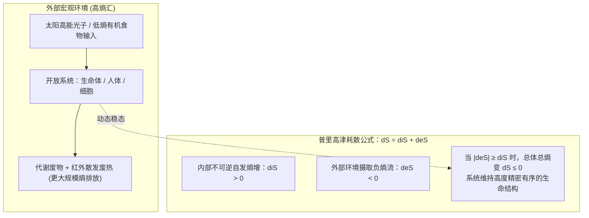

# 热力学第二定律：熵增生命对抗

> “如果有人告诉你，你的宇宙理论违背了麦克斯韦方程组，那也许是方程组不够完美；但如果你的理论违背了热力学第二定律，那它就毫无希望，除了彻底崩溃别无他法。”  
> —— 亚瑟·爱丁顿（Arthur Eddington）

在物理学史上，热力学第二定律（Second Law of Thermodynamics）拥有近乎崇高的最高法则地位。它以不可逆的时间之矢，勾勒出宇宙最深层的演化轨迹。

然而，在流俗科普与鸡汤文学中，人们常常将其文学化为“宇宙趋向混乱毁灭，而生命在对抗自然法则”——**这从严格的现代物理学角度看，存在着重大的理论边界混淆**。生命从未违反自然规律，而是物理学中最精妙绝伦的“开放耗散结构”。

---

## 一、 熵的物理本质：从微观概率到宏观单向度

在物理学中，“熵”（Entropy，符号为 $S$）并非日常语言中模糊的“变坏”，而是拥有极其严谨的数学定义：

### 1. 宏观热力学定义（克劳修斯，1865）

克劳修斯（Rudolf Clausius）从热机工质吸收热量与温度的比值定义了熵变：

$$dS = \frac{\delta Q_{\text{rev}}}{T}$$

热量总是自发地从高温物体流向低温物体，而绝不可能在没有外部做功的情况下自发地从低温逆流回高温。

### 2. 微观统计力学本质（玻尔兹曼墓碑公式，1877）

路德维希·玻尔兹曼（Ludwig Boltzmann）将熵的本质还原为**微观状态数（Microstates）的概率体现**：

$$S = k_B \ln \Omega$$

- $k_B$ 为玻尔兹曼常数（$1.38 \times 10^{-23} \text{ J/K}$）；

- $\Omega$ 是宏观状态所对应的所有可能微观分子排列方式的总数。

> **物理直觉真相**：  
> 为什么刚打扫完的房间会自然变乱？为什么滴入清水中的一滴墨水一定会扩散？  
> **答案不是有某种神秘力量在“破坏”，而是纯粹的数学概率压制！**  
> 一个房间“物品摆放整齐”的微观组合可能只有几百种，而“物品乱扔乱放”的可能排列方式却有几百亿种。当分子在热运动中随机乱撞时，系统仅仅是在不可逆地跌入“占据绝对压倒性概率的混乱状态”。

---

## 二、 关键边界辟谣：三大系统的物理分水岭

很多人认为“生命维持细胞有序、人类建立自律文明违背了热力学第二定律”，其根源在于**遗漏了定律成立的最核心前提——系统的开放性**：

| 系统类型 | 物质交换 | 能量交换 | 热力学第二定律表现 | 典型物理现实 |
| :--- | :---: | :---: | :--- | :--- |
| **孤立系统 (Isolated)** | ❌ 无 | ❌ 无 | **熵增定律严格成立：$\Delta S \ge 0$**（不可逆地单调递增，直至热寂） | 假想中的整个宇宙整体、完全绝热绝质的刚体容器 |
| **封闭系统 (Closed)** | ❌ 无 | ✅ 有 | 系统总熵可通过外部换热/做功实现局部降熵 | 密封的冷暖空调房、被外部加热的高压锅 |
| **开放系统 (Open)** | ✅ 有 | ✅ 有 | **可通过负熵流维持极低熵的自组织稳态** | **一切生命体（细胞/人体）、地球生态圈、社会组织** |

> [!IMPORTANT]
> **物理学硬性铁律**：  
> 克劳修斯的熵增定律（$\Delta S \ge 0$）**只对严格的“孤立系统”成立**！  
> 地球沐浴在太阳每秒数以亿计的高能低熵光子辐射中，并不断向深空散射红外辐射；生命体不断摄入高能养分并排放废热废弃物。**生命是典型的开放系统，其局部的低熵有序不仅没有打破物理定律，反而是自然法则在开放条件下的必然表现。**

---

## 三、 现代物理学解答：普里高津与耗散结构理论

1944 年，量子力学奠基人埃尔温·薛定谔（Erwin Schrödinger）在其名著《生命是什么》（*What is Life?*）中提出了一句振聋发聩的名言：

$$\text{“生命以负熵为食。” (Life feeds on negative entropy.)}$$

1977 年，物理化学家伊利亚·普里高津（Ilya Prigogine）凭借**耗散结构理论（Dissipative Structure Theory）**荣获诺贝尔化学奖，从数学与热力学上彻底完善了生命的物理图像：

普里高津将开放系统的总熵变 $dS$ 拆解为内外两部分：

$$dS = d_iS + d_eS$$

1. **$d_iS$（内部产生熵）**：系统内部一切不可逆生理生化反应（细胞老化、自由基氧化、蛋白质变性等），必然 $\mathbf{d_iS > 0}$；

2. **$d_eS$（外部熵流交换）**：生命体通过摄入低熵的复杂有机物与水分，借助新陈代谢，将降解后产生的高熵废热、二氧化碳与排泄物**强制排放至体外环境中**，从而形成强烈的**负熵流（$\mathbf{d_eS < 0}$）**。

**结论**：只要生命体代谢吞吐通畅，使得 $|d_eS| \ge d_iS$，局部系统内部就能实现 $dS \le 0$，生命便能在动态耗散中长期稳定维持极高精度的秩序。  

**生命并不违反第二定律——它是以加速周围更大范围环境的整体熵增为代价，换取了自身的精密与繁荣。**

---

## 四、 跨学科映射：自律、认知与组织治理的物理逻辑

将耗散结构与开放系统理论映射到个人成长与组织工程中，能推导出极具启发性的底层方法论：

### 1. 为什么“自律”必然伴随着心智做功？

- **微观概率的客观存在**：躺平、漫无目的地刷短视频，在神经层面对应着数以亿计的任意微观冲动状态（最大熵态，毫无门槛）；而高度专注、深度思考、攻克技术难题，对应着神经网络极度罕见且高度收敛的“极低概率微观状态”。

- **想要维持低熵构型，就必须建立高能输入与定向耗散**。所谓的意志力与自律，本质上是前额叶皮层调集能量驱动神经回路进行“逆概率排布”的过程。

### 2. 避免“封闭内耗”：保持终身开放系统

- 一个将自己封闭起来、拒绝接受外部新知识与认知挑战的个体或团队，就等同于走向了物理学上的“孤立系统”。内部不可逆的熵增（思维僵化、认知信息差扩大、流程冗余与推诿）是无法避免的必然结果。

- **破解熵死之道**：

  1. **输入高质量负熵**：阅读经过时间检验的硬核经典书籍、深度拆解工程底层架构、与高认知密度的人交流；

  2. **果断向外耗散废弃物**：定期清理负面情绪垃圾、重构历史技术负债、精简生活中的低效冗余。

**总结来说：**  

变乱不是世界恶意的诅咒，而是无所不在的统计概率；优秀与自律亦非反抗天地法则，而是我们在完全拥抱物理定律的前提下，主动做功打造的一座璀璨夺目的低熵耗散奇迹。

