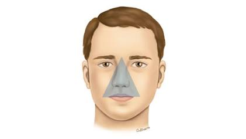
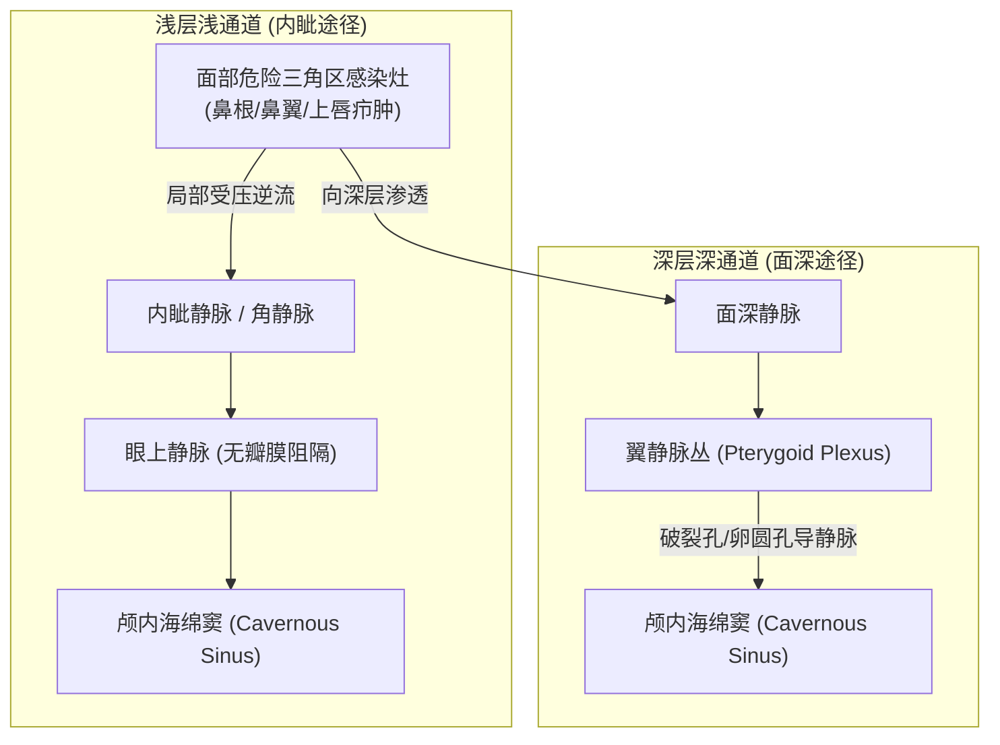

# 面部危险三角区解剖与感染机制

在临床医学与颌面外科中，**“面部危险三角区”**（通常指以鼻根为顶点、两侧嘴角连线为底边的等腰三角形区域）被反复严厉警告“严禁挤压、揉捏”。

这一区域之所以被冠以“危险”二字，核心在于其特殊的**静脉解剖结构**与**直通颅内核心中枢的血液循环通路**。

---

## 一、 静脉瓣膜真相：从“绝对无瓣”到“闭锁不全”

过去大众科普常沿用上世纪的简略观点，宣称*“面部静脉完全没有静脉瓣”*。但在现代外科与临床解剖学中，这一表述已被严格修正：

### 1. 现代显微解剖学实证
发表在权威期刊《Plastic and Reconstructive Surgery》及《Clinical Anatomy》上的系列显微解剖研究（如 *Zhang & Stringer, 2002* 等）明确证实：
- **约 70%~80% 的人类面静脉（Facial Vein）及内眦静脉（Angular Vein）中实际上是存在静脉瓣的**；
- 所谓“面部静脉绝对无瓣”属于早期粗糙解剖学留下的历史误区。

### 2. 为何依然极其危险？—— 瓣膜“闭锁不全”与双向对流
虽然存在瓣膜，但危险三角区的生理弱点在于：
1. **瓣膜发育脆弱、形态单薄**：面静脉管壁肌层薄弱，缺乏深筋膜包绕支撑，其内部瓣膜的**闭锁不全率（Valvular Incompetence）极高**，根本无法像下肢静脉瓣那样承受逆向压力；
2. **极易被外力冲开**：面静脉穿行于复杂的面部表情肌群之间。说话、咀嚼以及**外力用手挤压痘痘（疖、痈）**时，局部组织瞬时压力剧增，闭锁不全的瓣膜被轻易冲开，血液随之发生逆流；
3. **缺少单向物理屏障**：在日常血压波动与外力按压下，这里的血液本质上处于**可顺流、亦可逆流的“双向对流”状态**。

---

## 二、 直通颅内的双重通道：海绵窦血栓风险

比瓣膜脆弱更为致命的，是面部危险三角区静脉与颅内深部静脉池——**海绵窦（Cavernous Sinus）**之间的无障碍解剖交通网。

这一区域的静脉血不仅向前流回颈内静脉，还存在两条能够直接逆流入脑的危险旁路：

### 1. 浅层通道（内眦静脉 ➡️ 眼上静脉 ➡️ 海绵窦）
面静脉向上延伸汇入内眦静脉（角静脉），而内眦静脉直接与眼眶内的**眼上静脉**交通。眼上静脉向后穿过眶上裂，直接注入颅底硬脑膜窦的核心枢纽——**海绵窦**。

### 2. 深层通道（面深静脉 ➡️ 翼静脉丛 ➡️ 导静脉 ➡️ 海绵窦）
面静脉向下在咬肌前缘发出面深静脉，与颞下窝内的**翼静脉丛**相通。翼静脉丛又通过卵圆孔导静脉、破裂孔导静脉与海绵窦紧密相通。

### 3. 致命后果：海绵窦化脓性血栓性静脉炎
当三角区发生化脓性毛囊炎、疖或痈时，致病菌多为侵袭力极强的**金黄色葡萄球菌（Staphylococcus aureus）**：
- 一旦用手强行挤压、按捏或挑破，脓栓与细菌被强压挤入微静脉；
- 借助闭锁不全的瓣膜与双向对流通路，带菌栓子逆行“飙车”直抵颅底海绵窦；
- 造成极其凶险的**海绵窦血栓性静脉炎（CST）**。海绵窦内穿行着动眼神经、滑车神经、展神经、三叉神经眼支及颈内动脉，一旦感染血栓形成，可引发眼球突出、视力丧失、高热头痛、脑膜炎、脑脓肿乃至脓毒性休克，病死率与致残率极高。

---

## 三、 日常防护与科学应对原则

1. **绝对禁忌手法“挑破与强挤”**：
   - 三角区的痘痘若出现白色脓头或红肿疼痛，严禁用手掐捏、挑破或暴力挤压。血液动力学压力差是将菌栓推进眼静脉和海绵窦的最直接外力。
2. **正确外用干预策略**：
   - **早期红肿硬结期**：可局部点涂**莫匹罗星软膏（百多邦）**或**夫西地酸乳膏**进行抗生素外用消炎，促使炎症局限化；
   - **成熟出脓期**：切勿自行挤弄，应等待其自行破溃排出，或在无菌操作条件下由医院皮肤科医生使用无菌器械行微小引流切口；
3. **伴发警示症状立即就医**：
   - 若三角区疖肿扩散并伴随面部明显肿胀、畏寒发热、头痛、视物模糊或眼周水肿，表明炎症有顺静脉逆行扩散风险，必须立刻前往医院急诊或感染科接受足量系统性抗生素静脉给药治疗。
