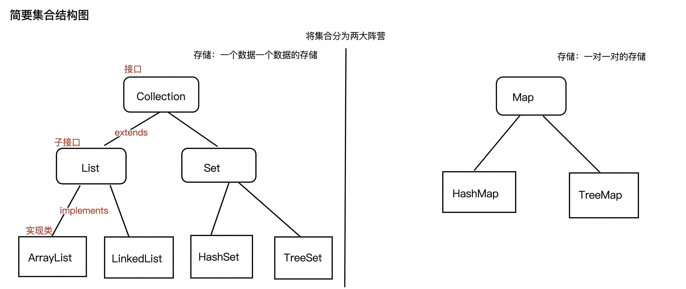

# Java集合框架体系核心结构图

首先要明确一个核心概念：图顶层的 `Collection`、`List`、`Set` 和 `Map` 都是**接口（Interface）**。接口只负责定义契约与规范（例如是否允许重复、是否有序、是否支持键值映射），**接口本身是不包含物理数据结构的**。

真正负责在内存中开辟空间、存储数据并在后台干活的，是底层的**具体实现类**。在 Java 工程实战中，我们通常将它们划分为两大阵营：

---

### 第一大阵营：Collection（单列集合，单个元素存储）

该阵营衍生出两大核心流派：`List` 流派（元素有序排列，允许重复）与 `Set` 流派（元素无序或按特定规则排序，严格去重不可重复）。

#### 1. ArrayList
- **底层数据结构**：**动态对象数组（Dynamic Object Array）**
- **底层工作机制**：
  - 它在内存中开辟的是一段**连续的物理内存空间**，就像一排紧挨着且连续编号的储物柜；
  - 当通过无参构造创建时，默认初始容量为 10（延迟到首次 `add` 时初始化）；当元素塞满容量阈值时，自动触发扩容机制——创建原容量 **1.5 倍**（`oldCapacity + (oldCapacity >> 1)`）的全新数组，并通过底层的 `Arrays.copyOf` / `System.arraycopy` 将旧数据批量拷贝过去。
- **复杂度与性能真相**：
  - **随机访问 / 查改极快 $O(1)$**：由于内存物理连续且元素大小固定，直接通过寻址公式 `内存地址 = 基地址 + index * 元素引用大小` 一步直达目标，性能极高；
  - **尾部追加平摊极快 $O(1)$**：在无需扩容的情况下，直接在数组末尾下标赋值即可；
  - **中间增删 $O(n)$**：若在中间任意位置插入或删除元素，其后方所有元素都必须整体向前或向后挪动一位（通过 `System.arraycopy` 内存搬运）。

---

#### 2. LinkedList
- **底层数据结构**：**双向链表（Doubly Linked List）**
- **底层工作机制**：
  - 它的每个数据节点（`Node`）在物理内存中是**分散且不连续**的；
  - 每个 `Node` 内部除存储数据实体（`item`）外，还维护了两个指针：`next`（指向后继节点）和 `prev`（指向前驱节点）。整个链表同时保留指向头尾的 `first` 和 `last` 引用指针。
- **复杂度与经典认知误区辨析**：
  - **误区警示：切勿笼统地认为“LinkedList 任意增删都是 $O(1)$”**！
    - **真正的 $O(1)$ 仅限于两端**：只有在**表头（`addFirst` / `removeFirst`）**或**表尾（`addLast` / `removeLast`）**操作时，因为直接持有头尾指针，增删确实是严格的 $O(1)$；或者在已获取 `ListIterator` 游标的当前位置插入时为 $O(1)$。
    - **任意指定位置增删依然是 $O(n)$**：若调用 `list.add(int index, E element)` 或 `list.remove(int index)`，在执行指针断开与重连的 $O(1)$ 动作之前，**必须先顺着链条从头或尾遍历到指定索引处**（折半寻址消耗时间为 $O(\min(index, n - index))$）。因此，**任意位置的增删综合时间复杂度是 $O(n) + O(1) = \mathbf{O(n)}$**，在渐近大 $O$ 阶梯上与 `ArrayList` 处于同一水平！
  - **工程硬件底层的“性能倒挂”真相（CPU 缓存局部性）**：
    - 很多初学者误以为“频繁增删一定要选 LinkedList”。但在现代计算机体系结构中，CPU 拥有极速的 L1/L2/L3 高速缓存行（Cache Line，通常 64 字节）与硬件预取机制（Spatial Locality）。
    - `ArrayList` 的**连续物理内存极易被 CPU 预取命中**，且现代 CPU 对连续内存块的批量拷贝（`System.arraycopy` 底层直接调用 SIMD 指令）速度快到极致；
    - 反观 `LinkedList`，每个节点都是独立在堆上 `new` 出来的散落对象，在 64 位 HotSpot JVM 开启指针压缩下，一个仅存 `int` 的 `Node` 节点就要额外耗费至少 24 字节的对象头与指针开销，且指针跳转会导致高频的 **CPU Cache Miss（缓存未命中）**。
    - **结论**：在实测绝大多数常规业务规模（几千至数万级以内），`ArrayList` 的实际增删与遍历吞吐量通常显著优于 `LinkedList`！只有在实现栈（Stack）、双端队列（Deque）或极其庞大且只在头尾吞吐数据的场景下，才考虑 `LinkedList`。

---

#### 3. HashSet
- **底层数据结构**：**哈希表（基于 HashMap 实现）**
- **底层工作机制**：
  - `HashSet` 内部完全是一个“甩手掌柜”，其源码底层直接封装了一个 `HashMap`；
  - 你存入 `HashSet` 的每一个元素，本质上都直接作为底层 `HashMap` 的 **Key** 进行存储；而底层 Map 的 Value 则统一绑定为一个无意义的静态虚拟占位常量 `private static final Object PRESENT = new Object();`。
- **核心特点**：
  - **严格去重**：依赖元素对象的 `hashCode()` 与 `equals()` 方法进行两重比对；
  - **无序存放**：元素的迭代顺序与插入顺序完全无关，完全取决于 Hash 散列计算后的桶位分布；
  - **极速查删**：平均时间复杂度稳定在接近 **$O(1)$** 水平。

---

#### 4. TreeSet
- **底层数据结构**：**红黑树（基于 TreeMap 实现）**
- **底层工作机制**：
  - 与 `HashSet` 类似，`TreeSet` 底层直接包装了一个 `TreeMap` 实例；
  - 红黑树是一种自平衡的二叉查找树，数据插入时会根据设定的排序规则（自然顺序或自定义 `Comparator`）在树枝上动态平衡生长，严格遵循“左子树节点小于父节点，右子树节点大于父节点”的红黑染色与旋转平衡规则。
- **核心特点**：
  - **元素天然有序**：遍历时始终输出升序（或自定义排序规则）序列；
  - **时间复杂度**：插入、删除、查询的时间复杂度均严格稳定在 **$O(\log n)$**，虽然常数开销略逊于哈希表，但能够随时获取子树范围（`subSet`）、首尾极值（`first` / `last`）。

---

### 第二大阵营：Map（双列集合，键值对映射存储）

该阵营存储的均为键值对映射实体（`Key-Value` Pair），Key 负责寻址索引（唯一），Value 负责承载业务数据。

#### 5. HashMap
- **底层数据结构**：**数组 + 单向链表 + 红黑树**（JDK 1.8 工业级形态）
- **底层工作机制**：
  - 骨架是一个存储哈希桶节点的散列数组（`Node<K,V>[] table`）；
  - 存取时，通过二次扰动哈希函数 `hash(key)` 并与数组长度减一进行位与运算 `(n - 1) & hash`，精准计算并定位在哪个桶槽内；
  - **冲突解决（链地址法）**：若不同 Key 发生哈希碰撞落入同一桶位，节点以单向链表形式向下延伸；
  - **树化阈值（Treeify）**：当某一单向链表的节点深度达到 **8** 且当前哈希表总容量不小于 **64** 时，底层链表将自动升级重构为一棵**红黑树**，从而将最坏情况下的检索复杂度从 $O(n)$ 骤降至 **$O(\log n)$**；当红黑树节点缩减至 6 时，又会退化回单向链表以节省空间开销。
- **核心特点**：
  - 综合了数组随机寻址与链表冲突解决的高性能优势，是现代企业级应用中使用频次最高、吞吐量最大的键值存储容器。

---

#### 6. TreeMap
- **底层数据结构**：**自平衡红黑树（Red-Black Tree）**
- **底层工作机制**：
  - 纯粹基于树状层次结构的有序映射容器，不依赖 Hash 算法；
  - 强烈要求存入的 Key 必须实现 `Comparable` 接口，或者在实例化时显式传入自定义 `Comparator` 比较器，所有条目严格按 Key 的升序树状排列。
- **核心特点**：
  - 插入、删除与检索的时间复杂度均恒定为 **$O(\log n)$**；
  - 提供了丰富的范围查询与边界导航 API（如 `headMap`、`tailMap`、`higherEntry` 等），适用于需要持续维护按键排序的数据报表或调度引擎。

---

### 💡 极客记忆矩阵与选型法则

| 容器名称 | 物理底层数据结构 | 增删复杂度（非头尾） | 随机查询复杂度 | 是否允许重复 | 是否保证顺序 | 最佳工程适用场景 |
| :--- | :--- | :---: | :---: | :---: | :---: | :--- |
| **ArrayList** | 动态连续数组 | $O(n)$ | **$O(1)$** | 允许 | 插入顺序 | 绝大多数常规业务列表，读多写少，首选默认容器 |
| **LinkedList** | 分散双向链表 | $O(n)$ | $O(n)$ | 允许 | 插入顺序 | 仅适合频繁在**两端吞吐**的队列/双端栈模型 |
| **HashSet** | 包装 HashMap | $O(1)$ | $O(1)$ | **禁止** | 无序 | 高性能数据去重与快速判存 |
| **TreeSet** | 包装 TreeMap | $O(\log n)$ | $O(\log n)$ | **禁止** | 自然/规则排序 | 实时动态去重并时刻维持元素排序的场景 |
| **HashMap** | 数组+链表+红黑树 | $O(1)$ | **$O(1)$** | Key唯一 | 无序 | 通用高性能缓存与键值对业务数据映射 |
| **TreeMap** | 纯自平衡红黑树 | $O(\log n)$ | $O(\log n)$ | Key唯一 | 按 Key 排序 | 需要按 Key 范围检索、按字母/数值顺序排名的报表 |
