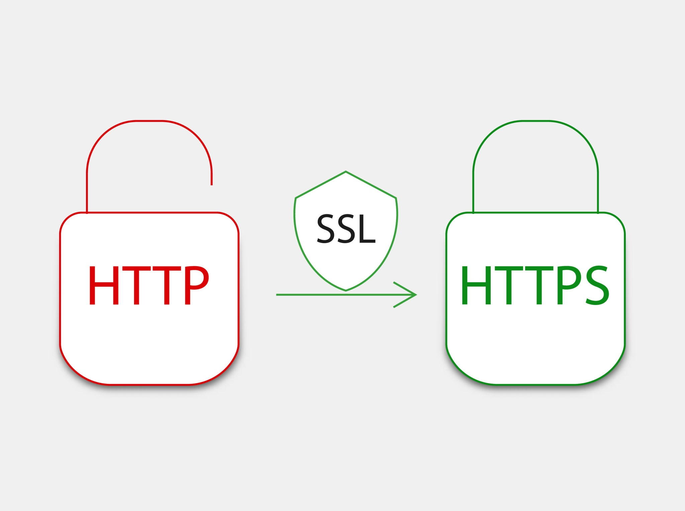
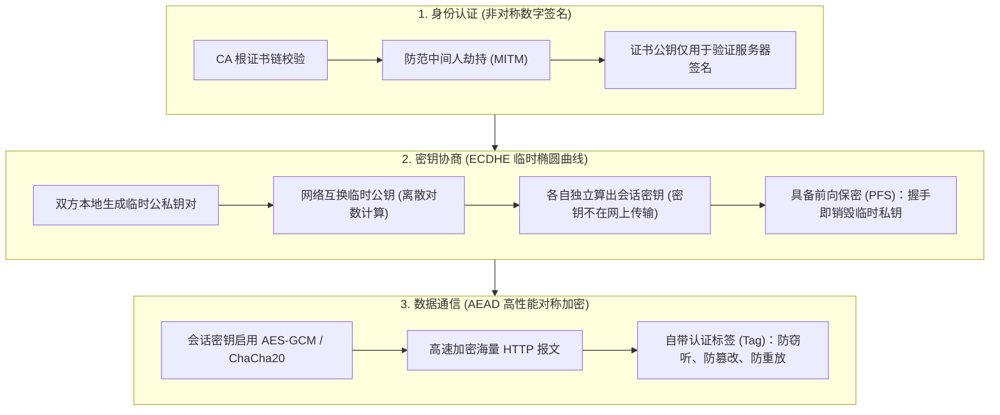

# HTTP与HTTPS加密与证书

HTTP 和 HTTPS 的核心区别可以用四个字概括：**安全加密**。

  

简单来说，HTTP 是互联网上应用最为广泛的一种网络协议，用于在 Web 浏览器和网站服务器之间传递信息；而 HTTPS 则是 HTTP 的“安全升级版”，它在 HTTP 的基础之上加入了 SSL/TLS 协议，为数据传输建立了一条端到端加密隧道。

---

## 一、 核心差异对比

|**维度**|**HTTP (HyperText Transfer Protocol)**|**HTTPS (HyperText Transfer Protocol Secure)**|
|---|---|---|
|**数据传输状态**|**明文传输**。任何人只要能在网络节点（如公共 Wi-Fi、路由器、运营商网关）截获数据包，就能直接看到密码、Cookie 凭证与交易信息。|**密文传输**。数据在发送前均由强对称算法加密，即便被中间人截获，看到的也是完全不可逆的密文乱码。|
|**默认端口**|`80`|`443`|
|**证书需求**|无需任何证书，服务器配置完成后即可直接使用。|需要向受信任的数字证书认证机构（CA）申请并配置 SSL/TLS 证书。|
|**连接建立流程**|仅需 TCP 三次握手（1-RTT）即可建立物理通道并直接发送请求。|在 TCP 三次握手之后，还必须进行 **TLS 安全握手**（验证证书签名、协商对称会话密钥），现代 TLS 1.3 仅需 1-RTT。|
|**浏览器安全标识**|现代浏览器（Chrome、Edge 等）会弹出“不安全”红色警告，限制地理位置、摄像头等高危 Web API。|浏览器地址栏显示“安全锁”标志；符合现代 Web 安全标准，搜索引擎享有更高 SEO 权重。|

---

## 二、 深度解密：现代 HTTPS 是如何实现加密的？

很多人常有一个历史误区，以为 HTTPS 的原理是：*“服务器给客户端公钥，客户端用公钥加密密码/会话密钥发给服务器，服务器用私钥解密”*——**这属于 20 年前早已被淘汰的陈旧 RSA 握手认知**！

在现代网络安全体系中，上述陈旧做法由于**不支持“前向保密”（一旦服务器私钥在未来泄露，过去录制的所有历史流量将被瞬间全部破译）**，在现代 **TLS 1.3 规范（RFC 8446）中已被彻底废除并永久移除**。

现代 HTTPS（基于 TLS 1.2+ 与 TLS 1.3）巧妙地融合了**非对称签名、ECDHE 密钥协商、AEAD 对称加密**三位一体的现代密码学：

### 1. 非对称加密与数字证书：用于“验证身份（防伪装）”

- **为什么不直接用公钥加密传输密钥？**  

  因为黑客可以假冒中间人（MITM）向客户端发送黑客自己的伪造公钥。

- **CA 证书与数字签名机制**：

  服务器向权威机构（CA，如 Let's Encrypt、DigiCert）申请数字证书。客户端内置了操作系统与浏览器信任的根 CA 列表。

- **证书公钥的真实用途**：

  在现代握手中，**服务器证书里的公钥只用于对握手临时参数进行“数字签名”**。客户端用证书中的公钥验签，只要签名无误，就能百分之百确认对方是正版服务器，中间人绝不可能伪造。

### 2. ECDHE 密钥协商：用于“安全推导密钥（前向保密）”

现代全网标配的 **ECDHE（基于短暂椭圆曲线的 Diffie-Hellman 算法）** 实现了极度优雅的密钥生成：

- **密钥根本不在网线上传输**：

  1. 客户端在本地内存临时生成一对随机公私钥（$c_{priv}, C_{pub}$）；

  2. 服务器也在本地内存临时生成一对随机公私钥（$s_{priv}, S_{pub}$）；

  3. 双方在网线上仅仅公开交换各自的临时公钥 $C_{pub}$ 和 $S_{pub}$；

  4. 依据椭圆曲线点乘的单向数学难题：

     $$\text{会话密钥} = c_{priv} \times S_{pub} = s_{priv} \times C_{pub}$$

     双方在各自本地、不经过任何网络传输，却能**神同步计算出完全相同的对称会话密钥**！

- **前向保密（PFS, Perfect Forward Secrecy）**：

  握手一结束，双方立即从内存中抹除临时私钥。就算攻击者把所有密文录制保存下来，即便未来某天攻破了机房、窃取了服务器的长期 SSL 私钥，也**永远无法倒推出当年的临时会话密钥**，过去的通信记录永久安全。

### 3. AEAD 对称加密：用于“高效传输海量报文”

非对称运算和椭圆曲线点乘非常消耗 CPU 算力，无法承受千兆网络的高速吞吐。

- 一旦双方安全推导出了对称“会话密钥”，后续的所有网页 HTML、图片、API 请求均切换为极速的**对称加密**（如 AES-256-GCM 或移动端针对 ARM 优化的 ChaCha20-Poly1305）。

- 现代对称加密算法均属于 **AEAD（关联数据的已认证加密）**，在加密内容的同时直接输出防篡改校验码（Tag），将数据加密与完整性校验合二为一，一旦数据在公网被篡改哪怕 1 个比特，解密立刻失败并断开连接。

---

## 三、演进：从 TLS 1.2 到 TLS 1.3 的性能飞跃

在典型的完整握手中，TLS 1.3 比 TLS 1.2 少等一次网络往返，就能发送第一个 HTTP 请求。下表从 TCP 连接建立后开始计时，1 RTT 表示一次网络往返。

| 协议 | 发送请求前的 TLS 握手开销 | 密钥交换 | 安全特性 |
| --- | :---: | --- | --- |
| 明文 HTTP | 无需 TLS 握手 | 无 | 请求和响应以明文传输，可能被窃听或篡改 |
| HTTPS（TLS 1.2） | 通常为 2 RTT | 常见方式有 RSA、DHE 和 ECDHE | DHE 和 ECDHE 可提供前向保密，传统 RSA 密钥交换无法提供 |
| HTTPS（TLS 1.3） | 通常为 **1 RTT** | 支持 DHE、ECDHE 和预共享密钥（PSK），移除了传统 RSA 密钥交换 | 统一使用认证加密（AEAD）。采用临时密钥交换时可提供前向保密，单独使用 PSK 时没有这项保障 |

**0-RTT 是什么？** 在支持会话恢复且服务器允许的情况下，客户端可以在第一条握手消息中附带请求，省去发送前的等待。握手仍会继续，而且早期数据可能被重放，因此付款、下单等操作应等握手完成后再发送。

总结来说：**现代 HTTPS 是用 CA 数字签名防假冒、用 ECDHE 离散数学算法防窃听与前向破解、用 AEAD 对称算法高速保密传输的工程典范。**

