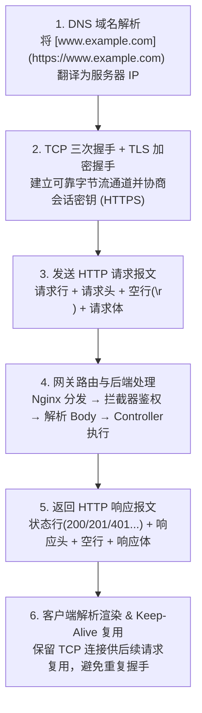

# HTTP 超文本传输协议工作原理

> **HTTP（HyperText Transfer Protocol，超文本传输协议）** 是互联网应用层的核心数据快递系统，本质上是一种**基于“请求-响应（Request-Response）”模式、无状态（Stateless）的应用层通信协议**。  
> 简单来说，浏览器或 App 每次点击加载、提交表单，底层都是把业务意图按固定格式打包成一份**请求报文（Request）**发往服务器；**服务器按规则拆包、验票、处理业务后，再回传一份标准格式的响应报文（Response）**。

如果把互联网通信比作寄送同城急件：底层的 TCP/IP 协议是修好的高速公路与货运卡车，TLS 加密是给包裹上的密码防盗箱，**而 HTTP 协议，就是贴在箱子表面的标准快递面单与拆包说明书**——写清了寄给谁、要干嘛、里面装的是什么格式，以及对方签收后的回执状态。

---

## 一、举个生活中的例子

假设你在做一个在线社区或工具平台（比如运行在 Spring Boot 上的用户系统），玩家 `shaoxia` 刚打开注册页，点击「提交注册」按钮。

看似只是前端调用了一行 `axios.post('/api/users', ...)`，但在网线与服务器之间，真正发生的是这样一场精确接力：

- **前端打包发货**：浏览器把 URL、登录凭证、数据格式说明书和 JSON 正文拼成一段严丝合缝的报文，通过网络发给目标服务器；
- **网关按门牌分拣**：Nginx 收到流量后，盯着面单上的 `Host` 域名，把它准确转发给对应的 Spring Boot 服务；
- **后端逐层拆包回执**：拦截器先查验门票（Token），Jackson 解析器按说明书把 JSON 还原成 Java DTO 对象，写入数据库后，再立刻签发一张写着 `201 Created` 的响应回执发回前端。

**只要双方都严格遵守 HTTP 这套面单规范，无论前端是 Chrome、iOS 还是 Python 脚本，后端是 Java、Go 还是 Rust，都能零障碍对话。**

---

## 二、一次完整的 HTTP 请求是如何运转的？

一条 HTTP 请求并不是凭空飞进后端 Controller 的。从你在前端按下回车，到页面拿到返回结果，底层通常会走完 **寻址 → 建连加密 → 发送请求 → 服务端处理 → 返回响应与连接复用** 五个核心阶段：



1. **DNS 解析**：网络路由只认 IP 地址，浏览器先查本地缓存或 DNS 服务器，把域名翻译成目标机器的 IP。
2. **TCP 与 TLS 握手**：HTTP/1.1 与 HTTP/2 运行在可靠的 TCP 字节流之上；现代网站普遍启用 **HTTPS（HTTP + TLS）**，会在三次握手后追加 TLS 握手，完成证书验证与对称密钥协商，防止明文报文在传输途中被窃听或篡改。
3. **请求与响应接力**：连接就绪后，客户端吐出请求报文，服务端按协议逐行读取、执行业务逻辑并返回响应报文。
4. **长连接复用（Keep-Alive）**：HTTP/1.1 默认开启 `Connection: keep-alive`，一条 TCP 连接处理完一次请求不会立刻挥手断开，而是复用给后续请求，大幅减少握手延迟。

---

## 三、解剖报文：请求（Request）与响应（Response）长什么样？

在 HTTP/1.1 中，剥开 HTTPS 的加密外衣后，网线里跑的其实是一段人类肉眼可读的**纯文本报文**。

### （一）HTTP 请求报文拆解

下面是一份标准的注册用户请求报文：

```http
POST /api/users HTTP/1.1
Host: [www.example.com](https://www.example.com)
Content-Type: application/json
User-Agent: Mozilla/5.0 (Windows NT 10.0; Win64; x64)
Authorization: Bearer token123
Content-Length: 32

{"name": "shaoxia", "level": 99}
```

#### 1. 请求行（Request Line）

> `POST /api/users HTTP/1.1`

这是整个包裹的“灵魂”，由空格分隔的三段组成：

- **`POST`（请求方法）**：动作指令，告诉服务器“我是来提交新数据的”。到达 Spring Boot 后，框架会匹配标有 `@PostMapping` 的接口。
- **`/api/users`（请求路径）**：目标资源的定位路径（RESTful 风格中表示“用户集合”），对应后端的 `@RequestMapping("/api/users")`。
- **`HTTP/1.1`（协议版本）**：告诉服务器按 1.1 版本的文本规矩拆包（现代生产环境常升级至 HTTP/2 或 HTTP/3，但理解报文语义仍以 HTTP/1.1 最直观）。

#### 2. 路由与定位层（请求头）

> `Host: www.example.com`

- **既然数据包已经发到服务器 IP 了，为什么还要写域名？**
- **底层真相**：一台物理服务器（同一个公网 IP）上往往通过虚拟主机同时运行着几十个不同网站。`Host` 就是这栋大楼里的**门牌号**，Nginx 或网关软件必须读取它，才能决定把请求转发给哪个后端服务。HTTP/1.1 强制要求所有请求必须携带 `Host` 头，缺之必报 `400 Bad Request`。

#### 3. 数据解析与拆包说明书（请求头）

> `Content-Type: application/json`  
> `Content-Length: 32`

这两行紧密配合，决定了后端能否正确切分并解析正文：

- **`Content-Type`**：告诉后端的序列化框架（如 Jackson）：“底下的正文是 JSON，请按 JSON 规则解析”。如果误传成 `text/plain`，Spring Boot 的 `@RequestBody` 会直接拒绝并返回 `415 Unsupported Media Type`。
- **`Content-Length`**：声明正文**精确到 UTF-8 字节的长度**（`{"name": "shaoxia", "level": 99}` 严格数下来正好是 **32 字节**，哪怕多写成 33，服务器数完 32 字节后也会死等第 33 个字节直到超时）。因为 TCP 是没有边界的“水流”字节流，服务器靠这个数字精准切分请求边界，避免和下一个请求发生**粘包**。

> **进阶补充（流式传输怎么办？）**：当后端做大模型逐字输出（SSE）或实时导出大文件、发送前根本不知道总字节数时，HTTP 会改用 `Transfer-Encoding: chunked`（分块传输编码），把数据切成带十六进制长度前缀的小块逐段发送，直到发完一个长度为 `0` 的结束块为止。

#### 4. 身份与安全层（请求头）

> `Authorization: Bearer token123`

- **背景**：HTTP 本身是无状态的，服务器默认不会记住“上一个请求是谁发的”。
- **运作机制**：用户登录成功后，后端签发一串加密令牌（如 JWT Token）。后续前端（如 axios 拦截器）自动把令牌放进 `Authorization` 头，前缀 **`Bearer`** 是行业规范，意为“持票人”。
- **后端拦截**：请求到达业务 Controller 之前，会被过滤器/拦截器（如 Spring Security Filter）拦下验签、校验有效期；验票失败直接打回 `401 Unauthorized`。

#### 5. 客户端画像（请求头）

> `User-Agent: Mozilla/5.0 (Windows NT 10.0; Win64; x64)`

- 客户端“自报家门”，声明操作系统、架构与浏览器内核。常用于区分 PC/移动端适配、埋点统计以及基础反爬虫识别（注意该字段可由客户端伪造，绝不能作为安全凭据）。

#### 6. 物理结界（空行）

> `（此处是一个不可见的回车换行符 \r\n）`

- **绝对不能省略的一行**。HTTP/1.1 规定每行末尾以 `CRLF`（`\r\n`）结尾，当服务器底层循环逐行读取头部、撞到一个**连续的空行（`\r\n\r\n`）**时，解析循环立刻跳出：“快递面单读完了，下面紧跟的全是实体货物（Body）！”

#### 7. 业务核心数据（请求体 Body）

> `{"name": "shaoxia", "level": 99}`

- 闯过路由分发、Token 鉴权和字节长度读取后，这串 32 字节的 JSON 最终交到 `@RequestBody` 手里，反序列化成后端的 `UserRegisterDTO` 对象。

---

### （二）有去有回：HTTP 响应报文长什么样？

后端写库成功后，不会只甩回一段 JSON，而是必须同样打包成一份完整的 **HTTP 响应报文**：

```http
HTTP/1.1 201 Created
Date: Fri, 20 Nov 2026 01:08:00 GMT
Content-Type: application/json; charset=utf-8
Content-Length: 44
Cache-Control: no-store
ETag: "u-10086-v1"
Connection: keep-alive

{"code": 201, "msg": "created", "id": 10086}
```

响应报文同样由 **状态行 + 响应头 + 空行（`\r\n`）+ 响应体** 四段构成：

1. **状态行（`HTTP/1.1 201 Created`）**：包含协议版本、三位数字状态码（`201` 表示资源创建成功）与原因短语。
2. **高频响应头**：
    - `Content-Type` / `Content-Length`：同样告知客户端如何解析响应正文（上述 JSON 精确为 44 字节）；
    - `Content-Encoding`：若开启了压缩（如 `gzip`、`br`、`zstd`），提示浏览器先用对应算法解压再解析；
    - `Cache-Control` 与 `ETag`：指挥浏览器是否缓存这份数据，以及下次如何验证数据有没有过期；
    - `Set-Cookie`：若使用 Cookie 会话机制，由服务端下发给浏览器保存。
3. **空行与响应体**：同样以 `\r\n` 空行分割，之后就是前端最终拿到的业务 JSON、HTML 页面或图片二进制流。

---

## 四、交互实验室：HTTP 请求-响应报文与后端处理模拟器

为了把**请求报文拼接、`Content-Length` 精确字节计数、`\r\n` 物理空行、网关鉴权拦截与响应状态码**串成一条直观的动态链路，你可以在下方实验室中自由切换预设场景、修改 JSON 正文或去掉 Token，并点击 **「▶ 发送模拟请求」** 观察全链路执行过程：

<style>
.tk-http {
  --ht-bg: rgba(24, 24, 27, 0.72);
  --ht-panel: rgba(39, 39, 42, 0.55);
  --ht-sub: #0d0d10;
  --ht-border: rgba(255, 255, 255, 0.1);
  --ht-accent: #10b981;
  --ht-blue: #38bdf8;
  --ht-amber: #f59e0b;
  --ht-red: #f43f5e;
  --ht-purple: #a78bfa;
  --ht-text: #f4f4f5;
  --ht-muted: #a1a1aa;
  box-sizing: border-box;
  margin: 20px 0 24px;
  padding: 18px;
  border: 1px solid var(--ht-border);
  border-radius: 16px;
  background: var(--ht-bg);
  color: var(--ht-text);
  font-family: 'Inter', -apple-system, BlinkMacSystemFont, "PingFang SC", "Microsoft YaHei", sans-serif;
  box-shadow: 0 12px 32px rgba(0, 0, 0, 0.35);
}
body.theme-light .tk-http {
  --ht-bg: rgba(255, 250, 253, 0.85);
  --ht-panel: rgba(243, 232, 255, 0.52);
  --ht-sub: rgba(255, 255, 255, 0.92);
  --ht-border: rgba(236, 72, 153, 0.22);
  --ht-accent: #ec4899;
  --ht-blue: #0284c7;
  --ht-amber: #d97706;
  --ht-red: #e11d48;
  --ht-purple: #7c3aed;
  --ht-text: #2e1065;
  --ht-muted: #6d597a;
  box-shadow: 0 12px 32px rgba(167, 139, 250, 0.16);
}
.tk-http, .tk-http *, .tk-http *::before, .tk-http *::after { box-sizing: border-box; }
.tk-http-head {
  display: flex;
  flex-wrap: wrap;
  justify-content: space-between;
  align-items: center;
  gap: 8px;
  padding-bottom: 12px;
  margin-bottom: 14px;
  border-bottom: 1px solid var(--ht-border);
}
.tk-http-title {
  font-size: 15px;
  font-weight: 700;
  color: var(--ht-text);
  display: flex;
  align-items: center;
  gap: 8px;
}
.tk-http-dot {
  width: 8px;
  height: 8px;
  border-radius: 50%;
  background: var(--ht-accent);
  box-shadow: 0 0 10px var(--ht-accent);
}
.tk-http-legend {
  font-size: 12px;
  color: var(--ht-muted);
}
.tk-http-presets {
  display: flex;
  flex-wrap: wrap;
  gap: 7px;
  margin-bottom: 12px;
}
.tk-http-btn {
  appearance: none;
  border: 1px solid var(--ht-border);
  background: var(--ht-panel);
  color: var(--ht-text);
  padding: 6px 11px;
  border-radius: 9px;
  font-size: 12px;
  font-weight: 600;
  cursor: pointer;
  transition: all 0.16s ease;
  font-family: inherit;
}
.tk-http-btn:hover {
  border-color: var(--ht-accent);
  color: var(--ht-accent);
  transform: translateY(-1px);
}
.tk-http-btn.is-primary {
  background: var(--ht-accent);
  border-color: var(--ht-accent);
  color: #ffffff;
}
.tk-http-btn.is-primary:hover {
  opacity: 0.92;
  color: #ffffff;
}
.tk-http-form {
  display: grid;
  grid-template-columns: 110px 1.2fr 1fr 1fr;
  gap: 8px;
  margin-bottom: 10px;
}
.tk-http-field {
  display: flex;
  flex-direction: column;
  gap: 4px;
}
.tk-http-label {
  font-size: 11px;
  font-weight: 600;
  color: var(--ht-muted);
}
.tk-http-select, .tk-http-input {
  width: 100%;
  padding: 7px 10px;
  border-radius: 9px;
  border: 1px solid var(--ht-border);
  background: var(--ht-sub);
  color: var(--ht-text);
  font-family: 'JetBrains Mono', Consolas, monospace;
  font-size: 12.5px;
  outline: none;
}
.tk-http-select:focus, .tk-http-input:focus {
  border-color: var(--ht-accent);
}
.tk-http-bodyrow {
  display: flex;
  flex-wrap: wrap;
  align-items: center;
  gap: 10px;
  margin-bottom: 12px;
}
.tk-http-bodywrap {
  flex: 1 1 300px;
}
.tk-http-checks {
  display: flex;
  flex-wrap: wrap;
  align-items: center;
  gap: 12px;
  font-size: 12px;
  color: var(--ht-muted);
}
.tk-http-checks label {
  display: inline-flex;
  align-items: center;
  gap: 5px;
  cursor: pointer;
  user-select: none;
}
.tk-http-pipe {
  display: grid;
  grid-template-columns: repeat(5, minmax(0, 1fr));
  gap: 6px;
  margin-bottom: 12px;
}
.tk-http-step {
  background: var(--ht-panel);
  border: 1px solid var(--ht-border);
  border-radius: 9px;
  padding: 7px 8px;
  font-size: 11.5px;
  text-align: center;
  color: var(--ht-muted);
  transition: all 0.2s ease;
  font-weight: 600;
}
.tk-http-step.is-active {
  border-color: var(--ht-blue);
  color: var(--ht-blue);
  box-shadow: 0 0 0 1px rgba(56, 189, 248, 0.25);
}
.tk-http-step.is-ok {
  border-color: var(--ht-accent);
  color: var(--ht-accent);
}
.tk-http-step.is-err {
  border-color: var(--ht-red);
  color: var(--ht-red);
}
.tk-http-grid {
  display: grid;
  grid-template-columns: 1fr 1fr;
  gap: 12px;
  margin-bottom: 12px;
}
.tk-http-panel {
  background: var(--ht-panel);
  border: 1px solid var(--ht-border);
  border-radius: 12px;
  padding: 12px;
  display: flex;
  flex-direction: column;
  min-width: 0;
}
.tk-http-ptitle {
  font-size: 12px;
  font-weight: 600;
  color: var(--ht-muted);
  margin-bottom: 8px;
  display: flex;
  flex-wrap: wrap;
  justify-content: space-between;
  align-items: center;
  gap: 6px;
}
.tk-http-badge {
  display: inline-block;
  padding: 2px 8px;
  border-radius: 999px;
  font-family: 'JetBrains Mono', Consolas, monospace;
  font-size: 11.5px;
  font-weight: 700;
}
.tk-http-badge.is-2xx { background: rgba(16, 185, 129, 0.18); color: var(--ht-accent); }
.tk-http-badge.is-3xx { background: rgba(56, 189, 248, 0.18); color: var(--ht-blue); }
.tk-http-badge.is-4xx { background: rgba(245, 158, 11, 0.18); color: var(--ht-amber); }
.tk-http-badge.is-5xx { background: rgba(244, 63, 94, 0.18); color: var(--ht-red); }
.tk-http-wire {
  background: var(--ht-sub);
  border: 1px solid var(--ht-border);
  border-radius: 10px;
  padding: 10px 12px;
  font-family: 'JetBrains Mono', Consolas, monospace;
  font-size: 12px;
  line-height: 1.65;
  white-space: pre-wrap;
  word-break: break-all;
  min-height: 225px;
  max-height: 280px;
  overflow: auto;
}
.tk-http-ln-start { color: var(--ht-blue); font-weight: 700; }
.tk-http-ln-hk { color: var(--ht-purple); }
.tk-http-ln-hv { color: var(--ht-text); }
.tk-http-ln-crlf { color: var(--ht-amber); opacity: 0.85; font-size: 11px; }
.tk-http-ln-gap {
  display: block;
  margin: 4px 0;
  padding: 1px 6px;
  border-radius: 4px;
  background: rgba(245, 158, 11, 0.12);
  color: var(--ht-amber);
  font-size: 11px;
}
.tk-http-ln-body { color: var(--ht-accent); }
.tk-http-trace {
  background: var(--ht-panel);
  border: 1px solid var(--ht-border);
  border-radius: 12px;
  padding: 11px 12px;
}
.tk-http-logs {
  background: var(--ht-sub);
  border: 1px solid var(--ht-border);
  border-radius: 8px;
  padding: 8px 10px;
  font-family: 'JetBrains Mono', Consolas, monospace;
  font-size: 12px;
  line-height: 1.7;
  color: var(--ht-muted);
}
.tk-http-log-ok { color: var(--ht-accent); }
.tk-http-log-warn { color: var(--ht-amber); }
.tk-http-log-err { color: var(--ht-red); }
@media (max-width: 820px) {
  .tk-http { padding: 14px; }
  .tk-http-form { grid-template-columns: repeat(2, minmax(0, 1fr)); }
  .tk-http-pipe { grid-template-columns: repeat(2, minmax(0, 1fr)); }
  .tk-http-pipe .tk-http-step:last-child { grid-column: 1 / -1; }
  .tk-http-grid { grid-template-columns: 1fr; }
}
</style>

<section id="tk-http-lab" class="tk-http" aria-label="HTTP 请求响应报文与后端处理交互实验室">
  <div class="tk-http-head">
    <div class="tk-http-title"><span class="tk-http-dot"></span><span>HTTP 请求-响应报文与后端处理模拟器</span></div>
    <span class="tk-http-legend">实时计算 UTF-8 字节长度 ｜ 观察空行分界与 Spring Boot 拦截链路</span>
  </div>
  <div class="tk-http-presets">
    <button type="button" class="tk-http-btn is-primary" id="tk-ht-send">▶ 发送模拟请求</button>
    <button type="button" class="tk-http-btn" id="tk-ht-p0">场景 1：201 正常注册</button>
    <button type="button" class="tk-http-btn" id="tk-ht-p1">场景 2：401 缺少 Token</button>
    <button type="button" class="tk-http-btn" id="tk-ht-p2">场景 3：415 格式错填</button>
    <button type="button" class="tk-http-btn" id="tk-ht-p3">场景 4：304 缓存命中</button>
    <button type="button" class="tk-http-btn" id="tk-ht-p4">场景 5：403 越权访问</button>
  </div>
  <div class="tk-http-form">
    <div class="tk-http-field">
      <span class="tk-http-label">请求方法 (Method)</span>
      <select id="tk-ht-method" class="tk-http-select" aria-label="HTTP 方法">
        <option value="POST" selected>POST</option>
        <option value="GET">GET</option>
        <option value="PUT">PUT</option>
        <option value="DELETE">DELETE</option>
      </select>
    </div>
    <div class="tk-http-field">
      <span class="tk-http-label">目标路径 (Path)</span>
      <select id="tk-ht-path" class="tk-http-select" aria-label="目标路径">
        <option value="/api/users" selected>/api/users (用户集合)</option>
        <option value="/api/users/99">/api/users/99 (指定用户)</option>
        <option value="/api/admin/stats">/api/admin/stats (管理员统计)</option>
        <option value="/api/unknown">/api/unknown (不存在路径)</option>
      </select>
    </div>
    <div class="tk-http-field">
      <span class="tk-http-label">身份令牌 (Authorization)</span>
      <select id="tk-ht-auth" class="tk-http-select" aria-label="身份令牌">
        <option value="valid" selected>Bearer token123 (有效)</option>
        <option value="none">不携带 Token</option>
        <option value="expired">Bearer expired_xyz (过期)</option>
      </select>
    </div>
    <div class="tk-http-field">
      <span class="tk-http-label">正文格式 (Content-Type)</span>
      <select id="tk-ht-ctype" class="tk-http-select" aria-label="Content-Type">
        <option value="application/json" selected>application/json</option>
        <option value="text/plain">text/plain</option>
      </select>
    </div>
  </div>
  <div class="tk-http-bodyrow">
    <div class="tk-http-bodywrap tk-http-field">
      <span class="tk-http-label">请求体正文 (Body) — 当前精确 UTF-8 长度：<strong id="tk-ht-bytes" style="color:var(--ht-accent)">32 bytes</strong></span>
      <input id="tk-ht-body" class="tk-http-input" type="text" value='{"name": "shaoxia", "level": 99}' aria-label="请求体 JSON">
    </div>
    <div class="tk-http-checks">
      <label><input type="checkbox" id="tk-ht-etag"> 携带 If-None-Match (协商缓存)</label>
      <label><input type="checkbox" id="tk-ht-crlf" checked> 可视化 \r\n 物理换行</label>
    </div>
  </div>
  <div class="tk-http-pipe" id="tk-ht-pipe">
    <div class="tk-http-step">1. DNS 寻址</div>
    <div class="tk-http-step">2. TCP + TLS 握手</div>
    <div class="tk-http-step">3. 发送请求报文</div>
    <div class="tk-http-step">4. 网关与后端处理</div>
    <div class="tk-http-step">5. 返回响应报文</div>
  </div>
  <div class="tk-http-grid">
    <div class="tk-http-panel">
      <div class="tk-http-ptitle">
        <span>客户端发出：原始 HTTP/1.1 请求报文</span>
        <span class="tk-http-badge is-3xx" id="tk-ht-reqmeta">POST · 32B Body</span>
      </div>
      <div class="tk-http-wire" id="tk-ht-req"></div>
    </div>
    <div class="tk-http-panel">
      <div class="tk-http-ptitle">
        <span>服务端回传：原始 HTTP/1.1 响应报文</span>
        <span class="tk-http-badge is-2xx" id="tk-ht-status">201 Created</span>
      </div>
      <div class="tk-http-wire" id="tk-ht-res"></div>
    </div>
  </div>
  <div class="tk-http-trace">
    <div class="tk-http-ptitle"><span>Nginx / Spring Boot 服务端拆包执行追踪</span></div>
    <div class="tk-http-logs" id="tk-ht-logs"></div>
  </div>
</section>

<script>
(function () {
  var lab = document.getElementById('tk-http-lab');
  if (!lab || lab.dataset.ready === '1') return;
  lab.dataset.ready = '1';

  var elMethod = document.getElementById('tk-ht-method');
  var elPath = document.getElementById('tk-ht-path');
  var elAuth = document.getElementById('tk-ht-auth');
  var elCtype = document.getElementById('tk-ht-ctype');
  var elBody = document.getElementById('tk-ht-body');
  var elBytes = document.getElementById('tk-ht-bytes');
  var elEtag = document.getElementById('tk-ht-etag');
  var elCrlf = document.getElementById('tk-ht-crlf');
  var elReq = document.getElementById('tk-ht-req');
  var elRes = document.getElementById('tk-ht-res');
  var elReqMeta = document.getElementById('tk-ht-reqmeta');
  var elStatus = document.getElementById('tk-ht-status');
  var elLogs = document.getElementById('tk-ht-logs');
  var steps = Array.prototype.slice.call(document.querySelectorAll('#tk-ht-pipe .tk-http-step'));
  var timers = [];

  function utf8Bytes(str) {
    if (typeof TextEncoder !== 'undefined') return new TextEncoder().encode(str).length;
    return unescape(encodeURIComponent(str)).length;
  }

  function clearTimers() {
    while (timers.length) clearTimeout(timers.pop());
  }

  function appendLine(container, cls, text, showCrlf) {
    var line = document.createElement('div');
    var sp = document.createElement('span');
    sp.className = cls;
    sp.textContent = text;
    line.appendChild(sp);
    if (showCrlf) {
      var cr = document.createElement('span');
      cr.className = 'tk-http-ln-crlf';
      cr.textContent = '\\r\\n';
      line.appendChild(cr);
    }
    container.appendChild(line);
  }

  function appendHeader(container, key, val, showCrlf) {
    var line = document.createElement('div');
    var k = document.createElement('span');
    k.className = 'tk-http-ln-hk';
    k.textContent = key + ': ';
    var v = document.createElement('span');
    v.className = 'tk-http-ln-hv';
    v.textContent = val;
    line.appendChild(k);
    line.appendChild(v);
    if (showCrlf) {
      var cr = document.createElement('span');
      cr.className = 'tk-http-ln-crlf';
      cr.textContent = '\\r\\n';
      line.appendChild(cr);
    }
    container.appendChild(line);
  }

  function appendGap(container, showCrlf) {
    var gap = document.createElement('span');
    gap.className = 'tk-http-ln-gap';
    gap.textContent = showCrlf ? '\\r\\n  ← 物理空行结界（头部结束，下方为 Body）' : '（空行：头部与正文的分界线）';
    container.appendChild(gap);
  }

  function evaluate() {
    var method = elMethod.value;
    var path = elPath.value;
    var auth = elAuth.value;
    var ctype = elCtype.value;
    var hasBody = method === 'POST' || method === 'PUT';
    var rawBody = hasBody ? elBody.value : '';
    var bodyLen = utf8Bytes(rawBody);
    var useEtag = elEtag.checked;
    var showCrlf = elCrlf.checked;

    elBody.disabled = !hasBody;
    elBody.style.opacity = hasBody ? '1' : '0.45';
    elCtype.disabled = !hasBody;
    elBytes.textContent = hasBody ? (bodyLen + ' bytes') : '0 bytes (无请求体)';
    elReqMeta.textContent = method + ' · ' + (hasBody ? (bodyLen + 'B Body') : 'No Body');

    var reqHeaders = [
      ['Host', 'www.example.com'],
      ['User-Agent', 'Mozilla/5.0 (Windows NT 10.0; Win64; x64)'],
      ['Connection', 'keep-alive']
    ];
    if (auth === 'valid') reqHeaders.push(['Authorization', 'Bearer token123']);
    if (auth === 'expired') reqHeaders.push(['Authorization', 'Bearer expired_xyz']);
    if (method === 'GET' && useEtag) reqHeaders.push(['If-None-Match', '"u-99-v2"']);
    if (hasBody) {
      reqHeaders.push(['Content-Type', ctype]);
      reqHeaders.push(['Content-Length', String(bodyLen)]);
    }

    var code = 200;
    var phrase = 'OK';
    var resBody = '';
    var resHeaders = [
      ['Date', 'Fri, 20 Nov 2026 01:08:00 GMT'],
      ['Connection', 'keep-alive']
    ];
    var logs = [
      { cls: 'tk-http-log-ok', text: '[Nginx] 读取 Host: www.example.com → 命中上游 upstream spring-boot-api:8080' }
    ];

    if (auth === 'none') {
      code = 401; phrase = 'Unauthorized';
      resBody = '{"code": 401, "error": "Missing Authorization header"}';
      logs.push({ cls: 'tk-http-log-err', text: '[SecurityFilter] 未检测到 Authorization 门票，请求被拦截，拒绝进入 Controller' });
    } else if (auth === 'expired') {
      code = 401; phrase = 'Unauthorized';
      resBody = '{"code": 401, "error": "JWT token expired"}';
      logs.push({ cls: 'tk-http-log-err', text: '[SecurityFilter] 验签发现 Bearer expired_xyz 已过期 → 直接返回 401' });
    } else {
      logs.push({ cls: 'tk-http-log-ok', text: '[SecurityFilter] 验签通过 Bearer token123 (role=USER) → 放行至 DispatcherServlet' });
      if (path === '/api/unknown') {
        code = 404; phrase = 'Not Found';
        resBody = '{"code": 404, "error": "No handler for /api/unknown"}';
        logs.push({ cls: 'tk-http-log-warn', text: '[Router] 路由表未匹配到 /api/unknown → 返回 404 Not Found' });
      } else if (path === '/api/admin/stats') {
        code = 403; phrase = 'Forbidden';
        resBody = '{"code": 403, "error": "Require ADMIN role"}';
        logs.push({ cls: 'tk-http-log-err', text: '[PreAuthorize] 身份有效但权限不足（需要 ADMIN，当前为 USER）→ 返回 403 Forbidden' });
      } else if (path === '/api/users' && (method === 'PUT' || method === 'DELETE')) {
        code = 405; phrase = 'Method Not Allowed';
        resHeaders.push(['Allow', 'GET, POST']);
        resBody = '{"code": 405, "error": "Method not allowed on /api/users"}';
        logs.push({ cls: 'tk-http-log-warn', text: '[Router] /api/users 仅支持 GET/POST，不支持 ' + method + ' → 返回 405' });
      } else if (path === '/api/users/99' && method === 'POST') {
        code = 405; phrase = 'Method Not Allowed';
        resHeaders.push(['Allow', 'GET, PUT, DELETE']);
        resBody = '{"code": 405, "error": "Use PUT to update user 99"}';
        logs.push({ cls: 'tk-http-log-warn', text: '[Router] 具体资源 /api/users/99 请用 PUT 更新，不支持 POST → 返回 405' });
      } else if (method === 'GET' && useEtag) {
        code = 304; phrase = 'Not Modified';
        resHeaders.push(['ETag', '"u-99-v2"']);
        resHeaders.push(['Cache-Control', 'no-cache']);
        resBody = '';
        logs.push({ cls: 'tk-http-log-ok', text: '[CacheFilter] 对比 If-None-Match 与当前资源指纹一致 → 返回 304，省去完整 Body 传输' });
      } else if (hasBody && ctype !== 'application/json') {
        code = 415; phrase = 'Unsupported Media Type';
        resBody = '{"code": 415, "error": "Expected application/json"}';
        logs.push({ cls: 'tk-http-log-err', text: '[MessageConverter] Content-Type 为 ' + ctype + '，无法触发 JSON 解析器 → 返回 415' });
      } else if (hasBody) {
        try {
          var parsed = JSON.parse(rawBody || '{}');
          if (method === 'POST') {
            code = 201; phrase = 'Created';
            resBody = '{"code": 201, "msg": "created", "id": 10086}';
            resHeaders.push(['Cache-Control', 'no-store']);
            logs.push({ cls: 'tk-http-log-ok', text: '[Jackson] 按 Content-Length=' + bodyLen + ' 精准截取字节流并反序列化为 DTO (name=' + (parsed.name || 'N/A') + ')' });
            logs.push({ cls: 'tk-http-log-ok', text: '[UserController] @PostMapping 写库成功 → 签发 201 Created 回执' });
          } else {
            code = 200; phrase = 'OK';
            resBody = '{"code": 200, "msg": "updated", "id": 99}';
            logs.push({ cls: 'tk-http-log-ok', text: '[UserController] @PutMapping 幂等更新用户 #99 成功 → 返回 200 OK' });
          }
        } catch (err) {
          code = 400; phrase = 'Bad Request';
          resBody = '{"code": 400, "error": "Malformed JSON body"}';
          logs.push({ cls: 'tk-http-log-err', text: '[Jackson] JSON 语法解析失败（请检查引号或逗号）→ 返回 400 Bad Request' });
        }
      } else if (method === 'DELETE') {
        code = 204; phrase = 'No Content';
        resBody = '';
        logs.push({ cls: 'tk-http-log-ok', text: '[UserController] @DeleteMapping 删除资源 #99 成功 → 返回 204（无响应体）' });
      } else {
        code = 200; phrase = 'OK';
        resHeaders.push(['Cache-Control', 'max-age=60']);
        resHeaders.push(['ETag', '"u-99-v2"']);
        resBody = path === '/api/users'
          ? '{"code": 200, "data": [{"id": 99, "name": "shaoxia"}]}'
          : '{"code": 200, "data": {"id": 99, "name": "shaoxia", "level": 99}}';
        logs.push({ cls: 'tk-http-log-ok', text: '[UserController] @GetMapping 查询成功，附带 ETag 响应头供下次协商缓存' });
      }
    }

    if (resBody) {
      resHeaders.push(['Content-Type', 'application/json; charset=utf-8']);
      resHeaders.push(['Content-Length', String(utf8Bytes(resBody))]);
    }

    return {
      method: method, path: path, reqHeaders: reqHeaders, rawBody: rawBody,
      code: code, phrase: phrase, resHeaders: resHeaders, resBody: resBody,
      logs: logs, showCrlf: showCrlf
    };
  }

  function render(state, animate) {
    clearTimers();
    while (elReq.firstChild) elReq.removeChild(elReq.firstChild);
    appendLine(elReq, 'tk-http-ln-start', state.method + ' ' + state.path + ' HTTP/1.1', state.showCrlf);
    state.reqHeaders.forEach(function (h) { appendHeader(elReq, h[0], h[1], state.showCrlf); });
    appendGap(elReq, state.showCrlf);
    if (state.rawBody) appendLine(elReq, 'tk-http-ln-body', state.rawBody, false);

    function paintResponse() {
      while (elRes.firstChild) elRes.removeChild(elRes.firstChild);
      appendLine(elRes, 'tk-http-ln-start', 'HTTP/1.1 ' + state.code + ' ' + state.phrase, state.showCrlf);
      state.resHeaders.forEach(function (h) { appendHeader(elRes, h[0], h[1], state.showCrlf); });
      appendGap(elRes, state.showCrlf);
      if (state.resBody) appendLine(elRes, 'tk-http-ln-body', state.resBody, false);

      var cls = state.code < 300 ? 'is-2xx' : (state.code < 400 ? 'is-3xx' : (state.code < 500 ? 'is-4xx' : 'is-5xx'));
      elStatus.className = 'tk-http-badge ' + cls;
      elStatus.textContent = state.code + ' ' + state.phrase;

      while (elLogs.firstChild) elLogs.removeChild(elLogs.firstChild);
      state.logs.forEach(function (item) {
        var row = document.createElement('div');
        row.className = item.cls;
        row.textContent = item.text;
        elLogs.appendChild(row);
      });
    }

    steps.forEach(function (s) { s.className = 'tk-http-step'; });
    if (!animate) {
      paintResponse();
      steps.forEach(function (s, idx) {
        if (idx === 3 && state.code >= 400) s.classList.add('is-err');
        else s.classList.add('is-ok');
      });
      return;
    }

    steps.forEach(function (s, idx) {
      timers.push(setTimeout(function () {
        if (idx > 0) {
          steps[idx - 1].classList.remove('is-active');
          steps[idx - 1].classList.add(idx - 1 === 3 && state.code >= 400 ? 'is-err' : 'is-ok');
        }
        s.classList.add('is-active');
        if (idx === steps.length - 1) {
          paintResponse();
          timers.push(setTimeout(function () {
            s.classList.remove('is-active');
            s.classList.add(state.code >= 400 ? 'is-err' : 'is-ok');
          }, 220));
        }
      }, idx * 170));
    });
  }

  function update(animate) { render(evaluate(), animate); }

  function applyPreset(cfg) {
    elMethod.value = cfg.method;
    elPath.value = cfg.path;
    elAuth.value = cfg.auth;
    elCtype.value = cfg.ctype;
    elEtag.checked = !!cfg.etag;
    if (cfg.body !== undefined) elBody.value = cfg.body;
    update(true);
  }

  document.getElementById('tk-ht-send').addEventListener('click', function () { update(true); });
  document.getElementById('tk-ht-p0').addEventListener('click', function () {
    applyPreset({ method: 'POST', path: '/api/users', auth: 'valid', ctype: 'application/json', etag: false, body: '{"name": "shaoxia", "level": 99}' });
  });
  document.getElementById('tk-ht-p1').addEventListener('click', function () {
    applyPreset({ method: 'POST', path: '/api/users', auth: 'none', ctype: 'application/json', etag: false, body: '{"name": "shaoxia", "level": 99}' });
  });
  document.getElementById('tk-ht-p2').addEventListener('click', function () {
    applyPreset({ method: 'POST', path: '/api/users', auth: 'valid', ctype: 'text/plain', etag: false, body: '{"name": "shaoxia", "level": 99}' });
  });
  document.getElementById('tk-ht-p3').addEventListener('click', function () {
    applyPreset({ method: 'GET', path: '/api/users/99', auth: 'valid', ctype: 'application/json', etag: true });
  });
  document.getElementById('tk-ht-p4').addEventListener('click', function () {
    applyPreset({ method: 'GET', path: '/api/admin/stats', auth: 'valid', ctype: 'application/json', etag: false });
  });

  [elMethod, elPath, elAuth, elCtype, elEtag, elCrlf].forEach(function (el) {
    el.addEventListener('change', function () { update(false); });
  });
  elBody.addEventListener('input', function () { update(false); });

  update(false);
})();
</script>

---

## 五、核心语义：请求方法、幂等性与高频状态码

写好 RESTful 接口与排查线上故障，绕不开 **请求方法语义** 和 **状态码分类** 这两张底牌。

### 1. 常用 HTTP 方法与幂等性对比

| 方法 | 核心语义 | 是否安全（只读） | 是否幂等（连发多次结果一致） | Spring Boot 对应注解 |
| :--- | :--- | :--- | :--- | :--- |
| **GET** | 获取资源（参数拼在 URL 查询串中） | 是 | 是 | `@GetMapping` |
| **POST** | 创建新资源或触发非幂等操作 | 否 | **否**（连点两次会插两条记录） | `@PostMapping` |
| **PUT** | 全量替换指定资源 | 否 | 是（覆盖成同一份数据结果不变） | `@PutMapping` |
| **PATCH** | 局部更新资源的某几个字段 | 否 | 视实现而定 | `@PatchMapping` |
| **DELETE** | 删除指定资源 | 否 | 是（删一次和删十次，资源都不存在） | `@DeleteMapping` |
| **OPTIONS** | 探测服务器支持的方法与跨域（CORS）策略 | 是 | 是 | 框架 / 网关自动响应 |

> **工程避坑**：弱网环境下前端重试只应默认放行**幂等请求**；对 `POST` 下单、扣款接口，后端必须额外结合**幂等键（Idempotency-Key）或唯一索引**防重。

### 2. 开发排障必背的状态码速查

| 分段与状态码 | 含义 | 典型排障触发场景 |
| :--- | :--- | :--- |
| **`200 OK`** | 请求成功 | 最常见的查询、更新成功返回 |
| **`201 Created`** | 资源创建成功 | `POST` 注册用户、提交新订单成功 |
| **`204 No Content`** | 成功但无正文 | `DELETE` 删除成功或 CORS 预检放行 |
| **`301 / 302`** | 永久 / 临时重定向 | 域名迁移（301 会被浏览器缓存）、未登录跳登录页（302） |
| **`304 Not Modified`** | 协商缓存命中 | 资源没变，服务端不传 Body，浏览器直接读本地缓存 |
| **`400 Bad Request`** | 客户端参数错误 | JSON 少个引号、必填字段缺失、类型不匹配 |
| **`401 Unauthorized`** | 未认证（没门票） | 没带 `Authorization` 头，或 JWT Token 已过期/伪造 |
| **`403 Forbidden`** | 无权限（票是真的但级别不够） | 普通用户强行访问管理员接口，或触发 WAF 风控 |
| **`404 Not Found`** | 资源不存在 | URL 拼错、前端路由与后端接口路径未对齐 |
| **`415 Unsupported Media Type`** | 媒体类型不支持 | 后端要 JSON，前端传成了 `text/plain` 或表单格式 |
| **`429 Too Many Requests`** | 触发限流 | 同一 IP / 账号请求过频，被网关限流熔断 |
| **`500 Internal Server Error`** | 服务端代码崩溃 | 后端抛出未捕获异常（如 `NullPointerException`） |
| **`502 Bad Gateway`** | 网关收到无效响应 | Nginx 转发时后端 Spring Boot 进程挂了或正在重启 |
| **`504 Gateway Timeout`** | 网关等待超时 | 后端慢 SQL 或外部接口卡死，超出 Nginx `proxy_read_timeout` |

---

## 六、给无状态打补丁，给网络提速：认证、缓存与 HTTPS

理解报文结构之后，真正决定系统“安全不安全、快不快”的，是架构在 HTTP 之上的三大工程机制：

### 1. 无状态的身份保持：Cookie/Session vs JWT Token

| 对比维度 | Cookie + Session（有状态） | Authorization + JWT（无状态） |
| :--- | :--- | :--- |
| **存储位置** | 浏览器存 `SessionID`，服务端内存/Redis 存用户状态 | 完整用户信息经签名加密后直接保存在客户端 Token 中 |
| **横向扩展性** | 多台后端需共享 Redis 集中存储 Session | 任意后端节点只要有密钥即可本地验签，天然适合微服务 |
| **主动踢下线** | **极容易**：删掉 Redis 里的 Session 立刻失效 | **较棘手**：签发后在过期前始终有效，需额外维护黑名单 |
| **防 CSRF 风险** | 浏览器会自动携带 Cookie，需配 `SameSite` 与 CSRF Token | 手动放入 `Authorization` 请求头，天然免疫传统 CSRF |

### 2. HTTP 缓存机制：省下 80% 重复流量的秘密

- **强缓存（连服务器都不问）**：响应头带 `Cache-Control: max-age=3600`。在 1 小时内，浏览器再次请求同一静态资源直接从本地磁盘/内存秒开，根本不发网络请求。
- **协商缓存（带指纹问一句变没变）**：强缓存过期后，浏览器把上次存下的资源指纹放到 `If-None-Match`（对应响应头 `ETag`）发给服务器。如果文件没改过，服务器直接回一个极小的 **`304 Not Modified`**（无 Body），省下整份文件带宽。

### 3. 为什么生产环境必须用 HTTPS？

纯文本的 HTTP 就像寄**明信片**，沿途的路由器、公共 Wi-Fi 甚至运营商都能一眼看穿你的账号密码与 Token。**HTTPS = HTTP + TLS**：握手阶段通过**非对称加密 + CA 数字证书**验证服务器真身并安全交换密钥，随后的所有 HTTP 报文全部用高速**对称加密（如 AES-GCM）**封装成密文，同时保证**防窃听、防篡改、防冒充**。

---

## 七、协议演进：从 HTTP/1.1 到 HTTP/2 与 HTTP/3

既然 HTTP/1.1 如此清晰，为什么现代浏览器和 CDN 都在全面切往 HTTP/2 和 HTTP/3？核心矛盾只有一个：**速度与队头阻塞（Head-of-Line Blocking）**。

| 演进维度 | HTTP/1.1（1997） | HTTP/2（2015） | HTTP/3（2022） |
| :--- | :--- | :--- | :--- |
| **底层传输协议** | TCP | TCP | **QUIC（基于 UDP）** |
| **报文传输格式** | 纯文本明文格式 | **二进制分帧（Binary Framing）** | 二进制分帧 |
| **并发复用能力** | 同一 TCP 连接必须一问一答排队，靠浏览器开 6 条连接硬扛 | **单连接多路复用**：一个连接内多条请求/响应交错并发，互不等待 | 原生多路复用，各数据流（Stream）在传输层彻底独立 |
| **头部压缩** | 每次重复发几百字节的 `User-Agent` / `Cookie` | **HPACK 算法**（索引表 + 霍夫曼编码），大幅压榨重复 Header | **QPACK 算法**，适配乱序到达场景 |
| **核心解决痛点** | 引入 `Keep-Alive` 与 `Host`，奠定现代 Web 基础 | 消灭了**应用层**队头阻塞，但 TCP 丢一个包仍会卡住整条连接 | 消灭了 **TCP 层**队头阻塞，且支持 **0-RTT 建连**与手机切 Wi-Fi/5G 无感迁移 |

---

## 八、总结

无论是浏览器里毫秒级加载的网页、手机 App 的后台接口，还是 Spring Boot 里一个个 `@PostMapping` 与 `@RequestBody`，底层全部运行在这套历经三十年演进的优雅秩序之上：

- **报文结构** 用“起始行 + 头部键值对 + `\r\n` 空行 + 精确字节正文”四段式约定，让异构系统之间实现了零歧义对话；
- **状态码、缓存与认证机制** 在无状态协议之上撑起了安全可靠的企业级业务闭环；
- **从 HTTP/1.1 到 HTTP/3**，尽管底层的传输载体从纯文本 TCP 进化到了二进制分帧与 UDP/QUIC，但**请求-响应的核心语义**始终一脉相承。

**用极简的文本规范定义通信语言，用层层演进的传输工程压榨网络延迟，这就是 HTTP 协议长盛不衰的全部核心。**