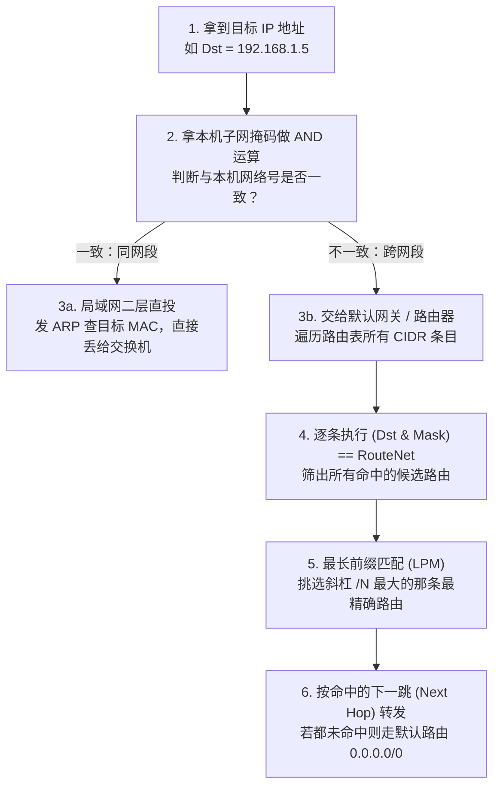

# IPv4 路由与 CIDR 子网掩码原理解析

> **IPv4 地址**是互联网设备在网络层的 32 位门牌号，**子网掩码（Subnet Mask）**决定了这 32 位中“哪一段表示街道、哪一段表示具体房间”，而 **CIDR（Classless Inter-Domain Routing，无类别域间路由）** 则是用 `IP/前缀长度`（如 `192.168.1.0/24`）精准划定网段边界、支撑全球路由器高速寻路的现代寻址规范。  
> 简单来说，普通用户日常看到的 `192.168.1.5` 指向的是**单台设备**，而 `192.168.1.0/24` 描述的是**一整个网段**；**路由器收到数据包后，正是拿着这张 CIDR 路由表，通过 32 位二进制按位与运算和“最长前缀匹配”原则，把数据包精准送往下一跳。**

如果把整个互联网比作一套庞大的邮政投递系统：单个 IP（`192.168.1.5`）就像是**“和平路 5 号”**的具体门牌，网段（`192.168.1.0/24`）就像是**“和平路整条街”**，**而子网掩码与 CIDR 前缀长度，就是邮局分拣中心用来判断“这封信到底属于本街道直投，还是该转运到外省分拨中心”的刻度尺**。

---

## 一、举个生活中的例子

假设你负责运维一台云服务器，监控日志显示来自 `203.0.113.0` 到 `203.0.113.255` 这一整片公网 IP 段都在对你的 SSH 端口发起暴力扫描（注：`203.0.113.0/24` 为 RFC 5737 规定的文档专用公网示例段）。

没有 CIDR 与有了 CIDR 的运维体验天差地别：

- **逐条封禁单 IP**：你需要在防火墙里机械地写入 256 条规则，规则表臃肿不堪，每次网络包经过都要逐条比对，拖慢转发性能；
- **使用 CIDR 网段封禁**：只需在防火墙敲入一行 **`DENY 203.0.113.0/24`**，底层芯片一次位运算就能瞬间拦下这 256 个地址的全部流量。

> **历史冷知识：CIDR 绝不是为了“偷懒”才发明的**  
> 1993 年 IETF 推出 CIDR（RFC 1519），是为了挽救当时互联网的两场生死危机：一是传统死板的 A/B/C 类地址划分导致 **IPv4 地址急速枯竭**（要 500 个 IP 却不得不发给人家 65,536 个的 B 类段）；二是把连续的小网段聚合成一条大前缀，阻止**全球核心路由器的 BGP 路由表体积爆炸**。

---

## 二、底层原理：32 位二进制、子网掩码与路由转发

要彻底吃透 CIDR，只需记住一条底层铁律：**任何 IPv4 地址在计算机内存和网卡里，本质上都不是 4 个十进制数，而是一串连续的 32 位二进制数（4 个字节，每段 8 bit）。**

### 1. 斜杠 `/N` 与子网掩码的对应关系

斜杠后面的数字 `/N` 叫做**网络前缀长度**，表示这 32 位中**从左往右前 $N$ 位被锁死作为“网络位（街道名）”**，剩下的 $32 - N$ 位作为**“主机位（门牌号）”**。

把前 $N$ 位全填 `1`、后 $32 - N$ 位全填 `0`，再每 8 位转回十进制，就是我们熟悉的点分十进制**子网掩码**。以 `192.168.1.5/24` 为例：

```text
IP 地址      : 192.168.1.5     -> 11000000.10101000.00000001 | 00000101
子网掩码 /24 : 255.255.255.0   -> 11111111.11111111.11111111 | 00000000
-----------------------------------------------------------------------
按位与 (AND) : 192.168.1.0     -> 11000000.10101000.00000001 | 00000000  (网络地址)
主机位全置 1 : 192.168.1.255   -> 11000000.10101000.00000001 | 11111111  (广播地址)
                                  |<------ 24 位网络位 ----->| |<8位主机>|
```

对于每个常规网段（前缀 $\le 30$），主机位共有 $2^{32-N}$ 种组合，但有两个特殊地址不能分配给普通设备：

| 地址类型 | 二进制特征 | 以 `192.168.1.0/24` 为例 | 核心作用 |
| :--- | :--- | :--- | :--- |
| **网络地址（Network）** | 主机位**全为 `0`** | `192.168.1.0` | 代表整个网段的身份标识，写入路由表，**不可**分给主机 |
| **可用主机地址（Usable）** | 主机位不全 0 且不全 1 | `192.168.1.1` ~ `192.168.1.254` | 可分配给路由器网关、电脑、手机、服务器（共 $2^{32-N} - 2$ 个） |
| **广播地址（Broadcast）** | 主机位**全为 `1`** | `192.168.1.255` | 网段内的“大喇叭”，发往此地址的包会广播给同网段所有设备，**不可**分给主机 |

> **高频误区纠偏：“以 `.0` 结尾的 IP 都不能分给设备”是错的！**  
> 真正不可分配的条件是**“所有主机位全为 0”**，而不是“最后一段是 `.0`”。  
> 比如在 `192.168.0.0/16` 网段里，主机位有整整 16 位：只有 `192.168.0.0` 的主机位是全 0；而 **`192.168.1.0`** 的 16 位主机位是 `00000001.00000000`，它完全是一个**合法且可以直接分配给电脑使用的有效主机 IP**！

### 2. 路由器如何利用 CIDR 决定数据包去向？

当你的电脑或路由器准备把一个数据包发往目标 IP 时，底层协议栈会严格按照以下流程完成寻路：



核心在于第 5 步的 **最长前缀匹配（Longest Prefix Match，LPM）**：如果路由表里同时存在 `0.0.0.0/0`、`192.168.0.0/16` 和 `192.168.1.0/24` 三条都能匹配 `192.168.1.5` 的规则，路由器永远听从**前缀最长（范围最精确）**的那条——即优先匹配 `/24`，其次 `/16`，最后才由 `/0` 兜底。

---

## 三、代码看透底层：位运算解析 CIDR 与 LPM 路由查表

路由器芯片和操作系统内核并不会用字符串去切割 IP，一切都在 32 位无符号整数上通过极速位运算完成。下面这段约 55 行的纯 Python 代码，完整还原了 **CIDR 解析 + 边界兼容（含 `/0`、`/31`、`/32`）+ 最长前缀匹配查表** 的全过程：

```python
def ip_to_int(ip: str) -> int:
    a, b, c, d = (int(x) for x in ip.split("."))
    return (a << 24) | (b << 16) | (c << 8) | d

def int_to_ip(val: int) -> str:
    return f"{(val >> 24) & 255}.{(val >> 16) & 255}.{(val >> 8) & 255}.{val & 255}"

def parse_cidr(cidr: str) -> dict:
    ip_str, prefix_str = cidr.split("/")
    ip_int, prefix = ip_to_int(ip_str), int(prefix_str)
    # 1. 构造 32 位掩码：前 prefix 位为 1，其余为 0
    mask = 0 if prefix == 0 else ((0xFFFFFFFF << (32 - prefix)) & 0xFFFFFFFF)
    # 2. 按位与求网络号，按位或反码求广播地址
    network = ip_int & mask
    broadcast = network | (~mask & 0xFFFFFFFF)

    # 3. 准确处理 /32 单主机与 /31 点对点专线（RFC 3021）边界
    if prefix == 32:
        usable, first_ip, last_ip = 1, network, network
    elif prefix == 31:
        usable, first_ip, last_ip = 2, network, broadcast
    else:
        usable = (1 << (32 - prefix)) - 2
        first_ip, last_ip = network + 1, broadcast - 1

    return {
        "mask": int_to_ip(mask),
        "network": int_to_ip(network),
        "broadcast": int_to_ip(broadcast),
        "range": f"{int_to_ip(first_ip)} ~ {int_to_ip(last_ip)}",
        "usable": usable,
    }

def lpm_route_lookup(dst_ip: str, routing_table: list) -> dict:
    dst = ip_to_int(dst_ip)
    best_match = None
    for route in routing_table:
        net_str, prefix_str = route["cidr"].split("/")
        prefix = int(prefix_str)
        mask = 0 if prefix == 0 else ((0xFFFFFFFF << (32 - prefix)) & 0xFFFFFFFF)
        # 判断目标 IP 是否落入该路由网段
        if (dst & mask) == (ip_to_int(net_str) & mask):
            if best_match is None or prefix > best_match["prefix"]:
                best_match = {**route, "prefix": prefix}
    return best_match

if __name__ == "__main__":
    print("解析 10.20.30.135/26 ->", parse_cidr("10.20.30.135/26"))
    table = [
        {"cidr": "0.0.0.0/0",      "next_hop": "公网默认网关 (eth0)"},
        {"cidr": "192.168.0.0/16", "next_hop": "园区汇聚交换机 (eth1)"},
        {"cidr": "192.168.1.0/24", "next_hop": "研发部局域网直连 (eth2)"},
    ]
    print("查表 192.168.1.5 ->", lpm_route_lookup("192.168.1.5", table))
```

这段代码揭示了四个最核心的底层机制：

1. **左移造掩码**：`(0xFFFFFFFF << (32 - prefix)) & 0xFFFFFFFF` 一行位运算就能生成任意 `/0` 到 `/32` 的精确掩码，彻底打破整字节（8/16/24）的限制。
2. **非整字节子网边界**：运行 `parse_cidr("10.20.30.135/26")` 会立刻算出它所属网段是 `10.20.30.128/26`（范围 `.129` ~ `.190`），无需死背口诀。
3. **默认路由 `0.0.0.0/0` 的数学本质**：当 `prefix = 0` 时，掩码全为 `0`，任意目标 IP 与 `0` 做按位与都必然等于 `0`，所以它能兜底匹配全互联网所有地址，且因为前缀长度最小（0），优先级永远垫底。
4. **LPM 决定最终出口**：真实骨干路由器会把路由表组织成**基数树（Radix Trie）**或写入硬件 **TCAM 芯片**，在纳秒级时间内从上百万条 BGP 路由中找出前缀最长的那一条。

---

## 四、交互实验室：IPv4/CIDR 32 位位图与 LPM 路由模拟器

为了直观感受**“32 位网络位与主机位的滑动分割”**、**“为什么 `192.168.1.0` 在 `/16` 里是合法主机”**以及**“路由器如何执行最长前缀匹配”**，你可以在下方实验室中输入任意 IP、拖动前缀滑块，甚至**直接点击 32 位二进制格子翻转 `0/1`** 实时观察变化：

<style>
.tk-cidr {
  --cd-bg: rgba(24, 24, 27, 0.72);
  --cd-panel: rgba(39, 39, 42, 0.55);
  --cd-sub: #0d0d10;
  --cd-border: rgba(255, 255, 255, 0.1);
  --cd-accent: #10b981;
  --cd-blue: #38bdf8;
  --cd-amber: #f59e0b;
  --cd-purple: #a78bfa;
  --cd-red: #f43f5e;
  --cd-text: #f4f4f5;
  --cd-muted: #a1a1aa;
  box-sizing: border-box;
  margin: 20px 0 24px;
  padding: 18px;
  border: 1px solid var(--cd-border);
  border-radius: 16px;
  background: var(--cd-bg);
  color: var(--cd-text);
  font-family: 'Inter', -apple-system, BlinkMacSystemFont, "PingFang SC", "Microsoft YaHei", sans-serif;
  box-shadow: 0 12px 32px rgba(0, 0, 0, 0.35);
}
body.theme-light .tk-cidr {
  --cd-bg: rgba(255, 250, 253, 0.85);
  --cd-panel: rgba(243, 232, 255, 0.52);
  --cd-sub: rgba(255, 255, 255, 0.92);
  --cd-border: rgba(236, 72, 153, 0.22);
  --cd-accent: #ec4899;
  --cd-blue: #0284c7;
  --cd-amber: #d97706;
  --cd-purple: #7c3aed;
  --cd-red: #e11d48;
  --cd-text: #2e1065;
  --cd-muted: #6d597a;
  box-shadow: 0 12px 32px rgba(167, 139, 250, 0.16);
}
.tk-cidr, .tk-cidr *, .tk-cidr *::before, .tk-cidr *::after { box-sizing: border-box; }
.tk-cidr-head {
  display: flex;
  flex-wrap: wrap;
  justify-content: space-between;
  align-items: center;
  gap: 8px;
  padding-bottom: 12px;
  margin-bottom: 14px;
  border-bottom: 1px solid var(--cd-border);
}
.tk-cidr-title {
  font-size: 15px;
  font-weight: 700;
  color: var(--cd-text);
  display: flex;
  align-items: center;
  gap: 8px;
}
.tk-cidr-dot {
  width: 8px;
  height: 8px;
  border-radius: 50%;
  background: var(--cd-accent);
  box-shadow: 0 0 10px var(--cd-accent);
}
.tk-cidr-legend { font-size: 12px; color: var(--cd-muted); }
.tk-cidr-presets {
  display: flex;
  flex-wrap: wrap;
  gap: 7px;
  margin-bottom: 12px;
}
.tk-cidr-btn {
  appearance: none;
  border: 1px solid var(--cd-border);
  background: var(--cd-panel);
  color: var(--cd-text);
  padding: 6px 11px;
  border-radius: 9px;
  font-size: 12px;
  font-weight: 600;
  cursor: pointer;
  transition: all 0.16s ease;
  font-family: inherit;
}
.tk-cidr-btn:hover {
  border-color: var(--cd-accent);
  color: var(--cd-accent);
  transform: translateY(-1px);
}
.tk-cidr-controls {
  display: grid;
  grid-template-columns: 1.1fr 1.4fr;
  gap: 12px;
  margin-bottom: 12px;
  align-items: end;
}
.tk-cidr-field {
  display: flex;
  flex-direction: column;
  gap: 5px;
}
.tk-cidr-label {
  font-size: 11.5px;
  font-weight: 600;
  color: var(--cd-muted);
  display: flex;
  justify-content: space-between;
  gap: 6px;
}
.tk-cidr-input {
  width: 100%;
  padding: 8px 11px;
  border-radius: 10px;
  border: 1px solid var(--cd-border);
  background: var(--cd-sub);
  color: var(--cd-text);
  font-family: 'JetBrains Mono', Consolas, monospace;
  font-size: 13.5px;
  outline: none;
}
.tk-cidr-input:focus { border-color: var(--cd-accent); }
.tk-cidr-input.is-invalid { border-color: var(--cd-red); }
.tk-cidr-slider-wrap {
  background: var(--cd-sub);
  border: 1px solid var(--cd-border);
  border-radius: 10px;
  padding: 8px 12px;
  display: flex;
  align-items: center;
  gap: 10px;
}
.tk-cidr-range {
  flex: 1;
  accent-color: var(--cd-accent);
  cursor: pointer;
}
.tk-cidr-pval {
  font-family: 'JetBrains Mono', Consolas, monospace;
  font-size: 14px;
  font-weight: 700;
  color: var(--cd-blue);
  min-width: 34px;
  text-align: right;
}
.tk-cidr-role {
  margin-bottom: 12px;
  padding: 8px 12px;
  border-radius: 10px;
  background: var(--cd-panel);
  border: 1px solid var(--cd-border);
  font-size: 12.5px;
  display: flex;
  flex-wrap: wrap;
  justify-content: space-between;
  align-items: center;
  gap: 8px;
}
.tk-cidr-badge {
  display: inline-block;
  padding: 2px 9px;
  border-radius: 999px;
  font-family: 'JetBrains Mono', Consolas, monospace;
  font-size: 11.5px;
  font-weight: 700;
}
.tk-cidr-badge.is-ok { background: rgba(16, 185, 129, 0.18); color: var(--cd-accent); }
.tk-cidr-badge.is-warn { background: rgba(245, 158, 11, 0.18); color: var(--cd-amber); }
.tk-cidr-badge.is-blue { background: rgba(56, 189, 248, 0.18); color: var(--cd-blue); }
.tk-cidr-stats {
  display: grid;
  grid-template-columns: repeat(5, minmax(0, 1fr));
  gap: 8px;
  margin-bottom: 12px;
}
.tk-cidr-stat {
  background: var(--cd-panel);
  border: 1px solid var(--cd-border);
  border-radius: 10px;
  padding: 9px 10px;
}
.tk-cidr-stat-k { font-size: 11px; color: var(--cd-muted); margin-bottom: 3px; }
.tk-cidr-stat-v {
  font-family: 'JetBrains Mono', Consolas, monospace;
  font-size: 13px;
  font-weight: 700;
  color: var(--cd-accent);
  word-break: break-all;
}
.tk-cidr-stat-v.is-blue { color: var(--cd-blue); }
.tk-cidr-panel {
  background: var(--cd-panel);
  border: 1px solid var(--cd-border);
  border-radius: 12px;
  padding: 12px;
  margin-bottom: 12px;
}
.tk-cidr-panel:last-child { margin-bottom: 0; }
.tk-cidr-ptitle {
  font-size: 12px;
  font-weight: 600;
  color: var(--cd-muted);
  margin-bottom: 9px;
  display: flex;
  flex-wrap: wrap;
  justify-content: space-between;
  gap: 6px;
}
.tk-cidr-bits-scroll {
  overflow-x: auto;
  background: var(--cd-sub);
  border: 1px solid var(--cd-border);
  border-radius: 10px;
  padding: 10px 12px;
}
.tk-cidr-bitrow {
  display: flex;
  align-items: center;
  gap: 8px;
  margin-bottom: 7px;
  min-width: 650px;
}
.tk-cidr-bitrow:last-child { margin-bottom: 0; }
.tk-cidr-rowtag {
  width: 78px;
  flex-shrink: 0;
  font-family: 'JetBrains Mono', Consolas, monospace;
  font-size: 11.5px;
  font-weight: 700;
  color: var(--cd-muted);
}
.tk-cidr-octets {
  display: flex;
  gap: 10px;
  flex: 1;
}
.tk-cidr-octet {
  display: flex;
  gap: 2px;
}
.tk-cidr-bit {
  width: 17px;
  height: 22px;
  border-radius: 4px;
  display: inline-flex;
  align-items: center;
  justify-content: center;
  font-family: 'JetBrains Mono', Consolas, monospace;
  font-size: 11.5px;
  font-weight: 700;
  border: 1px solid transparent;
  user-select: none;
}
.tk-cidr-bit.is-net {
  background: rgba(56, 189, 248, 0.16);
  color: var(--cd-blue);
  border-color: rgba(56, 189, 248, 0.32);
}
.tk-cidr-bit.is-host {
  background: rgba(16, 185, 129, 0.16);
  color: var(--cd-accent);
  border-color: rgba(16, 185, 129, 0.32);
}
.tk-cidr-bit.is-click { cursor: pointer; transition: transform 0.12s ease; }
.tk-cidr-bit.is-click:hover { transform: scale(1.16); border-color: var(--cd-amber); }
.tk-cidr-bit.is-dim { opacity: 0.45; }
.tk-cidr-rtbl {
  background: var(--cd-sub);
  border: 1px solid var(--cd-border);
  border-radius: 10px;
  overflow: hidden;
}
.tk-cidr-rhead, .tk-cidr-rrow {
  display: grid;
  grid-template-columns: 155px 1.2fr 95px 130px;
  align-items: center;
  gap: 8px;
  padding: 7px 10px;
  border-bottom: 1px solid var(--cd-border);
  font-family: 'JetBrains Mono', Consolas, monospace;
  font-size: 12px;
}
.tk-cidr-rhead {
  color: var(--cd-muted);
  font-weight: 700;
  background: rgba(255, 255, 255, 0.03);
}
.tk-cidr-rrow:last-child { border-bottom: none; }
.tk-cidr-rrow.is-cand { background: rgba(56, 189, 248, 0.08); }
.tk-cidr-rrow.is-win {
  background: rgba(16, 185, 129, 0.2) !important;
  color: var(--cd-accent);
  font-weight: 700;
}
body.theme-light .tk-cidr-rrow.is-win { background: rgba(236, 72, 153, 0.16) !important; }
@media (max-width: 820px) {
  .tk-cidr { padding: 14px; }
  .tk-cidr-controls { grid-template-columns: 1fr; }
  .tk-cidr-stats { grid-template-columns: repeat(2, minmax(0, 1fr)); }
  .tk-cidr-stats .tk-cidr-stat:last-child { grid-column: 1 / -1; }
  .tk-cidr-rhead, .tk-cidr-rrow { grid-template-columns: 125px 1fr 78px; }
  .tk-cidr-rhead span:nth-child(3), .tk-cidr-rrow span:nth-child(3) { display: none; }
}
</style>

<section id="tk-cidr-lab" class="tk-cidr" aria-label="IPv4 CIDR 32位二进制与最长前缀匹配交互实验室">
  <div class="tk-cidr-head">
    <div class="tk-cidr-title"><span class="tk-cidr-dot"></span><span>IPv4 / CIDR 32 位位图与最长前缀匹配模拟器</span></div>
    <span class="tk-cidr-legend">蓝色 = 网络位（锁死）｜ 绿色 = 主机位（可变）｜ 点击 IP 二进制位可直接翻转</span>
  </div>
  <div class="tk-cidr-presets">
    <button type="button" class="tk-cidr-btn" id="tk-cd-p0">家用局域网 192.168.1.5/24</button>
    <button type="button" class="tk-cidr-btn" id="tk-cd-p1">破除 .0 误区 192.168.1.0/16</button>
    <button type="button" class="tk-cidr-btn" id="tk-cd-p2">非整字节切分 10.20.30.135/26</button>
    <button type="button" class="tk-cidr-btn" id="tk-cd-p3">路由器专线 172.16.0.1/30</button>
    <button type="button" class="tk-cidr-btn" id="tk-cd-p4">单主机路由 203.0.113.42/32</button>
  </div>
  <div class="tk-cidr-controls">
    <div class="tk-cidr-field">
      <div class="tk-cidr-label"><span>目标 IPv4 地址（支持直接输入如 10.0.1.5/24）</span><span id="tk-cd-err" style="color:var(--cd-red)"></span></div>
      <input id="tk-cd-ip" class="tk-cidr-input" type="text" value="192.168.1.5" placeholder="例如 192.168.1.5" aria-label="IPv4 地址">
    </div>
    <div class="tk-cidr-field">
      <div class="tk-cidr-label"><span>CIDR 前缀长度（拖动滑块改变网络位与主机位分界线）</span><span id="tk-cd-split">网络 24 位 / 主机 8 位</span></div>
      <div class="tk-cidr-slider-wrap">
        <input id="tk-cd-prefix" class="tk-cidr-range" type="range" min="0" max="32" value="24" aria-label="CIDR 前缀长度">
        <span id="tk-cd-pval" class="tk-cidr-pval">/24</span>
      </div>
    </div>
  </div>
  <div class="tk-cidr-role">
    <div>当前输入地址判定：<strong id="tk-cd-currcidr" style="font-family:'JetBrains Mono',monospace">192.168.1.5/24</strong></div>
    <span id="tk-cd-rolebadge" class="tk-cidr-badge is-ok">合法可用主机 IP</span>
  </div>
  <div class="tk-cidr-stats">
    <div class="tk-cidr-stat"><div class="tk-cidr-stat-k">子网掩码 (Mask)</div><div class="tk-cidr-stat-v is-blue" id="tk-cd-mask">255.255.255.0</div></div>
    <div class="tk-cidr-stat"><div class="tk-cidr-stat-k">网络地址 (IP & Mask)</div><div class="tk-cidr-stat-v is-blue" id="tk-cd-net">192.168.1.0</div></div>
    <div class="tk-cidr-stat"><div class="tk-cidr-stat-k">广播地址 (主机位全1)</div><div class="tk-cidr-stat-v" id="tk-cd-bcast">192.168.1.255</div></div>
    <div class="tk-cidr-stat"><div class="tk-cidr-stat-k">可用主机数量</div><div class="tk-cidr-stat-v" id="tk-cd-cnt">254</div></div>
    <div class="tk-cidr-stat"><div class="tk-cidr-stat-k">可用主机起止范围</div><div class="tk-cidr-stat-v" id="tk-cd-rng">192.168.1.1 ~ .254</div></div>
  </div>
  <div class="tk-cidr-panel">
    <div class="tk-cidr-ptitle">
      <span>32 位二进制按位与（AND）实时解剖</span>
      <span>提示：点击第一行任意 0/1 格子即可翻转对应比特位</span>
    </div>
    <div class="tk-cidr-bits-scroll">
      <div class="tk-cidr-bitrow"><span class="tk-cidr-rowtag">目标 IP</span><div class="tk-cidr-octets" id="tk-cd-b-ip"></div></div>
      <div class="tk-cidr-bitrow"><span class="tk-cidr-rowtag">子网掩码</span><div class="tk-cidr-octets" id="tk-cd-b-mask"></div></div>
      <div class="tk-cidr-bitrow"><span class="tk-cidr-rowtag">AND 网络号</span><div class="tk-cidr-octets" id="tk-cd-b-net"></div></div>
    </div>
  </div>
  <div class="tk-cidr-panel">
    <div class="tk-cidr-ptitle">
      <span>路由器最长前缀匹配（LPM）实时查表结果</span>
      <span id="tk-cd-lpmhint" style="color:var(--cd-accent)">命中最高优先级规则：192.168.1.5/32</span>
    </div>
    <div class="tk-cidr-rtbl">
      <div class="tk-cidr-rhead"><span>目的网段 (CIDR)</span><span>下一跳 / 转发说明</span><span>出接口</span><span>匹配状态</span></div>
      <div id="tk-cd-rbody"></div>
    </div>
  </div>
</section>

<script>
(function () {
  var lab = document.getElementById('tk-cidr-lab');
  if (!lab || lab.dataset.ready === '1') return;
  lab.dataset.ready = '1';

  var elIp = document.getElementById('tk-cd-ip');
  var elPrefix = document.getElementById('tk-cd-prefix');
  var elPval = document.getElementById('tk-cd-pval');
  var elSplit = document.getElementById('tk-cd-split');
  var elErr = document.getElementById('tk-cd-err');
  var elCurrCidr = document.getElementById('tk-cd-currcidr');
  var elRole = document.getElementById('tk-cd-rolebadge');
  var elMask = document.getElementById('tk-cd-mask');
  var elNet = document.getElementById('tk-cd-net');
  var elBcast = document.getElementById('tk-cd-bcast');
  var elCnt = document.getElementById('tk-cd-cnt');
  var elRng = document.getElementById('tk-cd-rng');
  var boxIp = document.getElementById('tk-cd-b-ip');
  var boxMask = document.getElementById('tk-cd-b-mask');
  var boxNet = document.getElementById('tk-cd-b-net');
  var elRbody = document.getElementById('tk-cd-rbody');
  var elLpmHint = document.getElementById('tk-cd-lpmhint');

  var routes = [
    { cidr: '192.168.1.5/32', desc: '本机特定主机静态路由', iface: 'lo / host' },
    { cidr: '192.168.1.0/26', desc: '研发一部细分 VLAN 子网', iface: 'eth2.10' },
    { cidr: '192.168.1.0/24', desc: '常规办公局域网直连网段', iface: 'eth2' },
    { cidr: '192.168.0.0/16', desc: '公司总部内网汇总路由', iface: 'eth1' },
    { cidr: '10.20.30.128/26', desc: '数据中心 B 区微服务子网', iface: 'eth3.26' },
    { cidr: '10.0.0.0/8', desc: '云上私有 VPC 骨干路由', iface: 'wg0' },
    { cidr: '203.0.113.0/24', desc: '防火墙黑洞丢弃 (Null0)', iface: 'blackhole' },
    { cidr: '0.0.0.0/0', desc: '默认路由（兜底发往运营商）', iface: 'wan0' }
  ];

  var lastValidIp = 0xC0A80105; // 192.168.1.5

  function parseIp(str) {
    var parts = str.trim().split('.');
    if (parts.length !== 4) return null;
    var val = 0;
    for (var i = 0; i < 4; i++) {
      if (!/^\d+$/.test(parts[i])) return null;
      var num = parseInt(parts[i], 10);
      if (num < 0 || num > 255) return null;
      val = ((val << 8) | num) >>> 0;
    }
    return val >>> 0;
  }

  function intToIp(n) {
    return [(n >>> 24) & 255, (n >>> 16) & 255, (n >>> 8) & 255, n & 255].join('.');
  }

  function prefixToMask(p) {
    return p === 0 ? 0 : ((0xFFFFFFFF << (32 - p)) >>> 0);
  }

  function formatNum(num) {
    return String(num).replace(/\B(?=(\d{3})+(?!\d))/g, ',');
  }

  function renderBitRow(container, val, prefix, clickable, dimHost) {
    while (container.firstChild) container.removeChild(container.firstChild);
    for (var oct = 0; oct < 4; oct++) {
      var group = document.createElement('div');
      group.className = 'tk-cidr-octet';
      for (var b = 0; b < 8; b++) {
        var idx = oct * 8 + b;
        var bit = (val >>> (31 - idx)) & 1;
        var cell = document.createElement('span');
        var isNet = idx < prefix;
        cell.className = 'tk-cidr-bit ' + (isNet ? 'is-net' : 'is-host') +
          (clickable ? ' is-click' : '') + (dimHost && !isNet ? ' is-dim' : '');
        cell.textContent = String(bit);
        if (clickable) {
          (function (bitIndex) {
            cell.addEventListener('click', function () {
              var nextIp = (lastValidIp ^ (1 << (31 - bitIndex))) >>> 0;
              elIp.value = intToIp(nextIp);
              update();
            });
          })(idx);
        }
        group.appendChild(cell);
      }
      container.appendChild(group);
    }
  }

  function renderRoutes(ipInt) {
    var winnerIdx = -1;
    var bestPrefix = -1;
    var states = routes.map(function (r, idx) {
      var seg = r.cidr.split('/');
      var rNet = parseIp(seg[0]);
      var rPre = parseInt(seg[1], 10);
      var rMask = prefixToMask(rPre);
      var matched = ((ipInt & rMask) >>> 0) === ((rNet & rMask) >>> 0);
      if (matched && rPre > bestPrefix) {
        bestPrefix = rPre;
        winnerIdx = idx;
      }
      return { matched: matched, prefix: rPre };
    });

    while (elRbody.firstChild) elRbody.removeChild(elRbody.firstChild);
    routes.forEach(function (r, idx) {
      var isWin = idx === winnerIdx;
      var isCand = states[idx].matched && !isWin;
      var row = document.createElement('div');
      row.className = 'tk-cidr-rrow' + (isWin ? ' is-win' : (isCand ? ' is-cand' : ''));
      var c1 = document.createElement('span'); c1.textContent = r.cidr;
      var c2 = document.createElement('span'); c2.textContent = r.desc;
      var c3 = document.createElement('span'); c3.textContent = r.iface;
      var c4 = document.createElement('span');
      c4.textContent = isWin ? '★ 最长前缀命中' : (isCand ? '备选命中 (较宽泛)' : '未匹配');
      row.appendChild(c1); row.appendChild(c2); row.appendChild(c3); row.appendChild(c4);
      elRbody.appendChild(row);
    });

    if (winnerIdx >= 0) {
      elLpmHint.textContent = '最终转发出口：' + routes[winnerIdx].cidr + ' → ' + routes[winnerIdx].iface;
    }
  }

  function update() {
    var raw = elIp.value.trim();
    if (raw.indexOf('/') !== -1) {
      var parts = raw.split('/');
      var pNum = parseInt(parts[1], 10);
      if (!isNaN(pNum) && pNum >= 0 && pNum <= 32) {
        elPrefix.value = String(pNum);
      }
      raw = parts[0];
    }

    var ipInt = parseIp(raw);
    var prefix = parseInt(elPrefix.value, 10);
    elPval.textContent = '/' + prefix;
    elSplit.textContent = '网络 ' + prefix + ' 位 / 主机 ' + (32 - prefix) + ' 位';

    if (ipInt === null) {
      elIp.classList.add('is-invalid');
      elErr.textContent = '请输入合法的 IPv4 地址（0~255）';
      return;
    }
    elIp.classList.remove('is-invalid');
    elErr.textContent = '';
    lastValidIp = ipInt;

    var mask = prefixToMask(prefix);
    var net = (ipInt & mask) >>> 0;
    var bcast = (net | ((~mask) >>> 0)) >>> 0;
    var ipText = intToIp(ipInt);

    elCurrCidr.textContent = ipText + '/' + prefix;
    elMask.textContent = intToIp(mask);
    elNet.textContent = intToIp(net);
    elBcast.textContent = prefix === 31 ? '无 (RFC 3021 点对点)' : (prefix === 32 ? '无 (单主机)' : intToIp(bcast));

    if (prefix === 32) {
      elCnt.textContent = '1 (单主机)';
      elRng.textContent = ipText;
      elRole.className = 'tk-cidr-badge is-blue';
      elRole.textContent = '单主机精确路由 (/32)';
    } else if (prefix === 31) {
      elCnt.textContent = '2 (点对点)';
      elRng.textContent = intToIp(net) + ' ~ ' + intToIp(bcast);
      elRole.className = 'tk-cidr-badge is-ok';
      elRole.textContent = '点对点链路可用 IP (RFC 3021)';
    } else {
      var usable = Math.pow(2, 32 - prefix) - 2;
      elCnt.textContent = formatNum(usable);
      elRng.textContent = intToIp((net + 1) >>> 0) + ' ~ ' + intToIp((bcast - 1) >>> 0);
      if (ipInt === net) {
        elRole.className = 'tk-cidr-badge is-warn';
        elRole.textContent = '网络地址（主机位全 0，不可分配给设备）';
      } else if (ipInt === bcast) {
        elRole.className = 'tk-cidr-badge is-warn';
        elRole.textContent = '广播地址（主机位全 1，不可分配给设备）';
      } else {
        elRole.className = 'tk-cidr-badge is-ok';
        var endsZero = (ipInt & 255) === 0;
        elRole.textContent = endsZero ? '合法可用主机 IP（虽以 .0 结尾，但主机位非全 0）' : '合法可用主机 IP';
      }
    }

    renderBitRow(boxIp, ipInt, prefix, true, false);
    renderBitRow(boxMask, mask, prefix, false, true);
    renderBitRow(boxNet, net, prefix, false, true);
    renderRoutes(ipInt);
  }

  function setPreset(ip, p) {
    elIp.value = ip;
    elPrefix.value = String(p);
    update();
  }

  document.getElementById('tk-cd-p0').addEventListener('click', function () { setPreset('192.168.1.5', 24); });
  document.getElementById('tk-cd-p1').addEventListener('click', function () { setPreset('192.168.1.0', 16); });
  document.getElementById('tk-cd-p2').addEventListener('click', function () { setPreset('10.20.30.135', 26); });
  document.getElementById('tk-cd-p3').addEventListener('click', function () { setPreset('172.16.0.1', 30); });
  document.getElementById('tk-cd-p4').addEventListener('click', function () { setPreset('203.0.113.42', 32); });

  elIp.addEventListener('input', update);
  elPrefix.addEventListener('input', update);
  update();
})();
</script>

---

## 五、常见 CIDR 前缀速查与真实工程场景

牢记一个直观规律：**斜杠后面的数字越小，锁死的网络位越少，网段包含的 IP 数量呈 2 的幂次暴增**。

| CIDR 前缀 | 点分十进制掩码 | 总地址数 | 可用主机数 | 典型真实应用场景 |
| :--- | :--- | :--- | :--- | :--- |
| **`/0`** | `0.0.0.0` | $4,294,967,296$ | 全互联网 | **默认路由（`0.0.0.0/0`）**：所有精确路由都不匹配时的最后兜底出口 |
| **`/8`** | `255.0.0.0` | $16,777,216$ | $16,777,214$ | 云计算厂商（如阿里云、AWS）VPC 私有地址规划、超大型跨国企业总地址池 |
| **`/16`** | `255.255.0.0` | $65,536$ | $65,534$ | 大型园区/高校总地址块（**注：工程上一定会通过 VLAN 切分成几百个 `/24` 子网隔离广播风暴，绝不会让 6 万台设备挤在同一个平面 Wi-Fi 里**） |
| **`/24`** | `255.255.255.0` | $256$ | $254$ | 家庭宽带路由器、中小企业单个办公楼层/部门局域网、BGP 公网最小可宣告粒度 |
| **`/26`** | `255.255.255.192` | $64$ | $62$ | 精细子网划分（VLSM），把一个 `/24` 均分为 4 个独立小网段给不同微服务或机柜 |
| **`/30`** | `255.255.255.252` | $4$ | $2$ | 传统两台核心路由器之间的点对点互联专线（一端 `.1`，一端 `.2`，绝不浪费多余 IP） |
| **`/31`** | `255.255.255.254` | $2$ | $2$ | 现代骨干网点对点专线（RFC 3021 规定无广播地址，连网络/广播开销都省掉，利用率 100%） |
| **`/32`** | `255.255.255.255` | $1$ | $1$ | 单台主机的精确路由、环回口（Loopback）地址、防火墙白名单精确放行单台服务器 |

---

## 六、工程实战避坑：私有地址、子网切分与路由聚合

### 1. 千万别把“私有内网地址”当成公网地址配进外网黑名单

IPv4 预留了专门供局域网内部自由使用的地址段（RFC 1918），它们**不会在公网路由器上转发**（出外网必须经过 NAT 地址转换）：

| 地址段（CIDR） | 起始与结束范围 | 用途与工程注意点 |
| :--- | :--- | :--- |
| **`10.0.0.0/8`** | `10.0.0.0` ~ `10.255.255.255` | 云服务器 VPC、大型企业内网首选，容量大且极易按部门切分子网 |
| **`172.16.0.0/12`** | `172.16.0.0` ~ `172.31.255.255` | Docker 默认网桥（如 `172.17.0.0/16`）与中型内网常用，**注意掩码是 `/12` 而非 `/16`** |
| **`192.168.0.0/16`** | `192.168.0.0` ~ `192.168.255.255` | 家用路由器、小型办公室局域网默认地址段（公网黑客不会使用此段发起直连攻击） |
| **`100.64.0.0/10`** | `100.64.0.0` ~ `100.127.255.255` | 运营商级 NAT（CGNAT）与 Tailscale 等内网穿透虚拟组网专用段（RFC 6598） |
| **`127.0.0.0/8`** | `127.0.0.0` ~ `127.255.255.255` | 本机环回测试段（最常见 `127.0.0.1`），数据包不经过物理网卡直接折返本机协议栈 |

### 2. 一眼看懂非整字节切分（VLSM）：把 `/24` 切成 4 个 `/26`

假如公司只有一个 `192.168.1.0/24` 网段，但需要隔离成研发、测试、财务、访客 4 个互不干扰的子网。只需向主机位再借 2 位（$2^2 = 4$ 份），掩码从 `/24` 推进到 `/26`（每段步长 $2^{32-26} = 64$）：

- **子网 1（研发）**：`192.168.1.0/26` → 可用 `.1` ~ `.62`（广播 `.63`）
- **子网 2（测试）**：`192.168.1.64/26` → 可用 `.65` ~ `.126`（广播 `.127`）
- **子网 3（财务）**：`192.168.1.128/26` → 可用 `.129` ~ `.190`（广播 `.191`）
- **子网 4（访客）**：`192.168.1.192/26` → 可用 `.193` ~ `.254`（广播 `.255`）

### 3. 反其道而行之：路由聚合（Supernetting）

如果一个数据中心拥有 4 个连续的网段 `192.168.0.0/24`、`192.168.1.0/24`、`192.168.2.0/24`、`192.168.3.0/24`，它们的二进制前 22 位完全相同。向外宣告路由时，无需发送 4 条明细，只需合并成一条 **`192.168.0.0/22`**——这就是支撑全球互联网路由表保持精简的**路由聚合（超网）**技术。

---

## 七、总结

无论是配置家用路由器、编写云端 VPC 安全组规则，还是排查 Kubernetes 集群和 Docker 容器的网络不通，本质上都在与这套简洁而严密的 32 位二进制数学规则打交道：

- **CIDR 与子网掩码** 用一根可自由滑动的 `/N` 分界线，把 32 位 IPv4 地址划分为网络位与主机位，既实现了按需精细切分（VLSM），也实现了海量路由的向上聚合；
- **按位与（AND）运算与最长前缀匹配（LPM）** 让路由器无需理解复杂的业务拓扑，只需依靠极速位运算和前缀长度比对，就能在纳秒级时间内为每一帧数据包指明最精确的下一跳。

**把地址看成 32 位比特流，用掩码划定边界，用最长前缀裁决去向，这就是 IPv4 路由与 CIDR 的全部核心。**