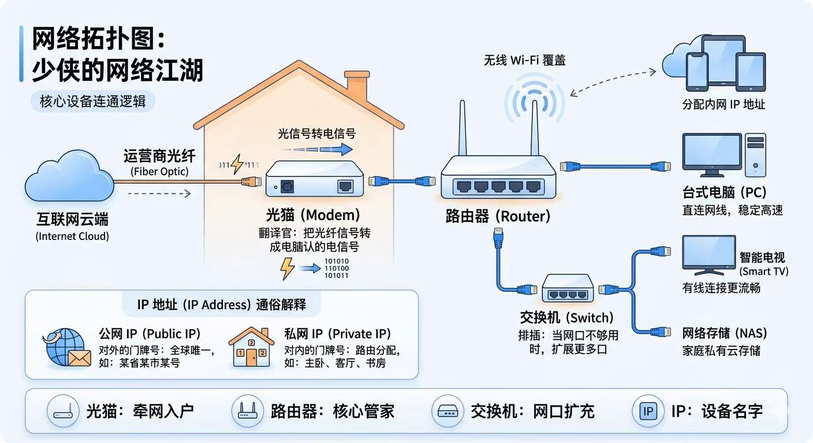

# 网线更换与DHCP租约分配机制

在绝大多数人的传统认知中，**“仅仅更换一根网线，电脑的内网 IP 地址是绝对不会改变的”**。

  

这个结论在**传统台式机与自带板载 RJ45 网口**的设备上确实成立。因为普通双绞线（网线）仅仅是负责传输高频电信号的“无源物理介质（OSI 物理层 L1）”，而分配 IP 认的是网络数据链路层（L2）的设备标识。

**但在现代办公与移动硬件生态下，这个断言经常被打破！**

如果你使用的是自带芯片的 Type-C 网线或扩展坞，换一根网线很可能让你的内网 IP **立刻发生改变**。本文将从现代硬件生态与 DHCP 底层租约机制，彻底讲透其中的网络运作逻辑。

---

## 一、 IP 到底跟什么绑定？

我们要把“公网 IP（外网）”与“私网 IP（内网）”分开来看：

### 1. 私网 IP（内网 IP）是跟什么绑定的？

在局域网拓扑中，私网 IP 是由你的**路由器（DHCP Server，核心网络管家）**动态分配给终端设备的。

- **深层绑定核心**：在网络底层，**私网 IP 并不认电脑的主机名，而是严格绑定在网卡的“物理硬件地址”（MAC 地址，Media Access Control Address）上**。

- **DHCP 账本（租约表）机制**：路由器内部维护着一张 DHCP 租约记录表（Lease Table），结构类似于：

  $$\text{终端硬件 MAC 地址} \longleftrightarrow \text{分配的私网 IP 地址} \longleftrightarrow \text{租约有效倒计时}$$

  当终端设备联网发起 DHCP 请求时，路由器会先检查“账本”中该 MAC 地址是否已有尚未过期的租约。若有，路由器会优先把之前用过的旧 IP 再次分配给它。

### 2. 公网 IP（外网 IP）是跟什么绑定的？

- **公网 IP** 是整个家庭或企业局域网在互联网上的全球唯一出口标识，由运营商（ISP，如电信、联通、移动）的宽带接入服务器（BRAS）在光猫/路由器拨号（PPPoE）时动态分配。

- 它绑定的是你的**宽带账号与运营商线路**，家庭宽带通常每隔几天或在路由器/光猫重启重拨时动态刷新一次，与局域网内换不换网线完全无关。

---

## 二、 现代硬件盲区：为什么换网线可能会导致内网 IP 改变？

### 1. 【高频踩坑】自带独立网卡芯片的 Type-C / USB 转接网线

现代轻薄办公本（如 MacBook Pro/Air、Dell XPS、ThinkPad X1 Carbon、Surface 等）出于轻薄化设计，**早已彻底取消了机身上的 RJ45 水晶头母口**。

在当今办公环境中，绝大多数人使用的所谓“网线”，实际上是以下两种之一：

1. **一体化 Type-C 转 RJ45 转接网线**（插头内部直接封装了网络控制芯片）；

2. **Type-C 多功能扩展坞（Docking Station）** 上的千兆网口。

#### 核心硬件机制：MAC 地址在线上，不在电脑上！

- 普通 RJ45 双绞线是纯铜缆，没有芯片；

- **而 Type-C 网线或扩展坞内部，封装了一枚独立的 USB 以太网控制器芯片**（最常见如 Realtek RTL8153、ASIX AX88179 等）。

- **这个网络芯片拥有独立的物理 MAC 地址，是出厂直接烧录在网线插头内部的微芯片上的！**

> [!WARNING]
> **连带反应**：  
> 当你把一条 Type-C 网线拔下，换了工位上另一条同类型的 Type-C 转接线时，**操作系统的网络协议栈其实经历了一次“拔出旧物理网卡，插入全新网卡”的过程**！  
> 此时系统向路由器发送的 `DHCP DISCOVER` 广播报文携带的是新网线芯片的 MAC 地址。路由器在租约账本里找不到对应记录，会判定这是一台**全新连入局域网的设备**，从而分配一个**全新的内网 IP**！

### 2. 普通无源网线：什么情况下换线也可能变 IP？

即便是两头均为 RJ45 水晶头的传统无源铜线，在以下网络工程场景中，换网线也会导致 IP 改变：

- **接入了划分 VLAN 的多网段端口**：企业交换机或高端家用路由器的不同 LAN 口可能划分了不同的 VLAN（虚拟局域网）或开启了访客网络（Guest Network）。如果换网线时顺手插到了另一个 LAN 口，可能会被划分进全新的子网网段（例如从 `192.168.1.x` 变到了 `192.168.2.x`）。

- **DHCP 租约刚好过期且局域网 IP 池紧张**：拔掉旧网线后，若设备长时间断网导致 DHCP 租期耗尽，且局域网内其他新增设备抢占了该 IP，插上新网线后设备将拿到新分配的空闲 IP。

---

## 三、 换了路由器，内网 IP 会变吗？

**答案是：几乎 100% 会重新分配。**

换路由器相当于换了一个“全新管家”，其原因如下：

### 1. 默认子网网段与掩码不同

不同品牌的路由器出厂默认的内网网段各不相同：

- 华为 / 荣耀路由器通常默认为：`192.168.3.x`

- 小米 / 华硕路由器通常默认为：`192.168.31.x` 或 `192.168.50.x`

- TP-Link / 水星路由器通常默认为：`192.168.1.x` 或 `192.168.0.x`

上层网络前缀变了，电脑拿到的私网 IP 自然从根本上发生改变。

### 2. 新管家的 DHCP 租约记录是空白的

新路由器刚通电时，手里的 DHCP 账本没有任何历史记录。当手机、电脑、智能家居相继发起连接请求时，新路由器会按照“先来后到”从地址池起始段（如 `.100` 起）依次分发 IP。

#### 怎样让换路由器后 IP 保持绝对不变？

若局域网内运行着 NAS、本地服务器或打印机，需要固定 IP，可通过以下三种方式实现：

1. **统一网段**：在新路由器管理后台中，将内网 LAN 口 IP 手动修改为与旧路由器完全一致的网段与网关；

2. **静态 DHCP 静态绑定（IP-MAC 绑定）**：在路由器后台将目标设备的 MAC 地址与指定 IP 绑定；

3. **终端手动配置静态 IP**：在操作系统网络适配器属性中，关闭 DHCP，手动填入固定静态 IP、子网掩码与默认网关。

---

## 四、 核心对比速查表

| 连接与硬件形态 | 网卡 MAC 地址归属 | 换线后 MAC 是否改变 | 换线后内网 IP 是否改变 | 核心原因 |
| :--- | :--- | :---: | :---: | :--- |
| **传统台式机 / 带 RJ45 母口笔记本**（两端均为 RJ45） | 电脑主板板载网卡 | ❌ 不变 | ❌ **不变** | 网线仅为 L1 物理导线，通信主体的 L2 MAC 地址未发生变更 |
| **现代轻薄本 / MacBook**（Type-C/USB 转 RJ45 网线） | **集成在线缆插头芯片内** | ✅ **改变** | ✅ **大概率改变** | 换线本质上是更换了外置物理网卡，路由器按新 MAC 重新分配 IP |
| **USB 扩展坞 / 拓展坞网口**（换插另一个拓展坞） | **集成在扩展坞主板芯片内** | ✅ **改变** | ✅ **大概率改变** | 扩展坞网卡芯片 MAC 地址不同，触发全新 DHCP 租约流程 |
| **更换路由器** | 电脑网卡自身 | ❌ 不变 | ✅ **基本必变** | 路由器的分配策略、默认网段不同，且历史 DHCP 租约账本未继承 |

