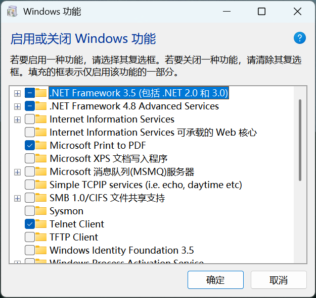

# 网络连通排障：Ping 与 Telnet

`ping` 和 `telnet` 是计算机网络中最常用、最基础的两个命令行排障工具。它们就像是网络世界里的“探路者”，但两者的探测方式和目的完全不同。

## Ping：网络连通性的“声呐”

**Ping** 的名字取自潜艇声呐发出的回声，主要用来测试两台计算机之间的网络**是否连通**，以及连接的**往返延迟**（数据包一来一回的耗时，单位通常为 `ms`；它反映的是响应快慢，不等于下载带宽）。

- **工作原理：** 它使用的是网络层的 ICMP（互联网控制消息协议）。当你执行 `ping` 命令时，电脑会向目标服务器发送一个小数据包（Echo Request），然后等待对方返回应答包（Echo Reply），并记录下这一来一回消耗的时间。
- **通俗比喻：** 就像你在山谷里大喊一声“喂！”，然后计算听到回音需要几秒。如果有回音，说明路是通的；如果没有收到回音（请求超时），可能是路断了，也可能是对方开启了防火墙禁 Ping，刻意“假装没听见”。如果此时你要确认网站能否访问，下一步就该去测网站的 TCP 443 端口。
- **常用场景：**
    - 测试自己能不能连上网（例如：`ping www.baidu.com`）。
    - 检查局域网内的某台设备是否开机在线。
    - 查看网络质量是否稳定（有没有丢包、延迟波动大不大）。

## Telnet：特定服务端口的“敲门砖”

**Telnet** 最早是一种用于远程登录服务器的协议，但现在开发者和运维人员主要用它来测试**目标服务器的某个特定端口是否开放**。

- **工作原理：** 它使用的是传输层的 TCP 协议。它会尝试与目标主机的特定网络端口建立一条 TCP 通信连接。
- **通俗比喻：** 如果说 `ping` 是确认“这栋大楼存不存在”，那么 `telnet` 就是走近这栋大楼，去推一推“80 号房间”或“3306 号房间”的门，看看门有没有锁、能不能进去。
- **安全现状：** 作为远程登录工具，Telnet 因为所有数据（包括密码）都是**明文传输**的，极易被截获，现在已经被加密的 SSH 完全淘汰。但作为“端口测试工具”，它依然是开发排障的利器。
- **常用场景：**
    - 测试数据库端口是否对外开放（例如：`telnet 192.168.1.100 3306`）。
    - 排查防火墙是否拦截了你的网站端口或某个服务的通信流量。

## 核心区别对比

| 特性 | Ping | Telnet |
| --- | --- | --- |
| **主要目的** | 测试主机是否可达、往返延迟与丢包率。 | 测试主机的某个特定服务端口是否开放且可访问。 |
| **底层协议** | ICMP（网络层协议） | TCP（传输层协议） |
| **能否指定端口** | **不能**。只能 Ping IP 地址或域名。 | **能**。省略端口时默认连 TCP 23，排障时通常手动指定目标端口（如 `3306`）。 |
| **防火墙影响** | 经常被服务器的安全策略（禁 Ping）拦截，导致 Ping 不通但服务可用。 | 只要该端口的服务正常运行且防火墙放行，就能连通。 |

## Windows 11 如何开启 Telnet 客户端

在 Windows 11 系统中，出于安全考虑，默认关闭了 Telnet 客户端。如果在终端里直接运行 `telnet`，通常会提示 `'telnet' 不是内部或外部命令，也不是可运行的程序或批处理文件`。

你可以通过以下两种方式快速开启它：

### 方法一：图形界面开启

1. **打开 Windows 功能：** 按下 `Win + S` 键打开系统搜索，输入 **启用或关闭 Windows 功能** 并回车打开（也可以在控制面板的“程序”中找到）。
2. **勾选 Telnet 客户端：** 在弹出的功能列表中，向下滚动找到 **Telnet 客户端**（Telnet Client），勾选后点击“确定”。
3. **重启终端：** 等待系统自动应用更改（通常需要几秒钟）。完成后，**必须关闭并重新打开**你的 CMD 或 PowerShell 窗口，命令才会生效。



### 方法二：命令行一键开启

如果你习惯纯命令行操作，可以通过管理员权限运行指令：

1. 右键点击任务栏的 Windows 开始图标，选择 **终端 (管理员)** 或 **Windows PowerShell (管理员)**。
2. 粘贴并运行以下命令：

```powershell
dism /online /Enable-Feature /FeatureName:TelnetClient
```

> **验证是否开启成功：** 重新打开命令行窗口，输入 `telnet` 并回车。如果界面跳转到 `欢迎使用 Microsoft Telnet Client`，说明开启成功。输入 `quit` 即可退回普通终端。

## 实战排障：看懂 3306 端口的测试结果

假设数据库客户端报“连接失败”，但你先执行 `ping 192.168.1.100` 发现网络是通的。接下来就可以测试数据库端口：

```cmd
telnet 192.168.1.100 3306
```

根据终端的反馈，可以直接判断下一步查哪里：

- **连接成功：** 窗口突然变成**一片黑屏（左上角光标闪烁）**，或弹出几行带 MySQL 版本号的乱码字符。这说明从你电脑到目标 `3306` 端口的 TCP 通道是畅通的。此时如果客户端依然连不上（例如提示“密码错误”或“拒绝访问”），就不用再怀疑网络，直接去查数据库账号、密码或远程访问权限即可。（按 `Ctrl + ]` 后输入 `quit` 退出）
- **连接失败：** 提示 `无法打开到主机的连接。 在端口 3306: 连接失败`。说明“门没开”或被拦住了，按顺序排查：
    1. 核对目标 IP 和端口号有没有写错；
    2. 登录服务器检查数据库服务是否已启动，且监听在对应的网卡地址和 `3306` 端口上；
    3. 检查服务器本机防火墙或云服务商安全组是否放行了 TCP `3306` 端口。

> **Windows 11 免安装替代方案：** 如果只是临时测端口、懒得开启 Telnet，可以直接在 PowerShell 里运行系统自带的 `Test-NetConnection` 命令：
>
> ```powershell
> Test-NetConnection 192.168.1.100 -Port 3306
> ```
>
> 直接看输出里的 `TcpTestSucceeded` 即可：`True` 表示端口连通，`False` 表示端口不通，比看黑屏更直观。