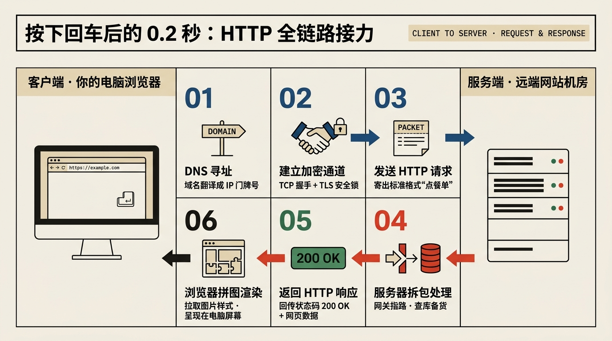
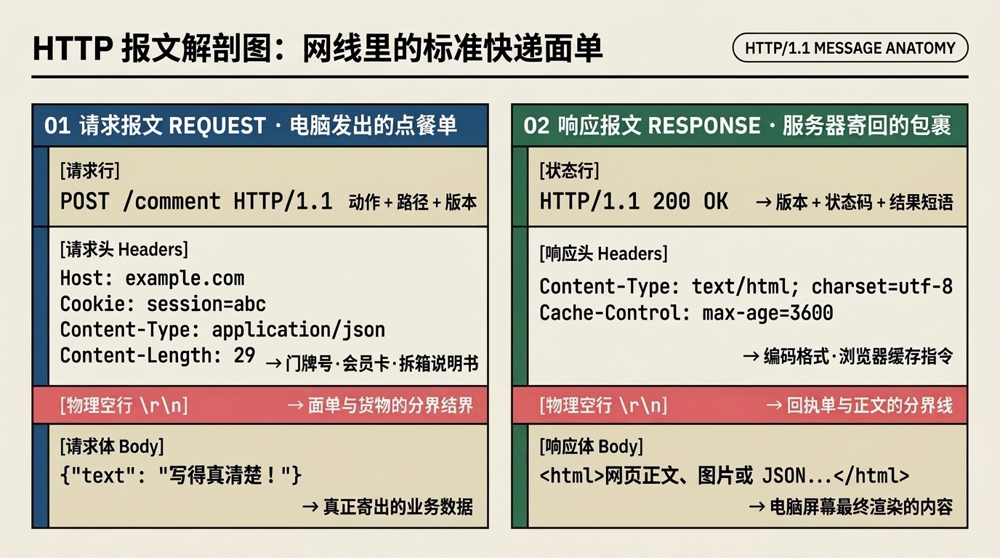
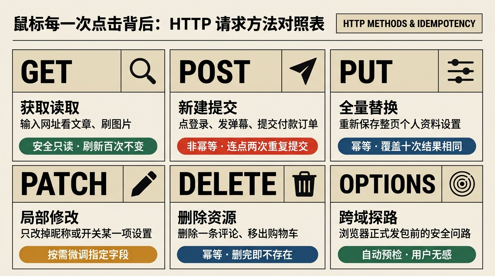
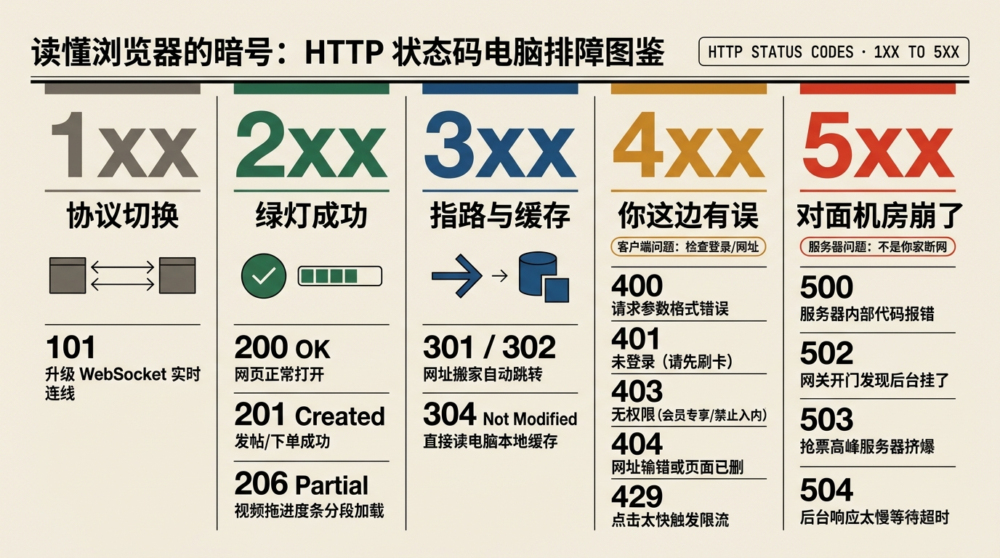
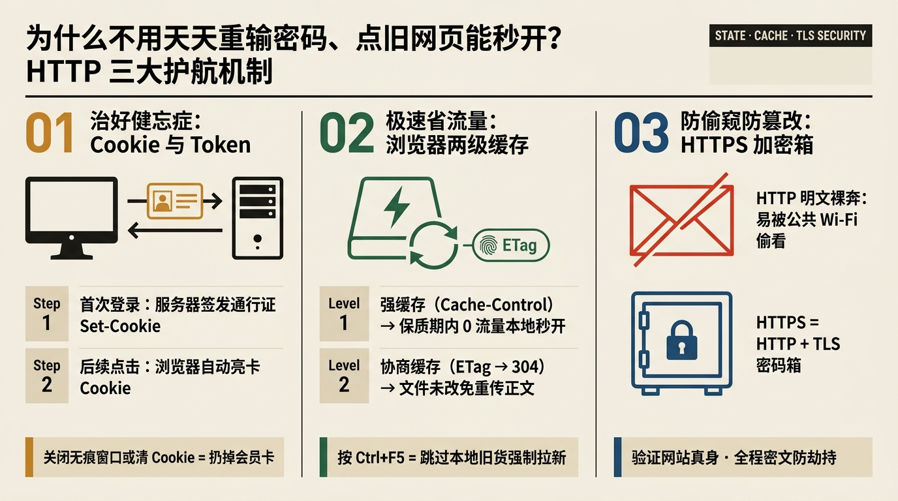
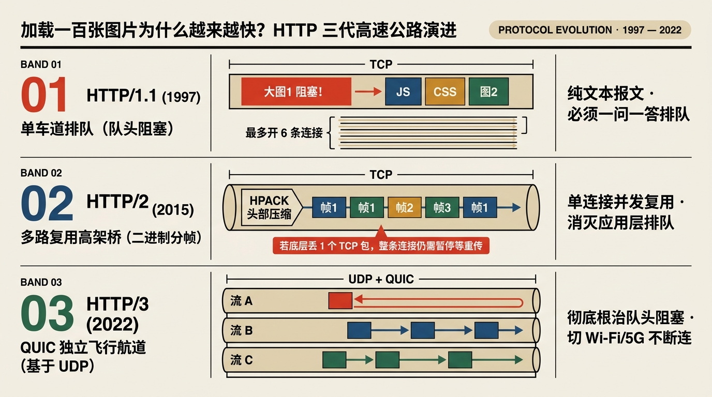

# 💯HTTP超文本传输协议工作原理

每天坐在电脑前，你都在不知不觉中调用成百上千次 **HTTP**：

双击打开 Chrome 或 Edge 浏览器，在地址栏敲下一串网址按下回车；在搜索框输入关键词；在视频网站把进度条直接拖到第 45 分钟；给喜欢的文章点个赞、发一条评论；在购物网站点击「提交订单」，或者看着网页里的 AI 助手一个字一个字往屏幕上蹦出回答……

你有没有想过：**你面前的这台 Windows 或 Mac 电脑，是怎么跨越几千公里的光纤，和远在北京、上海甚至大洋彼岸机房里的服务器“说上话”，并且分毫不差地把文字、高清图片、视频画面搬到你显示器上的？**

答案就藏在互联网应用层最核心的通用语言里——**HTTP（HyperText Transfer Protocol，超文本传输协议）**。今天我们抛开晦涩生硬的后端教条，完全站在**你每天使用电脑的真实视角**，把 HTTP 从头到尾拆开揉碎，让你一看就能彻底明白。

---

## 序章：先拆名字——到底什么是「超文本传输协议」？

很多教程一上来就背概念，其实只要把 **HTTP** 这四个英文字母拆成三截，放回你的电脑桌面上对比，三秒钟就能懂：

1. **什么是「超文本（HyperText）」？**
   你在电脑记事本里新建一个 `.txt` 文件，里面只有干巴巴的文字，只能从第一行读到最后一行，这叫**普通文本（Text）**。
   但你在浏览器里打开的网页完全不同——它不仅图文混排、嵌入了音频与视频，最神奇的是它拥有**超链接（Hyperlink）**：你用鼠标轻轻点一下蓝色的文字或封面图，屏幕瞬间就能“空间跳跃”到另一家网站的另一份文档！这种通过链接把全世界无数文档编织成一张大网（Web）的增强内容，就叫**超文本**。发展到今天，不只是网页，电脑软件检查更新、手机 App 刷信息流、下载 `.zip` 安装包、传输 JSON 数据，装在里面的统统都归它管。
2. **什么是「传输（Transfer）」？**
   就是**双向搬运**。把服务器硬盘里的网页、图片搬回你的电脑内存与屏幕上显示，或者把你在电脑键盘上敲下的评论、选中的本地头像照片搬运到远端服务器上保存。
3. **什么是「协议（Protocol）」？**
   就是电脑与服务器之间**白纸黑字签好的“快递面单格式规矩”**。你的电脑可能是 Windows 11，对面的服务器可能是 Linux；浏览器可能是 Edge，对面跑的程序可能是 C++、Go、Java 或 Python。大家之所以不会鸡同鸭讲，全靠严格遵守同一套写信格式：第一行写什么、第二行写什么、哪里必须空一行、用什么三位数字代表成功或失败。

在正式出发前，你只需要先记住 HTTP 与生俱来的**三大性格特征**（后面你在电脑上遇到的所有神奇现象，几乎都源于这三条）：

* **性格一：一问一答（请求-响应模式）**
  在常规 HTTP 里，服务器是个绝对被动的“老实人”。如果你坐在电脑前不敲网址、不点按钮（且网页脚本没有在后台替你发请求），远端服务器绝不会莫名其妙主动往你电脑里塞数据。永远是**你的电脑（客户端 Client）先发出一封「请求 Request」**，**服务器（Server）处理完后再回寄一封「响应 Response」**。
* **性格二：天生的“金鱼记忆”（无状态 Stateless）**
  纯天然的 HTTP 协议本身**没有任何记忆力**。哪怕你上一秒刚刚输入账号密码成功登录，下一秒鼠标点进「个人中心」，在原始 HTTP 协议眼里，这两次点击是完全独立的陌生来客——它根本不记得“一秒前登录的那个人就是你”。（至于你的浏览器为什么能记住登录状态不用每点一下重输密码，靠的是外挂“会员卡” `Cookie`，我们在第七章揭秘。）
* **性格三：只管写信打包，不管开车修路（应用层协议）**
  如果把上网比作寄快递，底层网线、Wi-Fi 和光纤是**高速公路**，IP 协议是**全球导航地图**，TCP 或 QUIC 协议是**负责拉货的卡车司机**；而 **HTTP 就是贴在快递箱最外面的那张「标准快递面单与装箱清单」**——它只负责把“我是谁、我要拿什么文件、箱子里装了几个字节”写得清清楚楚，写完往楼下运输队一交，剩下的跨省跨海搬运全由底层网络协议代劳。

---

## 第一章：拆解地址栏——你敲下的那串网址藏着什么玄机？

作为电脑用户，你和 HTTP 打交道的第一个入口，永远是浏览器最顶部的**地址栏**。

假设你在地址栏输入或点开了下面这串完整的网址（专业名叫 **URL，统一资源定位符**）：

```text
https://www.example.com:443/videos/tech?page=2&sort=hot#comment-88
```

别看它长，其实就像现实里寄快递写的「顺丰特快 · 北京市海淀区中关村大街 1 号 · 数码大厦 443 室 · 科技视频柜台 · 第 2 排最火那本」一样，每一截都有明确分工：

| 网址片段 | 名称 | 站在电脑用户角度的大白话解读 |
| :--- | :--- | :--- |
| **`https://`** | **协议方案（Scheme）** | 告诉浏览器用哪种规矩通信。`http://` 是不封口的透明明信片（如今浏览器会在地址栏标红提示“不安全”）；`https://` 则是加装了 TLS 防弹密码锁的安全通道。 |
| **`www.example.com`** | **域名（Host）** | 人类好记的“店铺招牌”。网络底层路由其实只认像 `93.184.216.34` 这样的数字 IP，浏览器稍后会先查通讯录把它翻译成数字门牌。 |
| **`:443`** | **端口号（Port）** | 服务器这栋大楼里的**具体房间号**。一台服务器可能同时开着网站、远程桌面和邮箱服务，靠端口号区分进哪个门。<br>💡 **为什么你平时上网从不敲冒号和数字？** 因为浏览器在后台默默替你补上了默认房间号：`http://` 默认走 **`80`** 号房，`https://` 默认走 **`443`** 号房！只有当你在电脑上连自家路由器后台、NAS 存储（如 `192.168.1.10:5000`）或本地开发程序（如 `localhost:3000`）时，才需要亲手敲出非默认端口。 |
| **`/videos/tech`** | **资源路径（Path）** | 进了房间后，你要去哪个货架拿东西。早年它真的对应服务器硬盘上的文件夹路径；如今它通常是后台程序的“功能分类目录”。 |
| **`?page=2&sort=hot`** | **查询参数（Query）** | 以问号 `?` 开头，多个条件之间用 `&` 相连，是你向服务器店员提的**附加筛选要求**（这里代表：我要看第 `2` 页，并且按热度 `hot` 排序）。 |
| **`#comment-88`** | **页内锚点（Fragment）** | 以井号 `#` 开头，代表网页打开后自动滚动定位到“第 88 条评论”的位置。<br>🔥 **冷知识暴击**：`#` 号及其后面的文字**纯粹是留给你自己电脑浏览器看的书签**！当浏览器向服务器发 HTTP 请求时，会直接把 `#comment-88` 一刀剪掉，**根本不会发送给服务器**。 |

> **小疑问：为什么我从浏览器地址栏复制带中文的网址，粘贴到微信里经常变成一长串 `%E7%BD%91%E7%BB%9C`？**
> 因为早年制定 URL 标准时，规定网址里只能安全出现英文字母、数字和少数符号。一旦网址里包含中文、空格或特殊符号，浏览器就会自动把它的 UTF-8 字节转换成 `%` 加两位十六进制数的形式（叫 **URL 百分号编码**）。比如汉字「网络」编码后就是 `%E7%BD%91%E7%BB%9C`——看着吓人，粘贴回浏览器地址栏又会自动还原成清爽的中文。

---

## 第二章：按下回车后的 0.2 秒——你的电脑经历了怎样的极速接力？

当你在键盘上敲下 `Enter` 回车键，到整个图文并茂的网页铺满你的电脑显示器，往往只用了短短一两百毫秒。在这眨眼之间，你的电脑与千里之外的服务器完成了一场严丝合缝的六步接力：



### 第 1 步：先翻自己电脑的“储物柜”与“通讯录”（缓存检查 + DNS 寻址）

浏览器是个精明的管家，绝不干多余的体力活：
* 它先翻一眼你电脑内存和硬盘里的**浏览器缓存**：“这个页面或里面的图标几分钟前刚下过吗？还在保质期内吗？”如果命中强缓存，连网线都不用走，直接从本地秒开。
* 如果本地没有，浏览器就得先查出 `www.example.com` 住在地球上哪个 IP 门牌号。它会依次查**浏览器缓存 → 操作系统缓存（含本机 `hosts` 文件）→ 家里路由器 → 运营商 DNS 服务器**，最终拿到目标服务器的真实 IP 地址（例如 `93.184.216.34`）。

### 第 2 步：拨通专线并锁上密码箱（TCP 三次握手 + TLS 加密握手）

拿到 IP 后，你的电脑操作系统开始向服务器的 `443` 端口拨号：
* **先确认线路畅通（TCP 三次握手）**：
  * 你的电脑：“喂，听得到吗？我想连你。”（`SYN`）
  * 远端服务器：“听得到！我也准备好了，你听得到我吗？”（`SYN + ACK`）
  * 你的电脑：“听得清清楚楚，专线接通！”（`ACK`）
* **再核验身份证并商定密码锁（TLS 握手）**：
  现在绝大多数网站都是 `https://`。连接刚接通，服务器就会亮出权威机构颁发的**数字证书**（浏览器地址栏那把“小锁”就是验明正身的标志），双方在几十毫秒内协商出一把**只有你这台电脑和这台服务器知道的临时对称密钥**。接下来网线里跑的所有 HTTP 内容，全都会锁进这只防弹箱里传输。（如果是新一代 **HTTP/3**，则直接基于 UDP 的 QUIC 协议把“连线握手”和“加密上锁”合二为一，速度更快。）

### 第 3 步：浏览器替你写出标准“点餐单”（发送 HTTP 请求报文）

通道就绪！浏览器立刻把你刚才敲的网址、你的电脑系统型号、浏览器支持的压缩格式、以及你在该网站保存的登录凭证（`Cookie`），按 HTTP 规范拼成一段整整齐齐的**请求报文**，加密后顺着网线/Wi-Fi 发射出去。

### 第 4 步：机房迎宾分流与后厨备餐（网关路由与服务器处理）

数据包顺着光纤跨越千山万水抵达目标机房。
很多大型机房同一个公网 IP 背后藏着成百上千台机器，门口通常站着一位叫 **反向代理网关（如 Nginx）** 的迎宾总管。它在门口完成 TLS 解密后，拆开信封看一眼上面的 `Host` 域名和 `/videos/tech` 路径，转头把单子精准递给负责视频业务的后台服务器；后台程序校验你的会员身份、从数据库查出视频列表数据，打包准备回传。

### 第 5 步：寄回带状态暗号的包裹（返回 HTTP 响应报文）

服务器把处理结果同样按 HTTP 规矩装进**响应报文**寄回你的电脑——信封第一行醒目地盖着一枚三位数字邮戳（比如 `200 OK` 表示一切顺利），里面装着网页的 HTML 代码。

### 第 6 步：电脑屏幕上的“瀑布流拼图”（解析渲染与并发加载）

**这是站在电脑用户角度最值得恍然大悟的一个真相：你在浏览器打开 1 个网页，绝对不止发送了 1 次 HTTP 请求！**

第一次 HTTP 请求拿回你电脑里的，往往只是一个几十 KB 大小的 **HTML 纯文本文件**——它就像毛坯房的“装修图纸”，里面只有文字骨架，并没有真正的图片像素和华丽排版。

你的浏览器一边从上往下读这份 HTML 图纸，一边不断发现新线索：
* 读到 `<link rel="stylesheet" href="/css/main.css">` → 浏览器立刻在后台发第 2 个 HTTP 请求去拉取**排版样式表**（给网页穿上衣服）；
* 读到 `<script src="/js/player.js">` → 立刻发第 3 个 HTTP 请求去拉取**交互脚本**（让按钮和播放器能动起来）；
* 读到 ``、``…… → 浏览器火力全开，在后台一口气并发发出几十个 HTTP 请求去拉取每一张封面图、头像和字体文件！

而且，为了避免每拿一张小图标都重新经历一遍“三次握手 + TLS 握手”的折腾，HTTP 默认开启了**长连接复用（`Connection: keep-alive` 或 HTTP/2 多路复用）**：第一趟专线拉通后先不挂电话，后面几十张图片顺着同一条现成管道鱼贯而入，最后由浏览器的渲染引擎在你的显卡与显示器上瞬间拼出完整画面！

---

## 第三章：按下键盘 `F12` 掀开引擎盖——HTTP 报文到底长什么样？

说了这么多“点餐单”和“快递面单”，网线里跑的 HTTP 报文究竟长什么样？

其实你根本不需要安装任何专业抓包软件——**现在在你的电脑浏览器上按下键盘顶部的 `F12` 键（笔记本可能是 `Fn + F12`，或者在网页空白处右键点击「检查」），切换到上方的「网络（Network）」标签页，然后按 `F5` 刷新一下网页**。列表中刷出来的每一行，就是你的电脑刚刚发出并收回的一笔真实 HTTP 通信！

如果我们把 HTTPS 的加密保护壳剥开，在最经典的 `HTTP/1.1` 里，它甚至不是什么天书般的二进制乱码，而是**一段人类肉眼直接能读懂的纯文本**。无论是发出去的请求，还是接收回来的响应，全都严格遵守**“四段式信封结构”**：



---

### （一）拆开你电脑寄出的信：HTTP 请求报文（Request）

假设你在某个技术社区看完文章，在底部评论框敲下 `写得真清楚！` 这六个汉字，然后用鼠标点击了「发表评论」按钮。此时你的浏览器在后台默默发出的原始 HTTP 请求报文长这样：

```http
POST /api/comments HTTP/1.1
Host: www.example.com
User-Agent: Mozilla/5.0 (Windows NT 10.0; Win64; x64) Chrome/130.0.0.0
Accept: application/json, text/plain, */*
Accept-Encoding: gzip, deflate, br, zstd
Accept-Language: zh-CN,zh;q=0.9,en;q=0.8
Origin: https://www.example.com
Referer: https://www.example.com/posts/1024
Cookie: session_id=9f8e7d6c5b4a
Content-Type: application/json; charset=utf-8
Content-Length: 30

{"text": "写得真清楚！"}
```

别被十几行英文吓到！我们对照你的电脑日常，一行一行把它翻译成人话：

#### 1. 第一行：请求行（信封最顶上的动作指令）
> `POST /api/comments HTTP/1.1`

由两个空格隔开三样东西：
* **`POST`（请求方法）**：告诉服务器这趟是来干嘛的——`POST` 代表“我是来提交新数据的”（如果是单纯打开网页看内容，这里就会是 `GET`）。
* **`/api/comments`（请求路径）**：要把数据交到服务器的哪个窗口。
* **`HTTP/1.1`（协议版本）**：双方约定按哪一代格式的规矩拆信。

#### 2. 中间十几行：请求头 Headers（贴满信封表面的说明标签）
每一行都是 `名字: 内容` 的键值对，专门向服务器交代各种上下文细节：

* **`Host: www.example.com`（大楼里的公司水牌）**
  你可能会纳闷：*数据包既然已经顺着 IP 地址送到这台服务器了，为什么还要再写一遍域名？*
  因为租用云服务器很贵，很多个人站长或大公司会把几十个不同域名的网站部署在**同一台物理服务器（同一个 IP）**上。门口的网关必须看一眼 `Host` 写的是哪个域名，才知道你到底想访问这栋写字楼里的哪家公司。在 `HTTP/1.1` 中，只要漏掉这一行，服务器当场翻脸回你 `400 Bad Request`。
* **`User-Agent: Mozilla/5.0 (Windows NT 10.0; Win64; x64)...`（你电脑的自我介绍）**
  简称 `UA`。浏览器向服务器自报家门：“嗨，我主人正用着 64 位 Windows 10/11 电脑上的 Chrome 浏览器访问你！”
  * **电脑日常体验**：为什么你在电脑上输入软件官网，网页下载按钮自动推荐 `.exe` Windows 安装包；换台 MacBook 打开同一个网址，按钮自动变成了 `.dmg` 苹果安装包？为什么同一个网址在电脑上是宽屏排版，在手机上是竖屏触控版？很多时候就是靠读取这行 `User-Agent` 实现的！（注：浏览器插件可以轻易修改伪装它，比如早期平板电脑常把 UA 伪装成台式机来强开电脑版网页。）
* **`Accept` / `Accept-Encoding` / `Accept-Language`（你电脑的口味偏好单）**
  * `Accept-Language: zh-CN...`：告诉跨国网站（比如 GitHub、Steam 官网）“我电脑系统首选简体中文，如果你们有中文版页面请优先发中文给我”。
  * `Accept-Encoding: gzip, br, zstd`：**省流量大功臣**！浏览器告诉服务器：“我电脑内置了解压缩引擎，你可以先把几十 KB 的网页文本压成只有几 KB 的 `br`（Brotli）或 `gzip` 压缩包再发过来，我收到自己解压！”这直接帮全世界的网线省下了约 70% 的文本体积。
* **`Origin` 与 `Referer`（我是从哪儿点过来的？）**
  `Referer` 记录了你是从哪一个具体页面（`/posts/1024`）点击链接或发起请求的（注：当年制定标准的工程师拼写漏了个字母 `r`，本应是 `Referrer`，结果将错就错成了延续三十年的互联网历史活化石）。
  * **电脑日常体验 1（图片防盗链）**：你有没有在逛某些论坛或个人博客时，看到本该显示图片的地方裂开了，变成一张写着**「此图片来自某某平台，未经允许不可引用」**的红叉图？那就是对方服务器检查了 HTTP 请求头里的 `Referer`——发现你的浏览器不是在他们自家网站看图，而是在别人的网页里白嫖他们的服务器带宽，于是当场拒绝发图！
  * **电脑日常体验 2（浏览器跨域保护 CORS）**：为了防止你误点钓鱼网站时，钓鱼网站的恶意脚本偷偷借用你电脑里的银行 `Cookie` 向银行服务器发转账请求，浏览器有一条铁律叫**同源策略**——只要 `Origin`（当前网页所在的域名）和目标接口域名不一致，且目标服务器没明确在响应头里盖章说“允许它访问”（`Access-Control-Allow-Origin`），浏览器就会直接把返回结果拦腰掐断！
* **`Cookie: session_id=9f8e7d6c5b4a`（你兜里的电子会员卡）**
  浏览器自动从本机保险柜里掏出这家网站上次发给你的登录凭证贴在信封上，服务器一看卡号就知道你是哪位老熟人了。
* **`Content-Type` 与 `Content-Length`（拆箱说明书与精确电子秤）**
  只要信封里面装了实体货物（请求体 Body），这两兄弟就必须出场：
  * **`Content-Type`（货物类型）**：告诉服务器箱子里装的是什么格式。你在电脑上操作时最常触发三种：
    1. `application/json`：现代网页最爱用的结构化 JSON 文本（如发评论、异步局部刷新）；
    2. `application/x-www-form-urlencoded`：传统老式网页表单（把 `user=zhangsan&age=20` 拼成一串发过去）；
    3. `multipart/form-data`：**当你在电脑上点击「上传头像 / 发送本地文件附件」时必用**！因为图片、PDF 是原始二进制字节，没法直接塞进普通单层文本里，浏览器就会用一串特殊的分隔符（Boundary）把文件二进制块和表单文字分仓打包。
  * **`Content-Length: 30`（精确到字节的净重）**：在 UTF-8 编码下，英文字母、数字和英文标点各占 `1` 个字节，而**一个常用汉字占 `3` 个字节**。你可以亲自数一数 `{"text": "写得真清楚！"}`：英文符号与字母共 12 个字节 + 6 个中文字符（含中文感叹号）× 3 = 18 个字节，加起来**分毫不差正好是 `30` 个字节**！
  * **为什么要算得这么死？** 因为底层的 TCP 传输就像一根源源不断流淌的自来水管（字节流），水滴之间没有天然隔板。如果同一根连接管道里紧挨着发了两条请求，服务器全靠盯着 `Content-Length: 30` 这个数字，数够 30 个字节就咔嚓一刀切下来作为第一封信的正文；要是数字报错写成 `35`，服务器数完 30 个字节后就会傻傻死等并不存在的后 5 个字节，你电脑浏览器上的加载小圆圈就会一直转到超时报错！

#### 3. 夹在中间的那一行：不可见的物理空行（`\r\n` 分界结界）
在 `Content-Length: 30` 下方，有一行看似什么都没写的空白行。
**千万别小看这行空白，它是整个 HTTP/1.1 报文的生命线！** HTTP 规定信封头部的每一行都以回车换行符 `\r\n`（`CRLF`）结尾；当服务器从头往下逐行读面单，突然撞见一个没有任何文字、只有 `\r\n` 的空行时，立刻明白：**“快递面单到此全部读完，从下一个字节开始，全都是箱子里的真货（Body）！”**

#### 4. 最后一段：请求体 Body（箱子里的真正货物）
> `{"text": "写得真清楚！"}`

这就是你敲下的评论内容本身。
*(注：如果你只是在地址栏敲网址看网页、刷图片，发出的是 `GET` 请求——你只是去“取货”而不是“寄货”，所以 `GET` 请求通常只有上面三部分，**请求体 Body 是空的**。)*

---

### （二）拆开服务器寄回的信：HTTP 响应报文（Response）

半秒钟不到，服务器把你的评论存进数据库，立刻给你电脑寄回一份结构完全对称的**响应报文**：

```http
HTTP/1.1 201 Created
Date: Fri, 27 Nov 2026 01:35:12 GMT
Content-Type: application/json; charset=utf-8
Content-Length: 54
Cache-Control: no-store

{"code": 201, "msg": "评论发表成功", "id": 8801}
```

同样是清爽的四段式：
1. **状态行（`HTTP/1.1 201 Created`）**：先报协议版本，紧接着甩出灵魂暗号 **`201`**（代表你提交的新评论已在服务器成功创建），后面跟着人类好读的简短解释 `Created`。
2. **响应头 Headers**：
   * `Content-Type: application/json; charset=utf-8`：告诉你的浏览器，“我回传的是 JSON 数据，请用 `UTF-8` 字符集解码显示汉字”。
     > 💡 **怀旧排障：为什么十几年前浏览一些老网站，电脑屏幕上经常蹦出满屏「锟斤拷」或「烫烫烫」乱码？**
     > 真相就在这个 `charset` 上！早年国内不少老服务器用的是 `GBK` 中文编码，但如果服务器忘了在响应头的 `Content-Type` 里写明 `charset=gbk`，你的浏览器误拿国际通用的 `UTF-8` 密码本去硬翻译，汉字字节对不上号，就会成片变成黑色的问号菱形（乱码占位符），再经二次转码就成了著名的「锟斤拷」！如今全球统一标配 `UTF-8`，这种乱码才几乎绝迹。
   * `Content-Length: 54`：上面那行未压缩的 JSON 正文（36 个英文字符与符号 + 6 个三字节汉字 = `54` 字节）的精确长度。如果回传的是几百 KB 的长网页，服务器还会额外加上 `Content-Encoding: br`（或 `gzip`）先把正文压成二进制压缩包再发，此时 `Content-Length` 填的就是压缩后的字节数，浏览器收到后先解压再渲染。
   * `Cache-Control: no-store`：叮嘱浏览器这份动态提交结果不要缓存。
3. **物理空行（`\r\n`）**：同样用一道空行把回执单与货物隔开。
4. **响应体 Body**：你的浏览器脚本拿到这段 JSON 后，无需刷新整张网页，直接在评论区最上方优雅地插入了你刚发的那句话！

---

### （三）电脑冲浪三大高能名场面：看长视频、下大文件、刷 AI 对话是怎么传的？

看到这里，爱动脑筋的你肯定会冒出两个疑问：
1. *“一部 2 小时的 4K 电影有好几个 GB，难道服务器要把几个 GB 全塞进一个响应体发完，我的电脑才能开始播放吗？我把进度条直接拖到第 80 分钟为什么一秒就能播？”*
2. *“我在电脑网页上和 AI 大模型聊天时，AI 还没想完整篇回答呢，根本算不出总字节数 `Content-Length`，它是怎么把字一个一个实时蹦到我屏幕上的？”*

这就是 HTTP 最精妙的三个扩展设计：

#### 1. 视频拖进度条与迅雷断点续传：`Range` 分段拉取（`206 Partial Content`）
当你点开在线长视频，或者下载一个 4GB 的系统镜像中途断网重连时，浏览器绝不会傻乎乎重头拉取整份文件，而是在请求头里加一行“精准切片点菜”：
```http
GET /movie/interstellar_4k.mp4 HTTP/1.1
Host: video.example.com
Range: bytes=104857600-106954751
```
这句话翻译过来就是：**“老板，整部电影太大了，我现在把进度条拖到了中间，请只切第 `100 MB` 到第 `102 MB` 这一小截画面发给我！”**
服务器收到后，不会返回普通的 `200 OK`，而是返回 **`206 Partial Content`（部分内容）**，精准切下这 2MB 视频流寄过来。你一边看，浏览器在后台一小截一小截往后预加载；下载软件多线程加速与断网续传，底层全靠这一招！

#### 2. 网页 AI 打字机逐字蹦出：分块流式传输（`Chunked` 与 `SSE`）
当你在网页版 AI 助手里按下提问回车时，服务器后厨的大模型是一边推理一边吐字的，出发前谁也不知道这篇回答最终是 500 字还是 3000 字，根本没法提前填 `Content-Length`。
此时服务器会在响应头里换上另一套装备：
* 在 `HTTP/1.1` 下声明 `Transfer-Encoding: chunked`（分块传输），并且把 `Content-Type` 设为 **`text/event-stream`**（简称 **SSE，Server-Sent Events 服务端推送事件流**；在 `HTTP/2` 和 `HTTP/3` 中则直接利用原生数据流帧实现同样效果）。
* 它的效果就像**把外卖盒改成了回转寿司传送带**：HTTP 响应管道接通后先不挂断，大模型每算完两三个词，服务器就打包一小碟 `data: 你好` 顺着管道推给你电脑，屏幕立刻蹦出“你好”；隔 0.05 秒再推一碟 `data: ，今天`，直到全文答完发一个 `[DONE]` 结束暗号才收工！

#### 3. 网页版微信与在线对战小游戏：`WebSocket` 协议升级（`101`）
前面说过 HTTP 天生是“你问一句、服务器答一句”。但如果你挂着网页版聊天软件，别人随时可能给你发消息，总不能让你的电脑每隔 0.5 秒就傻问服务器一句“有人找我吗？有人找我吗？”（这叫轮询，极度浪费电量和带宽）。
于是浏览器会先发一个特殊的 HTTP 请求敲门：`Upgrade: websocket`（“咱们别一问一答寄信了，直接把这条线升级成全双工实时对讲机吧！”）。服务器回一个 **`101 Switching Protocols`** 表示同意，从这一秒起，双方就能随时互相主动喊话了。

---

## 第四章：鼠标的每一次点击，对应哪种 HTTP 动作？

你在电脑浏览器里的操作千变万化，但归纳到底层 HTTP 请求行的第一个单词（**请求方法 Method**），其实最核心的只有下面 6 种：



| 请求方法 | 你在电脑上的典型动作 | 核心语义 | 是否安全（只看不改） | 是否幂等（连发十次结果一样吗？） |
| :--- | :--- | :--- | :--- | :--- |
| **`GET`** | 敲网址打开文章、看图片、搜关键词翻页 | **读取获取**：只去服务器拿东西，绝不改动服务器上的业务数据 | ✅ 是 | ✅ **是** |
| **`POST`** | 点击「登录」、发弹幕、上传文件、**点「提交订单/立即付款」** | **新建或触发动作**：往服务器塞新记录，或触发一次不可逆的业务操作 | ❌ 否 | ❌ **否（连点两次可能下两单！）** |
| **`PUT`** | 在账号设置页改完昵称、签名、生日后点击「保存全部资料」 | **全量替换**：拿你手里这整份新表单，完整覆盖服务器上的指定档案 | ❌ 否 | ✅ **是**（拿同一份资料覆盖 1 次和覆盖 10 次，档案最终长一个样） |
| **`PATCH`** | 点击表格里某一行旁边的开关，只把状态从「公开」改成「私密」 | **局部微调**：只修改指定资源的某一个或几个小字段 | ❌ 否 | ❌ **否**（协议不保证：若为“直接设为私密”则结果不变；若为“给点赞数 +1”连发则会累加） |
| **`DELETE`** | 点击自己评论右下角的「删除」、清空某条浏览记录 | **删除资源**：把服务器上的指定条目移除 | ❌ 否 | ✅ **是**（删第 1 次删掉了，连点第 2 次目标依然处于“已不存在”状态） |
| **`OPTIONS`** | *(无需你动手，浏览器在跨域发复杂请求前自动后台发送)* | **安全探路**：先问问对面服务器支持哪些方法、允不允许当前网页跨域调用 | ✅ 是 | ✅ **是** |

*(此外还有一个轻巧的 **`HEAD`** 方法：它和 `GET` 一模一样，但明确要求服务器**“只把响应头面单发给我看一眼，别发巨大的正文 Body”**——比如你的下载工具在正式开始下载前，先发个 `HEAD` 看看服务器返回的 `Content-Length`，就能提前在弹窗里告诉你“该安装包大小为 1.42 GB”！)*

### 💡 一个电脑名场面，让你终生记住什么是「幂等性（Idempotency）」

“幂等”这个数学词听着唬人，其实翻译成大白话只有一句话：**同一个请求如果因为手抖或网络卡顿连发了两次甚至十次，服务器上产生的最终效果，跟只发一次是不是完全一样？**

回想一下你在电脑浏览器上肯定见过的这两个画面：
1. 你正在看一篇新闻文章（底层是 **`GET`** 请求），觉得没加载全，手指连按五下键盘上的 **`F5` 刷新键**——浏览器眼皮都不眨，干脆利落地给你刷新五遍，服务器数据毫发无伤。因为 `GET` 既安全又幂等。
2. 反过来，当你在某个传统报名网站或老式支付页面填好信息点击「提交」（底层发出了页面级的 **`POST`** 请求），紧接着你手滑按了一下 **`F5` 刷新键**——浏览器会立刻神情紧张地弹出一个系统级警告框：
   > ⚠️ **确认重新提交表单？**
   > 您正在查找的页面使用了您已输入的信息。返回此页可能需要重复您已执行的任何操作（例如重复搜索或重复购买）。

**为什么浏览器唯独在这里拼命拦着你？** 因为浏览器清清楚楚知道刚才那一下是 **`POST`**！`POST` **不是幂等的**——重发一次，你在论坛可能就刷出了两条一模一样的帖子，在订票系统甚至可能扣两次钱！为了防手抖，现代优秀网站在点击付款按钮后会立刻把按钮置灰转圈，并在请求头里塞一张唯一编号的“防重票”（`Idempotency-Key`），哪怕弱网重发了两次，服务器认出是同一张防重票，也只会扣一次款。

---

## 第五章：读懂浏览器的“脸色”——HTTP 状态码电脑排障图鉴

每次服务器回信，响应报文第一行都会带一个**三位数字状态码（Status Code）**。
平时风平浪静返回 `200` 时浏览器从不声张，直接把网页画给你看；可一旦网页打不开，屏幕上蹦出一串大号数字，很多朋友第一反应就是去拍路由器或者重启电脑。

其实只要看一眼这三位数的**第一个数字（百位）**，你就能一秒断案**“到底是我电脑/操作的问题，还是对面网站服务器崩了”**！



### 1. `1xx` 家族：稍安勿躁，正在切换频道（信息提示）
平时网页浏览极少直接看到，最常见的是你在按 `F12` 抓包在线聊天室或实时行情页时看到的 **`101 Switching Protocols`**——代表服务器同意把普通 HTTP 升级为 `WebSocket` 实时双向长连接。

### 2. `2xx` 家族：绿灯通行，一切圆满（成功）
* **`200 OK`**：最幸福的数字。你要的网页、图片、接口数据完美拿到。
* **`201 Created`**：你刚点的“注册账号”、“发布动态”、“新建收藏夹”已经在服务器上妥妥建好了。
* **`204 No Content`**：服务器说“活儿我已经替你办妥了，而且没有任何多余正文需要回传给你”（常见于点击“取消点赞”、“删除草稿”或后台静默打点统计）。
* **`206 Partial Content`**：前面讲过的看视频拖进度条、大文件分块断点续传专用成功码。

### 3. `3xx` 家族：东西不在这儿，请往那边走（重定向与缓存复用）
看到 `3` 开头，浏览器根本不用麻烦你动手，自己就会乖乖照办：
* **`301 Moved Permanently`（永久搬家）**：比如你在电脑地址栏图省事只敲了 `bilibili.com`，按下回车后，你会眼睁睁看着地址栏自动跳变成了 `https://www.bilibili.com`！这是因为旧地址回了一个 `301` 外加一行新地址响应头 `Location: https://www.bilibili.com`，浏览器不仅自动跳过去，还会拿小本本记住：“以后主人再敲旧网址，我直接去新家，连旧门都不敲了”。（若要求永久跳转时严格保留原 `POST` 方法不变成 `GET`，则会派上它的严谨兄弟 `308 Permanent Redirect`。）
* **`302 Found` / `307 Temporary Redirect`（临时指路）**：比如你点进某购物网的「我的订单」，服务器发现你还没登录，立刻回一个 `302` 把你的浏览器临时支到「登录扫码页」，等你扫完码再把你送回订单页。（其中 `307` 比老前辈 `302` 更严谨，强制要求跳转时原本是 `POST` 的绝不能偷偷变成 `GET`。）
* **`304 Not Modified`（省流大神 · 本地缓存有效）**：浏览器拿着本地存的旧图片指纹去问服务器“这图换新了吗？”，服务器看了一眼回个空手而归的 `304`：“一模一样没改过，直接从你电脑硬盘里读旧图吧！”

### 4. `4xx` 家族：锅在你这边——检查网址、登录或手速！（客户端错误）
只要看到 **`4` 开头**，说明对面服务器活得好好的，但**你这边发过去的请求不合规矩或不够资格**：
* **`400 Bad Request`**：请求格式写歪了、必填项漏了，服务器没法拆包理解。
* **`401 Unauthorized` vs `403 Forbidden`（最容易混的一对双胞胎！）**：
  * **`401`（没刷门禁卡 · 请先登录）**：服务器还不认识你是谁（没带登录凭证，或者登录过期失效了），只要你去重新登录刷一下卡就能解决。
  * **`403`（刷了卡但级别不够 · 禁止入内）**：服务器认出了你是普通用户张三，但你强行点进了后台管理员页面、点开了付费会员专享内容，或者你的 IP 触发了防火墙防盗链——**再怎么刷新重登也没用，因为权限不够**！
* **`404 Not Found`**：全地球网民最眼熟的数字。要么你在地址栏把网址字母敲错了，要么作者已经把那篇文章/视频删掉了，服务器上压根没这件货。
* **`413 Content Too Large`**：你在网页上传身份证照片或附件，网站规定最大 5MB，你塞了一张 25MB 的相机原图，被当场拒收。
* **`429 Too Many Requests`**：抢演唱会门票或刷页面时你疯狂连点鼠标（或者开了抢票脚本），触发了网站的防刷限流保护，屏幕提示“您的操作过于频繁，请稍后再试”。

### 5. `5xx` 家族：锅在对面机房——别拍自家路由器了！（服务端错误）
只要看到 **`5` 开头**，请放心：**你家的宽带、Wi-Fi 和电脑一点毛病都没有，是对面网站的服务器后厨起火了！**
* **`500 Internal Server Error`**：服务器后台程序在跑代码时自己踩坑崩溃了（比如程序员漏判了空数据，或者数据库连接断了）。
* **`502 Bad Gateway`**：机房大门口的迎宾保安（Nginx 网关）还尽职地站着，但他转身去叫后厨真正干活的业务程序时，发现后厨进程挂掉了，或者对方公司程序员正在重启更新版本（等一两分钟再刷新往往就好了）。
* **`503 Service Unavailable`**：常见于双十一零点、春运放票瞬间或官方停机维护——涌进来的电脑和手机太多，服务器彻底挤爆，主动拉闸挂出“暂停营业”牌子保护自己不死机。
* **`504 Gateway Timeout`**：迎宾保安把你的单子递进了后厨，结果后厨查一张超级复杂的报表查了整整 60 秒还没吭声，迎宾保安等不及了，先出来给你鞠躬道歉说“等超时了”。

---

## 第六章：互动实验室——在电脑里亲手按一次「发包与抓包透视」

光看文字不过瘾，下面我们直接在页面里放一台**「微型电脑浏览器 + F12 报文透视仪」**。

你可以直接点击上方预设的 **6 个日常电脑上网动作**，或者亲手改一改请求方法、在输入框里敲几个汉字（观察 UTF-8 字节数如何精准每敲一个汉字跳动 `+3`！），看看你的电脑究竟拼出了怎样一封原始 HTTP 信件，以及远端服务器是如何拆信并作出反馈的：

<style>
.tk-http {
  --ht-bg: #f4efe6;
  --ht-panel: #eae2d3;
  --ht-sub: #faf7f2;
  --ht-border: #181715;
  --ht-line: rgba(24, 23, 21, 0.22);
  --ht-red: #d83a26;
  --ht-blue: #204e78;
  --ht-green: #2b6a4d;
  --ht-ochre: #b87618;
  --ht-text: #181715;
  --ht-muted: #57524a;
  color-scheme: light;
  box-sizing: border-box;
  margin: 24px 0 28px;
  padding: 20px;
  border: 1.5px solid var(--ht-border);
  border-radius: 6px;
  background: var(--ht-bg);
  color: var(--ht-text);
  font-family: "Helvetica Neue", "Inter", "PingFang SC", "Hiragino Sans GB", "Microsoft YaHei", sans-serif;
  box-shadow: 6px 6px 0 rgba(0, 0, 0, 0.28);
}
body.theme-light .tk-http {
  box-shadow: 6px 6px 0 rgba(24, 23, 21, 0.12);
}
.tk-http-bytes {
  color: var(--ht-red);
  font-weight: 800;
}
.tk-http, .tk-http *, .tk-http *::before, .tk-http *::after { box-sizing: border-box; }
.tk-http-head {
  display: flex;
  flex-wrap: wrap;
  justify-content: space-between;
  align-items: baseline;
  gap: 8px;
  padding-bottom: 12px;
  margin-bottom: 14px;
  border-bottom: 2px solid var(--ht-border);
}
.tk-http-title {
  font-size: 16px;
  font-weight: 800;
  letter-spacing: 0.02em;
  color: var(--ht-text);
  display: flex;
  align-items: center;
  gap: 8px;
}
.tk-http-sq {
  width: 11px;
  height: 11px;
  background: var(--ht-red);
  display: inline-block;
  flex-shrink: 0;
}
.tk-http-tag {
  font-family: "JetBrains Mono", Consolas, monospace;
  font-size: 11px;
  font-weight: 700;
  letter-spacing: 0.06em;
  color: var(--ht-muted);
  text-transform: uppercase;
}
.tk-http-presets {
  display: flex;
  flex-wrap: wrap;
  gap: 7px;
  margin-bottom: 14px;
}
.tk-http-btn {
  appearance: none;
  border: 1px solid var(--ht-border);
  background: var(--ht-sub);
  color: var(--ht-text);
  padding: 6px 11px;
  border-radius: 3px;
  font-size: 12px;
  font-weight: 700;
  cursor: pointer;
  transition: transform 0.12s ease, background 0.12s ease;
  font-family: inherit;
}
.tk-http-btn:hover {
  background: var(--ht-panel);
  transform: translateY(-1px);
}
.tk-http-btn.is-primary {
  background: var(--ht-red);
  border-color: var(--ht-border);
  color: #ffffff;
}
.tk-http-btn.is-primary:hover {
  opacity: 0.92;
}
.tk-http-btn.is-current {
  outline: 2px solid var(--ht-blue);
  outline-offset: 1px;
}
.tk-http-screen {
  background: var(--ht-sub);
  border: 1px solid var(--ht-border);
  border-radius: 4px;
  padding: 10px 12px;
  margin-bottom: 12px;
}
.tk-http-bar {
  display: flex;
  align-items: center;
  gap: 8px;
  padding-bottom: 8px;
  margin-bottom: 8px;
  border-bottom: 1px solid var(--ht-line);
  font-family: "JetBrains Mono", Consolas, monospace;
  font-size: 12px;
}
.tk-http-dots {
  display: inline-flex;
  gap: 4px;
}
.tk-http-dots i {
  width: 8px;
  height: 8px;
  border-radius: 50%;
  border: 1px solid var(--ht-border);
  display: inline-block;
}
.tk-http-url {
  flex: 1;
  background: var(--ht-bg);
  border: 1px solid var(--ht-line);
  padding: 3px 8px;
  border-radius: 3px;
  color: var(--ht-blue);
  font-weight: 600;
  overflow: hidden;
  text-overflow: ellipsis;
  white-space: nowrap;
}
.tk-http-view {
  font-size: 13px;
  line-height: 1.6;
  color: var(--ht-text);
}
.tk-http-form {
  display: grid;
  grid-template-columns: 110px 1.3fr 1fr 1fr;
  gap: 8px;
  margin-bottom: 10px;
}
.tk-http-field {
  display: flex;
  flex-direction: column;
  gap: 4px;
}
.tk-http-label {
  font-size: 11px;
  font-weight: 700;
  color: var(--ht-muted);
}
.tk-http-select, .tk-http-input {
  width: 100%;
  padding: 6px 9px;
  border-radius: 3px;
  border: 1px solid var(--ht-border);
  background: var(--ht-sub);
  color: var(--ht-text);
  font-family: "JetBrains Mono", Consolas, monospace;
  font-size: 12px;
  outline: none;
}
.tk-http-select:focus, .tk-http-input:focus {
  border-color: var(--ht-blue);
  box-shadow: 0 0 0 1px var(--ht-blue);
}
.tk-http-bodyrow {
  display: flex;
  flex-wrap: wrap;
  align-items: flex-end;
  gap: 12px;
  margin-bottom: 12px;
}
.tk-http-bodywrap {
  flex: 1 1 280px;
}
.tk-http-checks {
  display: flex;
  flex-wrap: wrap;
  align-items: center;
  gap: 12px;
  padding-bottom: 5px;
  font-size: 12px;
  font-weight: 600;
  color: var(--ht-muted);
}
.tk-http-checks label {
  display: inline-flex;
  align-items: center;
  gap: 5px;
  cursor: pointer;
  user-select: none;
}
.tk-http-pipe {
  display: grid;
  grid-template-columns: repeat(5, minmax(0, 1fr));
  gap: 6px;
  margin-bottom: 12px;
}
.tk-http-step {
  background: var(--ht-panel);
  border: 1px solid var(--ht-line);
  border-radius: 3px;
  padding: 6px 8px;
  font-size: 11.5px;
  text-align: center;
  color: var(--ht-muted);
  font-weight: 700;
  transition: all 0.16s ease;
}
.tk-http-step.is-active {
  border-color: var(--ht-blue);
  background: var(--ht-sub);
  color: var(--ht-blue);
}
.tk-http-step.is-ok {
  border-color: var(--ht-green);
  color: var(--ht-green);
}
.tk-http-step.is-err {
  border-color: var(--ht-red);
  color: var(--ht-red);
}
.tk-http-grid {
  display: grid;
  grid-template-columns: 1fr 1fr;
  gap: 12px;
  margin-bottom: 12px;
}
.tk-http-panel {
  background: var(--ht-panel);
  border: 1px solid var(--ht-border);
  border-radius: 4px;
  padding: 11px;
  display: flex;
  flex-direction: column;
  min-width: 0;
}
.tk-http-ptitle {
  font-size: 12px;
  font-weight: 800;
  color: var(--ht-text);
  margin-bottom: 8px;
  display: flex;
  flex-wrap: wrap;
  justify-content: space-between;
  align-items: center;
  gap: 6px;
}
.tk-http-badge {
  display: inline-block;
  padding: 2px 8px;
  border-radius: 2px;
  font-family: "JetBrains Mono", Consolas, monospace;
  font-size: 11.5px;
  font-weight: 800;
  border: 1px solid currentColor;
}
.tk-http-badge.is-2xx { background: rgba(43, 106, 77, 0.12); color: var(--ht-green); }
.tk-http-badge.is-3xx { background: rgba(32, 78, 120, 0.12); color: var(--ht-blue); }
.tk-http-badge.is-4xx { background: rgba(184, 118, 24, 0.14); color: var(--ht-ochre); }
.tk-http-badge.is-5xx { background: rgba(216, 58, 38, 0.14); color: var(--ht-red); }
.tk-http-wire {
  background: var(--ht-sub);
  border: 1px solid var(--ht-line);
  border-radius: 3px;
  padding: 10px 12px;
  font-family: "JetBrains Mono", Consolas, monospace;
  font-size: 12px;
  line-height: 1.65;
  white-space: pre-wrap;
  word-break: break-all;
  min-height: 215px;
  max-height: 275px;
  overflow: auto;
}
.tk-http-ln-start { color: var(--ht-blue); font-weight: 800; }
.tk-http-ln-hk { color: var(--ht-ochre); font-weight: 700; }
.tk-http-ln-hv { color: var(--ht-text); }
.tk-http-ln-crlf { color: var(--ht-red); opacity: 0.85; font-size: 11px; margin-left: 2px; }
.tk-http-ln-gap {
  display: block;
  margin: 5px 0;
  padding: 2px 6px;
  border-left: 3px solid var(--ht-red);
  background: rgba(216, 58, 38, 0.1);
  color: var(--ht-red);
  font-size: 11px;
  font-weight: 700;
}
.tk-http-ln-body { color: var(--ht-green); font-weight: 600; }
.tk-http-trace {
  background: var(--ht-panel);
  border: 1px solid var(--ht-border);
  border-radius: 4px;
  padding: 10px 12px;
}
.tk-http-logs {
  background: var(--ht-sub);
  border: 1px solid var(--ht-line);
  border-radius: 3px;
  padding: 8px 10px;
  font-family: "JetBrains Mono", Consolas, monospace;
  font-size: 12px;
  line-height: 1.7;
}
.tk-http-log-ok { color: var(--ht-green); }
.tk-http-log-info { color: var(--ht-blue); }
.tk-http-log-warn { color: var(--ht-ochre); }
.tk-http-log-err { color: var(--ht-red); }
@media (max-width: 820px) {
  .tk-http { padding: 14px; }
  .tk-http-form { grid-template-columns: repeat(2, minmax(0, 1fr)); }
  .tk-http-pipe { grid-template-columns: repeat(2, minmax(0, 1fr)); }
  .tk-http-pipe .tk-http-step:last-child { grid-column: 1 / -1; }
  .tk-http-grid { grid-template-columns: 1fr; }
}
</style>

<section id="tk-http-lab" class="tk-http" aria-label="电脑浏览器 HTTP 发包与 F12 抓包透视模拟器">
  <div class="tk-http-head">
    <div class="tk-http-title"><span class="tk-http-sq"></span><span>电脑浏览器 + F12 抓包透视实验室</span></div>
    <span class="tk-http-tag">SWISS LAB · BROWSER TO SERVER WIRE INSPECTOR</span>
  </div>
  <div class="tk-http-presets">
    <button type="button" class="tk-http-btn is-primary" id="tk-ht-send">▶ 按下回车 / 发送请求</button>
    <button type="button" class="tk-http-btn" id="tk-ht-p0">🌐 1. 打开网页首页 (200)</button>
    <button type="button" class="tk-http-btn is-current" id="tk-ht-p1">💬 2. 发表中文评论 (201)</button>
    <button type="button" class="tk-http-btn" id="tk-ht-p2">🔄 3. F5 刷新命中缓存 (304)</button>
    <button type="button" class="tk-http-btn" id="tk-ht-p3">🎬 4. 拖动视频进度条 (206)</button>
    <button type="button" class="tk-http-btn" id="tk-ht-p4">🔒 5. 未登录点收藏夹 (401)</button>
    <button type="button" class="tk-http-btn" id="tk-ht-p5">👑 6. 免费号点会员番剧 (403)</button>
  </div>
  <div class="tk-http-screen">
    <div class="tk-http-bar">
      <span class="tk-http-dots"><i></i><i></i><i></i></span>
      <span class="tk-http-url" id="tk-ht-urlbar">https://www.example.com/api/comments</span>
    </div>
    <div class="tk-http-view" id="tk-ht-screenview">🖥️ 电脑屏幕反馈：正在等待请求发送…</div>
  </div>
  <div class="tk-http-form">
    <div class="tk-http-field">
      <span class="tk-http-label">01 鼠标动作 (Method)</span>
      <select id="tk-ht-method" class="tk-http-select" aria-label="HTTP 方法">
        <option value="GET">GET (读取网页/资源)</option>
        <option value="POST" selected>POST (提交新内容)</option>
        <option value="PUT">PUT (覆盖保存设置)</option>
        <option value="DELETE">DELETE (删除条目)</option>
      </select>
    </div>
    <div class="tk-http-field">
      <span class="tk-http-label">02 访问地址 (Path)</span>
      <select id="tk-ht-path" class="tk-http-select" aria-label="目标路径">
        <option value="/index.html">/index.html (网站首页)</option>
        <option value="/api/comments" selected>/api/comments (文章评论区)</option>
        <option value="/video/ep1.mp4">/video/ep1.mp4 (高清长视频)</option>
        <option value="/my/favorites">/my/favorites (个人收藏夹)</option>
        <option value="/vip/4k-cinema">/vip/4k-cinema (大会员专享厅)</option>
        <option value="/old-link-999">/old-link-999 (已失效链接)</option>
      </select>
    </div>
    <div class="tk-http-field">
      <span class="tk-http-label">03 浏览器卡包 (Cookie 登录态)</span>
      <select id="tk-ht-auth" class="tk-http-select" aria-label="登录凭证">
        <option value="user" selected>已登录普通账号 (Cookie 有效)</option>
        <option value="none">无痕窗口 / 未登录 (无 Cookie)</option>
        <option value="vip">已登录大会员账号 (VIP Cookie)</option>
      </select>
    </div>
    <div class="tk-http-field">
      <span class="tk-http-label">04 附加头选项 (特殊机制)</span>
      <select id="tk-ht-extra" class="tk-http-select" aria-label="附加请求头">
        <option value="none" selected>常规请求 (不带特殊头)</option>
        <option value="etag">带 If-None-Match (问缓存变没变)</option>
        <option value="range">带 Range 分段头 (只拉 10MB~12MB)</option>
        <option value="wrongtype">错标 text/plain 格式说明书</option>
      </select>
    </div>
  </div>
  <div class="tk-http-bodyrow">
    <div class="tk-http-bodywrap tk-http-field">
      <span class="tk-http-label">05 装入信封的正文 (Body) — 实时 UTF-8 电子秤：<span id="tk-ht-bytes" class="tk-http-bytes">30 bytes</span></span>
      <input id="tk-ht-body" class="tk-http-input" type="text" value='{"text": "写得真清楚！"}' aria-label="请求体正文">
    </div>
    <div class="tk-http-checks">
      <label><input type="checkbox" id="tk-ht-crlf" checked> 显影 \r\n 换行与物理空行</label>
    </div>
  </div>
  <div class="tk-http-pipe" id="tk-ht-pipe">
    <div class="tk-http-step">01 DNS 查门牌</div>
    <div class="tk-http-step">02 TCP+TLS 上锁</div>
    <div class="tk-http-step">03 电脑寄出请求</div>
    <div class="tk-http-step">04 机房拆信处理</div>
    <div class="tk-http-step">05 屏幕渲染响应</div>
  </div>
  <div class="tk-http-grid">
    <div class="tk-http-panel">
      <div class="tk-http-ptitle">
        <span>📤 你的电脑发出：HTTP 请求报文 (Request)</span>
        <span class="tk-http-badge is-3xx" id="tk-ht-reqmeta">POST · 30B</span>
      </div>
      <div class="tk-http-wire" id="tk-ht-req"></div>
    </div>
    <div class="tk-http-panel">
      <div class="tk-http-ptitle">
        <span>📥 服务器寄回：HTTP 响应报文 (Response)</span>
        <span class="tk-http-badge is-2xx" id="tk-ht-status">201 Created</span>
      </div>
      <div class="tk-http-wire" id="tk-ht-res"></div>
    </div>
  </div>
  <div class="tk-http-trace">
    <div class="tk-http-ptitle"><span>🔍 全程幕后解说（对应你在 F12 网络面板看到的现象）</span></div>
    <div class="tk-http-logs" id="tk-ht-logs"></div>
  </div>
</section>

<script>
(function () {
  var lab = document.getElementById('tk-http-lab');
  if (!lab || lab.dataset.ready === '1') return;
  lab.dataset.ready = '1';

  var elMethod = document.getElementById('tk-ht-method');
  var elPath = document.getElementById('tk-ht-path');
  var elAuth = document.getElementById('tk-ht-auth');
  var elExtra = document.getElementById('tk-ht-extra');
  var elBody = document.getElementById('tk-ht-body');
  var elBytes = document.getElementById('tk-ht-bytes');
  var elCrlf = document.getElementById('tk-ht-crlf');
  var elUrlBar = document.getElementById('tk-ht-urlbar');
  var elScreen = document.getElementById('tk-ht-screenview');
  var elReq = document.getElementById('tk-ht-req');
  var elRes = document.getElementById('tk-ht-res');
  var elReqMeta = document.getElementById('tk-ht-reqmeta');
  var elStatus = document.getElementById('tk-ht-status');
  var elLogs = document.getElementById('tk-ht-logs');
  var steps = Array.prototype.slice.call(document.querySelectorAll('#tk-ht-pipe .tk-http-step'));
  var presetBtns = [
    document.getElementById('tk-ht-p0'),
    document.getElementById('tk-ht-p1'),
    document.getElementById('tk-ht-p2'),
    document.getElementById('tk-ht-p3'),
    document.getElementById('tk-ht-p4'),
    document.getElementById('tk-ht-p5')
  ];
  var timers = [];

  function utf8Bytes(str) {
    if (typeof TextEncoder !== 'undefined') return new TextEncoder().encode(str).length;
    return unescape(encodeURIComponent(str)).length;
  }

  function clearTimers() {
    while (timers.length) clearTimeout(timers.pop());
  }

  function appendLine(container, cls, text, showCrlf) {
    var line = document.createElement('div');
    var sp = document.createElement('span');
    sp.className = cls;
    sp.textContent = text;
    line.appendChild(sp);
    if (showCrlf) {
      var cr = document.createElement('span');
      cr.className = 'tk-http-ln-crlf';
      cr.textContent = '\\r\\n';
      line.appendChild(cr);
    }
    container.appendChild(line);
  }

  function appendHeader(container, key, val, showCrlf) {
    var line = document.createElement('div');
    var k = document.createElement('span');
    k.className = 'tk-http-ln-hk';
    k.textContent = key + ': ';
    var v = document.createElement('span');
    v.className = 'tk-http-ln-hv';
    v.textContent = val;
    line.appendChild(k);
    line.appendChild(v);
    if (showCrlf) {
      var cr = document.createElement('span');
      cr.className = 'tk-http-ln-crlf';
      cr.textContent = '\\r\\n';
      line.appendChild(cr);
    }
    container.appendChild(line);
  }

  function appendGap(container, showCrlf, hasBody) {
    var gap = document.createElement('span');
    gap.className = 'tk-http-ln-gap';
    if (showCrlf) {
      gap.textContent = hasBody
        ? '\\r\\n  ← 物理空行分界（面单到此结束，下方紧接正文货物）'
        : '\\r\\n  ← 物理空行结尾（本次信封无正文 Body）';
    } else {
      gap.textContent = hasBody ? '（空行：面单与正文的分界线）' : '（空行：头部结束，无正文）';
    }
    container.appendChild(gap);
  }

  function evaluate() {
    var method = elMethod.value;
    var path = elPath.value;
    var auth = elAuth.value;
    var extra = elExtra.value;
    var hasBody = method === 'POST' || method === 'PUT';
    var rawBody = hasBody ? elBody.value : '';
    var bodyLen = utf8Bytes(rawBody);
    var showCrlf = elCrlf.checked;
    var ctype = extra === 'wrongtype' ? 'text/plain' : 'application/json; charset=utf-8';

    elBody.disabled = !hasBody;
    elBody.style.opacity = hasBody ? '1' : '0.45';
    elBytes.textContent = hasBody ? (bodyLen + ' bytes') : '0 bytes (GET/DELETE 不带请求体)';
    elReqMeta.textContent = method + ' · ' + (hasBody ? (bodyLen + 'B Body') : '无 Body');
    elUrlBar.textContent = 'https://www.example.com' + path;

    var reqHeaders = [
      ['Host', 'www.example.com'],
      ['User-Agent', 'Mozilla/5.0 (Windows NT 10.0; Win64; x64) Chrome/130.0'],
      ['Accept-Encoding', 'gzip, br, zstd'],
      ['Connection', 'keep-alive']
    ];
    if (auth === 'user') reqHeaders.push(['Cookie', 'session_id=user_9527']);
    if (auth === 'vip') reqHeaders.push(['Cookie', 'session_id=vip_8888; tier=premium']);
    if (method === 'GET' && extra === 'etag') reqHeaders.push(['If-None-Match', '"home-v42"']);
    if (method === 'GET' && extra === 'range') reqHeaders.push(['Range', 'bytes=10485760-12582911']);
    if (hasBody) {
      reqHeaders.push(['Content-Type', ctype]);
      reqHeaders.push(['Content-Length', String(bodyLen)]);
    }

    var code = 200;
    var phrase = 'OK';
    var resBody = '';
    var screenMsg = '';
    var resHeaders = [
      ['Date', 'Fri, 27 Nov 2026 01:35:00 GMT'],
      ['Connection', 'keep-alive']
    ];
    var logs = [
      { cls: 'tk-http-log-info', text: '① [你的电脑] 查出 www.example.com 门牌 IP，通过 TLS 密码锁将请求发出。' },
      { cls: 'tk-http-log-ok', text: '② [机房网关] 读取 Host: www.example.com，准确分流给对应站点服务。' }
    ];

    if (path === '/old-link-999') {
      code = 404; phrase = 'Not Found';
      resBody = '{"error": "页面已被作者删除或网址拼写错误"}';
      screenMsg = '❌ 电脑屏幕显示：404 找不到页面 —— 这个链接已经失效啦，检查一下网址有没有输错吧。';
      logs.push({ cls: 'tk-http-log-warn', text: '③ [服务器] 翻遍货架也没找到 /old-link-999 → 盖章 404 Not Found 退回。' });
    } else if ((path === '/my/favorites' || path === '/vip/4k-cinema' || method !== 'GET') && auth === 'none') {
      code = 401; phrase = 'Unauthorized';
      resHeaders.push(['WWW-Authenticate', 'Bearer realm="example"']);
      resBody = '{"error": "请先登录账号后再执行此操作"}';
      screenMsg = '🔒 电脑屏幕弹出登录框（401 未登录）：无痕窗口或未登录状态下没有携带 Cookie 会员卡，服务器不认识你。';
      logs.push({ cls: 'tk-http-log-err', text: '③ [检票员] 请求头里没有发现 Cookie 凭证 → 返回 401 提醒浏览器弹出扫码登录框。' });
    } else if (path === '/vip/4k-cinema' && auth !== 'vip') {
      code = 403; phrase = 'Forbidden';
      resBody = '{"error": "当前为普通账号，需开通大会员方可观看 4K 专享厅"}';
      screenMsg = '👑 电脑屏幕提示开通会员（403 无权限）：服务器认出了你的普通账号，但你的会员等级不够进入该影厅。';
      logs.push({ cls: 'tk-http-log-err', text: '③ [权限守卫] Cookie 有效（普通用户），但无 VIP 权限 → 严词拒绝返回 403 Forbidden。' });
    } else if (method === 'GET' && extra === 'etag') {
      code = 304; phrase = 'Not Modified';
      resHeaders.push(['ETag', '"home-v42"']);
      resHeaders.push(['Cache-Control', 'max-age=60']);
      resBody = '';
      screenMsg = '⚡ 电脑屏幕瞬间秒开（304 协商缓存命中）：服务器确认网页一个字都没改，省去正文传输，直接读取你电脑本地缓存！';
      logs.push({ cls: 'tk-http-log-ok', text: '③ [缓存管家] 对比 If-None-Match 指纹一致 → 只回空身 304，省下 100% 正文流量！' });
    } else if (method === 'GET' && (extra === 'range' || path === '/video/ep1.mp4')) {
      code = 206; phrase = 'Partial Content';
      resHeaders.push(['Accept-Ranges', 'bytes']);
      resHeaders.push(['Content-Range', 'bytes 10485760-12582911/524288000']);
      resHeaders.push(['Content-Type', 'video/mp4']);
      resHeaders.push(['Content-Length', '2097152']);
      resBody = '[此处为 2MB 视频二进制切片流，无需下载整部 500MB 视频即可在播放器立即开播]';
      screenMsg = '🎬 视频播放器立即从第 15 分钟起播（206 分段拉取）：只下载你拖动进度条所在的那 2MB 切片！';
      logs.push({ cls: 'tk-http-log-ok', text: '③ [媒体服务] 按 Range 切下第 10MB~12MB 片段返回 206，支持进度条秒跳与断点续传。' });
    } else if (hasBody && extra === 'wrongtype') {
      code = 415; phrase = 'Unsupported Media Type';
      resBody = '{"error": "服务器只接收 application/json，拒绝解析 text/plain"}';
      screenMsg = '⚠️ 提交失败（415 格式不匹配）：信封里装的是 JSON，但面单 Content-Type 贴错了标签，服务器拒绝拆箱。';
      logs.push({ cls: 'tk-http-log-err', text: '③ [拆包器] 看到 Content-Type: text/plain 与接口要求的 JSON 不符 → 返回 415。' });
    } else if (hasBody) {
      try {
        var parsed = JSON.parse(rawBody || '{}');
        if (method === 'POST') {
          code = 201; phrase = 'Created';
          resHeaders.push(['Cache-Control', 'no-store']);
          resBody = '{"code": 201, "msg": "发表成功", "echo": ' + JSON.stringify(parsed.text || 'OK') + '}';
          screenMsg = '✅ 评论区顶部立即插入你的新评论：「' + (parsed.text || '（空内容）') + '」（状态码 201 Created）。';
          logs.push({ cls: 'tk-http-log-ok', text: '③ [拆包器] 遇到 \\r\\n 空行后精准截取 ' + bodyLen + ' 字节 UTF-8 正文，写入数据库并返回 201。' });
        } else {
          code = 200; phrase = 'OK';
          resBody = '{"code": 200, "msg": "资料已全量覆盖保存"}';
          screenMsg = '✅ 个人设置保存成功（状态码 200 OK，PUT 幂等覆盖）。';
          logs.push({ cls: 'tk-http-log-ok', text: '③ [服务器] 执行 PUT 幂等覆盖更新成功 → 返回 200 OK。' });
        }
      } catch (e) {
        code = 400; phrase = 'Bad Request';
        resBody = '{"error": "JSON 括号或引号不配对，解析失败"}';
        screenMsg = '❌ 参数报错（400 Bad Request）：你输入的 JSON 正文少了引号或大括号，服务器拆包报错啦。';
        logs.push({ cls: 'tk-http-log-err', text: '③ [拆包器] 按 Content-Length 读出正文但 JSON 语法损坏 → 返回 400 Bad Request。' });
      }
    } else if (method === 'DELETE') {
      code = 204; phrase = 'No Content';
      resBody = '';
      screenMsg = '🗑️ 删除成功（204 No Content）：该条记录已从页面消失，服务器无需回传多余正文。';
      logs.push({ cls: 'tk-http-log-ok', text: '③ [服务器] 目标记录已移除 → 返回轻巧无正文的 204 No Content。' });
    } else {
      code = 200; phrase = 'OK';
      resHeaders.push(['Content-Type', 'text/html; charset=utf-8']);
      resHeaders.push(['Cache-Control', 'max-age=60']);
      resHeaders.push(['ETag', '"home-v42"']);
      resBody = '<!DOCTYPE html><html><h1>欢迎来到示例小站</h1></html>';
      resHeaders.push(['Content-Length', String(utf8Bytes(resBody))]);
      screenMsg = '🌐 网页成功渲染（200 OK）：浏览器拿到 HTML 图纸后，顺着 Keep-Alive 连接继续拉取 /logo.png 铺满屏幕！';
      logs.push({ cls: 'tk-http-log-ok', text: '③ [服务器] 返回 HTML 首页并附上 ETag="home-v42" 指纹，下次按 F5 即可触发 304 秒开。' });
    }

    if (resBody && code !== 206 && !(method === 'GET' && code === 200)) {
      resHeaders.push(['Content-Type', 'application/json; charset=utf-8']);
      resHeaders.push(['Content-Length', String(utf8Bytes(resBody))]);
    }

    return {
      method: method, path: path, reqHeaders: reqHeaders, rawBody: rawBody, hasBody: hasBody,
      code: code, phrase: phrase, resHeaders: resHeaders, resBody: resBody,
      logs: logs, showCrlf: showCrlf, screenMsg: screenMsg
    };
  }

  function render(state, animate) {
    clearTimers();
    while (elReq.firstChild) elReq.removeChild(elReq.firstChild);
    appendLine(elReq, 'tk-http-ln-start', state.method + ' ' + state.path + ' HTTP/1.1', state.showCrlf);
    state.reqHeaders.forEach(function (h) { appendHeader(elReq, h[0], h[1], state.showCrlf); });
    appendGap(elReq, state.showCrlf, state.hasBody);
    if (state.rawBody) appendLine(elReq, 'tk-http-ln-body', state.rawBody, false);

    function paintResponse() {
      while (elRes.firstChild) elRes.removeChild(elRes.firstChild);
      appendLine(elRes, 'tk-http-ln-start', 'HTTP/1.1 ' + state.code + ' ' + state.phrase, state.showCrlf);
      state.resHeaders.forEach(function (h) { appendHeader(elRes, h[0], h[1], state.showCrlf); });
      appendGap(elRes, state.showCrlf, !!state.resBody);
      if (state.resBody) appendLine(elRes, 'tk-http-ln-body', state.resBody, false);

      var cls = state.code < 300 ? 'is-2xx' : (state.code < 400 ? 'is-3xx' : (state.code < 500 ? 'is-4xx' : 'is-5xx'));
      elStatus.className = 'tk-http-badge ' + cls;
      elStatus.textContent = state.code + ' ' + state.phrase;
      elScreen.textContent = state.screenMsg;

      while (elLogs.firstChild) elLogs.removeChild(elLogs.firstChild);
      state.logs.forEach(function (item) {
        var row = document.createElement('div');
        row.className = item.cls;
        row.textContent = item.text;
        elLogs.appendChild(row);
      });
    }

    steps.forEach(function (s) { s.className = 'tk-http-step'; });
    if (!animate) {
      paintResponse();
      steps.forEach(function (s, idx) {
        if (idx === 3 && state.code >= 400) s.classList.add('is-err');
        else s.classList.add('is-ok');
      });
      return;
    }

    elScreen.textContent = '⏳ 电脑浏览器正在顺着光纤收发数据包…';
    steps.forEach(function (s, idx) {
      timers.push(setTimeout(function () {
        if (idx > 0) {
          steps[idx - 1].classList.remove('is-active');
          steps[idx - 1].classList.add(idx - 1 === 3 && state.code >= 400 ? 'is-err' : 'is-ok');
        }
        s.classList.add('is-active');
        if (idx === steps.length - 1) {
          paintResponse();
          timers.push(setTimeout(function () {
            s.classList.remove('is-active');
            s.classList.add(state.code >= 400 ? 'is-err' : 'is-ok');
          }, 180));
        }
      }, idx * 140));
    });
  }

  function highlightPreset(activeIdx) {
    presetBtns.forEach(function (b, i) {
      if (!b) return;
      if (i === activeIdx) b.classList.add('is-current');
      else b.classList.remove('is-current');
    });
  }

  function update(animate) { render(evaluate(), animate); }

  function applyPreset(idx, cfg) {
    highlightPreset(idx);
    elMethod.value = cfg.method;
    elPath.value = cfg.path;
    elAuth.value = cfg.auth;
    elExtra.value = cfg.extra;
    if (cfg.body !== undefined) elBody.value = cfg.body;
    update(true);
  }

  document.getElementById('tk-ht-send').addEventListener('click', function () { update(true); });
  presetBtns[0].addEventListener('click', function () {
    applyPreset(0, { method: 'GET', path: '/index.html', auth: 'user', extra: 'none' });
  });
  presetBtns[1].addEventListener('click', function () {
    applyPreset(1, { method: 'POST', path: '/api/comments', auth: 'user', extra: 'none', body: '{"text": "写得真清楚！"}' });
  });
  presetBtns[2].addEventListener('click', function () {
    applyPreset(2, { method: 'GET', path: '/index.html', auth: 'user', extra: 'etag' });
  });
  presetBtns[3].addEventListener('click', function () {
    applyPreset(3, { method: 'GET', path: '/video/ep1.mp4', auth: 'user', extra: 'range' });
  });
  presetBtns[4].addEventListener('click', function () {
    applyPreset(4, { method: 'GET', path: '/my/favorites', auth: 'none', extra: 'none' });
  });
  presetBtns[5].addEventListener('click', function () {
    applyPreset(5, { method: 'GET', path: '/vip/4k-cinema', auth: 'user', extra: 'none' });
  });

  [elMethod, elPath, elAuth, elExtra, elCrlf].forEach(function (el) {
    el.addEventListener('change', function () { highlightPreset(-1); update(false); });
  });
  elBody.addEventListener('input', function () { highlightPreset(-1); update(false); });

  update(false);
})();
</script>

---

## 第七章：三大“护航外挂”——电脑怎么记住登录、秒开旧页、防住偷窥？

前面我们说过，裸装上阵的原始 HTTP 有三大天生短板：**金鱼记忆（不记登录）、每次重传费流量、纯文本裸奔易泄密**。
现代浏览器与网站工程师给它装上了三件神级外挂，彻底塑造了你今天丝滑安全的电脑冲浪体验：



### 外挂一：给“健忘症”发会员卡——`Cookie`、`Session` 与 `Token`

既然 HTTP 每发一次请求就“失忆”一次，为什么你在电脑上扫码登录一次视频网站，关机睡一觉，第二天打开浏览器依然挂着你的头像和大会员身份？

全靠 **`Cookie`（浏览器替你保管的小甜饼 / 电子会员卡）**：
1. **首次办卡（`Set-Cookie`）**：你第一次输入账号密码或手机扫码成功时，服务器在后台记下一笔账，并在寄回的 HTTP 响应头里夹带一行指令：`Set-Cookie: session_id=9f8e7d6c; Max-Age=2592000; HttpOnly`（“把这张编号 `9f8e7d6c` 的会员卡存进电脑硬盘里，有效期 30 天！”）。
2. **自动亮卡（`Cookie`）**：从下一秒开始，只要你在浏览器里点开这家网站的任何页面，浏览器就会自动把这张卡贴进请求头 `Cookie: session_id=9f8e7d6c` 发过去，服务器一查账本就认出了你。

搞懂了这个机制，你在电脑上遇到的**三个日常现象瞬间全通了**：
* **为什么打开浏览器的「无痕窗口 / 隐私模式」访问同一个网站，瞬间变成未登录状态？**
  因为无痕窗口启动时，浏览器专门给它发了一个**干干净净的临时空卡包**，既不读取你平时攒下的旧 `Cookie`，关掉无痕窗口时还会把刚才临时领的卡当场销毁！这也正是为什么当你需要在同一台电脑上**同时登录两个不同账号**（比如一个工作号、一个个人号）时，开一个无痕窗口就能完美错开。
* **为什么清理电脑垃圾时勾选了「清除 Cookie 及其他网站数据」，所有网站全都要重新扫码登录？**
  因为你亲手把浏览器保险柜里存的几十张网站会员卡一次性全剪碎扔进了垃圾桶。
* **什么是常听说的 `Session` 和 `Token（JWT）`？**
  * **`Cookie + Session`（饭店寄存牌模式）**：卡上只印一串随机编号，你的真实身份存在服务器内存或数据库账本里。好处是你在手机上点“退出电脑端登录”时，服务器划掉账本那一行，电脑端立刻下线。
  * **`Token / JWT`（防伪加密身份证模式）**：现代网页与手机 App 常用。服务器直接把“你是张三、有效期到下周三”写进证件并用只有服务器知道的私钥盖上防伪钢印交给电脑保存（常放在请求头 `Authorization: Bearer xxx` 中）。服务器验票时只需核对防伪钢印真假，连数据库账本都不用查，几十台服务器集群分流起来极其轻松。

### 外挂二：省下 80% 等待时间——电脑浏览器的两级缓存与 `Ctrl + F5`

一个大型门户首页动辄几十张高清图、几百 KB 样式表与脚本。如果每次点回首页都要跨省重拉一遍，再快的千兆宽带也会觉得顿挫。为此，HTTP 设计了精妙的**两级缓存流水线**：

1. **第一道关卡：强缓存（保质期内，连网线都不走！）**
   服务器第一次发图片或脚本时，在响应头贴上一张保质期标签：`Cache-Control: max-age=86400`（保质期 24 小时）。
   在这 24 小时内，当你再次打开该网站，浏览器看一眼保质期没过，**压根不往网线上发任何数据包**，直接从你电脑内存（`memory cache`，耗时 0 毫秒）或固态硬盘（`disk cache`，耗时一两毫秒）里把文件端上屏幕！
2. **第二道关卡：协商缓存（过了保质期，带“指纹”问一句变没变）**
   24 小时过去了，强缓存到期，难道文件就一定作废重下吗？未必！网站的 Logo 图可能半年都不换一次。
   于是浏览器把上次存下的文件唯一指纹（`ETag: "logo-v1"`）放进请求头 `If-None-Match: "logo-v1"` 发给服务器问一句：“老板，这图还是 `v1` 版吗？”
   服务器核对一眼没变，直接回一个极轻巧、不带任何图片正文的 **`304 Not Modified`**，同时把保质期再续上 24 小时！

> 💡 **电脑排障神技：点链接进入、`F5` 普通刷新 vs `Ctrl + F5` 强制刷新（Mac 为 `Cmd + Shift + R`）到底差在哪？**
> 有时候公司内部系统或某个网页明明刚发布了新功能，同事电脑上都变样了，你的电脑刷新却死活还是旧界面。这时候技术支持总会让你按 **`Ctrl + F5`**！其实这三种操作触发的 HTTP 行为截然不同：
> * **直接点链接 / 地址栏回车进入**：优先走**强缓存**，只要没过保质期，连网线都不走，直接读本地旧货；
> * **按普通 `F5` 刷新**：浏览器会主动跳过主文档的强缓存保质期（常附带 `Cache-Control: max-age=0`），拿着指纹去问服务器走一遍**协商缓存（`304`）**，但页面引用的部分子资源或中间代理仍可能沿用缓存；
> * **按 `Ctrl + F5` 强制刷新**：浏览器彻底翻脸，连本地旧文件的 `ETag` 指纹都不带了，直接在发出的所有 HTTP 请求头里硬拍两行军令——`Cache-Control: no-cache` 和 `Pragma: no-cache`：“本机硬盘里的旧货我一概不用，沿途代理服务器也不许拿缓存敷衍我，必须去源头服务器重新拉一整份 `200 OK` 最新原件回来！”一按药到病除。

### 外挂三：告别“透明明信片裸奔”——为什么现在满世界都是 HTTPS？

在十多年前还是纯 `http://` 当道的年代，你可能经历过两件怪事：
1. 在咖啡馆、机场连了不需要密码的陌生公共 Wi-Fi，账号莫名被盗；
2. 明明访问的是正规网站，电脑网页右下角却莫名其妙弹出了当地某医院或页游的小广告（俗称**宽带流量劫持**）。

原因很简单：纯 HTTP 在网线里就是一张**不装信封的透明明信片**。数据包从你电脑网卡出发，经过公共 Wi-Fi 路由器、小区交换机、各级中转节点，沿途任何一个中间设备只要低头看一眼，不仅能把你的密码和 `Cookie` 看得底朝天，甚至能半路把服务器寄给你的 HTML 网页拦下来，偷偷往里面塞一行 `<script src="广告.js">` 再转寄给你，你的浏览器根本察觉不到被人动过手脚！

而 **`HTTPS = HTTP + TLS`**：
* HTTP 的面单和正文语法**一个字都不用改**，只是在塞进底层传输管道前，先装进了由现代密码学（CA 数字证书验真身 + ECDHE 协商临时密钥 + AES-GCM/ChaCha20 对称加密）打造的**防弹密码箱**。
* 一旦锁上，沿途路由器和公共 Wi-Fi 最多只能从握手阶段的门牌提示（SNI）里看到“这台电脑连了 `www.example.com` 这家服务器”，至于你具体看了哪篇文章路径 `/posts/xxx`、带了什么 `Cookie`、填了什么表单、服务器回了什么网页内容，**在网线上全是一串无法破译也无法篡改的密文乱码**——哪怕中间人硬改了半个比特，你的浏览器验算校验码不通过也会立刻报警熔断，彻底终结了网页插小广告与公共 Wi-Fi 窃听的时代！

---

## 第八章：高速公路的三次大扩建——从 HTTP/1.1 到 HTTP/2 与 HTTP/3

既然 HTTP 加上缓存和 HTTPS 已经这么完善了，为什么最近十年工程师们还要大动干戈，接连推出 **HTTP/2** 和 **HTTP/3**？

答案全是为了治好你在电脑上打开复杂现代网页时的头号大敌——**排队堵车（队头阻塞 Head-of-Line Blocking）**。

回想一下：1990 年代一个网页只有几段文字加两张小图；而今天你打开一个主流电商、视频或云文档网站，背后瞬间要加载 **100 多张缩略图、十几个脚本与样式表**。我们来看看四代协议是怎么一步步把乡间小道扩建成星际航道的：



### 1. 远古时代：`HTTP/1.0`（1996）——“说一句话挂一次电话”
那时候没有默认长连接。浏览器拿 HTML 握一次手、拿完挂断；再拿第一张图又重新三次握手、拿完又挂断……光在路上来回寒暄握手的时间，比真正传图片的时间还长好几倍。

### 2. 中流砥柱：`HTTP/1.1`（1997）——长连接上阵，但困在“单车道排队”
`HTTP/1.1` 默认开启了 `Connection: keep-alive` 长连接，电话拨通后终于不用反复挂断了。
但它有一个结构性死穴：**在认识纯文本的同一条 TCP 管道里，必须严格遵循“一问一答、先来后到”！**
* 想象一下超市只有一个收银台（一条 TCP 连接）：排在第一位的顾客推了满满三车年货（一张 5MB 的高清大图或一个慢吞吞的后台接口），排在他身后的二十位顾客哪怕手里只拿了一瓶矿泉水（1KB 的小图标和关键脚本），也必须干瞪眼在原地死等第一位结完账才能轮到自己！这就是著名的**应用层队头阻塞**。
* 为了硬扛这个问题，Chrome、Edge 等电脑浏览器被迫使出一招“曲线救国”：**允许对同一个网站域名同时偷偷开辟最多 6 条并发 TCP 连接**（相当于超市临时加开到 6 个收银台），但面对上百个网页请求依然捉襟见肘。

### 3. 高架立交：`HTTP/2`（2015）——二进制分帧与单连接多路复用
到了 `HTTP/2`（在浏览器 F12 里简写为 **`h2`**），工程师们对底层打包方式做了一次外科手术级革新：
* **保持表面语法不变，底层切成「二进制帧（Binary Framing）」**：你在代码和 F12 里看到的还是熟悉的 `GET`、`200`、请求头，但在真正上路前，`HTTP/2` 把每一份大图、小脚本全都切碎成一小块一小块带编号（`Stream ID`）的乐高积木帧！
* **单连接多路复用（Multiplexing）**：现在只需要向服务器开 **1 条 TCP 连接**！1 号大图切出来的帧、2 号脚本切出来的帧、3 号图标切出来的帧，全部混在这条宽阔管道里并排穿插狂奔，到了你电脑后再按各自的 `Stream ID` 编号重新拼回原样——再也不用傻等大块头先走完了！
* **HPACK 头部压缩**：以前发 100 个请求，就要把几百字节一模一样的 `User-Agent` 和 `Cookie` 重复抄写 100 遍；`HTTP/2` 让你的电脑和服务器各拿一本“暗号字典索引表”，相同头部只需传一两个字节的字典编号，极大压榨了冗余体积。

**那 `HTTP/2` 还有什么遗憾？**
它治好了 HTTP 层的排队，却被脚底下雇佣的 **TCP 运输队**拖了后腿！当你的笔记本连在信号不太稳的隔墙 Wi-Fi 上，只要那 1 条共享 TCP 管道里**哪怕只丢了 1 个微不足道的数据包**，死守秩序的操作系统内核 TCP 就会大喊一声“全体立正暂停！等那个丢掉的包重传补齐之前，后面已经安全到达的 50 张图片帧谁也不准往上交！”——结果整条连接瞬间卡顿一下，这叫 **TCP 层队头阻塞**。

### 4. 终极进化：`HTTP/3`（2022）——换上 UDP + QUIC 引擎的独立飞行航道
为了连根拔起 TCP 的历史包袱，IETF 在 2022 年正式拍板发布了 **`HTTP/3`**（F12 里简写为 **`h3`**）：**大胆弃用跑了三十年的 TCP，改在轻快的 UDP 地基上自建了一套全能王牌协议——QUIC！**

你在电脑和手机上立刻收获了三大质的飞跃：
1. **彻底消灭队头阻塞**：在 QUIC 隧道里，每一张图片、每一个脚本都是**彻底独立的飞行航道**。就算 1 号图片在弱网下不幸丢了个包需要重传，2 号、3 号、4 号图片照常全速飞进你的屏幕渲染，再也不会“一人摔跤，全班罚站”！
2. **闪电建连（1-RTT 甚至 0-RTT）**：以前得先 TCP 握手一趟，再 TLS 加密握手一趟；QUIC 把传输握手和 TLS 1.3 加密握手揉进同一个回合完成，连老熟人网站甚至能实现 **`0-RTT`**——打招呼的第一句话里就直接把网页请求捎过去了！
3. **无感网络切换（连接迁移 Connection Migration）**：
   以前用传统 TCP 看直播或下载，你的笔记本电脑从家里路由器 Wi-Fi 切到手机热点（或者你拿着手机走出电梯从 Wi-Fi 切到 5G），因为电脑的 IP 地址变了，TCP 连接当场作废断开，页面必须转圈重连；
   而 `HTTP/3` 认的不是易变的 IP 地址，而是一串专属的**连接身份证号（`Connection ID`）**——哪怕你切了热点换了 IP，只要亮出同一个 `Connection ID`，服务器秒认老连接，视频直播连一帧都不卡！

| 对比维度 | HTTP/1.1（1997） | HTTP/2（2015） | HTTP/3（2022） |
| :--- | :--- | :--- | :--- |
| **F12 协议列代号** | `http/1.1` | `h2` | `h3` |
| **脚底运输底座** | TCP | TCP | **QUIC（基于 UDP）** |
| **网线内数据形态** | 人类可读纯文本 | 二进制分帧 | 二进制分帧 |
| **并发与排队情况** | 单连接串行排队，靠浏览器硬开 6 条连接缓解 | **单连接多路复用**，但底层丢一个 TCP 包仍会全线暂停 | **流级彻底独立复用**，单流丢包绝不拖累其他图片脚本 |
| **头部冗余处理** | 每次原样重复发送大段文本头 | **HPACK** 静态/动态字典压缩 | **QPACK** 适配乱序流的头部压缩 |
| **断网切热点体验** | IP 一变连接必断，需重新握手 | IP 一变连接必断，需重新握手 | **连接迁移黑科技**，切热点/切 5G 丝滑不断连 |

---

## 第九章：现在就在你的电脑上亲手验证！（1 分钟趣味实操）

读完全文，你已经比 95% 的日常电脑用户更懂浏览器底下的暗流涌动了。不妨现在就花 **1 分钟**，在你眼前的这台电脑上亲眼抓一次真家伙：

### 玩法一：打开浏览器 `F12` 抓出 `h2`、`h3` 与 `304`
1. 随便打开一个你常逛的大型网站（如 B 站、知乎或 GitHub），按下键盘上的 **`F12`**，点击顶部的 **「网络（Network）」**。
2. 在表格标题栏（名称、状态、类型那一行）上**点击鼠标右键**，把 **「协议（Protocol）」** 勾选出来。
3. 按 **`F5`** 刷新网页：
   * 看 **「协议」列**：你会惊喜地发现满屏几乎全是最先进的 **`h2`** 甚至 **`h3`**！
   * 看 **「状态」与「大小」列**：你会看到大量 `200`（后面括号写着 `内存缓存 memory cache` 或 `磁盘缓存 disk cache`）以及省流量的 **`304`**！
   * 随便点开左侧第一行请求，右侧切到 **「标头（Headers）」**，你就能亲眼看到刚刚学过的 `Request URL`、`Status Code`、`User-Agent`、`Cookie`、`Cache-Control` 一字排开！

### 玩法二：在电脑终端里敲一行命令，裸眼看原始面单
不管你用的是 Windows 10/11（按 `Win + R` 输入 `powershell` 回车）还是 Mac / Linux（打开「终端」），系统里其实都已经自带了一个极简纯文字版 HTTP 发包神器 **`curl`**。复制对应命令粘进去按回车（`-I` 参数代表发送我们前面提过的 `HEAD` 请求，只拿响应头面单）：

```powershell
# Windows PowerShell 请输入（加 .exe 以免被 PowerShell 别名拦截）：
curl.exe -I https://www.example.com

# macOS / Linux 终端请输入：
curl -I https://www.example.com
```

不到一秒钟，黑底白字的窗口里就会原汁原味吐出远方服务器寄回给你的真实 HTTP 响应面单——状态行、日期、`Content-Type`、`ETag`、`Cache-Control` 历历在目，没有任何魔法滤镜！

---

## 全文总结

回望整趟旅程，HTTP 之所以能支撑起整个人类现代互联网三十余年而长盛不衰，靠的正是**“极简的信封约定 + 持续进化的工程外挂”**：

* **一串 URL 地址**，替你在浩瀚网海里精准定位到了某台服务器的某个房间与货架；
* **四段式请求与响应报文**（起始行 + 头部面单 + `\r\n` 空行结界 + 精确字节正文），让全世界不同品牌、不同系统的电脑与服务器零歧义顺畅对话；
* **方法与状态码**（`GET`/`POST` 与 `200`/`304`/`401`/`404`/`502`），把鼠标的每一次点击和浏览器的每一种报错脸色安排得明明白白；
* **`Cookie`、两级缓存与 `HTTPS`**，联手补齐了登录记忆、秒开提速与防弹加密三块拼图；
* **从 `HTTP/1.1` 到 `HTTP/2` 再到 `HTTP/3`**，表面那张优雅好懂的“点餐单”始终未变，脚底下的高速公路却已从单车道泥路悄然蜕变成了不堵车、不断连的多维航道。

下次当你在电脑前敲下回车、看着网页在零点几秒内跃然屏上时，你会会心一笑——因为那不再是一团黑盒魔法，而是一场每一行字符都清晰可见的精密协奏。

---

### 参考规范与延伸阅读

* 互联网工程任务组（IETF）核心规范：[RFC 9110《HTTP Semantics（HTTP 核心语义）》](https://www.rfc-editor.org/rfc/rfc9110.html)、[RFC 9111《HTTP Caching（HTTP 缓存机制）》](https://www.rfc-editor.org/rfc/rfc9111.html)
* 历代传输映射规范：[RFC 9112《HTTP/1.1》](https://www.rfc-editor.org/rfc/rfc9112.html)、[RFC 9113《HTTP/2》](https://www.rfc-editor.org/rfc/rfc9113.html)、[RFC 9114《HTTP/3》](https://www.rfc-editor.org/rfc/rfc9114.html)、[RFC 9000《QUIC 传输协议》](https://www.rfc-editor.org/rfc/rfc9000.html)
* 状态保持与安全规范：[RFC 6265《HTTP State Management Mechanism (Cookies)》](https://www.rfc-editor.org/rfc/rfc6265.html)、[RFC 8446《TLS 1.3 加密传输层协议》](https://www.rfc-editor.org/rfc/rfc8446.html)、[MDN Web Docs — HTTP 协议指南](https://developer.mozilla.org/zh-CN/docs/Web/HTTP)
