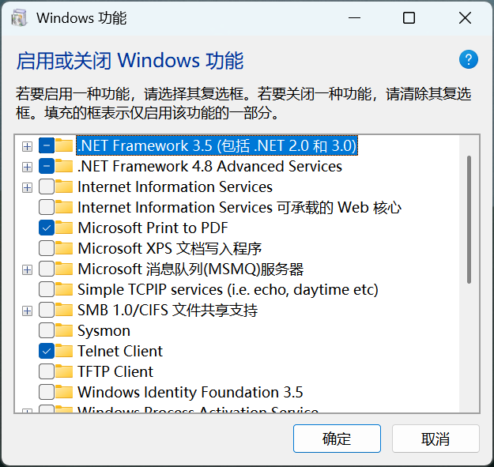

# 💯Ping与Telnet

`ping` 和 `telnet` 是计算机网络中最常用、最基础的两个命令行排障工具。它们就像是网络世界里的“探路者”，但两者的探测方式和目的完全不同。

## Ping：网络连通性的“声呐”

**Ping** 的名字取自潜艇声呐发出的回声，主要用来测试两台计算机之间的网络**是否连通**，以及连接的**往返延迟**（数据包一来一回的耗时，单位通常为 `ms`；它反映的是响应快慢，不等于下载带宽）。

- **工作原理：** 它使用的是网络层的 ICMP（互联网控制消息协议）。当你执行 `ping` 命令时，电脑会向目标服务器发送一个小数据包（Echo Request），然后等待对方返回应答包（Echo Reply），并记录下这一来一回消耗的时间。
- **通俗比喻：** 就像你在山谷里大喊一声“喂！”，然后计算听到回音需要几秒。如果有回音，说明路是通的；如果没有收到回音（请求超时），可能是路断了，也可能是对方开启了防火墙禁 Ping，刻意“假装没听见”。如果此时你要确认网站能否访问，下一步就该去测网站的 TCP 443 端口。
- **常用场景：**
    - 测试自己能不能连上网（例如：`ping www.baidu.com`）。
    - 检查局域网内的路由器或主机是否在线（前提是对方未禁 Ping）。
    - 查看网络质量是否稳定（有没有丢包、延迟波动大不大）。

## Telnet：特定服务端口的“敲门砖”

**Telnet** 最早是一种用于远程登录服务器的协议，但现在开发者和运维人员主要用它来测试**目标服务器的某个特定端口是否开放**。

- **工作原理：** 它使用的是传输层的 TCP 协议。它会尝试与目标主机的特定网络端口建立一条 TCP 通信连接。
- **通俗比喻：** 如果说 `ping` 是站在大楼外喊一嗓子看有没有人搭腔（哪怕大楼正常开放，对方也可能因为“禁 Ping”而不回话），那么 `telnet` 就是直接走到这栋楼的“80 号房间”或“3306 号房间”门口推一推门，看这间屋子到底开没开门。
- **安全现状：** 作为远程登录工具，Telnet 因为所有数据（包括账号密码）都是**明文传输**的，极易被截获，在现代运维中已基本被加密通信的 **SSH** 取代。但作为纯粹的“端口测试工具”（只测连通、不传密码），它依然是开发排障的常用利器。
- **常用场景：**
    - 测试数据库端口是否对外开放（例如：`telnet 192.168.1.100 3306`）。
    - 排查防火墙是否拦截了你的网站端口或某个服务的通信流量。

## 核心区别对比

| 特性 | Ping | Telnet |
| --- | --- | --- |
| **主要目的** | 测试主机是否可达、往返延迟与丢包率。 | 测试主机的某个特定服务端口是否开放且可访问。 |
| **底层协议** | ICMP（网络层协议） | TCP（传输层协议） |
| **能否指定端口** | **不能**。只能 Ping IP 地址或域名。 | **能**（仅限 TCP 端口）。省略端口时默认连 23 端口，排障时需手动指定目标端口（如 `3306`）。 |
| **防火墙影响** | 经常被服务器的安全策略（禁 Ping）拦截，导致 Ping 不通但服务可用。 | 只要该端口的服务正常运行且防火墙放行，就能连通。 |

## Windows 11 如何开启 Telnet 客户端

在 Windows 11 系统中，出于安全考虑，默认关闭了 Telnet 客户端。如果在 CMD 或 PowerShell 里直接运行 `telnet`，通常会提示 `'telnet' 不是内部或外部命令` 或 `无法将“telnet”项识别为……可运行程序的名称`。

你可以通过以下两种方式快速开启它：

### 方法一：图形界面开启

1. **打开 Windows 功能：** 按下 `Win + S` 键打开系统搜索，输入 **启用或关闭 Windows 功能** 并回车打开（也可以在控制面板的“程序”中找到）。
2. **勾选 Telnet 客户端：** 在弹出的功能列表中，向下滚动找到 **Telnet 客户端**（Telnet Client），勾选后点击“确定”。
3. **等待完成：** 系统会自动应用更改（通常只需几秒钟），看到提示“Windows 已完成请求的更改”后点击“关闭”即可。



### 方法二：命令行一键开启

如果你习惯纯命令行操作，可以通过管理员权限运行指令：

1. 右键点击任务栏的 Windows 开始图标，选择 **终端 (管理员)** 或 **Windows PowerShell (管理员)**。
2. 粘贴并运行以下命令：

```powershell
dism /online /Enable-Feature /FeatureName:TelnetClient
```

### 验证是否开启成功

无论使用上面哪种方法，完成后直接在当前终端窗口输入 `telnet` 并回车（若仍提示找不到命令，再关闭并重新打开终端窗口重试）。如果界面跳转到 `欢迎使用 Microsoft Telnet Client`（提示符变为 `Microsoft Telnet>`），说明开启成功。

> **注意：** 验证完请先输入 `quit` 并回车退回普通终端，再执行后面的排障命令；不要留在 `Microsoft Telnet>` 交互界面里直接输 `telnet IP 端口`，否则会提示“无效命令”。

## 实战排障：看懂 3306 端口的测试结果

假设你的数据库客户端连不上 `192.168.1.100` 上的 MySQL。你可以先执行 `ping 192.168.1.100` 看看基础连通和延迟情况；但无论 Ping 通不通（服务器可能禁了 Ping），接下来都可以直接测数据库的 `3306` 端口（注意 IP 和端口号之间用**空格**隔开，不要写成冒号 `:`）：

```cmd
telnet 192.168.1.100 3306
```

根据终端的反馈，可以直接判断下一步查哪里：

- **连接成功：** 窗口突然变成**一片黑屏（左上角光标闪烁）**，或弹出几行带 MySQL 版本号的乱码字符（看完后按 `Ctrl + ]` 切回提示符，再输入 `quit` 回车退出）。这说明当前你的电脑已成功与目标 `3306` 端口建立 TCP 连接——基础网络路由、防火墙放行和端口监听通常都没问题。接下来回到数据库客户端，根据**具体报错信息**继续排查：
    - 若提示 **“拒绝访问 (Access denied)”** 或 **“不允许此主机连接 (Host is not allowed to connect)”**：优先核对账号、密码，以及该账号是否开启了允许当前电脑登录的远程访问权限。
    - 若提示 **“证书验证失败”**、**SSL 连接错误** 或 **`Public Key Retrieval is not allowed`**：优先检查客户端的 SSL/加密连接设置、证书与连接时填写的服务器名称，或按需调整驱动的公钥获取配置。
- **连接失败：** 提示 `无法打开到主机的连接。 在端口 3306: 连接失败`。说明“门没开”或半路被拦住了，按顺序排查：
    1. 核对目标 IP、端口号有没有写错（若报错里显示 `在端口 23: 连接失败`，说明你把空格误写成了冒号 `:`）；
    2. 登录服务器检查数据库服务是否已启动，且监听在对外网卡地址和 `3306` 端口上（而非仅绑定在本机回环地址 `127.0.0.1`）；
    3. 检查服务器本机防火墙或云服务商安全组是否放行了 TCP `3306` 端口。

> **Windows 11 免安装替代方案：** 如果只是临时测端口、懒得开启 Telnet，可以直接在 PowerShell 里运行系统自带的 `Test-NetConnection` 命令：
>
> ```powershell
> Test-NetConnection 192.168.1.100 -Port 3306
> ```
>
> 直接看输出里的 `TcpTestSucceeded` 即可：`True` 表示 TCP 端口连通，`False` 表示端口不通，不用记退出快捷键，比看黑屏更直观。