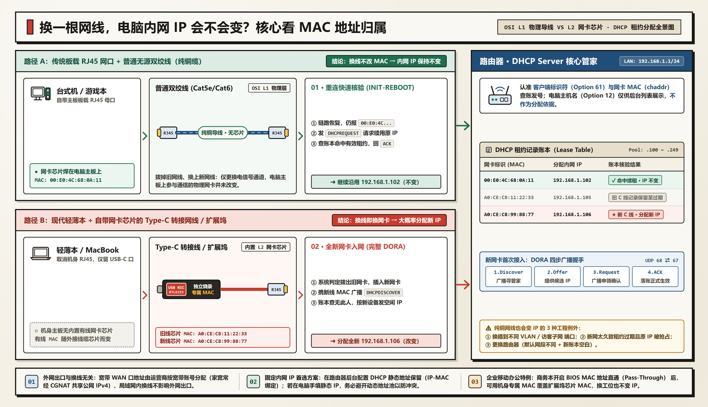

# 💯网线更换与DHCP租约分配机制

在日常网络排障中，流传着一句耳熟能详的经验法则：**“仅仅更换一根网线，电脑的内网 IP 地址不会发生改变。”**

这句话在**传统台式机与自带主板 RJ45 网口的笔记本**上确实成立——普通双绞线只是工作在 **OSI 物理层（L1）** 的纯铜无源导线，仅负责传导高频电信号，本身没有任何硬件身份；而局域网分配 IP 认的是 **数据链路层（L2）** 网卡接口的标识。

**但在轻薄本普及的现代办公硬件生态下，这条经验法则经常当场失灵：**

如果你使用的是自带转接头的 **Type-C / USB 转 RJ45 网线**或**多功能扩展坞**，拔下工位上的旧线、换插另一条同款转接线，电脑的内网 IP **极大概率会立刻变成一个新地址**。本文将从地址归属边界、DHCP 租约状态机、转接线芯片原理到固定 IP 避坑实操，把这一现象背后的底层逻辑彻底讲透。



---

## 一、先划清边界：外网 IP 与内网 IP 分别跟什么绑定？

讨论“换线变不变 IP”之前，必须先将家庭或企业网络中的**宽带外网出口地址（WAN 侧）**与**局域网私网地址（LAN 侧）**严格拆开来看：

### 1. 局域网私网 IP（内网 IP）：认网卡标识，不认电脑名字

在局域网内部（常见为 [RFC 1918](https://www.rfc-editor.org/rfc/rfc1918.html) 规定的 `192.168.x.x`、`10.x.x.x` 或 `172.16.x.x` – `172.31.x.x` 私网网段），终端设备的内网 IPv4 地址由 **DHCP 服务器**（家用场景通常集成在无线路由器内，企业网常由核心交换机或独立服务器承担）自动下发。

* **底层查账主键（`Option 61` 与 `MAC`）**：根据 [RFC 2131（DHCPv4 协议规范）](https://www.rfc-editor.org/rfc/rfc2131.html) 与 [RFC 2132](https://www.rfc-editor.org/rfc/rfc2132.html)，路由器内部维护着一张 **DHCP 租约记录表（Lease Table）**。服务器在检索历史租约时，优先比对客户端上报的 **`Option 61`（客户端标识符，Client Identifier）**；若未携带该选项，则直接比对报文头部的 **`chaddr`（客户端硬件地址，即网卡 MAC 地址）**。
* **主流系统的默认行为**：Windows 与 macOS 的 DHCPv4 客户端默认直接把 `Option 61` 填为当前活动网卡的 **MAC 地址**（硬件类型 `0x01` 加 6 字节物理地址）。因此在日常桌面环境中，可以准确地理解为：**私网 IP 严格绑定在具体那块参与通信的网卡 MAC 地址上**。
* **澄清一个高频误区——“路由器不是认我的电脑主机名吗？”**
  终端申请 IP 时，确实常通过 `Option 12（Host Name）` 顺带把电脑名称（如 `MacBook-Pro` 或 `DESKTOP-A1B2`）发给路由器，但**主机名仅供路由器管理后台列表展示备注，绝非分配 IP 的依据**。最直观的证明是：同一台笔记本同时连上 Wi-Fi 并插上网线，两边上报的主机名一模一样，但因为无线网卡与有线网卡拥有不同的 MAC 地址，路由器依然会给它分配**两个不同的内网 IP**。

> **Linux 服务端补充说明**：部分现代 Linux 发行版（如默认启用 `systemd-networkd` 的 Ubuntu Server）遵循 [RFC 4361](https://www.rfc-editor.org/rfc/rfc4361.html)，默认使用由 `/etc/machine-id` 派生的 `DUID + IAID` 作为 `Option 61` 客户端标识符，而非纯 MAC 地址。这也是克隆 Linux 虚拟机后即便重置了虚拟网卡 MAC，仍可能拿到相同 DHCP 地址的原因（在 Netplan 配置中显式声明 `dhcp-identifier: mac` 即可切回按 MAC 识别）。

### 2. 宽带外网出口 IP（公网 IP / 运营商 CGNAT）：认宽带账号与线路

* **分配主体**：由宽带运营商（ISP，如电信、联通、移动）的宽带接入服务器（BRAS / BNG），在光猫或路由器执行 PPPoE 拨号（或 IPoE 自动接入）时按**宽带账号与入户线路**动态下发。
* **现实形态**：受限于全球 IPv4 地址枯竭，如今普通家庭宽带在路由器 WAN 口拿到的往往是 [RFC 6598](https://www.rfc-editor.org/rfc/rfc6598.html) 定义的 `100.64.0.0/10` 运营商级内网地址（CGNAT），再由运营商大网关统一转换为公网 IPv4 出网；仅在光猫/路由器重拨或运营商定时轮换时才会变动。**无论你在房间里拔插多少次网线，都不会触发外网出口 IP 变更。**

### 3. 顺带一提：开启 IPv6 后，换线会变地址吗？

国内主流宽带现已全面双栈支持 IPv6（常见以 `240e:`、`2408:`、`2409:` 开头）。终端通过 **SLAAC（无状态地址自动配置，[RFC 4862](https://www.rfc-editor.org/rfc/rfc4862.html) / [RFC 7217](https://www.rfc-editor.org/rfc/rfc7217.html)）** 或 **DHCPv6（[RFC 8415](https://www.rfc-editor.org/rfc/rfc8415.html)）** 生成本机 IPv6 地址时，接口标识符同样绑定在**具体的网络接口**上：同一板载网口更换普通铜线时，稳定型 IPv6 地址保持不变（直至运营商重拨更换前缀）；而更换带芯片的 Type-C 转接线时，系统会将其枚举为全新网络接口，IPv6 地址也会随之重新生成。

---

## 二、协议底层拆解：DHCP 是怎么“发新号”与“续旧号”的？

看懂了路由器手里的“租约账本”，我们再深入一层，看看网线插上的一瞬间，电脑与路由器在协议层究竟聊了什么（基于 `UDP` 协议：客户端 `68` 端口 ⇄ 服务端 `67` 端口）：

| 触发时机 | 客户端状态（RFC 2131） | 实际报文交互流程 | 最终 IP 结果 |
| :--- | :--- | :--- | :--- |
| **陌生新网卡首次连入**<br>（如插上一根全新的 Type-C 芯片网线） | **`INIT`**<br>（全新初始化） | **完整 `DORA` 四步广播握手**：<br>1. `DHCPDISCOVER`（广播寻管家）<br>2. `DHCPOFFER`（查账无记录，挑空闲 IP 提议）<br>3. `DHCPREQUEST`（广播确认申领该提议）<br>4. `DHCPACK`（正式写入租约表并盖章生效） | **分配全新空闲 IP**<br>（启用前客户端还会按 [RFC 5227](https://www.rfc-editor.org/rfc/rfc5227.html) 发 ARP 探测防冲突） |
| **同一网卡拔插网线重连**<br>（如台式机换一根普通纯铜双绞线） | **`INIT-REBOOT`**<br>（断线重连核验） | **精简两步快速核验**：<br>1. 物理链路恢复（Link Up），客户端直接广播 `DHCPREQUEST`，在 `Option 50` 中指名请求沿用断线前的旧 IP；<br>2. 路由器核对 MAC 与网段无误，直接回 `DHCPACK` 放行（若换插到了其他子网，则回 `DHCPNAK` 打回重走 DORA）。 | **毫秒级恢复原 IP**<br>（连完整的四步广播都无需重跑） |
| **持续在线期间自动续命**<br>（网线一直插着正常办公） | **`BOUND` → `RENEWING`**<br>（后台静默续期） | **双计时器平滑续租**：<br>• 租期过半（**`T1 = 50%`**，如 24 小时租期的第 12 小时），电脑用**单播**静默向原路由器发 `DHCPREQUEST`，收到 `ACK` 后租期重置；<br>• 若原路由器失联，到 **`T2 = 87.5%`** 时改为**广播**重绑（`REBINDING`）；直至 **100% 期满**才释放地址。 | **全程不断流、不换 IP** |

> **排障实战彩蛋：为什么有时换完网线，电脑查出 `169.254.x.x` 且彻底上不了网？**
>
> 当你换上一根内部铜芯折断的劣质网线，或误把网线插进了未连上层路由器的孤立交换机时，网卡物理指示灯虽然会亮（触发系统发起寻址），但连续发出的 `DHCPDISCOVER` 广播没有任何 DHCP 服务器应答。此时 Windows 与 macOS 会遵循 [RFC 3927](https://www.rfc-editor.org/rfc/rfc3927.html) 启动**链路本地寻址（APIPA）**，在 `169.254.0.0/16` 段自拟一个临时地址。以后只要在排障时看到 `169.254` 开头，一秒就能锁定病根：**电脑没够着路由器的 DHCP 服务，重点排查上联跳线、VLAN 隔离或路由器 DHCP 开关！**

---

## 三、现代硬件盲区：为什么换根网线等于换了块网卡？

### 1. 高频踩坑：自带独立网卡芯片的 Type-C / USB 转接线与扩展坞

如今的轻薄办公本（如 MacBook Air / Pro、ThinkPad X1 Carbon、Dell XPS、Surface 等）为了压缩机身厚度，**不仅砍掉了厚重的 RJ45 水晶头母口，也一并省去了主板上的内置有线以太网控制器芯片**。

在现代办公桌上，大家随手插拔的所谓“网线”，绝大多数属于以下两种形态：

1. **一体化 Type-C / USB-A 转 RJ45 网线**（USB 插头金属壳内部直接集成了微型电路板与网卡芯片）；
2. **Type-C 多功能扩展坞（Docking Station）**侧面的千兆 / 2.5G 有线网口。

这两类配件与传统纯铜双绞线有着本质的代差：

* **MAC 地址长在线上，不在电脑上**：Type-C 转接线或扩展坞内部封装了一颗完整的 **USB 以太网控制器芯片**（千兆常见如 `Realtek RTL8153`、`ASIX AX88179`，2.5G 常见如 `Realtek RTL8156`；雷电扩展坞则常内置 PCIe 通道的 `Intel I225` 芯片）。每颗芯片在出厂时，都已在内部非易失性存储器（eFuse / EEPROM）中烧录了**独立的全球唯一物理 MAC 地址**。
* **换线的连带连锁反应**：当你把工位上的 A 号 Type-C 网线拔下，换插同事递过来的 B 号同款 Type-C 网线时，**操作系统的硬件总线实际经历了一次“卸载旧外置网卡 → 枚举全新外置网卡”的热插拔过程**。系统随即带着 B 线芯片那串陌生的 MAC 地址发起 `DORA` 广播；而在路由器的租约账本里，刚才 A 线的旧租约尚未过期（正占着原 IP），面对眼前这串查无记录的新 MAC，路由器自然将其判定为**第二台全新入网的设备**，从地址池里另行分配一个**全新的内网 IP**。

### 2. 企业级解药：商用本 BIOS 里的「MAC 地址直通」

在推行共享工位（Hot-Desking）与企业 802.1X 网络准入控制的公司里，员工每天抱着笔记本坐不同工位、插桌上不同的扩展坞。如果每次换工位都因为扩展坞芯片而改变 MAC 和 IP，内网白名单与固定地址策略就会彻底瘫痪。

为了解决这一痛点，联想 ThinkPad、戴尔 Latitude / XPS、惠普 EliteBook 等商用笔记本在主板 BIOS 中专门设计了 **MAC 地址直通（MAC Address Pass-Through，简称 MAPT）** 功能：

* 主板出厂时在 BIOS 固件里额外预留了一串专属于这台笔记本的**系统级直通 MAC 地址**；
* 开启该选项并接入受支持的 USB-C / 雷电扩展坞时，系统底层驱动会自动用这串直通 MAC **覆盖掉扩展坞内置芯片的出厂 MAC**；
* 这样一来，无论你在公司换插哪一个工位的扩展坞，向路由器上报的 `chaddr` 与 `Option 61` 始终是笔记本自己的同一串直通 MAC，**内网 IP 与准入权限都能纹丝不动**。

### 3. 普通纯铜双绞线：哪 3 种情况下换线也会变 IP？

即便使用的是两头均为 RJ45 水晶头的纯铜无源双绞线、电脑主板网卡 MAC 分毫未变，在以下三种网络工程场景中，换线操作同样会导致内网 IP 改变：

1. **换插到了划分不同 VLAN 或访客网络的端口**：企业交换机的不同物理面板口常被划入不同的 `VLAN`（虚拟局域网），部分家用路由器也支持将特定 LAN 口设为独立的访客网段或 IPTV 专口。换线时若顺手插进了另一个子网的网口，重连核验会收到 `DHCPNAK` 并重新申请新网段地址（例如从 `192.168.10.x` 变为 `192.168.20.x`）。
2. **断网期间旧租约已过期，且原 IP 恰好被其他设备抢占**：需要补充的是，许多家用路由器（如基于 `dnsmasq` 的固件）默认会根据 MAC 地址哈希计算候选 IP，或在后台保留过期记录作为软预留——因此即便断网超过租期，只要地址池宽裕，重连时往往仍能拿回原 IP；**唯有在租期耗尽且局域网地址池紧张、原 IP 已被新连入设备占走时**，路由器才会改派其他空闲 IP。
3. **换线排障时顺手断电重启了路由器**：不少消费级路由器为了减少闪存擦写寿命损耗，将 DHCP 租约表保存在断电即失的内存（`RAM / tmpfs`）中。一旦拔电重启，旧账本瞬间清零，家里手机、电视、电脑重连抢号的先后次序发生变化，分到的尾号自然重新洗牌。

---

## 四、换了路由器内网 IP 会变吗？如何稳妥锁死固定 IP？

**如果直接换上一台未做特殊配置的新路由器，电脑的内网 IP 几乎 100% 会重新分配。**

原因非常直观——你把局域网里的“发号管家”连人带账本一起换掉了：

1. **各品牌路由器的出厂默认网段不同**：例如 TP-Link / 水星常见为 `192.168.1.0/24` 或 `192.168.0.0/24`，华为 / 荣耀常见为 `192.168.3.0/24`，小米常见为 `192.168.31.0/24`，华硕常见为 `192.168.50.0/24`。网络前缀变了，全屋设备的内网门牌号必然整体迁移。
2. **新路由器的 DHCP 租约表是一张白纸**：即使新旧路由器碰巧同属 `192.168.1.0/24` 网段，新管家首次通电时没有任何历史绑定记忆，只能按终端发起 `DORA` 握手的先后顺序，从地址池起始号段（如 `.100` 起）依次重新发牌。

### 工程实战：怎样让 NAS、打印机或本地服务器永远固定同一个内网 IP？

当你在局域网内部署了 NAS 私有云、网络共享打印机、SSH 开发机或端口转发规则时，按推荐优先级可采用以下两种固化方案（换新路由器时，只需先在后台将新路由器的 **LAN 口网关网段**修改为与旧路由器一致，再套用下列配置即可）：

#### 方案一（首选推荐）：路由器后台配置「DHCP 静态地址保留（IP-MAC 绑定）」

* **操作方式**：电脑或 NAS 系统内保持默认的**“自动获得 IP 地址与 DNS”**不用动；登录路由器管理后台，在“DHCP 静态 IP 分配 / 地址保留”列表中，将该设备的 **MAC 地址**与指定的内网 IP（如 `192.168.1.88`）绑定保存。
* **核心优势**：集中管理最省心，日后调整 DNS 或网关时全网自动同步，且路由器会主动为你预留该地址，**从根源上杜绝局域网 IP 冲突**。
* **Type-C 网线避坑提示**：静态绑定认的是网卡 MAC——若目标设备通过 Type-C 转接线联网，绑定的其实是**那根转接线芯片的 MAC**。请给这根线做好标记专机专用，否则一旦换线，静态绑定就会因 MAC 不匹配而失效。

#### 方案二：在终端操作系统内手动填写静态 IP（严守两条防翻车铁律）

如果你无权登录公司或房东的路由器后台，只能在电脑网络适配器属性中关闭 DHCP、手动指定静态 IPv4 配置，请务必严守以下两条工程铁律：

1. **静态 IP 必须避开路由器的动态 DHCP 地址池区间（防撞车铁律）**：
   假设路由器网关是 `192.168.1.1`，动态地址池设为 `192.168.1.100` ~ `192.168.1.249`，手动填写的静态 IP **应选在地址池之外的 `.2` ~ `.99` 范围**（例如 `192.168.1.50`，选前先 `ping` 一下确认无人占用）。若图省事随手填了一个池内的 `.105`，因为你没走 DHCP 登记，当这台电脑休眠未响应探测时，路由器很可能把 `.105` 分给新连 Wi-Fi 的手机；等电脑唤醒瞬间就会爆发**局域网 IP 地址冲突**，导致两台设备双双断流！
2. **切勿漏填子网掩码、默认网关与 DNS 服务器（防“假断网”铁律）**：
   将 IP 切为手动模式时，Windows 会同步要求手动填写 **DNS 服务器**。若只填了 IP（`192.168.1.50`）、子网掩码（`255.255.255.0`）和默认网关（`192.168.1.1`）却把 DNS 留空，就会出现经典的**“能登已在线软件、能 `ping` 通外网纯数字 IP，但浏览器打不开任何域名网站”**的半瘫痪现象（DNS 可填入路由器网关 IP，或 `223.5.5.5`、`119.29.29.29` 等公共 DNS）。

---

## 五、全景对比速查表与交互式租约沙盒

先把日常最易遇到的 6 类连接变动浓缩为一张速查对照表：

| 终端与硬件连接场景 | 实际参与通信的 MAC 归属 | 动作后上报 MAC 是否改变 | 内网 IP 结果 | 底层协议机制说明 |
| :--- | :--- | :---: | :---: | :--- |
| **台式机 / 带 RJ45 口笔记本**<br>（同网段更换普通纯铜双绞线） | 电脑主板板载网卡 | **不变** | **保持不变** | 纯铜线仅为 L1 导电介质；网卡重连走 `INIT-REBOOT` 命中租约表续用原 IP |
| **轻薄本 / MacBook**<br>（更换另一条 Type-C 转接线或扩展坞） | **外接线缆插头 / 扩展坞内置网卡芯片** | **改变** | **大概率改变** | 换线等价于插入全新外置网卡，携新芯片 MAC 触发完整 `DORA` 申请新 IP |
| **商用笔记本开启 BIOS MAC 直通**<br>（跨工位更换兼容的 USB-C 扩展坞） | 笔记本 BIOS 系统直通 MAC（覆盖坞站芯片） | **不变** | **保持不变** | 驱动以机身专属直通 MAC 覆盖扩展坞出厂 MAC，路由器识别为同一老设备 |
| **任意电脑更换普通纯铜网线**<br>（但换插进不同 VLAN / 访客网段端口） | 原网卡自身 | **不变** | **必定改变** | 物理端口广播域与子网前缀已变，原地址核验收到 `DHCPNAK` 后重领新子网 IP |
| **局域网更换全新路由器**<br>（未手动对齐旧网段与静态保留表） | 原网卡自身 | **不变** | **基本必变** | 新路由器默认网段往往不同，且全新 `Lease Table` 为空，按接入先后重新排号 |
| **网线接入孤立交换机或断芯劣质线**<br>（物理亮灯但与上层 DHCP 服务隔绝） | 原网卡自身 | **不变** | **变为 `169.254.x.x`** | 连续 `DHCPDISCOVER` 广播无响应，系统触发 RFC 3927 链路本地寻址（无法上网） |

### 动手实验：换线与 DHCP 租约分配交互沙盒

点击下方 **6 个典型场景预设按钮**（也可自由组合下拉菜单并点击「执行拔插检测」），实时观察**上报网卡 MAC 的变化**、**DHCP 握手报文路径**以及**路由器租约账本（Lease Table）**的动态增删过程：

<style>
.tk-dhcp {
  --dh-bg: #14161a;
  --dh-panel: #1c1f26;
  --dh-sub: #101216;
  --dh-border: #323846;
  --dh-line: rgba(148, 163, 184, 0.18);
  --dh-text: #f1f5f9;
  --dh-muted: #94a3b8;
  --dh-green: #10b981;
  --dh-red: #f43f5e;
  --dh-amber: #f59e0b;
  --dh-blue: #38bdf8;
  box-sizing: border-box;
  margin: 22px 0 28px;
  padding: 20px;
  border: 1.5px solid var(--dh-border);
  border-radius: 12px;
  background: var(--dh-bg);
  color: var(--dh-text);
  font-family: "Inter", -apple-system, BlinkMacSystemFont, "PingFang SC", "Microsoft YaHei", sans-serif;
  box-shadow: 0 12px 30px rgba(0, 0, 0, 0.42);
}
body.theme-light .tk-dhcp {
  --dh-bg: #faf8f3;
  --dh-panel: #ffffff;
  --dh-sub: #f3efe6;
  --dh-border: #181715;
  --dh-line: rgba(24, 23, 21, 0.16);
  --dh-text: #181715;
  --dh-muted: #57524a;
  --dh-green: #1f6e50;
  --dh-red: #c93b2b;
  --dh-amber: #b86b14;
  --dh-blue: #204e78;
  box-shadow: 5px 5px 0 rgba(24, 23, 21, 0.14);
}
.tk-dhcp, .tk-dhcp *, .tk-dhcp *::before, .tk-dhcp *::after {
  box-sizing: border-box;
}
.tk-dhcp-head {
  display: flex;
  flex-wrap: wrap;
  justify-content: space-between;
  align-items: center;
  gap: 8px;
  padding-bottom: 12px;
  margin-bottom: 14px;
  border-bottom: 1.5px solid var(--dh-line);
}
.tk-dhcp-title {
  font-size: 16px;
  font-weight: 800;
  color: var(--dh-text);
  display: flex;
  align-items: center;
  gap: 8px;
}
.tk-dhcp-dot {
  width: 10px;
  height: 10px;
  border-radius: 2px;
  background: var(--dh-green);
  display: inline-block;
}
.tk-dhcp-tag {
  font-family: "JetBrains Mono", Consolas, monospace;
  font-size: 11px;
  font-weight: 700;
  letter-spacing: 0.05em;
  color: var(--dh-muted);
}
.tk-dhcp-presets {
  display: flex;
  flex-wrap: wrap;
  gap: 7px;
  margin-bottom: 14px;
}
.tk-dhcp-btn {
  appearance: none;
  border: 1px solid var(--dh-border);
  background: var(--dh-panel);
  color: var(--dh-text);
  padding: 6px 11px;
  border-radius: 6px;
  font-size: 12px;
  font-weight: 700;
  cursor: pointer;
  transition: transform 0.14s ease, border-color 0.14s ease, background 0.14s ease;
  font-family: inherit;
}
.tk-dhcp-btn:hover {
  transform: translateY(-1px);
  border-color: var(--dh-blue);
}
.tk-dhcp-btn.is-primary {
  background: var(--dh-green);
  border-color: var(--dh-green);
  color: #ffffff;
}
.tk-dhcp-btn.is-current {
  border-color: var(--dh-blue);
  box-shadow: 0 0 0 1.5px var(--dh-blue);
}
.tk-dhcp-controls {
  display: grid;
  grid-template-columns: repeat(3, minmax(0, 1fr));
  gap: 10px;
  margin-bottom: 14px;
}
.tk-dhcp-field {
  display: flex;
  flex-direction: column;
  gap: 5px;
}
.tk-dhcp-label {
  font-size: 11.5px;
  font-weight: 700;
  color: var(--dh-muted);
}
.tk-dhcp-select {
  width: 100%;
  padding: 7px 10px;
  border-radius: 6px;
  border: 1px solid var(--dh-border);
  background: var(--dh-sub);
  color: var(--dh-text);
  font-size: 12.5px;
  font-weight: 600;
  font-family: inherit;
  outline: none;
}
.tk-dhcp-select:focus {
  border-color: var(--dh-blue);
}
.tk-dhcp-summary {
  background: var(--dh-panel);
  border: 1px solid var(--dh-border);
  border-radius: 8px;
  padding: 12px 14px;
  margin-bottom: 12px;
  display: flex;
  flex-wrap: wrap;
  align-items: center;
  justify-content: space-between;
  gap: 10px;
}
.tk-dhcp-kv {
  display: flex;
  flex-wrap: wrap;
  gap: 14px;
  font-size: 12.5px;
}
.tk-dhcp-kv span b {
  font-family: "JetBrains Mono", Consolas, monospace;
  color: var(--dh-blue);
}
.tk-dhcp-verdict {
  padding: 4px 11px;
  border-radius: 999px;
  font-size: 12px;
  font-weight: 800;
  border: 1px solid currentColor;
}
.tk-dhcp-verdict.is-same {
  color: var(--dh-green);
  background: rgba(16, 185, 129, 0.12);
}
.tk-dhcp-verdict.is-changed {
  color: var(--dh-amber);
  background: rgba(245, 158, 11, 0.14);
}
.tk-dhcp-verdict.is-err {
  color: var(--dh-red);
  background: rgba(244, 63, 94, 0.14);
}
.tk-dhcp-pipe {
  display: grid;
  grid-template-columns: repeat(4, minmax(0, 1fr));
  gap: 8px;
  margin-bottom: 12px;
}
.tk-dhcp-step {
  background: var(--dh-sub);
  border: 1px solid var(--dh-line);
  border-radius: 6px;
  padding: 8px 9px;
  text-align: center;
  font-size: 11.8px;
  font-weight: 700;
  color: var(--dh-muted);
  transition: all 0.18s ease;
}
.tk-dhcp-step.is-active {
  border-color: var(--dh-blue);
  color: var(--dh-blue);
  transform: translateY(-1px);
}
.tk-dhcp-step.is-ok {
  border-color: var(--dh-green);
  color: var(--dh-green);
}
.tk-dhcp-step.is-warn {
  border-color: var(--dh-amber);
  color: var(--dh-amber);
}
.tk-dhcp-step.is-err {
  border-color: var(--dh-red);
  color: var(--dh-red);
}
.tk-dhcp-grid {
  display: grid;
  grid-template-columns: 1.15fr 1fr;
  gap: 12px;
}
.tk-dhcp-box {
  background: var(--dh-panel);
  border: 1px solid var(--dh-border);
  border-radius: 8px;
  padding: 12px;
  min-width: 0;
}
.tk-dhcp-btitle {
  font-size: 12.5px;
  font-weight: 800;
  margin-bottom: 9px;
  display: flex;
  justify-content: space-between;
  align-items: center;
  color: var(--dh-text);
}
.tk-dhcp-btitle small {
  font-family: "JetBrains Mono", Consolas, monospace;
  font-size: 11px;
  color: var(--dh-muted);
}
.tk-dhcp-tbl {
  width: 100%;
  border-collapse: collapse;
  font-size: 12px;
}
.tk-dhcp-tbl th, .tk-dhcp-tbl td {
  padding: 7px 8px;
  text-align: left;
  border-bottom: 1px solid var(--dh-line);
}
.tk-dhcp-tbl th {
  color: var(--dh-muted);
  font-weight: 700;
  background: var(--dh-sub);
}
.tk-dhcp-tbl td {
  font-family: "JetBrains Mono", Consolas, monospace;
  font-size: 11.5px;
}
.tk-dhcp-tbl tr.is-hit td {
  color: var(--dh-green);
  font-weight: 800;
}
.tk-dhcp-tbl tr.is-new td {
  color: var(--dh-amber);
  font-weight: 800;
}
.tk-dhcp-log {
  background: var(--dh-sub);
  border: 1px solid var(--dh-line);
  border-radius: 6px;
  padding: 10px 12px;
  font-size: 12.5px;
  line-height: 1.68;
  color: var(--dh-text);
}
.tk-dhcp-log p {
  margin: 0 0 6px 0 !important;
  font-size: 12.5px !important;
  line-height: 1.65 !important;
}
.tk-dhcp-log p:last-child {
  margin-bottom: 0 !important;
}
@media (max-width: 820px) {
  .tk-dhcp-controls { grid-template-columns: 1fr; }
  .tk-dhcp-pipe { grid-template-columns: repeat(2, minmax(0, 1fr)); }
  .tk-dhcp-grid { grid-template-columns: 1fr; }
}
</style>

<section id="tk-dhcp-lab" class="tk-dhcp" aria-label="网线更换与 DHCP 租约分配交互沙盒">
  <div class="tk-dhcp-head">
    <div class="tk-dhcp-title"><span class="tk-dhcp-dot"></span><span>换线与换路由：DHCP 租约分配交互沙盒</span></div>
    <span class="tk-dhcp-tag">RFC 2131 LEASE SIMULATOR</span>
  </div>
  <div class="tk-dhcp-presets">
    <button type="button" class="tk-dhcp-btn is-primary" id="tk-dh-run">▶ 执行拔插检测</button>
    <button type="button" class="tk-dhcp-btn" id="tk-dh-p0">1. 台式机换普通网线</button>
    <button type="button" class="tk-dhcp-btn is-current" id="tk-dh-p1">2. 轻薄本换另一条 Type-C 线</button>
    <button type="button" class="tk-dhcp-btn" id="tk-dh-p2">3. 商务本开 MAC 直通换扩展坞</button>
    <button type="button" class="tk-dhcp-btn" id="tk-dh-p3">4. 普通网线插进另一 VLAN 口</button>
    <button type="button" class="tk-dhcp-btn" id="tk-dh-p4">5. 更换新品牌路由器</button>
    <button type="button" class="tk-dhcp-btn" id="tk-dh-p5">6. 插进未接路由的孤立交换机</button>
  </div>
  <div class="tk-dhcp-controls">
    <div class="tk-dhcp-field">
      <span class="tk-dhcp-label">01 终端与网卡形态</span>
      <select id="tk-dh-hw" class="tk-dhcp-select" aria-label="终端与网卡形态">
        <option value="onboard">台式机 / 游戏本（主板板载 RJ45 网卡）</option>
        <option value="typec" selected>现代轻薄本（无网口，依赖 Type-C 芯片线/坞）</option>
        <option value="mapt">商用笔记本（已开启 BIOS MAC 地址直通）</option>
      </select>
    </div>
    <div class="tk-dhcp-field">
      <span class="tk-dhcp-label">02 物理换线动作</span>
      <select id="tk-dh-act" class="tk-dhcp-select" aria-label="物理换线动作">
        <option value="pure">更换普通 RJ45 纯铜双绞线</option>
        <option value="newchip" selected>换插另一条 Type-C 芯片网线 / 另一扩展坞</option>
      </select>
    </div>
    <div class="tk-dhcp-field">
      <span class="tk-dhcp-label">03 上联网络与路由器环境</span>
      <select id="tk-dh-net" class="tk-dhcp-select" aria-label="上联网络环境">
        <option value="same" selected>原路由器 · 同网段端口（旧租约有效）</option>
        <option value="vlan">原交换机 · 误插进 VLAN 20 隔离网口</option>
        <option value="expired">原路由器 · 断网数日租约过期且原 IP 被占</option>
        <option value="newrouter">更换全新路由器（默认 192.168.31.0/24）</option>
        <option value="nodhcp">孤立傻瓜交换机 / 断芯网线（无 DHCP 响应）</option>
      </select>
    </div>
  </div>
  <div class="tk-dhcp-summary">
    <div class="tk-dhcp-kv">
      <span>换线前：<b id="tk-dh-old">A0:CE:C8:11:22:33 → 192.168.1.105</b></span>
      <span>换线后上报：<b id="tk-dh-new">A0:CE:C8:99:88:77 → 192.168.1.106</b></span>
    </div>
    <span class="tk-dhcp-verdict is-changed" id="tk-dh-badge">内网 IP 发生改变（新网卡入网）</span>
  </div>
  <div class="tk-dhcp-pipe" id="tk-dh-pipe">
    <div class="tk-dhcp-step is-warn">① 新 USB 网卡芯片枚举</div>
    <div class="tk-dhcp-step is-warn">② 广播 DHCPDISCOVER</div>
    <div class="tk-dhcp-step is-warn">③ 收到 DHCPOFFER (.106)</div>
    <div class="tk-dhcp-step is-warn">④ REQUEST → ACK 落账</div>
  </div>
  <div class="tk-dhcp-grid">
    <div class="tk-dhcp-box">
      <div class="tk-dhcp-btitle">
        <span>路由器 DHCP 租约账本（Lease Table）</span>
        <small id="tk-dh-pool">LAN: 192.168.1.1/24</small>
      </div>
      <table class="tk-dhcp-tbl">
        <thead>
          <tr>
            <th>客户端标识 / MAC</th>
            <th>分配 IP</th>
            <th>租约状态</th>
          </tr>
        </thead>
        <tbody id="tk-dh-tbody">
          <tr>
            <td>A0:CE:C8:11:22:33</td>
            <td>192.168.1.105</td>
            <td>旧线租约保留（余 23h）</td>
          </tr>
          <tr class="is-new">
            <td>A0:CE:C8:99:88:77</td>
            <td>192.168.1.106</td>
            <td>★ 新芯片线首次分配</td>
          </tr>
        </tbody>
      </table>
    </div>
    <div class="tk-dhcp-box">
      <div class="tk-dhcp-btitle">
        <span>底层归因与排障解读</span>
        <small id="tk-dh-mode">INIT → DORA</small>
      </div>
      <div class="tk-dhcp-log" id="tk-dh-log">
        <p><strong>硬件层变化：</strong>新换上的 Type-C 转接线插头内焊有独立的 USB 网卡芯片，上报 MAC 从 <code>A0:CE:C8:11:22:33</code> 变为 <code>A0:CE:C8:99:88:77</code>。</p>
        <p><strong>账本核验结果：</strong>原路由器账本里查不到这串新 MAC，且旧线的 <code>192.168.1.105</code> 仍在有效期内，因此按新设备走完整 DORA 流程下发 <code>192.168.1.106</code>。</p>
      </div>
    </div>
  </div>
</section>

<script>
(function () {
  var root = document.getElementById('tk-dhcp-lab');
  if (!root || root.dataset.ready === '1') return;
  root.dataset.ready = '1';

  var elHw = document.getElementById('tk-dh-hw');
  var elAct = document.getElementById('tk-dh-act');
  var elNet = document.getElementById('tk-dh-net');
  var elOld = document.getElementById('tk-dh-old');
  var elNew = document.getElementById('tk-dh-new');
  var elBadge = document.getElementById('tk-dh-badge');
  var elPool = document.getElementById('tk-dh-pool');
  var elMode = document.getElementById('tk-dh-mode');
  var elTbody = document.getElementById('tk-dh-tbody');
  var elLog = document.getElementById('tk-dh-log');
  var stepEls = Array.prototype.slice.call(root.querySelectorAll('#tk-dh-pipe .tk-dhcp-step'));
  var presetBtns = [
    document.getElementById('tk-dh-p0'),
    document.getElementById('tk-dh-p1'),
    document.getElementById('tk-dh-p2'),
    document.getElementById('tk-dh-p3'),
    document.getElementById('tk-dh-p4'),
    document.getElementById('tk-dh-p5')
  ];
  var timers = [];

  function clearTimers() {
    while (timers.length) clearTimeout(timers.pop());
  }

  function compute() {
    var hw = elHw.value;
    var act = elAct.value;
    var net = elNet.value;

    var oldMac = hw === 'onboard' ? '00:E0:4C:68:0A:11' : (hw === 'mapt' ? '54:EE:75:30:40:50' : 'A0:CE:C8:11:22:33');
    var oldIp = hw === 'typec' ? '192.168.1.105' : '192.168.1.102';
    var macChanged = false;
    var newMac = oldMac;

    if (act === 'newchip') {
      if (hw === 'mapt') {
        macChanged = false;
        newMac = '54:EE:75:30:40:50';
      } else {
        macChanged = true;
        newMac = 'A0:CE:C8:99:88:77';
      }
    }

    var newIp = oldIp;
    var verdictCls = 'is-same';
    var verdictText = '内网 IP 保持不变';
    var stepTone = 'is-ok';
    var poolText = 'LAN: 192.168.1.1/24';
    var modeText = 'INIT-REBOOT';
    var steps = [];
    var rows = [];
    var logs = [];

    if (net === 'nodhcp') {
      newIp = '169.254.84.19';
      verdictCls = 'is-err';
      verdictText = '无法联网（回退 169.254 APIPA 地址）';
      stepTone = 'is-err';
      poolText = '未检测到可用 DHCP Server';
      modeText = 'RFC 3927 APIPA';
      steps = [
        '① 物理网口载波亮起',
        '② 连续广播 DHCPDISCOVER',
        '③ 超时未收到任何 OFFER',
        '④ 自拟 169.254.84.19/16'
      ];
      rows = [
        { cls: '', mac: '（无服务器响应）', ip: '—', state: '上联链路未通达路由器' }
      ];
      logs = [
        ['故障定位：', '网卡虽检测到物理电信号，但广播出去的 DHCPDISCOVER 石沉大海（常见于交换机未接上层主路由、VLAN 配错放行规则或网线部分线芯断路）。'],
        ['系统兜底：', '操作系统按 RFC 3927 自动生成 169.254.x.x 链路本地地址，无默认网关，无法访问外网。']
      ];
    } else if (net === 'newrouter') {
      newIp = '192.168.31.100';
      verdictCls = 'is-changed';
      verdictText = '内网 IP 改变（更换路由器管家）';
      stepTone = 'is-warn';
      poolText = '新路由 LAN: 192.168.31.1/24';
      modeText = 'NAK / INIT → DORA';
      steps = [
        '① 接入新路由器 LAN 口',
        '② 旧网段请求遭拒或超时',
        '③ 重发 DISCOVER 获 .31.100',
        '④ REQUEST → ACK 写入新账本'
      ];
      rows = [
        { cls: 'is-new', mac: newMac, ip: newIp, state: '★ 新路由器空白账本首号分配' }
      ];
      logs = [
        ['网段与账本双重置：', '新路由器默认采用 192.168.31.0/24 子网，且内部 DHCP 租约账本完全空白，不继承旧路由器的历史发放记录。'],
        ['固化建议：', '若有 NAS 或本地服务，只需将新路由 LAN 口改回 192.168.1.1 并在后台添加 IP-MAC 静态保留即可恢复原地址。']
      ];
    } else if (net === 'vlan') {
      newIp = '192.168.20.101';
      verdictCls = 'is-changed';
      verdictText = '内网 IP 改变（跨入 VLAN 20 新子网）';
      stepTone = 'is-warn';
      poolText = 'VLAN 20: 192.168.20.1/24';
      modeText = 'DHCPNAK → DORA';
      steps = [
        '① 插入 VLAN 20 交换机口',
        '② 请求旧 IP 收到 DHCPNAK',
        '③ 退回 INIT 重发 DISCOVER',
        '④ 获配新网段 192.168.20.101'
      ];
      rows = [
        { cls: 'is-new', mac: newMac, ip: newIp, state: '★ VLAN 20 地址池重新下发' }
      ];
      logs = [
        ['广播域切换：', '即便使用纯铜网线且网卡 MAC 未变，但换插的面板端口属于 VLAN 20 子网（192.168.20.0/24）。'],
        ['协议纠偏：', '网关发现客户端请求的 192.168.1.x 不属于当前子网，立即回复 DHCPNAK 强制打回，触发重走 DORA 领取新网段地址。']
      ];
    } else if (macChanged) {
      newIp = '192.168.1.106';
      verdictCls = 'is-changed';
      verdictText = '内网 IP 发生改变（新网卡芯片入网）';
      stepTone = 'is-warn';
      modeText = 'INIT → DORA';
      steps = [
        '① 新 USB 网卡芯片枚举',
        '② 广播 DHCPDISCOVER',
        '③ 收到 DHCPOFFER (.106)',
        '④ REQUEST → ACK 落账'
      ];
      rows = [
        { cls: '', mac: oldMac, ip: oldIp, state: '原网卡租约保留（尚未过期）' },
        { cls: 'is-new', mac: newMac, ip: newIp, state: '★ 新芯片线首次分配' }
      ];
      logs = [
        ['硬件层真相：', (hw === 'onboard' ? '你从主板 RJ45 口改插到了带芯片的 Type-C 转接网线上' : '新换上的 Type-C 转接线/扩展坞内含独立的 USB 网卡芯片') + '，上报的物理 MAC 变成了 ' + newMac + '。'],
        ['账本核验结果：', '路由器在租约表里找不到这串新 MAC，而原地址 ' + oldIp + ' 仍归旧 MAC 持有，于是按全新设备走 DORA 分配了 ' + newIp + '。']
      ];
    } else if (net === 'expired') {
      newIp = '192.168.1.118';
      verdictCls = 'is-changed';
      verdictText = '内网 IP 改变（旧租期耗尽且原号被占）';
      stepTone = 'is-warn';
      modeText = 'DHCPNAK → DORA';
      steps = [
        '① 长时间离线后插线重连',
        '② 请求原 IP 发现已被占用',
        '③ 路由器拒绝并重发 OFFER',
        '④ 改领空闲地址 .1.118'
      ];
      rows = [
        { cls: '', mac: 'DC:A6:32:77:88:99', ip: oldIp, state: '已被局域网其他设备抢占' },
        { cls: 'is-new', mac: newMac, ip: newIp, state: '★ 旧租过期，改派新空闲号' }
      ];
      logs = [
        ['租期与池竞争：', '网卡 MAC（' + newMac + '）虽然没变，但设备断网时间超过了租期上限，且期间局域网地址池紧张，原 ' + oldIp + ' 已被其他新入网设备领走。'],
        ['处理结果：', '路由器无法再把旧地址发回给你，只能从剩余空闲池中重新指派 ' + newIp + '。']
      ];
    } else {
      newIp = oldIp;
      verdictCls = 'is-same';
      verdictText = hw === 'mapt' && act === 'newchip'
        ? '内网 IP 保持不变（BIOS MAC 直通生效）'
        : '内网 IP 保持不变（命中有效租约）';
      stepTone = 'is-ok';
      modeText = 'INIT-REBOOT → ACK';
      steps = [
        hw === 'mapt' && act === 'newchip' ? '① 直通 MAC 覆盖新扩展坞' : '① 纯铜换线，网卡芯片未变',
        '② 广播 DHCPREQUEST 续用原号',
        '③ 路由器查账本命中有效记录',
        '④ 秒回 DHCPACK 继续使用'
      ];
      rows = [
        { cls: 'is-hit', mac: newMac, ip: newIp, state: '✓ 命中有效租约 · 刷新倒计时' }
      ];
      if (hw === 'mapt' && act === 'newchip') {
        logs = [
          ['企业直通黑科技：', '虽然你换插了另一台扩展坞，但商用本 BIOS 开启了 MAC Address Pass-Through，强制用机身专属 MAC（' + newMac + '）覆盖了扩展坞内置芯片地址。'],
          ['账本无缝续接：', '路由器看到的依然是老熟人 MAC，直接回复 DHCPACK 放行原地址 ' + newIp + '，跨工位移动办公零感知。']
        ];
      } else {
        logs = [
          ['L1 无源介质替换：', '普通 RJ45 双绞线只是纯铜导线，不带任何芯片。换线后参与通信的依然是原网卡（' + newMac + '）。'],
          ['快速核验放行：', '客户端进入 INIT-REBOOT 状态直接请求续用 ' + newIp + '，路由器核对租约账本命中有效记录，毫秒级回 ACK 维持原 IP 不变。']
        ];
      }
    }

    return {
      oldStr: oldMac + ' → ' + oldIp,
      newStr: newMac + ' → ' + newIp,
      verdictCls: verdictCls,
      verdictText: verdictText,
      stepTone: stepTone,
      poolText: poolText,
      modeText: modeText,
      steps: steps,
      rows: rows,
      logs: logs
    };
  }

  function render(state, animate) {
    clearTimers();
    elOld.textContent = state.oldStr;
    elNew.textContent = state.newStr;
    elBadge.className = 'tk-dhcp-verdict ' + state.verdictCls;
    elBadge.textContent = state.verdictText;
    elPool.textContent = state.poolText;
    elMode.textContent = state.modeText;

    stepEls.forEach(function (el, i) {
      el.textContent = state.steps[i] || '';
      el.className = 'tk-dhcp-step';
    });

    function paintDetails() {
      while (elTbody.firstChild) elTbody.removeChild(elTbody.firstChild);
      state.rows.forEach(function (r) {
        var tr = document.createElement('tr');
        if (r.cls) tr.className = r.cls;
        [r.mac, r.ip, r.state].forEach(function (txt) {
          var td = document.createElement('td');
          td.textContent = txt;
          tr.appendChild(td);
        });
        elTbody.appendChild(tr);
      });

      while (elLog.firstChild) elLog.removeChild(elLog.firstChild);
      state.logs.forEach(function (pair) {
        var p = document.createElement('p');
        var st = document.createElement('strong');
        st.textContent = pair[0];
        p.appendChild(st);
        p.appendChild(document.createTextNode(pair[1]));
        elLog.appendChild(p);
      });
    }

    if (!animate) {
      stepEls.forEach(function (el) { el.classList.add(state.stepTone); });
      paintDetails();
      return;
    }

    stepEls.forEach(function (el, idx) {
      timers.push(setTimeout(function () {
        if (idx > 0) {
          stepEls[idx - 1].classList.remove('is-active');
          stepEls[idx - 1].classList.add(state.stepTone);
        }
        el.classList.add('is-active');
        if (idx === stepEls.length - 1) {
          paintDetails();
          timers.push(setTimeout(function () {
            el.classList.remove('is-active');
            el.classList.add(state.stepTone);
          }, 180));
        }
      }, idx * 120));
    });
  }

  function markPreset(idx) {
    presetBtns.forEach(function (b, i) {
      if (!b) return;
      if (i === idx) b.classList.add('is-current');
      else b.classList.remove('is-current');
    });
  }

  function applyPreset(idx, hw, act, net) {
    markPreset(idx);
    elHw.value = hw;
    elAct.value = act;
    elNet.value = net;
    render(compute(), true);
  }

  document.getElementById('tk-dh-run').addEventListener('click', function () {
    render(compute(), true);
  });
  presetBtns[0].addEventListener('click', function () { applyPreset(0, 'onboard', 'pure', 'same'); });
  presetBtns[1].addEventListener('click', function () { applyPreset(1, 'typec', 'newchip', 'same'); });
  presetBtns[2].addEventListener('click', function () { applyPreset(2, 'mapt', 'newchip', 'same'); });
  presetBtns[3].addEventListener('click', function () { applyPreset(3, 'onboard', 'pure', 'vlan'); });
  presetBtns[4].addEventListener('click', function () { applyPreset(4, 'onboard', 'pure', 'newrouter'); });
  presetBtns[5].addEventListener('click', function () { applyPreset(5, 'onboard', 'pure', 'nodhcp'); });

  [elHw, elAct, elNet].forEach(function (sel) {
    sel.addEventListener('change', function () {
      markPreset(-1);
      render(compute(), false);
    });
  });

  render(compute(), false);
})();
</script>

---

## 六、1 分钟上机实证：一眼看穿你的网口真身与 DHCP 租期

不用拆开网线外壳，你现在就可以打开系统终端，用两行自带命令亲眼核实自己电脑的有线网口究竟是“主板板载芯片”还是“外接线缆芯片”，并查看当前租约的精确到期时刻：

### 1. Windows 10 / 11（PowerShell 或 CMD）

按下 `Win + R` 输入 `cmd` 回车，执行：

```cmd
ipconfig /all
```

在输出的有线以太网适配器段落中，重点核对以下四行：

* **描述 (Description)**：
  * 若显示 `Realtek PCIe GbE Family Controller` 或 `Intel(R) Ethernet Connection` —— 带有 `PCIe` 字样，代表**焊在主板上的板载有线网卡**，换普通双绞线不会改变 MAC 与 IP；
  * 若显示 `Realtek USB GbE Family Controller` 或 `ASIX AX88179 USB 3.0 to Gigabit Ethernet` —— 带有 **`USB`** 字样，实锤**网卡芯片藏在你的 Type-C 转接线或扩展坞里**，换一根转接线就会换一串物理地址！
* **物理地址 (Physical Address)**：当前向路由器亮出的 6 字节 MAC 地址。
* **DHCP 服务器 (DHCP Server)**：给你发号的路由器管家地址（如 `192.168.1.1`）。
* **获得租约的时间 / 租约过期的时间**：精确到秒的租约起止账期（过半即自动触发 `T1` 静默续租）。

若换插了不同 VLAN 的网口或排障完 `169.254.x.x` 故障后希望立即重拿地址，可手动释放并重新申请租约（**注意**：请勿在远程桌面连接中单独执行 `release`，否则释放瞬间远程会话会直接断开，应使用 `&` 连写一气呵成）：

```cmd
ipconfig /release & ipconfig /renew
```

### 2. macOS 系统

打开「终端（Terminal）」，依次运行以下两条命令：

```bash
# 1. 列出所有物理网络硬件端口，一眼区分内置网口与 USB 扩展坞网卡（记下对应的 Device 名如 en5）
networksetup -listallhardwareports

# 2. 直接透视路由器最近一次发给该网口的原始 DHCPACK 报文内容（将 en5 替换为实际设备名）
ipconfig getpacket en5
```

`ipconfig getpacket` 是 macOS 内置的排障利器，无需抓包工具即可原样打印路由器回传的 `yiaddr`（分配的 IP）、`chaddr`（网卡 MAC）、`server_identifier`（DHCP 服务器）以及十六进制 `lease_time`（例如 `0x15180` 换算为十进制即 `86400` 秒 = 24 小时）。

### 3. Linux 系统（Ubuntu / Debian / RHEL 等）

打开终端运行：

```bash
# 查看各网卡 IPv4 地址、是否由 DHCP 动态分配（dynamic 标记）及剩余有效秒数（valid_lft）
ip -4 addr show

# 若使用外置 Type-C 网卡或扩展坞，可直接查看 USB 总线上挂载的网卡芯片型号
lsusb
```

在 `ip -4 addr show` 输出中，`inet 192.168.1.102/24 brd ... scope global dynamic` 下方的 `valid_lft 82410sec` 就是内核正在实时倒计时的当前 DHCP 租约剩余秒数。

---

## 参考规范与延伸阅读

* **DHCPv4 核心协议与配置选项**：[RFC 2131 — Dynamic Host Configuration Protocol](https://www.rfc-editor.org/rfc/rfc2131.html)、[RFC 2132 — DHCP Options and BOOTP Vendor Extensions（含 Option 12 主机名、Option 50 请求地址与 Option 61 客户端标识符）](https://www.rfc-editor.org/rfc/rfc2132.html)
* **客户端标识与地址冲突防护**：[RFC 4361 — Node-specific Client Identifiers for DHCPv4](https://www.rfc-editor.org/rfc/rfc4361.html)、[RFC 5227 — IPv4 Address Conflict Detection](https://www.rfc-editor.org/rfc/rfc5227.html)、[RFC 3927 — Dynamic Configuration of IPv4 Link-Local Addresses (`169.254.0.0/16`)](https://www.rfc-editor.org/rfc/rfc3927.html)
* **地址空间划分与 IPv6 自动寻址**：[RFC 1918 — Address Allocation for Private Internets](https://www.rfc-editor.org/rfc/rfc1918.html)、[RFC 6598 — Shared Address Space (CGNAT)](https://www.rfc-editor.org/rfc/rfc6598.html)、[RFC 4862 — IPv6 Stateless Address Autoconfiguration (SLAAC)](https://www.rfc-editor.org/rfc/rfc4862.html)、[RFC 8415 — Dynamic Host Configuration Protocol for IPv6 (DHCPv6)](https://www.rfc-editor.org/rfc/rfc8415.html)
