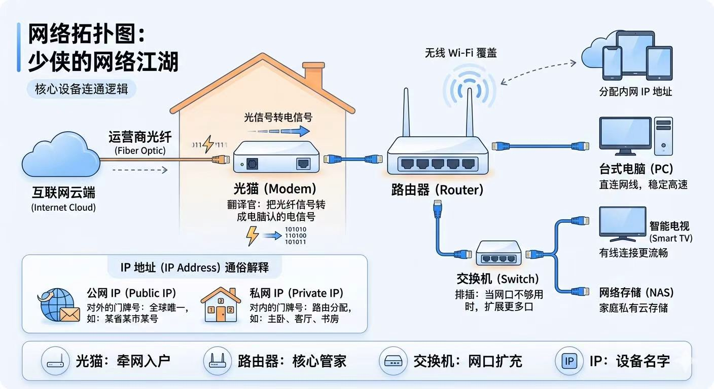
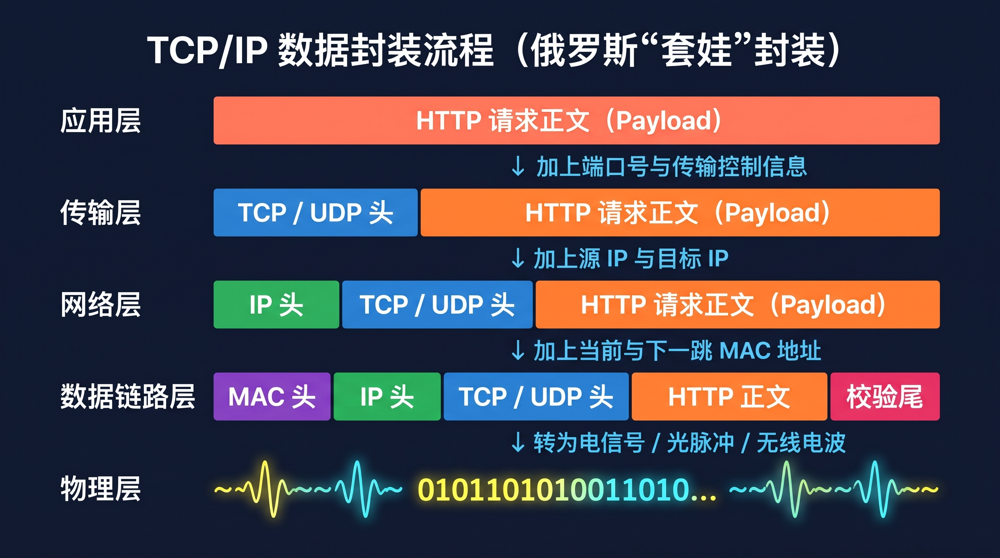

# 💯计算机网络

今天，我们不念枯燥的定义。我们将把整个“计算机网络”拆解开来，看一看在这个看不见、摸不着的数字世界里，千军万马的数据是如何在你敲击回车键的瞬间，跨越千山万水完成交流的。

准备好了吗？我们将从最基本的元素开始，一步步构建出庞大的互联网帝国。

---

## 第一章：网络的本质——一场永不停歇的“快递物流”

你可以把计算机网络直接理解为“全球最庞大、最极速的快递物流系统”。

在现实中，你要给远方的朋友寄一封信，你需要：信件内容、对方的地址、社区驿站、跨省分拨中心和公路。在网络中，这几样东西一一对应：

* **信件内容** = **数据（Data）**。比如你发的一条微信、看的一段视频。
* **收件人终极门牌号** = **IP 地址（IP Address）**。负责指明包裹从哪座城市出发、最终要送到哪座城市。
* **驿站交接单号** = **MAC 地址（MAC Address）**。每块网卡出厂时烙在硬件里的唯一物理地址（硬件层面标识设备），负责在相邻两个站点之间完成“手递手”交接。
* **社区驿站与跨省分拨中心** = **交换机（Switch）与路由器（Router）**。
* **公路与高架桥** = **网线、光纤、Wi-Fi 电磁波**。

当你的电脑或手机接入网络时，它就像是在这套全球物流系统中登记了一个门牌号。网络存在的唯一目的，就是通过**包交换（Packet Switching，分组交换）**技术，把庞大的数据切分成一个个标准大小的“数据包”（快递包裹），从一个门牌号准确无误地送到另一个门牌号。

---

## 第二章：核心基建——交换机与路由器

如果世界上只有两台电脑，我们拉一根网线把它们连起来，这就是最简单的网络。但全世界有几十亿台设备，怎么连？这就需要“网络集线枢纽”。

### 1. 交换机（Switch）：同一个小区里的居委会大妈

假设你的家里或办公室有电脑、手机、打印机，它们都连在同一个局域网（LAN）里。交换机的作用就是在**同一个局域网内部**传递数据。它手里有一本动态学习的花名册（MAC 地址表），记住了本小区里每一台设备的 MAC 地址对应插在哪个网口上。

当你的手机想把照片传给同在一个局域网的电脑时，交换机看一眼包裹外层的收件人 MAC 地址，直接在内部网口之间完成点对点投递，根本不需要迈出小区大门。

### 2. 路由器（Router）：跨省跨国的超级分拨中心

当你想要访问远在几千公里外的服务器（比如微信或 B 站的服务器）时，交换机就无能为力了，因为收件人不在本小区，数据需要“出省”。这时候就必须请出路由器。

路由器懂得阅读更高级的“IP 地址”（全球网络门牌号），它手里握着一张实时更新的**路由表**（全球物流导航地图）。当你的数据包到达路由器时，它会拆开最外层的社区包装，看一眼里面的目标 IP 地址，瞬间计算出：“哦，这个包要去北京机房，当前走哪条骨干光缆最快、最不堵车？”然后给它换上通往下一站的交接单（重写源和目标 MAC 地址），接力抛给下一个城市的路由器，直到抵达终点。

> **为什么家里只有一个小盒子？**
> 平时摆在客厅里的“家用无线路由器”，其实是**三合一集成设备**：它把**路由器**（连外网、做 NAT）、**小型交换机**（背面的几个 LAN 网口）和**无线接入点 AP**（发 Wi-Fi 信号）塞进了同一个外壳里。而在企业机房和运营商骨干网中，它们是各自独立的专业设备。

> **一句话记住两个地址的配合**：**IP 地址**负责管“起点到终点”（除 NAT 转换外全程不变），而 **MAC 地址**负责管“下一棒交给谁”（每经过一个路由器就会重新改写一次）。

---

## 第三章：沟通的语言——TCP/IP 分层与“套娃封装”

网络中连接着千奇百怪的设备：有苹果手机、有 Windows 电脑、有 Linux 服务器。它们本来说着不同的“硬件方言”，为了让大家能听懂彼此，网络世界制定了一套铁律般的“普通话”——**网络协议**，其中最核心的就是 **TCP/IP 协议栈**。

为了避免把所有功能揉成一团乱麻，工程师们采用了**分层设计**。数据从你的软件发出去之前，会像套“俄罗斯套娃”一样，自上而下逐层套上包装盒（这叫**封装 Encapsulation**）；到达目的地后再自下而上逐层拆开（**解封装**）：

### 1. 应用层（HTTP / HTTPS 等）：写好信件正文

浏览器或微信把你要发送的文字、图片按照双方约定的格式写成“信件正文”（报文 Payload）。

### 2. 传输层（TCP 与 UDP）：贴上快递服务单与房间号（端口号 Port）

一台电脑上同时开着微信、浏览器和游戏，数据包到了电脑怎么知道该进哪个软件？靠的就是传输层的**端口号（Port）**——如果 IP 地址是“办公楼地址”，端口号就是楼里的“具体房间号”。同时，传输层还决定了这趟快递的运送方式：

* **TCP（传输控制协议）——“靠谱的老黄牛”**：
  TCP 追求的是**绝对可靠、丝毫不差**。在发送真正的数据前，TCP 会先和对方“打电话”确认连接，这就是著名的**“三次握手”**：
  * *你*：“喂，你在吗？我准备给你发东西了。”（`SYN`）
  * *服务器*：“我在的，我准备好接收了，你也准备好了吗？”（`SYN-ACK`）
  * *你*：“我也准备好了，连接建立！”（`ACK`）

  握手成功后，数据才开始传输。TCP 会给每一个切分出来的小数据包编上序列号（Sequence Number），如果中间丢了一个包，或者到达顺序乱了，TCP 会负责重传并严格按编号排好队，同时动态调整发包节奏防止把网络堵死（拥塞控制）。虽然多花一点时间，但绝不出错。

* **UDP（用户数据报协议）——“轻装快跑的短跑选手”**：
  UDP 本身不握手、不建立连接、不保证顺序与重传，拿到数据加上端口号就直接发出去，开销极低、延迟极小。
  * 在**实时对战游戏、语音通话、视频直播**场景里，丢一两帧画面顶多闪一下，停下来等几百毫秒重传旧画面反而会导致严重卡顿，这是原生 UDP 的主战场。
  * 而在现代互联网中，UDP 还解锁了新玩法——**HTTP/3（基于 QUIC 协议）**。它以 UDP 为底座，在应用层自己实现了更轻快的可靠传输与加密，既绕开了 TCP 传统握手耗时与队头阻塞问题，又保证数据不丢失，如今已承担了大量主流网页与视频流量。

| 对比维度 | TCP | UDP |
| --- | --- | --- |
| **连接方式** | 面向连接（需三次握手、四次挥手） | 无连接（直接发送） |
| **可靠性** | 可靠传输（确认、重传、排序、流量与拥塞控制） | 尽力而为（协议本身不保证不丢包、不乱序） |
| **传输延迟与开销** | 头部较大（至少 20 字节），握手与重传有额外延迟 | 头部极简（仅 8 字节），延迟极低 |
| **典型应用** | HTTP/1.1 & HTTP/2、文件下载、邮件、SSH | 实时音视频、FPS 网游、DNS 查询、HTTP/3（QUIC） |

### 3. 网络层（IP 层）：套上全球邮寄信封

在传输层包裹外面，IP（Internet Protocol）协议再套上一层信封，贴上“源 IP”（我是谁）和“目标 IP”（我要去哪）。目前最常见的是 32 位的 IPv4（比如 `192.168.1.1`），但因为全球约 43 亿个地址早已枯竭，现在正全面普及 128 位、几乎取之不尽的 IPv6。

### 4. 数据链路层与物理层：装进集装箱、化作光电信号上路

最后，网卡在最外层套上写有当前起点和下一跳路由器 **MAC 地址**的“集装箱外壳”（以太网帧 Frame），附带检错校验尾，再将其转化为高低电平、Wi-Fi 无线电波或光纤里的脉冲光信号，真正发射到物理线路上。

---

## 第四章：化繁为简的魔法——DNS 与 NAT

### 1. 互联网的电话本：DNS（域名系统）

我们人类的脑子记不住 `114.114.114.114` 这种一长串冰冷的数字 IP，我们只记得住 `taobao.com` 或 `bilibili.com`。把好记的域名翻译成机器认识的 IP 地址，靠的就是 **DNS（Domain Name System）**。

当你在浏览器输入网址时，系统会先翻看本机与路由器的缓存；若没命中，再向 DNS 服务器（常见使用 UDP 53 端口，现代系统也支持加密的 DoH / DoT）发起查询：“请问 `bilibili.com` 的门牌号是多少？”拿到真实的 IP 地址后，电脑才真正开始向目标服务器发起连接。

### 2. 局域网的隐身衣：NAT（网络地址转换）

你可能会发现，你在公司或家里的电脑，查出来的 IP 地址往往都是 `192.168.x.x` 或 `10.x.x.x`，同事甚至隔壁邻居家的电脑也是同一个地址。为什么全球这么多重名的地址却不会冲突？

因为这只是**“局域网内部的分机号”（私网 IP）**。

为了缓解 IPv4 公网地址枯竭的问题，路由器使用了 **NAT（Network Address Translation）** 技术。整个家庭或公司对外共享公网地址：当家里的设备（分机号）上网发包时，路由器会在大门口把包裹上的“内网源 IP + 端口”替换成路由器外网口的“IP + 新分配端口”，并拿小本子（NAT 转换表）记下这笔映射；等远方服务器把数据回传到路由器门口时，路由器再对照小本子，精准转交给对应的内网设备。

> **现实中的“套娃 NAT”（CGNAT）**：由于国内家庭宽带用户极其庞大，如今普通家宽在路由器外网口拿到的往往也不是独立公网 IPv4，而是运营商分配的二级内网地址（常见为 `100.64.x.x`）。也就是说，你的数据包经常要先后穿过**家用路由器 NAT** 和 **运营商级 CGNAT** 两层翻译才能抵达公网；而启用 **IPv6** 后，每台设备都能直接分到全球唯一的公网地址，无需再依赖 NAT 中转。

---

## 第五章：一趟完整的奇妙漂流

现在，让我们把所有知识串起来。当你在浏览器输入一个 `https://` 网址并按下回车键时，在这电光火石的零点几秒内，底层究竟发生了什么？

1. **查电话本（DNS 解析）**：浏览器先查本地与系统缓存；若没有记录，便向 DNS 服务器发起查询，将域名解析为目标服务器的真实 IP 地址。
2. **修路握手（建立传输与加密连接）**：拿到 IP 后，操作系统向目标服务器发起连接——若走 HTTP/1.1 或 HTTP/2，先完成 **TCP 三次握手**，再进行 **TLS 加密握手**商定密钥；若双方支持 **HTTP/3（QUIC）**，则会基于 UDP 将连接建立与加密握手合二为一，进一步缩短等待时间。（注：握手阶段的每一个小包，同样要走下面所述的逐层封装与路由转发。）
3. **套娃打包（分层封装）**：安全通道就绪后，浏览器按 **HTTP** 协议写好“请求网页”的正文，经 TLS 加密后，操作系统自上而下依次套上 **TCP/UDP 头**（端口与控制信息）、**IP 头**（源和目标 IP）以及 **MAC 帧头**（下一跳为家里路由器的 MAC 地址）。
4. **改头换面出发（局域网与 NAT 接入）**：数据包从网卡发出，抵达家里的**路由器**。路由器通过 **NAT** 改写源地址与端口，经**光猫（ONU）**把电信号转换成光信号，顺着光纤进入运营商城域网（若为 IPv4 家宽，通常会在此再经过一层运营商级 CGNAT）。
5. **光速接力（骨干网路由）**：数据包化作激光脉冲，在地下深处与海底的石英玻璃光纤中以约每秒 20 万公里的速度（约为真空光速的三分之二）狂奔，经过沿途十几个核心路由器的查表接力与 MAC 换签，精准抵达目标服务器机房。
6. **分包狂奔（包交换动态回传）**：服务器收到请求后，将网页的 HTML、样式表和图片切分成成千上万个数据包。在**包交换**机制下，这些小包裹并不死守同一条路线，而是由沿途路由器根据实时路况各自选择最优路径、殊途同归地涌向你的电脑。
7. **拼图渲染（解封装与重排）**：你的电脑网卡接住这些先后抵达的数据包，由下往上逐层拆掉 MAC、IP、传输层外壳，按序列号把可能乱序到达的包裹重新排好队、解密并拼成完整的网页数据，最终由浏览器渲染出你眼前的画面。

这一切，都发生在你眨眼的一瞬间。这并非魔法，而是无数条深埋海底与地下的光缆、无数台日夜嗡鸣的交换机与路由器，以及一套极其精妙、严密的数学与工程协议共同构筑的现代奇迹。

这，就是计算机网络。

---

### 参考依据

* 互联网核心协议规范：IETF `RFC 791`（IPv4）、`RFC 8200`（IPv6）、`RFC 9293`（TCP）、`RFC 768`（UDP）。
* 现代 Web 传输与基础服务：IETF `RFC 9000`（QUIC）、`RFC 9114`（HTTP/3）、`RFC 1035`（DNS）、`RFC 6598`（CGNAT 保留地址段 `100.64.0.0/10`）。