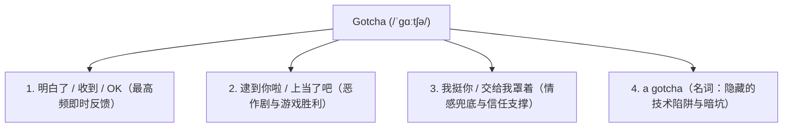

# 地道英语口语与高频俚语精解

地道口语与书本英语的最大差异，在于大量的弱读缩音、流行俚语（Slang）以及特定语境下的数字与习惯用语。掌握这些地道表达，不仅能扫除日常交流与美剧生肉的理解盲区，更能准确把握现代年轻人的语感与流行文化脉络。

---

## 一、 现代年轻人的松弛感哲学：Chill 的多维语境

**“chill”** 是现代英语（尤其是网络流行语境与年轻人群体）中高频出现的俚语，其语义早已从传统的字面“微寒、变凉”演变为涵盖**“放松、随性、无压力、冷静、松弛感”**等多维内涵的万能表达。

### 1. 形容词用法：很 chill / 超 chill（松弛感与随和）

在当代流行口语中最为广泛，用于描绘**松弛不焦虑、随遇而安、舒适自在**的心态、为人或氛围：

- **形容场所或氛围舒适**：  
  “This cafe has such a chill vibe.”（这家咖啡馆氛围超棒，安逸舒适没人催，特别适合放空发呆。）
- **形容性格随和豁达**：  
  “He is super chill about everything.”（他这人特别佛系随和，从不斤斤计较，心态极好。）
- **形容生活状态惬意**：  
  “We had a very chill weekend.”（我们度过了一个极其悠闲惬意的周末，开启完全躺平模式。）

与中文语境中的“松弛感”、“不内卷”、“躺平”高度契合。

### 2. 动词用法：chill / chilling / let's chill（休闲消磨时光）

意为**彻底放松、闲呆着、不抱功利目地打发时间**（通常指不用干正事的休闲状态）：

- **回复日常问询“你在干嘛”**：  
  “Not much, just chilling at home.”（没干啥，就宅在家里瘫着刷剧发呆呢。）
- **平辈间的休闲社交邀约**：  
  “Let's chill together tonight.”（今晚一起找个地方喝杯东西、随便坐坐聊聊。）
- **静止状态描述**：  
  “The cat is just chilling on the sofa.”（那只猫正懒洋洋地趴在沙发上晒太阳呢。）

### 3. 祈使与情绪安抚：chill out / take a chill pill（冷静沉着）

意为**冷静一点、别冲动、放宽心**，用于劝阻对方切勿情绪上头：

- **安抚上头激动的情绪**：  
  “Chill out, bro! It's really not that serious.”（哥们儿冷静冷静，真没多大事，别急着发火。）
- **劝解过度焦虑的伙伴**：  
  “You really need to chill; everything is going according to plan.”（你得放松下来，别这么焦虑，一切都在按计划进行。）
- **生动习语比喻**：  
  “Take a chill pill.”（吃颗定心丸冷静一下吧。）

### 4. 经典文化梗与网络衍生

- **Netflix and chill**：  
  字面意思为“一起看网飞追剧放松”，但在当代欧美流行社交文化中，这是一句极具代表性的委婉社交暗语，通常带有亲密关系的邀约暗示。在跨文化交流尤其是异性互动中需知晓其潜台词，避免语境混淆造成误解。
- **Bing Chilling**：  
  源于知名演艺名人对汉语“冰淇淋”的趣味发音被网络二次创作，随后在国际社交平台衍生为带有幽默戏谑意味的“很 Cool、完全没问题、轻松搞定”的青年亚文化流行梗。

---

## 二、 极致震惊与扎心反问：Damn Son 的惊叹文化

**“Damn son”** 是一句极具街头感与戏剧张力的地道美式口语。翻译成生动中文，大致相当于**“我去，兄弟！”、“牛哇老铁！”**或**“好家伙，绝了！”**。

虽然词尾带有“son”（儿子），但在非正式俚语语境中，它绝非实际的父子伦理称谓，而是纯粹充当承载强烈情绪波动的**感叹词与语气强调词**。

### 1. 核心使用场景

#### 场景 A：极度震撼、折服或赞叹（最高频）
当亲眼目睹他人完成了一项难度极高、极具观赏性或出人意料的酷炫成就时：
- **典型情境**：球场上投进超远距离压哨三分；极客朋友一把调通了高难度分布式架构；好友开来一辆帅气的全新改装车。
- **语感流露**：脱口而出一句：“**Damn son!** Where did you learn that?”（我去兄弟！这绝活你打哪儿练出来的，太牛了！）

#### 场景 B：面对犀利回怼时的“扎心”与“绝杀”叹服
当发生言语交锋、辩论对抗或说唱 Diss 时，若某人抛出一针见血、令人当场石化且无法反驳的暴击时：
- **典型情境**：脱口秀现场神级现挂让对手哑口无言；犀利回怼直接戳中要害。
- **语感流露**：“**Damn son...** that was brutally honest.”（好家伙，这记回马枪扎得太狠了，绝杀！）

### 2. 流行文化源起与交际分寸

该短语在互联网席卷全球，很大程度上源于嘻哈音乐混音中经典的采样音轨与网络大鼻子人物表情包台词：**“Damn Son, Where'd You Find This?”**（我去兄弟，你从哪儿淘到这神作的？）。

> [!WARNING]
> **交际边界预警**：  
> “Damn son” 带有强烈的草根街头与非正式社交属性（Informal Slang），仅限于平辈朋友、游戏开黑或熟稔私下交流。在严肃的商业答辩、学术会议、职场正式沟通或对长辈交流时必须严格规避。

---

## 三、 高效确认与情感支撑：Gotcha 的四大核心阶梯

**Gotcha** 是日常英语口语中使用频率极高的缩读俚语。其本质是 **"got you"**（原意：我抓住你了 / 我懂你了）在快速口语交际中的连读与弱读缩略形态，国际音标发音通常为 `/ˈɡɑːtʃə/` 或 `/ˈɡɒtʃə/`。

根据交互场景的深浅，其用法由高到低呈现出清晰的四层语义阶梯：

### 1. 明白了 / 了解 / 收到（最高频即时反馈）
等同于口语中的 *“Got it”*、*“Understood”* 或 *“I get what you mean”*，用于对同伴传达的信息作干脆利落的正面响应：
- **日常对话**：  
  — “Meet me at the north entrance at 8:00 AM sharp.”（明早 8 点整在北门集合。）  
  — “**Gotcha!** See you tomorrow.”（收到！明天见。）

### 2. 逮到你啦 / 上当了吧（戏谑与恶作剧成功）
常用于捉迷藏、恶作剧成功揭晓瞬间或游戏中抓取对手时得意洋洋的欢呼：
- **捉迷藏或吓人瞬间**：从门后冷不防跳出来：“**Gotcha!** Did I scare you?”（抓到你啦！吓一跳吧？）
- **玩笑被当真后揭秘**：编了个荒诞故事朋友却深信不疑时：“Haha, **gotcha!** It was totally made up.”（哈哈上当了吧！全是逗你玩的。）

### 3. 我罩你 / 我挺你 / 交给我（情感支撑与兜底）
常搭配为 **“I gotcha”** 或 **“Gotcha, bro”**。这是一种温暖且富有担当的表达，意指“我完全理解你的难处，这事有我替你兜底，放宽心”：
- **日常对话**：  
  — “I'm genuinely terrified about presenting this project tomorrow alone.”（明天要一个人上台汇报这个项目，我紧张得手心出汗。）  
  — “Don't worry, **I gotcha**. I'll handle the Q&A section with you.”（别慌，有我挺你呢，提问环节我跟你一块儿顶。）

### 4. 隐藏陷阱 / 易踩的暗坑（名词化用法：a gotcha）
在计算机软件工程、法律文书与严谨规则中，常将那些表面看似合理、实则暗藏玄机且容易导致新手翻车的缺陷或陷阱称为 **“a gotcha”**：
- **技术语境**：  
  “The new framework has remarkable performance, but watch out for a few **gotchas** in memory management.”（这个新框架性能极为炸裂，但内存管理部分存在几个容易踩的大坑，务必留心。）

---

## 四、 跨越直译陷阱：9/10 的三种地道解读范式

在书面交流与各类文献中，“**9/10**” 是一种极其简练的高频符号。然而若是直接按汉语字面套用，往往容易在口语朗读与文化意图上产生重大歧义。根据其所处的应用情境，规范读法可分为以下三大范式：

### 1. 数学度量场景：分数表达（十分之九）
- **规范读音**：`nine tenths`
- **语法法则**：英语分数的标准规则为**“分子使用基数词（nine），分母使用序数词（tenth）”**。因为分子数值大于 1，作为分母的序数词末尾必须追加复数后缀 `-s`。
- **示例**：  
  “Nine tenths of the codebase has been thoroughly tested.”（代码库中十分之九的模块已完成严密测试。）

### 2. 评价与口碑打分：评分比例（满分 10 分给 9 分）
- **规范读音**：`nine out of ten`
- **核心句型**：`[实际得分] out of [满分基准]`
- **使用场景**：日常评测、餐厅评分、游戏与电影口碑打分中最地道、最本能的表达体系。
- **示例**：  
  “I’d definitely give this sci-fi thriller a **nine out of ten**.”（满分若是十分，我绝对会给这部科幻惊悚片打出九分的高分。）

### 3. 日历与文档简写：英美日期书写差异
若 “9/10” 出现于护照盖章、账单发票或日程安排栏目中，其含义与读法则直接取决于当地的文化书写惯例：
- **美式英语习惯（月 / 日 制）**：  
  指代 **9 月 10 日**。口语规范读作 `September tenth` 或 `September the tenth`。
- **英式英语习惯（日 / 月 制）**：  
  指代 **10 月 9 日**。口语规范读作 `the ninth of October` 或 `October the ninth`。

在跨国商务协约与机票日程沟通中，遇到纯数字斜杠日期务必向对方核准月份与日期的前后排布，避免因文化习惯差异造成误机或履约延误。

---

## 五、 四大核心表达速查与交际锦囊

| 地道表达词条 | 核心语法范畴 | 最佳意合对照 | 适用场景与关键辨析 |
| :--- | :--- | :--- | :--- |
| **Chill** | 形容词 / 动词 / 祈使 | 松弛随和 / 闲瘫打发时间 / 别上头冷静 | 流行度极广，跨文化交流时留意识别特有文化暗语 |
| **Damn son** | 叹词短语 | 我去，绝了！ / 扎心绝杀 | 街头与网络口语，带强情感冲击，严禁用于正式商务场合 |
| **Gotcha** | 叹词 / 名词 | 收到 / 逮到你啦 / 我罩你 / 隐藏暗坑 | 连读快音节，按语境承载从“即时确认”到“工程技术陷阱”的递进内涵 |
| **Nine out of ten** | 比例打分习惯结构 | 满分十分给九分 / 十有八九 | 评价口碑专用句型，与纯数学分数 `nine tenths` 明确区分 |
