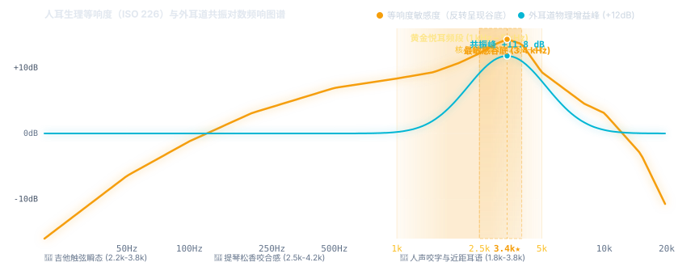

# 黄金悦耳区

在心理声学与混音工程中，**“黄金悦耳区”**（Golden Sweet Spot，又称核心临场感频段）通常指 **1 kHz – 5 kHz** 的中高音频段（核心敏感区集中在 **2 kHz – 4 kHz**）；若从广义的音乐表现力来看，它也常延伸至包含基音与泛音过渡的 **500 Hz – 4 kHz** 中频核心区。

这一频段之所以被称为“黄金区”，是因为它恰好处于**人类听觉生理最敏感的谷底**与**乐器、人声泛音最密集的交汇点**——声音的清晰度、贴耳度（Presence）与乐器的生命力几乎都由它决定。

---

## 频响图谱与听觉响应

> 🎧 **在线交互与试听实验室**：
> 本文配套了完整的 Web Audio 交互实验室，支持**纯音等响度对比扫频**、**全频粉红噪音与原声木吉他连奏实时 A/B EQ 模拟**。
> - **独立文件打开**：可在 WebStorm 中右键打开 [黄金悦耳区_交互实验室.html](./黄金悦耳区_交互实验室.html) 并选择 **Open in -> Browser**。
> - **页面内嵌试听**：点击下方展开内嵌窗口即可直接试听交互。

<b>▶ 点击展开/收起内嵌交互试听实验室（需支持 iframe 的查看器）</b>

<iframe src="./黄金悦耳区_交互实验室.html" width="100%" height="860" style="border: 1px solid #1e293b; border-radius: 12px; margin-top: 12px; background: #0a0d14;" loading="lazy"></iframe>

---

## 一、 为什么它是生理上的“黄金区”？

观察上图的**等响度曲线（Fletcher-Munson Curves / ISO 226）**，横轴代表频率（Hz），纵轴代表达到相同主观响度（phon）所需的物理声压级（dB）。可以看到所有曲线在 **1000 Hz 到 5000 Hz** 之间都出现了一个明显的**下凹谷底**（尤其在 3 kHz – 4 kHz 处最低）：

### 1. 耳道共鸣管效应（物理放大器）
成年人的外耳道平均长度约为 $L \approx 2.5\text{ cm}$，在声学上相当于一根一端封闭（鼓膜端）、一端开口的**四分之一波长共鸣管**。根据一端封闭管的声学共振公式：

$$f = \frac{c}{4L}$$

其中：
- 空气中声速 $c \approx 343\text{ m/s}$（常温约 $20^\circ\text{C}$）
- 耳道平均深度 $L \approx 0.025\text{ m}$

计算得出共振中心频率：

$$f = \frac{343}{4 \times 0.025} \approx 3430\text{ Hz} \quad (3.43\text{ kHz})$$

这意味着外耳道在无须任何外部电声设备放大的情况下，会对进入的 **2.5 kHz – 4 kHz** 声波产生高达 **+10 dB 至 +12 dB** 的天然物理共振增益。

### 2. 极致的微动态捕捉
因为只需要极低的物理声压级就能被耳膜清晰感知，人耳在这一频段对**瞬态响应（Transients）**、微小的音量起伏和空间相位变化最为敏锐。吉他拨弦的触碰起音（Attack）和泛音衰减都在这里被纤毫毕现地接收。

### 3. 进化留下的语言解码区
人类语言中决定“听得清不清”的辅音（齿音、唇音、摩擦音与爆破音）以及婴儿啼哭、危险求救信号的核心共振峰（Formants）全部集中在这一区间。大脑听觉皮层对该频段赋予了极高的神经优先级。

---

## 二、 器乐与人声在黄金区的“灵魂质感”

在音乐录制与回放中，500 Hz 以下提供“厚度与力量”，10 kHz 以上提供“空气感”，而 **1 kHz – 5 kHz 决定了声音的辨识度与距离感**：

- **原声吉他（指弹与拨弦）**：
  琴体箱体共鸣的温暖感集中在 200 Hz – 400 Hz，但指尖、指甲或拨片触碰钢弦瞬间的清脆颗粒感与瞬态爆发力（Attack）正好落在 **2 kHz – 3.5 kHz**。适度突出这一区域，独奏曲中的轮指、拍泛音与勾弦细节会立刻像在面前演奏一样鲜活贴耳。

- **小提琴与弦乐组**：
  小提琴极强的音乐厅穿透力（即俗称的“琴声能立住、不被交响乐队淹没”）正是依赖 **2.5 kHz – 4 kHz** 的高频泛音群（对应歌手共振峰 / Singer's Formant 同频段）。弓毛摩擦琴弦的松香咬弦张力与摩擦颗粒感全由该频段呈现。

- **人声（Vocals）**：
  人声的基音通常在 100 Hz – 400 Hz，但唇齿开合的咬字清晰度、嗓音特有的沙哑颗粒感以及“歌手站在你耳边低语”的亲近临场感（Intimacy & Presence），全部由 **1.5 kHz – 4 kHz** 掌控。

---

## 三、 黄金悦耳区细分频段与调音把控

正因为人耳对 **1 kHz – 5 kHz** 极度敏感，它在均衡器（EQ）调节与耳机/音箱调音中是一把**双刃剑**——给得恰当叫“通透抓耳”，给多了则会瞬间变成“刺耳、轰头”并引发听觉疲劳。

| 细分频段 | 声学特征与主要成分 | 适度提升（+1 至 +2.5 dB） | 过度堆积（大于 +3.5 dB）的负面听感 | 调音推荐操作 |
| :--- | :--- | :--- | :--- | :--- |
| **800 Hz – 1.5 kHz** | 中频骨架、乐器结像核心、人声胸腔与泛音过渡 | 声音更有肉感、结像扎实居中 | 产生“喇叭味/收音机电话音”（Honky/Nasal），听感生硬干瘪 | 伴奏轨道适度让位；主奏乐器若发飘可微提 1dB |
| **1.5 kHz – 2.5 kHz** | 咬字清晰度、拨弦打击感（Attack）、破混浊核心 | 乐器线条清晰，在嘈杂伴奏中破土而出 | 声音干瘪，出现铁皮敲击刺耳感 | 木吉他指弹起音不足时在此稍做宽带提升（Q=1.2） |
| **2.5 kHz – 4.0 kHz** | **核心黄金临场区**（外耳道驻波共振极大值峰） | 极佳的贴耳感、指弹瞬态鲜活、歌手耳边近距感 | **极易引发听觉疲劳**，听感金属刮擦、尖锐刺耳（Harshness） | **严控提升量**！宁可用动态 EQ（Dynamic EQ）按需压制，切忌静态大推 |
| **4.0 kHz – 5.0 kHz** | 泛音边缘、乐器外壳光泽感、唇齿音过渡带 | 增加晶莹感与开阔度，提亮乐器边缘 | 唇齿音（Sibilance，“嘶、呲”声）炸耳刺痛 | 人声配搭 De-Esser 压制齿音；箱琴可适度提亮增加华丽度 |

---

## 四、 实战听音与工程混音黄金法则

### 1. 空间深度掌控法则：拉近靠微升，推远靠微降
在声学认知中，**高频能量随空气传播的自然衰减是人类大脑判断声源物理距离的核心心理声学线索**：
- **推远背景**：想让伴奏木吉他、副歌和声或合成器垫音（Pad）退到主唱背后 3 米处，无需大幅拉低总推子音量，只需在 **2.5 kHz – 3.5 kHz** 选用平滑的中宽带（Q $\approx$ 1.0~1.4）温和衰减 **-2 dB 到 -3 dB**，声源就会极其自然地隐入立体声纵深景深中。
- **拉近前景**：想让吉他独奏或主唱走到最前台，只需在 **3 kHz** 附近轻微推高 **+1.5 dB**，声像立即如在耳畔。

### 2. 消除听觉疲劳法则：守护 3.4 kHz 与善用动态 EQ
如果一首作品播放 3~5 分钟就让人感觉耳膜发紧、烦躁疲劳，绝大多数原因是 **2.8 kHz – 4 kHz** 处的能量在多轨道（如吉他扫弦、军鼓破音、主唱高音）叠加时发生了共振能量堆积：
- **不要滥用静态大切除**：粗暴地使用静态陷波（Notch）削掉 3.4 kHz 会让乐器瞬态瘫软、整体听感发暗发浑。
- **正解：挂载动态均衡器（Dynamic EQ）**：平日保持平直响应以保证通透抓耳的临场感，仅在乐曲强音、拨弦重击或高潮爆发导致能量超标时，瞬间自动向下压缩 2~3 dB，瞬态过后即刻复原，达到“晶莹通透”与“久听不累”的极致平衡。
